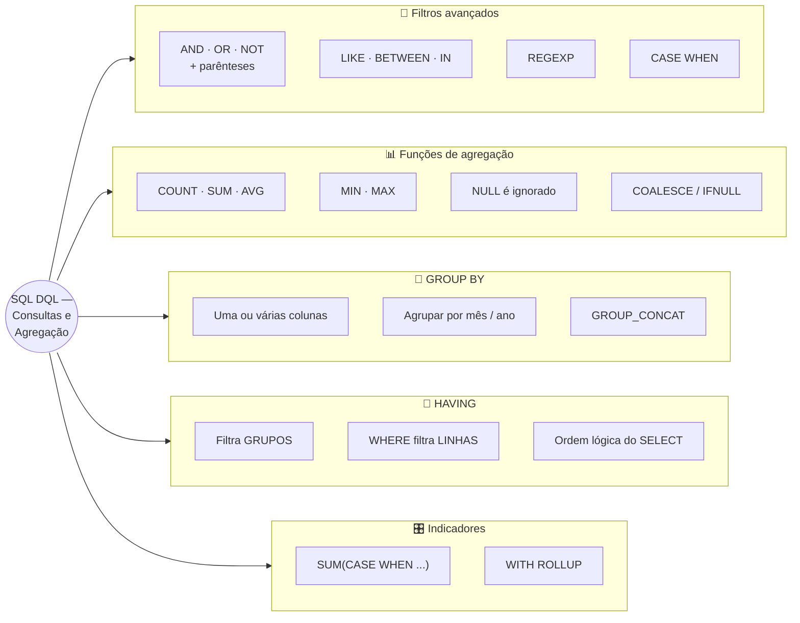
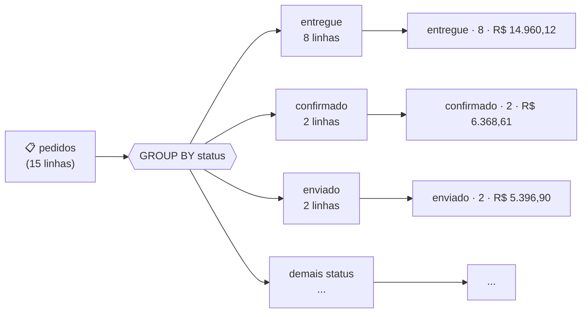

# Tópico 06 — SQL DQL: Consultas e Agregação

**Disciplina:** Banco de Dados — Relacional (IBD015)
**Professor:** Ronan Adriel Zenatti · ronan.zenatti@cps.sp.gov.br
**Fatec Jahu — 2º Semestre/2026**

---

## 🎯 Objetivos do Tópico

Ao final deste tópico você deverá ser capaz de:

- Combinar filtros avançados (`AND`, `OR`, `NOT`, `LIKE`, `BETWEEN`, `IN`, `REGEXP`) respeitando a precedência dos operadores, e classificar linhas com `CASE`;
- Resumir dados com as funções de agregação `COUNT`, `SUM`, `AVG`, `MIN` e `MAX`, distinguindo `COUNT(*)`, `COUNT(coluna)` e `COUNT(DISTINCT coluna)`;
- Prever como `NULL` se comporta dentro de uma agregação e tratá-lo com `COALESCE`/`IFNULL`;
- Agrupar linhas com `GROUP BY` (uma ou várias colunas) e filtrar os grupos com `HAVING`, explicando a diferença entre `WHERE` e `HAVING`;
- Descrever a ordem lógica de execução de um `SELECT` e usá-la para explicar erros comuns;
- Montar indicadores de negócio com agregação condicional (`SUM(CASE ...)`) e totais com `WITH ROLLUP`.

---

## 🗺️ Mapa Mental do Tópico



---

## 🧭 Contexto

No Tópico 05 você aprendeu a **buscar linhas**: escolher colunas, filtrar, ordenar e paginar. Mas uma pergunta de negócio raramente é "me mostre todas as linhas". Ela costuma ser: *quanto vendemos por mês? qual categoria tem o maior preço médio? quais clientes compraram mais de uma vez?* Para responder isso, o banco precisa **resumir** muitas linhas em poucas — e é exatamente isso que as **funções de agregação** e o `GROUP BY` fazem.

Este tópico também retoma o `WHERE` com as ferramentas que faltavam para escrever filtros realistas (precedência, `NOT`, `REGEXP` e `CASE`), porque quase toda agregação útil começa filtrando a população certa.

Os exemplos continuam no schema `loja_virtual`. Como agregar exige **volume de dados**, a carga mínima do Tópico 04 (5 pessoas, 1 pedido) não basta: use o script de carga ampliada abaixo, que reaproveita os registros do Tópico 04 e acrescenta mais clientes, produtos e pedidos de 2026.

??? note "📦 Script de carga ampliada do `loja_virtual` (clique para expandir)"
    **Antes de rodar:** o schema do Tópico 03 (apenas os `CREATE TABLE`) precisa existir. O script **esvazia as tabelas** (mantém a estrutura) e recarrega tudo — pode ser executado de novo sempre que você quiser "voltar ao estado inicial" depois de um exercício que bagunçou os dados.

    ```sql
    -- =============================================================================
    -- Script de apoio (NÃO faz parte do site) — Tópico 06 — Carga de dados de exemplo
    -- Disciplina: IBD015 — Banco de Dados Relacional — Fatec Jahu — 2º Sem/2026
    -- Professor: Ronan Adriel Zenatti
    --
    -- Objetivo: popular o schema loja_virtual (Tópico 03) com um volume de dados
    -- suficiente para praticar agregação, JOINs, subconsultas, views, procedures,
    -- triggers, transações e otimização (Tópicos 06 a 13). Esta mesma carga é o
    -- ponto de partida dos scripts dos tópicos seguintes.
    --
    -- PRÉ-REQUISITO: o schema loja_virtual criado pelos CREATE TABLE do Tópico 03
    -- (sql/Topico_03_SQL_DDL.sql, Seção 11). Rode só os CREATE TABLE — NÃO os ALTER
    -- TABLE demonstrativos do final daquele script (eles renomeiam pessoas.telefone
    -- para celular, removem o UNIQUE de e-mail etc., e este script usa os nomes
    -- originais das colunas).
    --
    -- ATENÇÃO: este script ESVAZIA as tabelas do loja_virtual antes de carregar
    -- (a estrutura é mantida, só os registros são apagados). É seguro rodar de novo
    -- para "voltar ao estado inicial" quando um exercício bagunçar os dados.
    --
    -- Como executar (Windows / XAMPP):
    --   "C:\xampp\mysql\bin\mysql.exe" -u root -p --default-character-set=utf8mb4 < sql\Topico_06_Carga_Dados.sql
    -- ou cole o conteúdo no phpMyAdmin > SQL.
    --
    -- Esta carga reaproveita os registros do Tópico 04 (as 5 pessoas, 3 categorias,
    -- 5 produtos e o pedido #1 da Ana Lima) e acrescenta mais dados por cima.
    -- =============================================================================

    USE loja_virtual;

    SET FOREIGN_KEY_CHECKS = 0;
    TRUNCATE TABLE itens_pedidos;
    TRUNCATE TABLE vendas;
    TRUNCATE TABLE pedidos;
    TRUNCATE TABLE produtos;
    TRUNCATE TABLE categorias;
    TRUNCATE TABLE enderecos;
    TRUNCATE TABLE pessoas;
    SET FOREIGN_KEY_CHECKS = 1;


    -- -----------------------------------------------------------------------------
    -- Pessoas — clientes e funcionários compartilham a tabela
    --   Funcionários (atendentes): 4 Diego, 5 Ronan, 12 Marina
    --   Cliente sem nenhum pedido (útil para LEFT JOIN): 11 Lucas
    -- -----------------------------------------------------------------------------
    INSERT INTO pessoas (nome, cpf, email, data_nascimento, telefone) VALUES
        ('Ana Lima',        '11122233344', 'ana@email.com',        '1990-05-10', '14999990001'),
        ('Carlos Melo',     '22233344455', 'carlos@email.com',     '1985-11-22', '19988880002'),
        ('Beatriz Costa',   '33344455566', 'bi@email.com',         '1998-07-03', NULL),
        ('Diego Rocha',     '44455566677', 'diego@email.com',      '1992-02-28', '11977770003'),
        ('Prof. Ronan',     '55566677788', 'ronan@fatec.edu.br',   '1988-09-15', '14966660004'),
        ('Fernanda Alves',  '66677788899', 'fernanda@email.com',   '1996-01-20', '14955550005'),
        ('Gustavo Lima',    '77788899900', 'gustavo@email.com',    '1983-12-05', NULL),
        ('Helena Souza',    '88899900011', 'helena@email.com',     '2001-03-30', '11944440006'),
        ('Igor Martins',    '99900011122', 'igor@email.com',       '1994-08-18', '19933330007'),
        ('Juliana Pires',   '10011122233', 'juliana@email.com',    '1989-06-12', '14922220008'),
        ('Lucas Ferreira',  '12300045678', 'lucas@email.com',      '2003-10-01', '14911110009'),
        ('Marina Duarte',   '23411156789', 'marina@email.com',     '1991-04-25', '11900000010');


    -- -----------------------------------------------------------------------------
    -- Endereços — a Ana (pessoa 1) tem dois; Lucas (11) e Diego/Marina não têm
    -- -----------------------------------------------------------------------------
    INSERT INTO enderecos (pessoa_id, logradouro, numero, complemento, bairro, cidade, estado, cep, principal) VALUES
        (1,  'Rua das Flores',        '120',  NULL,       'Centro',        'Jahu',      'SP', '17201000', 1),
        (1,  'Avenida Paulista',      '1000', 'Apto 52',  'Bela Vista',    'São Paulo', 'SP', '01310100', 0),
        (2,  'Rua Barão de Jaguara',  '455',  NULL,       'Centro',        'Campinas',  'SP', '13015001', 1),
        (3,  'Rua Quinze de Agosto',  '78',   NULL,       'Jardim Paulista','Jahu',     'SP', '17201010', 1),
        (6,  'Avenida Nações Unidas', '2310', 'Bloco B',  'Vila Nova Cidade Universitária', 'Bauru', 'SP', '17012100', 1),
        (7,  'Rua Augusta',           '900',  NULL,       'Consolação',    'São Paulo', 'SP', '01304001', 1),
        (8,  'Rua Oscar Freire',      '350',  'Apto 11',  'Jardins',       'São Paulo', 'SP', '01426001', 1),
        (9,  'Avenida Norte-Sul',     '640',  NULL,       'Centro',        'Campinas',  'SP', '13010020', 1),
        (10, 'Rua Edgard Ferraz',     '215',  NULL,       'Centro',        'Jahu',      'SP', '17201030', 1),
        (5,  'Rua Dom Pedro II',      '60',   NULL,       'Centro',        'Jahu',      'SP', '17201040', 1);


    -- -----------------------------------------------------------------------------
    -- Categorias — "Games" (id 5) fica sem nenhum produto de propósito
    -- -----------------------------------------------------------------------------
    INSERT INTO categorias (nome, descricao, ativa) VALUES
        ('Eletrônicos', 'Computadores, smartphones e acessórios',   1),
        ('Periféricos', 'Mouse, teclado, headset e similares',      1),
        ('Livros',      'Técnicos, acadêmicos e literatura',        1),
        ('Casa',        'Utensílios, iluminação e mobiliário',      1),
        ('Games',       'Consoles, jogos e acessórios gamer',       1);


    -- -----------------------------------------------------------------------------
    -- Produtos — alguns propositalmente "incompletos" para exercitar NULL e filtros:
    --   descricao NULL: ids 2, 4, 8 · estoque 0: id 7 · inativo: id 10
    -- -----------------------------------------------------------------------------
    INSERT INTO produtos (categoria_id, nome, descricao, preco, estoque, ativo) VALUES
        (1, 'Notebook Lenovo IdeaPad',                 'Notebook 15" com 16 GB de RAM e SSD de 512 GB',  3499.90, 15, 1),
        (1, 'Smartphone Samsung A55',                  NULL,                                             1899.00, 30, 1),
        (2, 'Mouse Logitech MX Master',                'Mouse sem fio ergonômico com 7 botões',           399.90, 50, 1),
        (2, 'Teclado Mecânico Redragon',               NULL,                                              299.90, 40, 1),
        (3, 'Sistemas de Banco de Dados — Elmasri',    'Livro-texto clássico de banco de dados',          189.90, 20, 1),
        (1, 'Monitor LG UltraWide 29"',                'Monitor ultrawide IPS Full HD',                  1299.00,  8, 1),
        (2, 'Headset HyperX Cloud',                    'Headset gamer com microfone removível',           449.90,  0, 1),
        (2, 'Webcam Full HD',                          NULL,                                              229.90, 25, 1),
        (3, 'SQL para Análise de Dados — Tanimura',    'Técnicas avançadas de SQL para análise',          129.90, 35, 1),
        (3, 'Introdução a Sistemas de Bancos de Dados — Date', 'Edição antiga, fora de linha',            159.90,  5, 0),
        (4, 'Luminária de Mesa LED',                   'Luminária com 3 níveis de brilho',                 89.90, 60, 1),
        (4, 'Cadeira Ergonômica',                      'Cadeira com ajuste lombar e apoio de braço',     1199.00,  6, 1);


    -- -----------------------------------------------------------------------------
    -- Pedidos — o valor_total é calculado logo abaixo, a partir dos itens
    -- (cliente 11 nunca comprou; produtos 7 e 10 nunca foram vendidos)
    -- -----------------------------------------------------------------------------
    INSERT INTO pedidos (cliente_id, funcionario_id, endereco_id, data_pedido, status) VALUES
        (1,  5,    1, '2026-02-10 10:15:00', 'confirmado'),   -- pedido 1  (o mesmo do Tópico 04)
        (2,  NULL, 3, '2026-02-18 14:40:00', 'entregue'),     -- pedido 2
        (3,  4,    4, '2026-03-05 09:05:00', 'entregue'),     -- pedido 3
        (6,  NULL, 5, '2026-03-22 20:30:00', 'cancelado'),    -- pedido 4
        (1,  5,    2, '2026-04-09 16:10:00', 'entregue'),     -- pedido 5
        (7,  NULL, 6, '2026-04-27 11:00:00', 'entregue'),     -- pedido 6
        (8,  12,   7, '2026-05-14 13:25:00', 'entregue'),     -- pedido 7
        (9,  NULL, 8, '2026-06-02 18:50:00', 'enviado'),      -- pedido 8
        (10, 4,    9, '2026-06-19 10:00:00', 'entregue'),     -- pedido 9
        (2,  NULL, 3, '2026-07-08 15:35:00', 'em_separacao'), -- pedido 10
        (6,  12,   5, '2026-08-15 12:20:00', 'confirmado'),   -- pedido 11
        (1,  NULL, 1, '2026-09-03 21:45:00', 'pendente'),     -- pedido 12
        (7,  5,    6, '2026-09-21 09:30:00', 'entregue'),     -- pedido 13
        (3,  NULL, 4, '2026-10-05 17:15:00', 'enviado'),      -- pedido 14
        (8,  4,    7, '2026-10-12 10:40:00', 'entregue');     -- pedido 15


    -- -----------------------------------------------------------------------------
    -- Itens dos pedidos — (pedido_id, produto_id, quantidade, preco_unitario, desconto)
    -- preco_unitario é o snapshot do preço no momento da compra
    -- -----------------------------------------------------------------------------
    INSERT INTO itens_pedidos (pedido_id, produto_id, quantidade, preco_unitario, desconto) VALUES
        (1,  1, 1, 3499.90,  0.00),
        (1,  3, 1,  399.90,  0.00),
        (2,  2, 1, 1899.00,  0.00),
        (2,  8, 2,  229.90,  0.00),
        (3,  5, 1,  189.90,  0.00),
        (3,  9, 1,  129.90,  0.00),
        (4,  6, 1, 1299.00,  0.00),
        (5,  4, 1,  299.90,  0.00),
        (5,  3, 1,  399.90, 10.00),
        (6,  1, 1, 3499.90,  5.00),
        (7,  9, 2,  129.90,  0.00),
        (7,  5, 1,  189.90,  0.00),
        (7, 11, 3,   89.90,  0.00),
        (8,  2, 2, 1899.00,  0.00),
        (8,  3, 1,  399.90,  0.00),
        (9,  6, 1, 1299.00,  0.00),
        (9,  4, 1,  299.90,  0.00),
        (10, 8, 1,  229.90,  0.00),
        (10,12, 1, 1199.00,  0.00),
        (11, 2, 1, 1899.00,  0.00),
        (11, 4, 2,  299.90,  5.00),
        (12, 9, 1,  129.90,  0.00),
        (13, 6, 1, 1299.00,  0.00),
        (13, 3, 2,  399.90,  0.00),
        (14,12, 1, 1199.00,  0.00),
        (15, 1, 1, 3499.90,  0.00),
        (15, 5, 2,  189.90,  0.00);


    -- -----------------------------------------------------------------------------
    -- valor_total = soma dos itens (quantidade × preço × (1 − desconto/100))
    -- -----------------------------------------------------------------------------
    UPDATE pedidos p
    SET    p.valor_total = (
               SELECT COALESCE(SUM(i.quantidade * i.preco_unitario * (1 - i.desconto / 100)), 0)
               FROM   itens_pedidos i
               WHERE  i.pedido_id = p.id_pedido
           );


    -- -----------------------------------------------------------------------------
    -- Conferência rápida da carga
    -- -----------------------------------------------------------------------------
    SELECT 'pessoas'       AS tabela, COUNT(*) AS linhas FROM pessoas
    UNION ALL SELECT 'enderecos',     COUNT(*) FROM enderecos
    UNION ALL SELECT 'categorias',    COUNT(*) FROM categorias
    UNION ALL SELECT 'produtos',      COUNT(*) FROM produtos
    UNION ALL SELECT 'pedidos',       COUNT(*) FROM pedidos
    UNION ALL SELECT 'itens_pedidos', COUNT(*) FROM itens_pedidos;
    ```

> 📌 Os tópicos seguintes (07 a 13) usam essa mesma carga. Guarde o script.

---

## 1. Filtros Avançados na Prática

O Tópico 05 apresentou `LIKE`, `BETWEEN`, `IN` e `IS NULL` um de cada vez. Na vida real eles aparecem **combinados** — e é aí que mora o erro.

### 1.1 Precedência: o `AND` ganha do `OR`

Em SQL, `AND` é avaliado **antes** de `OR`, exatamente como a multiplicação vem antes da soma. Veja duas consultas que parecem a mesma coisa:

```sql
-- Sem parênteses: lido como  categoria 1  OU  (categoria 2 E preco < 300)
SELECT nome, preco FROM produtos
WHERE  categoria_id = 1 OR categoria_id = 2 AND preco < 300;
-- 5 linhas: TODOS os eletrônicos (inclusive o notebook de R$ 3.499,90!) + periféricos baratos

-- Com parênteses: (categoria 1 OU categoria 2)  E  preco < 300
SELECT nome, preco FROM produtos
WHERE  (categoria_id = 1 OR categoria_id = 2) AND preco < 300;
-- 2 linhas: Teclado Mecânico Redragon e Webcam Full HD
```

> ⚠️ **Regra prática:** sempre que misturar `AND` com `OR` no mesmo `WHERE`, escreva os parênteses — mesmo quando a precedência "por acaso" já daria o resultado certo. Parênteses documentam a intenção de quem escreveu e protegem contra a edição futura.

### 1.2 Negações: `NOT LIKE`, `NOT BETWEEN`, `NOT IN`

```sql
-- Pessoas cujo nome NÃO contém "Lima"
SELECT nome FROM pessoas WHERE nome NOT LIKE '%Lima%';

-- Produtos fora da faixa de R$ 100 a R$ 1.000 (os muito baratos e os muito caros)
SELECT nome, preco FROM produtos WHERE preco NOT BETWEEN 100 AND 1000;

-- Pedidos que ainda NÃO terminaram o ciclo
SELECT id_pedido, status FROM pedidos WHERE status NOT IN ('entregue', 'cancelado');
```

> ⚠️ **Pegadinha do `NOT IN` com `NULL`:** se a lista (ou a subconsulta) do `NOT IN` contiver um `NULL`, a condição nunca fica verdadeira e o resultado vem **vazio**. Voltaremos a isso no Tópico 07, ao estudar subconsultas.

### 1.3 `REGEXP` — quando o `LIKE` não basta

O `LIKE` só conhece `%` e `_`. Para padrões mais ricos o MariaDB oferece expressões regulares com `REGEXP` (sinônimo: `RLIKE`):

```sql
-- Nome começa com Mouse, Teclado OU Webcam  (| = "ou", ^ = início do texto)
SELECT nome FROM produtos WHERE nome REGEXP '^(Mouse|Teclado|Webcam)';

-- Nome contém "SQL" OU "Banco de Dados" em qualquer posição
SELECT nome FROM produtos WHERE nome REGEXP 'SQL|Banco de Dados';

-- CPF com exatamente 11 dígitos numéricos (auditoria de qualidade de dados)
SELECT cpf FROM pessoas WHERE cpf REGEXP '^[0-9]{11}$';
```

| Símbolo | Significado |
|---|---|
| `^` / `$` | Início / fim do texto |
| `.` | Qualquer caractere |
| `[0-9]` / `[a-z]` | Um caractere dentro do intervalo |
| `{n}` | Repetição exata (`[0-9]{11}` = 11 dígitos) |
| `a\|b` | `a` **ou** `b` |
| `( )` | Agrupa partes do padrão |

> 💡 O `LIKE` é mais simples e costuma ser mais rápido; reserve o `REGEXP` para padrões que o `LIKE` não consegue expressar. E, para procurar um `%` ou `_` **literal** dentro de um `LIKE`, escape-o com barra invertida: `LIKE '%10\%%'` casa com `"desconto 10%"`.

### 1.4 `CASE` — decisões dentro da consulta

O `CASE` é o "se/senão" do SQL: transforma um valor em outro **dentro do resultado**, sem alterar a tabela.

```sql
SELECT nome, preco,
       CASE
           WHEN preco <  200  THEN 'Econômico'
           WHEN preco < 1000  THEN 'Intermediário'
           ELSE                    'Premium'
       END AS faixa_preco
FROM   produtos
ORDER BY preco;
```

As condições são testadas **de cima para baixo** e a primeira verdadeira vence — por isso a ordem dos `WHEN` importa (o segundo `WHEN` não precisa repetir `preco >= 200`). Sem `ELSE`, o que não casar vira `NULL`.

!!! example "🔍 Checkpoint 1 — Filtros combinados: plataforma de streaming"
    Uma plataforma de streaming guarda seu catálogo em `titulos (id_titulo PK, nome, tipo, ano_lancamento, nota_media, classificacao)`, com `tipo` em `'filme'`, `'serie'` ou `'documentario'` e `classificacao` em `'L'`, `'10'`, `'12'`, `'14'`, `'16'` ou `'18'`. Escreva **uma única consulta** que liste `nome` e `tipo` dos títulos que sejam **filmes ou séries**, com `nota_media` de pelo menos 4,0, e cuja classificação **não** seja `'16'` nem `'18'` (perfil infantojuvenil). Acrescente uma coluna `destaque` que mostre `'Imperdível'` quando a nota for 4,5 ou mais e `'Bom'` nos demais casos, ordenando da maior para a menor nota. Depois, explique o que aconteceria com o resultado se você esquecesse os parênteses em torno do `OR`.

    🔑 Resolução no [Gabarito do Tópico 06](Topico_06_Gabarito.md#checkpoint-1) — tente resolver antes de conferir.

---

## 2. Funções de Agregação

Uma **função de agregação** recebe várias linhas e devolve **um único valor**. As cinco principais:

| Função | O que devolve | Observação |
|---|---|---|
| `COUNT(...)` | Quantidade de linhas (ou de valores) | Três formas — veja abaixo |
| `SUM(expr)` | Soma | Só faz sentido para valores numéricos |
| `AVG(expr)` | Média aritmética | **Ignora** `NULL` (não entra no divisor) |
| `MIN(expr)` / `MAX(expr)` | Menor / maior valor | Funciona com números, textos e datas |

```sql
SELECT COUNT(*)                AS qtd_produtos,
       SUM(preco)              AS soma_precos,
       ROUND(AVG(preco), 2)    AS preco_medio,
       MIN(preco)              AS mais_barato,
       MAX(preco)              AS mais_caro
FROM   produtos;
-- 12 | 9846.10 | 820.51 | 89.90 | 3499.90
```

Sem `GROUP BY`, a agregação **colapsa a tabela inteira em uma linha só** (a população é definida pelo `WHERE`). Ela também aceita expressões:

```sql
-- Quanto dinheiro está "parado" em estoque de produtos ativos?
SELECT SUM(estoque * preco) AS valor_em_estoque
FROM   produtos
WHERE  ativo = 1;
```

### 2.1 As três formas do `COUNT`

```sql
SELECT COUNT(*)                     AS total_pedidos,        -- 15: conta LINHAS, não olha para NULL
       COUNT(funcionario_id)        AS atendidos_por_pessoa, --  8: conta valores NÃO NULOS da coluna
       COUNT(DISTINCT cliente_id)   AS clientes_distintos    --  8: conta valores diferentes, sem repetir
FROM   pedidos;
```

| Forma | Conta... | Exemplo no `loja_virtual` |
|---|---|---|
| `COUNT(*)` | todas as linhas do grupo | 15 pedidos |
| `COUNT(coluna)` | linhas em que a coluna **não é** `NULL` | 8 pedidos com `funcionario_id` preenchido (os outros 7 foram autoatendimento) |
| `COUNT(DISTINCT coluna)` | valores **diferentes** (e não nulos) | 8 clientes distintos — embora existam 15 pedidos |

### 2.2 `NULL` dentro de agregações

As funções de agregação (exceto `COUNT(*)`) **ignoram `NULL`**. Isso é conveniente, mas muda o significado do resultado:

```sql
SELECT AVG(funcionario_id)                         AS media_ignorando_null,   -- 6.3750  (soma / 8)
       SUM(funcionario_id) / COUNT(*)              AS soma_sobre_todas,       -- 3.4000  (soma / 15)
       SUM(funcionario_id) / COUNT(funcionario_id) AS soma_sobre_nao_nulos    -- 6.3750  (igual ao AVG)
FROM   pedidos;
```

(O exemplo é só didático — a média de um `id` não significa nada — mas mostra com clareza que o `AVG` divide **apenas** pelas linhas não nulas.)

E há um segundo cuidado: se **nenhuma linha** entrar na agregação, `SUM`, `AVG`, `MIN` e `MAX` devolvem `NULL` (e não zero). `COUNT` devolve 0. Para exibir `0` em vez de `NULL`, use `COALESCE`:

```sql
SELECT SUM(valor_total)               AS sem_tratamento,   -- NULL
       COALESCE(SUM(valor_total), 0)  AS com_tratamento    -- 0.00
FROM   pedidos
WHERE  status = 'devolvido_ao_fornecedor';   -- nenhuma linha atende
```

`COALESCE(a, b, c, ...)` devolve o **primeiro argumento não nulo**. O `IFNULL(a, b)` do MariaDB/MySQL é a versão de dois argumentos; `COALESCE` é padrão SQL e funciona em qualquer SGBD — prefira-o.

### 2.3 Misturar agregada com não agregada

```sql
-- ❌ Faz sentido? Qual "nome" acompanharia o MAX(preco)?
SELECT nome, MAX(preco) FROM produtos;
```

Sem `GROUP BY`, o resultado tem uma única linha de agregação, e a coluna `nome` não tem qual linha representar. Dependendo da configuração do servidor o MariaDB devolve um nome arbitrário (veja o aviso da Seção 3.3) — **é um bug em potencial, não um recurso**. Para "o nome do produto mais caro" a resposta é `ORDER BY preco DESC LIMIT 1` (ou uma subconsulta, no Tópico 07).

!!! example "🔍 Checkpoint 2 — Agregação: energia solar residencial"
    Uma empresa de energia solar residencial registra as medições de seus inversores em `geracao_diaria (id_geracao PK, instalacao_id FK, data_leitura, kwh_gerado, kwh_consumido)`. Em dias com o medidor de consumo offline, `kwh_consumido` fica `NULL`. Escreva **uma consulta** que, considerando somente as leituras de **setembro de 2026**, devolva: a quantidade de leituras (`leituras`), o total gerado (`total_gerado_kwh`), a média diária gerada arredondada para 2 casas (`media_gerada_kwh`), o maior valor gerado em um dia (`pico_kwh`) e quantas leituras têm consumo informado (`leituras_com_consumo`).

    🔑 Resolução no [Gabarito do Tópico 06](Topico_06_Gabarito.md#checkpoint-2) — tente resolver antes de conferir.

---

## 3. `GROUP BY` — Agrupando para Resumir

Até aqui o resultado era **uma linha para a tabela inteira**. Mas "o total geral" raramente basta; queremos o total **por** alguma coisa: por status, por categoria, por cliente, por mês. O `GROUP BY` divide as linhas em **grupos** (uma "gaveta" para cada valor distinto) e aplica a função de agregação **a cada grupo separadamente**.



```sql
SELECT status,
       COUNT(*)           AS qtd_pedidos,
       SUM(valor_total)   AS faturamento
FROM   pedidos
GROUP BY status
ORDER BY qtd_pedidos DESC;
```

| status | qtd_pedidos | faturamento |
|---|---|---|
| entregue | 8 | 14960.12 |
| confirmado | 2 | 6368.61 |
| enviado | 2 | 5396.90 |
| cancelado | 1 | 1299.00 |
| em_separacao | 1 | 1428.90 |
| pendente | 1 | 129.90 |

**A regra de ouro do `GROUP BY`:** no `SELECT`, cada coluna precisa ser **ou** uma coluna do `GROUP BY` **ou** estar dentro de uma função de agregação. Tudo que é "uma por grupo" pode aparecer; o que varia dentro do grupo só aparece resumido.

### 3.1 Agrupando por várias colunas

Com mais de uma coluna, o grupo passa a ser a **combinação** delas:

```sql
-- Quantos pedidos cada cliente tem em cada status?
SELECT cliente_id, status, COUNT(*) AS qtd
FROM   pedidos
GROUP BY cliente_id, status
ORDER BY cliente_id, status;
```

### 3.2 Agrupando por período

Para responder "quanto vendemos por mês?" agrupe pelo resultado de uma função de data:

```sql
SELECT YEAR(data_pedido)   AS ano,
       MONTH(data_pedido)  AS mes,
       COUNT(*)            AS pedidos,
       SUM(valor_total)    AS faturamento
FROM   pedidos
GROUP BY YEAR(data_pedido), MONTH(data_pedido)
ORDER BY ano, mes;

-- Variante compacta: um único rótulo "AAAA-MM" (ordena corretamente como texto)
SELECT DATE_FORMAT(data_pedido, '%Y-%m') AS mes, COUNT(*) AS pedidos
FROM   pedidos
GROUP BY mes
ORDER BY mes;
```

> 📌 O MariaDB permite usar o **alias** (`GROUP BY mes`) — conveniente, mas é uma extensão que nem todo SGBD aceita. Em outros bancos, repita a expressão.

### 3.3 `GROUP_CONCAT` e o perigo do `ONLY_FULL_GROUP_BY`

O `GROUP_CONCAT` junta os valores do grupo em **um único texto** — ótimo para listas resumidas:

```sql
SELECT categoria_id,
       COUNT(*) AS qtd,
       GROUP_CONCAT(nome ORDER BY nome SEPARATOR ' | ') AS produtos
FROM   produtos
GROUP BY categoria_id;
```

Agora o aviso prometido. Veja esta consulta, que **viola** a regra de ouro (`nome` não está no `GROUP BY` nem dentro de agregação):

```sql
SELECT categoria_id, nome, COUNT(*) FROM produtos GROUP BY categoria_id;
```

No MariaDB 10.4 padrão (XAMPP) ela **executa sem erro** e devolve, para cada categoria, um `nome` arbitrário — por exemplo "Notebook Lenovo IdeaPad" para a categoria 1 — como se esse fosse o "nome da categoria". Isso acontece porque o modo `ONLY_FULL_GROUP_BY` não faz parte do `sql_mode` padrão do MariaDB. Se você ativar o modo, o banco passa a recusar a consulta, como o padrão SQL manda:

```sql
SET SESSION sql_mode = CONCAT(@@sql_mode, ',ONLY_FULL_GROUP_BY');
SELECT categoria_id, nome, COUNT(*) FROM produtos GROUP BY categoria_id;
-- ERROR 1055 (42000): 'loja_virtual.produtos.nome' isn't in GROUP BY
```

> ⚠️ **Conclusão prática:** mesmo quando o servidor "deixa passar", não escreva `SELECT` com coluna solta. Um resultado que parece certo hoje pode trocar de linha amanhã (depois de um índice novo, por exemplo) sem aviso algum.

!!! example "🔍 Checkpoint 3 — GROUP BY: e-sports competitivo"
    Um app de e-sports guarda o histórico em `partidas (id_partida PK, jogador_id FK, mapa, resultado, abates, mortes, jogada_em)`, com `resultado` em `'vitoria'` ou `'derrota'`. (a) Escreva a consulta que mostre, **por mapa**, o total de partidas (`partidas`), o número de vitórias (`vitorias`) e a média de abates com 1 casa decimal (`media_abates`), colocando no topo o mapa com mais vitórias. (b) Agora mostre o total de partidas **por jogador e mapa**, de modo que cada jogador veja seus mapas em ordem. Dica: no item (a), uma comparação como `resultado = 'vitoria'` vale 1 quando verdadeira e 0 quando falsa.

    🔑 Resolução no [Gabarito do Tópico 06](Topico_06_Gabarito.md#checkpoint-3) — tente resolver antes de conferir.

---

## 4. `HAVING` — Filtrando Grupos

Suponha que você queira apenas os clientes com **dois ou mais pedidos**. A tentação é escrever:

```sql
-- ❌ ERRO: o WHERE roda ANTES de existir qualquer grupo
SELECT cliente_id, COUNT(*) AS qtd
FROM   pedidos
WHERE  COUNT(*) >= 2
GROUP BY cliente_id;
-- ERROR 1111 (HY000): Invalid use of group function
```

O `WHERE` filtra **linhas**, e ele é avaliado antes do agrupamento — nesse momento ainda não existe "contagem do grupo". Para filtrar com base no **resultado de uma agregação**, usa-se o `HAVING`, que é avaliado **depois** do `GROUP BY`:

```sql
SELECT cliente_id,
       COUNT(*)           AS qtd_pedidos,
       SUM(valor_total)   AS total_gasto
FROM   pedidos
GROUP BY cliente_id
HAVING COUNT(*) >= 2
ORDER BY total_gasto DESC;
```

### 4.1 `WHERE` e `HAVING` juntos

Os dois não competem — trabalham em etapas diferentes e quase sempre aparecem **juntos**:

```sql
-- Clientes que já gastaram mais de R$ 3.000, ignorando pedidos cancelados
SELECT cliente_id,
       COUNT(*)           AS qtd_pedidos,
       SUM(valor_total)   AS total_gasto
FROM   pedidos
WHERE  status <> 'cancelado'          -- 1º: descarta LINHAS (pedidos cancelados)
GROUP BY cliente_id                   -- 2º: forma os grupos
HAVING SUM(valor_total) > 3000        -- 3º: descarta GRUPOS (clientes que gastaram pouco)
ORDER BY total_gasto DESC;
```

| | `WHERE` | `HAVING` |
|---|---|---|
| Filtra | **linhas** individuais | **grupos** já formados |
| Roda | antes do `GROUP BY` | depois do `GROUP BY` |
| Pode usar `COUNT`, `SUM`...? | ❌ não | ✅ sim |
| Quando preferir | sempre que o filtro der para fazer sobre a linha (reduz o trabalho do agrupamento) | só quando o critério depende do resultado da agregação |

> 💡 **Boa prática de desempenho:** se uma condição pode ir no `WHERE`, coloque-a no `WHERE`. `status <> 'cancelado'` no `HAVING` até funcionaria em alguns casos, mas obrigaria o banco a agrupar linhas que seriam descartadas depois.

### 4.2 A ordem lógica de execução de um `SELECT`

Você **escreve** o `SELECT` na ordem `SELECT → FROM → WHERE → GROUP BY → HAVING → ORDER BY → LIMIT`, mas o banco **raciocina** em outra ordem. Entender essa ordem explica quase todos os erros deste tópico:


Consequências diretas:

- `WHERE` não enxerga funções de agregação (os grupos ainda não existem — passo 2 vem antes do 3).
- `WHERE` não enxerga alias do `SELECT` (o alias só nasce no passo 5). Já o `ORDER BY` enxerga (passo 6 vem depois do 5).
- `LIMIT` só corta depois de tudo — por isso `ORDER BY ... LIMIT 1` devolve o maior/menor de verdade.

> 📌 Por conveniência, o MariaDB deixa o `HAVING` usar um alias (`HAVING qtd > 2`), mas o padrão SQL não permite. Em código portável, repita a expressão: `HAVING COUNT(*) > 2`.

!!! tip "✅ Verificação Rápida — WHERE × HAVING e ordem de execução"
    Bloco conceitual — confira o entendimento com os dois quizzes abaixo. A resposta é revelada na hora.

<quiz>
Qual consulta lista as categorias de produtos com preço médio acima de R$ 300, considerando apenas produtos ativos?
- [ ] SELECT categoria_id, AVG(preco) FROM produtos WHERE AVG(preco) > 300 AND ativo = 1 GROUP BY categoria_id;
- [x] SELECT categoria_id, AVG(preco) FROM produtos WHERE ativo = 1 GROUP BY categoria_id HAVING AVG(preco) > 300;
- [ ] SELECT categoria_id, AVG(preco) FROM produtos HAVING ativo = 1 GROUP BY categoria_id;
- [ ] SELECT categoria_id, AVG(preco) FROM produtos GROUP BY categoria_id WHERE AVG(preco) > 300;

O filtro `ativo = 1` é sobre a linha e vai no WHERE (antes do agrupamento); o filtro sobre `AVG(preco)` é sobre o grupo e só pode ir no HAVING (depois). Além disso, a cláusula WHERE sempre vem antes do GROUP BY na sintaxe.
</quiz>

<quiz>
Por que a consulta SELECT preco * 0.9 AS promo FROM produtos WHERE promo < 100; falha?
- [ ] Porque o alias não pode conter números
- [x] Porque o WHERE é executado antes do SELECT, então o alias promo ainda não existe
- [ ] Porque o operador * não é permitido no SELECT
- [ ] Porque o alias só pode ser usado no GROUP BY

Na ordem lógica de execução, o WHERE (passo 2) roda antes do SELECT (passo 5), que é onde o alias é criado. A solução é repetir a expressão no WHERE: WHERE preco * 0.9 < 100.
</quiz>

!!! example "🔍 Checkpoint 4 — HAVING: antifraude em fintech"
    Uma fintech guarda as transferências instantâneas em `transacoes_pix (id_transacao PK, conta_id FK, tipo, valor, status, realizada_em)`, com `tipo` em `'envio'`/`'recebimento'` e `status` em `'concluida'`/`'falhou'`/`'em_analise'`. O time de antifraude quer listar as contas que, **nos últimos 30 dias**, fizeram **mais de 5 envios concluídos** que somam **mais de R$ 10.000**. Escreva a consulta devolvendo `conta_id`, `qtd_envios` e `total_enviado`, do maior para o menor total. Deixe explícito, em comentários SQL, quais condições vão no `WHERE` e quais vão no `HAVING`, e por quê.

    🔑 Resolução no [Gabarito do Tópico 06](Topico_06_Gabarito.md#checkpoint-4) — tente resolver antes de conferir.

---

## 5. Indicadores de Negócio: Agregação Condicional e `ROLLUP`

### 5.1 Agregação condicional — `SUM(CASE ...)`

Com `GROUP BY` você divide os dados **em linhas**. Mas e se quisermos um relatório "em colunas" — quantos pedidos entregues, quantos cancelados, quantos de autoatendimento, tudo **numa linha só**? A resposta é colocar um `CASE` **dentro** da função de agregação:

```sql
SELECT COUNT(*)                                               AS total_pedidos,
       SUM(CASE WHEN status = 'entregue'  THEN 1 ELSE 0 END)  AS entregues,
       SUM(status = 'cancelado')                              AS cancelados,
       COUNT(CASE WHEN funcionario_id IS NULL THEN 1 END)     AS autoatendimento,
       ROUND(100 * SUM(status = 'entregue') / COUNT(*), 1)    AS pct_entregues
FROM   pedidos;
-- 15 | 8 | 1 | 7 | 53.3
```

Três truques equivalentes aparecem acima:

- `SUM(CASE WHEN cond THEN 1 ELSE 0 END)` — a forma portável, funciona em qualquer SGBD;
- `SUM(cond)` — atalho do MariaDB/MySQL, onde uma comparação vale 1 (verdadeiro) ou 0 (falso);
- `COUNT(CASE WHEN cond THEN 1 END)` — conta só os não nulos; como o `CASE` sem `ELSE` devolve `NULL` quando a condição falha, o `COUNT` ignora essas linhas.

Combinando com `GROUP BY`, você "gira" categorias em colunas (uma espécie de tabela dinâmica):

```sql
-- Quanto cada cliente gastou no 1º e no 2º semestre de 2026?
SELECT cliente_id,
       SUM(CASE WHEN MONTH(data_pedido) <= 6 THEN valor_total ELSE 0 END) AS primeiro_semestre,
       SUM(CASE WHEN MONTH(data_pedido) >  6 THEN valor_total ELSE 0 END) AS segundo_semestre
FROM   pedidos
GROUP BY cliente_id;
```

### 5.2 `WITH ROLLUP` — subtotais e total geral

Relatórios gerenciais costumam trazer uma linha de **total** no fim. Em vez de rodar duas consultas, o `WITH ROLLUP` acrescenta ao resultado as linhas de subtotal:

```sql
SELECT COALESCE(status, 'TOTAL GERAL')  AS status,
       COUNT(*)                         AS qtd,
       SUM(valor_total)                 AS faturamento
FROM   pedidos
GROUP BY status WITH ROLLUP;
```

| status | qtd | faturamento |
|---|---|---|
| pendente | 1 | 129.90 |
| confirmado | 2 | 6368.61 |
| em_separacao | 1 | 1428.90 |
| enviado | 2 | 5396.90 |
| entregue | 8 | 14960.12 |
| cancelado | 1 | 1299.00 |
| **TOTAL GERAL** | **15** | **29583.43** |

A linha de total aparece com `NULL` na coluna de agrupamento — o `COALESCE` troca esse `NULL` por um rótulo legível. (Com duas colunas no `GROUP BY` haveria subtotais por nível; experimente `GROUP BY status, YEAR(data_pedido) WITH ROLLUP`.)

> ⚠️ Se a própria coluna agrupada puder conter `NULL` de verdade, o `COALESCE` confundirá "total" com "sem valor". Nesse caso o PostgreSQL oferece `GROUPING()`; no MariaDB, evite colunas anuláveis em consultas com `ROLLUP`.

!!! example "🔍 Checkpoint 5 — Agregação condicional: telemedicina"
    Uma plataforma de saúde digital guarda as teleconsultas em `consultas_telemedicina (id_consulta PK, especialidade, status, valor, agendada_para)`, com `status` em `'realizada'`, `'cancelada'` ou `'nao_compareceu'`. Escreva a consulta que mostre, **por especialidade**, quantas consultas foram agendadas (`agendadas`), quantas foram realizadas (`realizadas`), o percentual de não comparecimento com 1 casa decimal (`pct_no_show`) e a receita das consultas **realizadas** (`receita`) — com uma última linha `'TODAS'` de totais.

    🔑 Resolução no [Gabarito do Tópico 06](Topico_06_Gabarito.md#checkpoint-5) — tente resolver antes de conferir.

---

## 6. Para ir Além: Funções de Janela (curiosidade)

O `GROUP BY` **colapsa** as linhas: depois dele, você perde o detalhe de cada pedido. As **funções de janela** (*window functions*, disponíveis no MariaDB desde a versão 10.2) calculam a agregação **sem colapsar**, mantendo todas as linhas — ótimas para "quanto esse pedido representa do total do cliente?" ou para numerar as compras de cada cliente:

```sql
SELECT id_pedido, cliente_id, valor_total,
       SUM(valor_total) OVER (PARTITION BY cliente_id)                         AS total_do_cliente,
       ROW_NUMBER()     OVER (PARTITION BY cliente_id ORDER BY data_pedido)   AS n_da_compra
FROM   pedidos
ORDER BY cliente_id, data_pedido;
```

Este assunto não é cobrado nas avaliações da disciplina — está aqui para você saber que existe e reconhecer a sintaxe quando encontrá-la em consultas de analistas de dados (veja *SQL para Análise de Dados*, de Tanimura, na bibliografia).

---

## 7. Exercícios de Fixação

> 🔑 As resoluções destes seis exercícios estão no [Gabarito do Tópico 06](Topico_06_Gabarito.md) — tente resolver antes de conferir. Use o schema `loja_virtual` com a carga ampliada deste tópico.

**Exercício 1:** quantos produtos ativos existem e qual o valor total do estoque deles (preço × estoque)?

**Exercício 2:** para cada `status` de pedido, exiba a quantidade de pedidos e o valor médio (2 casas decimais), ignorando os cancelados, do maior para o menor valor médio.

**Exercício 3:** liste os clientes (`cliente_id`) com pelo menos 2 pedidos **não cancelados**, mostrando a quantidade e o total gasto.

**Exercício 4:** mostre o faturamento de cada mês de 2026 (exceto pedidos cancelados), com o mês no formato `MM/AAAA`, em ordem cronológica.

**Exercício 5:** quais os 3 produtos (`produto_id`) com mais unidades vendidas, considerando todos os itens vendidos? Em caso de empate, desempate pelo menor `produto_id`.

**Exercício 6:** classifique os produtos em faixas (`'Econômico'` até R$ 199,99; `'Intermediário'` até R$ 999,99; `'Premium'` acima disso) e mostre quantos produtos há em cada faixa.

---

## 📚 Referências deste Tópico

- ELMASRI, R.; NAVATHE, S. B. *Sistemas de Banco de Dados*. 7 ed. Cap. 7.1 — Funções de agregação, agrupamento e `HAVING`. São Paulo: Pearson, 2018.
- FORTA, B. *SQL em 10 Minutos por Dia*. 5 ed. Lições sobre funções de agregação, agrupamento e `CASE`. São Paulo: Novatec, 2021.
- TANIMURA, C. *SQL para Análise de Dados*. São Paulo: Novatec, 2022. (agregação condicional e funções de janela)
- Documentação oficial do MariaDB — [Aggregate Functions](https://mariadb.com/kb/en/aggregate-functions/), [GROUP BY](https://mariadb.com/kb/en/group-by/), [GROUP_CONCAT](https://mariadb.com/kb/en/group_concat/), [CASE](https://mariadb.com/kb/en/case-operator/), [Regular Expressions](https://mariadb.com/kb/en/regular-expressions-overview/)

---

## 🃏 Flashcards de Revisão

??? question "Qual a diferença entre COUNT(*), COUNT(coluna) e COUNT(DISTINCT coluna)?"
    `COUNT(*)` conta todas as linhas do grupo, inclusive as com `NULL`. `COUNT(coluna)` conta
    só as linhas em que a coluna **não** é `NULL`. `COUNT(DISTINCT coluna)` conta os valores
    **diferentes** (e não nulos) — por exemplo, 15 pedidos feitos por 8 clientes distintos.

??? question "Qual a diferença entre WHERE e HAVING?"
    `WHERE` filtra **linhas** antes do agrupamento e não aceita funções de agregação.
    `HAVING` filtra **grupos** depois do `GROUP BY` e aceita `COUNT`, `SUM` etc. Se a
    condição puder ser aplicada à linha, prefira o `WHERE`.

??? question "Como as funções de agregação tratam NULL?"
    `SUM`, `AVG`, `MIN`, `MAX` e `COUNT(coluna)` ignoram os `NULL` (o `AVG` não os conta
    no divisor). Só o `COUNT(*)` conta a linha inteira. Se nenhuma linha entrar na
    agregação, `SUM`/`AVG`/`MIN`/`MAX` devolvem `NULL` — use `COALESCE(SUM(x), 0)` para exibir zero.

??? question "Qual é a ordem lógica de execução de um SELECT?"
    `FROM` → `WHERE` → `GROUP BY` → `HAVING` → `SELECT` → `ORDER BY` → `LIMIT`. É por isso
    que o `WHERE` não enxerga alias nem agregações, e o `ORDER BY` enxerga alias.

??? question "Pegadinha: por que SELECT categoria_id, nome, COUNT(*) FROM produtos GROUP BY categoria_id; é um erro mesmo quando roda?"
    Porque `nome` não está no `GROUP BY` nem dentro de uma agregação: o banco precisa
    escolher um nome qualquer entre os vários do grupo. No MariaDB padrão (sem
    `ONLY_FULL_GROUP_BY`) ele escolhe sem avisar — o resultado parece certo, mas é arbitrário.

??? question "O que AND e OR têm de diferente na precedência, e como evitar surpresas?"
    `AND` é avaliado antes de `OR`. `a OR b AND c` é lido como `a OR (b AND c)`. Sempre use
    parênteses ao misturar os dois — eles documentam a intenção e evitam resultados
    incorretos.

---

## ✅ Quiz de Fixação

<quiz>
Sabendo que a coluna funcionario_id de pedidos tem 15 linhas das quais 7 são NULL, qual o valor de COUNT(funcionario_id)?
- [ ] 15
- [ ] 7
- [x] 8
- [ ] 22

COUNT(coluna) conta apenas os valores não nulos: 15 − 7 = 8. Só o COUNT(*) conta as 15 linhas.
</quiz>

<quiz>
Qual a função de HAVING em uma consulta com GROUP BY?
- [ ] Ordenar os grupos formados
- [ ] Remover linhas individuais antes do agrupamento
- [x] Filtrar os grupos com base no resultado de funções de agregação
- [ ] Limitar a quantidade de linhas devolvidas

O HAVING é avaliado depois do GROUP BY e decide quais grupos permanecem no resultado — por exemplo, só os clientes com COUNT(*) >= 2. A remoção de linhas individuais é papel do WHERE; a ordenação, do ORDER BY.
</quiz>

<quiz>
Marque todas as afirmações corretas sobre a consulta SELECT SUM(valor_total) FROM pedidos WHERE status = 'nao_existe';
- [x] Devolve exatamente uma linha, mesmo que nenhum pedido atenda ao filtro
- [x] O valor devolvido é NULL, e não 0
- [ ] Devolve zero linhas, pois nenhum pedido atende ao filtro
- [ ] Gera um erro, pois o status informado não existe no ENUM

Uma agregação sem GROUP BY sempre devolve uma linha; com população vazia, SUM devolve NULL (e não zero). Comparar um ENUM com um texto que não pertence à lista não é erro — apenas não casa com nenhuma linha. Para exibir 0, use COALESCE(SUM(valor_total), 0).
</quiz>

<quiz>
Dada a expressão WHERE categoria_id = 1 OR categoria_id = 2 AND preco < 300, como o MariaDB a interpreta?
- [ ] (categoria_id = 1 OR categoria_id = 2) AND preco < 300
- [x] categoria_id = 1 OR (categoria_id = 2 AND preco < 300)
- [ ] Da esquerda para a direita, sem prioridade entre os operadores
- [ ] Como um erro de sintaxe, pois AND e OR não podem ser misturados

O AND tem precedência sobre o OR. Para obter a primeira leitura, os parênteses são obrigatórios — e recomendados mesmo quando o resultado "por acaso" coincide.
</quiz>

<quiz>
Qual consulta mostra a quantidade de pedidos por mês, em ordem cronológica?
- [ ] SELECT MONTH(data_pedido), COUNT(*) FROM pedidos ORDER BY data_pedido;
- [x] SELECT DATE_FORMAT(data_pedido, '%Y-%m') AS mes, COUNT(*) FROM pedidos GROUP BY mes ORDER BY mes;
- [ ] SELECT COUNT(*) FROM pedidos HAVING MONTH(data_pedido);
- [ ] SELECT data_pedido, COUNT(*) FROM pedidos WHERE MONTH(data_pedido) GROUP BY COUNT(*);

É preciso agrupar pela expressão que representa o mês (aqui, AAAA-MM, que também ordena corretamente como texto). Sem GROUP BY, o COUNT(*) colapsaria a tabela inteira e a coluna do mês seria arbitrária.
</quiz>

---

## 📝 Resumo

Neste tópico você deixou de apenas buscar linhas para **resumir dados**. Combinou filtros
com precedência correta (parênteses!), `NOT`, `REGEXP` e `CASE`; usou `COUNT`, `SUM`,
`AVG`, `MIN` e `MAX` entendendo como `NULL` é tratado; agrupou com `GROUP BY` e filtrou
grupos com `HAVING`, guiado pela ordem lógica de execução (`FROM` → `WHERE` →
`GROUP BY` → `HAVING` → `SELECT` → `ORDER BY` → `LIMIT`); e montou indicadores com
`SUM(CASE ...)` e totais com `WITH ROLLUP`. Até aqui cada consulta olhou para **uma
tabela** — no próximo tópico você vai juntar tabelas com `JOIN`.

---

## 🏆 Conquista do Tópico

!!! success "Selo desbloqueado: 📊 Analista de Agregações"
    Você já transforma milhares de linhas em números que ajudam a decidir — faturamento
    por mês, clientes mais valiosos, taxa de não comparecimento. A próxima parada da
    Trilha do(a) Arquiteto(a) de Dados é combinar várias tabelas numa só consulta com os
    `JOIN`s, as subconsultas e as visões.

---

## 🔑 Gabarito deste Tópico

As respostas dos 5 checkpoints espalhados pelo tópico, e dos 6 Exercícios de Fixação da
Seção 7, estão em um arquivo separado, para não estragar a tentativa de quem ainda não
chegou até aqui: [Gabarito — Tópico 06](Topico_06_Gabarito.md).

---

## 🔗 Navegação

⬅️ [Tópico 05 — SQL: Consultas Básicas](./Topico_05_SQL_Consultas_Basicas.md) · ➡️ [Tópico 07 — JOINs, Subconsultas e Visões](./Topico_07_Joins_Subconsultas_Visoes.md)

---

*Fatec Jahu · IBD015 · Prof. Ronan Adriel Zenatti · 2026*
