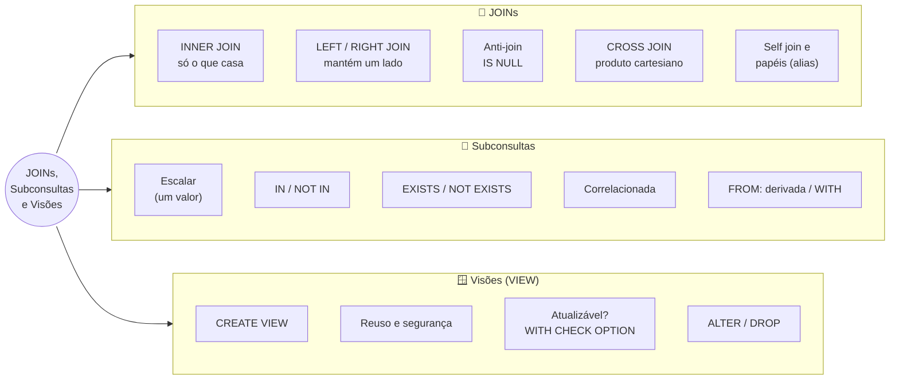
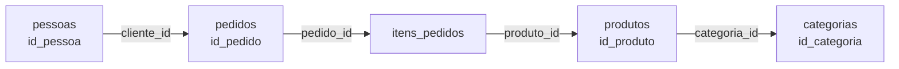

# Tópico 07 — Junções (JOINs), Subconsultas e Visões

**Disciplina:** Banco de Dados — Relacional (IBD015)
**Professor:** Ronan Adriel Zenatti · ronan.zenatti@cps.sp.gov.br
**Fatec Jahu — 2º Semestre/2026**

---

## 🎯 Objetivos do Tópico

Ao final deste tópico você deverá ser capaz de:

- Explicar por que um banco normalizado exige junções e o que acontece quando o `ON` é esquecido (produto cartesiano);
- Combinar duas ou mais tabelas com `INNER JOIN`, `LEFT JOIN` e `RIGHT JOIN`, escolhendo o tipo de junção pela pergunta de negócio;
- Encontrar registros "sem correspondência" (anti-join) e juntar uma tabela a si mesma ou duas vezes à mesma tabela em papéis diferentes;
- Escrever subconsultas escalares, com `IN`/`NOT IN`, `EXISTS`/`NOT EXISTS`, correlacionadas e em `FROM` (tabelas derivadas e `WITH`), e decidir entre subconsulta e `JOIN`;
- Criar, consultar, alterar e remover visões (`VIEW`), explicando quando uma visão aceita `UPDATE`/`INSERT` e o que faz o `WITH CHECK OPTION`.

---

## 🗺️ Mapa Mental do Tópico



---

## 🧭 Contexto

No Tópico 02 você **dividiu** os dados em várias tabelas para eliminar redundância: o pedido guarda só o `cliente_id`, o produto guarda só o `categoria_id`, o item guarda só o `produto_id`. Isso é ótimo para o armazenamento e para a integridade — mas péssimo para leitura: nenhum usuário quer ver "o pedido 7 é do cliente 8". Ele quer ver **"o pedido 7 é da Helena Souza"**.

O `JOIN` é o mecanismo que **reconstrói a informação completa** a partir das tabelas normalizadas, usando as chaves estrangeiras (Regras 5 e 6) como ponte: `pedidos.cliente_id` (FK) aponta para `pessoas.id_pessoa` (PK). Neste tópico você também aprende a **aninhar consultas** (subconsultas) e a **dar nome a uma consulta** para reutilizá-la (visões).

Os exemplos usam o `loja_virtual` com a carga ampliada do [Tópico 06](Topico_06_SQL_DQL_Agregacao.md) (rode o script de carga de novo se tiver bagunçado os dados).

---

## 1. `INNER JOIN` — Juntando Tabelas pelo que Casa

### 1.1 O problema: dados espalhados

Queremos listar cada produto **com o nome da sua categoria**. O nome da categoria está em `categorias`; o produto só tem o número:

| `produtos` | `categoria_id` |   | `categorias` | `nome` |
|---|---|---|---|---|
| Mouse Logitech MX Master | **2** | → | **2** | Periféricos |
| Cadeira Ergonômica | **4** | → | **4** | Casa |

Para juntar, dizemos ao banco **qual coluna de uma tabela corresponde a qual coluna da outra**: é o papel do `ON`.

```sql
SELECT p.nome        AS produto,
       c.nome        AS categoria,
       p.preco
FROM   produtos p
INNER JOIN categorias c ON c.id_categoria = p.categoria_id
ORDER BY c.nome, p.nome;
```

Três detalhes dessa consulta valem atenção:

- **Alias de tabela** (`produtos p`, `categorias c`): abreviam o texto e, principalmente, resolvem a **ambiguidade** de colunas com o mesmo nome. Tanto `produtos` quanto `categorias` têm uma coluna `nome`; escrever apenas `SELECT nome` gera `ERROR 1052: Column 'nome' in field list is ambiguous`. Prefixe com o alias (`p.nome`, `c.nome`) e use `AS` para nomear as colunas do resultado.
- **A condição de junção segue o par PK/FK**: `c.id_categoria = p.categoria_id`. Essa legibilidade vem das Regras 5 e 6 — a PK é `id_...` e a FK é `..._id`, então o par é fácil de enxergar.
- **`INNER JOIN` devolve só as linhas que têm correspondência nos dois lados.** A categoria "Games", que não tem nenhum produto, **não aparece** no resultado.

> 💡 `JOIN` sozinho significa `INNER JOIN` — escreva sempre `INNER` quando quiser deixar a intenção explícita para quem lê.

### 1.2 O que acontece se esquecer o `ON`?

Sem condição de junção, o banco combina **cada linha da primeira tabela com cada linha da segunda** — o **produto cartesiano**:

```sql
SELECT COUNT(*) FROM produtos CROSS JOIN categorias;   -- 12 × 5 = 60 linhas
SELECT COUNT(*) FROM produtos, categorias;             -- mesma coisa (sintaxe antiga)
```

Em tabelas pequenas isso é só um resultado estranho; em tabelas com milhões de linhas, é uma consulta que derruba o servidor. Existem usos legítimos do `CROSS JOIN` (gerar todas as combinações de tamanho × cor, por exemplo), mas a regra é: **toda junção precisa de um `ON`**. A sintaxe antiga com vírgula e a condição no `WHERE` (`FROM a, b WHERE a.x = b.y`) funciona, mas mistura o critério de junção com os filtros — evite.

### 1.3 Juntando várias tabelas

Cada `JOIN` adicional liga mais uma tabela ao que já foi montado. Para listar **os itens dos pedidos com o nome do cliente e do produto**:

```sql
SELECT ped.id_pedido,
       pes.nome                                              AS cliente,
       pr.nome                                               AS produto,
       i.quantidade,
       i.preco_unitario,
       ROUND(i.quantidade * i.preco_unitario * (1 - i.desconto / 100), 2) AS subtotal
FROM   pedidos ped
INNER JOIN pessoas       pes ON pes.id_pessoa  = ped.cliente_id
INNER JOIN itens_pedidos i   ON i.pedido_id    = ped.id_pedido
INNER JOIN produtos      pr  ON pr.id_produto  = i.produto_id
WHERE  ped.id_pedido IN (1, 7)
ORDER BY ped.id_pedido, pr.nome;
```

Para montar um `JOIN` com várias tabelas sem se perder, siga o caminho das chaves: `pessoas ← pedidos ← itens_pedidos → produtos`.



> 📌 A ordem de escrita dos `JOIN`s não precisa ser a ordem de execução — o otimizador do banco decide (veremos no Tópico 13). Escreva na ordem que for mais fácil de **ler**.

!!! example "🔍 Checkpoint 1 — INNER JOIN com 3 tabelas: micromobilidade elétrica"
    Uma operadora de patinetes elétricos compartilhados tem `usuarios (id_usuario PK, nome, cidade)`, `patinetes (id_patinete PK, modelo, nivel_bateria)` e `viagens (id_viagem PK, usuario_id FK, patinete_id FK, iniciada_em, distancia_km, valor)`. Escreva a consulta que liste, para as viagens com **mais de 5 km**, o `nome` do usuário, o `modelo` do patinete, a `distancia_km` e o `valor`, ordenadas da viagem mais cara para a mais barata. Use aliases de tabela e nomeie as colunas do resultado como `usuario` e `modelo`.

    🔑 Resolução no [Gabarito do Tópico 07](Topico_07_Gabarito.md#checkpoint-1) — tente resolver antes de conferir.

---

## 2. `LEFT JOIN`, `RIGHT JOIN` e o Anti-Join

### 2.1 Quando "só o que casa" não basta

E se a pergunta for: *"liste **todas** as categorias, com a quantidade de produtos — inclusive as que não têm nenhum"*? O `INNER JOIN` descartaria "Games". É para isso que existem as junções externas (*outer joins*):

| Junção | Mantém **todas** as linhas de... | Onde não há correspondência, o outro lado vem... |
|---|---|---|
| `INNER JOIN` | nenhum lado — só as que casam | (não aparece) |
| `LEFT JOIN` | da tabela da **esquerda** (a que vem antes do `JOIN`) | com `NULL` |
| `RIGHT JOIN` | da tabela da **direita** (a que vem depois do `JOIN`) | com `NULL` |

```sql
SELECT c.nome                       AS categoria,
       COUNT(p.id_produto)          AS qtd_produtos
FROM   categorias c
LEFT JOIN produtos p ON p.categoria_id = c.id_categoria
GROUP BY c.id_categoria, c.nome
ORDER BY qtd_produtos DESC;
```

| categoria | qtd_produtos |
|---|---|
| Periféricos | 4 |
| Eletrônicos | 3 |
| Livros | 3 |
| Casa | 2 |
| **Games** | **0** |

> ⚠️ **Detalhe que derruba muita gente:** a contagem correta usa `COUNT(p.id_produto)` — uma coluna do lado que pode faltar. Um `COUNT(*)` contaria a linha "Games" (que existe, com `NULL` nas colunas de `produtos`) e informaria 1 produto onde há 0. Regra: em `LEFT JOIN` + agregação, conte **uma coluna da tabela opcional**.

O `RIGHT JOIN` é o espelho do `LEFT JOIN` — `A LEFT JOIN B` equivale a `B RIGHT JOIN A`. Na prática, quase todo mundo escreve só `LEFT JOIN` (basta trocar a ordem das tabelas), porque lemos da esquerda para a direita e fica mais natural.

### 2.2 Anti-join: encontrando o que **não** tem correspondência

Como o `LEFT JOIN` deixa `NULL` no lado que não casou, filtrar esse `NULL` revela exatamente os registros "órfãos de relacionamento":

```sql
-- Pessoas que nunca fizeram um pedido como cliente
SELECT pes.nome
FROM   pessoas pes
LEFT JOIN pedidos ped ON ped.cliente_id = pes.id_pessoa
WHERE  ped.id_pedido IS NULL;
-- Diego Rocha, Prof. Ronan, Lucas Ferreira, Marina Duarte

-- Produtos que nunca foram vendidos
SELECT p.nome
FROM   produtos p
LEFT JOIN itens_pedidos i ON i.produto_id = p.id_produto
WHERE  i.pedido_id IS NULL;
-- Headset HyperX Cloud, Introdução a Sistemas de Bancos de Dados — Date
```

O teste `IS NULL` deve ser feito em uma coluna que **nunca é nula quando há correspondência** — tipicamente a PK (ou parte dela) da tabela da direita.

### 2.3 `ON` × `WHERE` em uma junção externa

Em um `INNER JOIN`, mover uma condição entre `ON` e `WHERE` não muda o resultado. Em um `LEFT JOIN`, **muda** — e muito:

```sql
-- Condição no ON: continuam aparecendo TODAS as pessoas (quem não tem pedido entregue vem com 0)
SELECT pes.nome, COUNT(ped.id_pedido) AS entregues
FROM   pessoas pes
LEFT JOIN pedidos ped ON ped.cliente_id = pes.id_pessoa AND ped.status = 'entregue'
GROUP BY pes.id_pessoa, pes.nome;          -- 12 linhas

-- Condição no WHERE: as linhas "sem pedido" têm status NULL, que falha no filtro e é DESCARTADA
SELECT pes.nome, COUNT(ped.id_pedido) AS entregues
FROM   pessoas pes
LEFT JOIN pedidos ped ON ped.cliente_id = pes.id_pessoa
WHERE  ped.status = 'entregue'
GROUP BY pes.id_pessoa, pes.nome;          -- 6 linhas: virou um INNER JOIN disfarçado
```

> 📌 **Regra prática:** em `LEFT JOIN`, condições sobre a tabela **opcional** (a da direita) vão no `ON`; só filtre a tabela opcional no `WHERE` se você realmente quer descartar quem não tem correspondência (o que, então, é um `INNER JOIN`).

### 2.4 `FULL OUTER JOIN` não existe no MariaDB

O `FULL OUTER JOIN` (todas as linhas dos **dois** lados) existe no PostgreSQL, mas **não** no MariaDB/MySQL. A emulação é a união de um `LEFT` com um `RIGHT`:

```sql
SELECT c.nome AS categoria, p.nome AS produto
FROM   categorias c LEFT JOIN produtos p ON p.categoria_id = c.id_categoria
UNION
SELECT c.nome, p.nome
FROM   categorias c RIGHT JOIN produtos p ON p.categoria_id = c.id_categoria;
```

O `UNION` (sem `ALL`) elimina as linhas duplicadas que os dois lados têm em comum. No `loja_virtual` os dois lados coincidem (toda FK é `NOT NULL`), mas o padrão vale para qualquer modelo em que ambos os lados possam ficar sem correspondência.

!!! tip "✅ Verificação Rápida — escolhendo o tipo de junção"
    Bloco conceitual — confira o entendimento com os dois quizzes abaixo. A resposta é revelada na hora.

<quiz>
Quer-se um relatório de TODOS os clientes cadastrados, com a quantidade de pedidos de cada um (zero para quem nunca comprou). Qual junção atende?
- [ ] pessoas INNER JOIN pedidos
- [x] pessoas LEFT JOIN pedidos, contando com COUNT(pedidos.id_pedido)
- [ ] pessoas CROSS JOIN pedidos
- [ ] pedidos LEFT JOIN pessoas

A tabela cujos registros precisam todos aparecer (pessoas) fica à esquerda de um LEFT JOIN. O COUNT deve ser sobre uma coluna da tabela opcional (pedidos) para que quem não comprou resulte em 0 e não em 1.
</quiz>

<quiz>
Qual a consequência de mover o filtro ped.status = 'entregue' do ON para o WHERE em um LEFT JOIN de pessoas com pedidos?
- [ ] Nenhuma — o resultado é sempre idêntico
- [ ] O banco retorna um erro de sintaxe
- [x] As pessoas sem pedido entregue somem do resultado, pois o NULL falha no filtro do WHERE
- [ ] O LEFT JOIN passa a incluir também as linhas duplicadas

Depois da junção externa, as pessoas sem correspondência têm todas as colunas de pedidos como NULL. O WHERE ped.status = 'entregue' é falso (NULL) para elas e as descarta — o LEFT JOIN vira, na prática, um INNER JOIN.
</quiz>

!!! example "🔍 Checkpoint 2 — LEFT JOIN e anti-join: plataforma de criadores"
    Uma plataforma de criadores de conteúdo tem `criadores (id_criador PK, nome_canal)` e `videos (id_video PK, criador_id FK, titulo, visualizacoes, publicado_em)`. (a) Liste **todos** os canais com a quantidade de vídeos (`total_videos`) e o total de visualizações (`total_visualizacoes`, mostrando 0 e não `NULL` para quem não publicou), do canal com mais visualizações para o com menos. (b) Liste apenas os canais que **nunca publicaram** nenhum vídeo.

    🔑 Resolução no [Gabarito do Tópico 07](Topico_07_Gabarito.md#checkpoint-2) — tente resolver antes de conferir.

---

## 3. Juntando a Mesma Tabela Mais de Uma Vez

### 3.1 Papéis diferentes: o prêmio da Regra 7

Lembra que `pedidos` tem **duas** chaves estrangeiras para a mesma tabela `pessoas` — `cliente_id` e `funcionario_id` (Regra 7: FK nomeada pelo papel semântico)? Para exibir os **dois nomes** na mesma linha, junte `pessoas` duas vezes, com **aliases diferentes**, um para cada papel:

```sql
SELECT ped.id_pedido,
       cli.nome                                   AS cliente,
       COALESCE(fun.nome, '(autoatendimento)')    AS atendente,
       ped.status
FROM   pedidos ped
INNER JOIN pessoas cli ON cli.id_pessoa = ped.cliente_id        -- obrigatório: todo pedido tem cliente
LEFT  JOIN pessoas fun ON fun.id_pessoa = ped.funcionario_id    -- opcional: pode ser NULL
ORDER BY ped.id_pedido;
```

Note a combinação: `INNER JOIN` para o cliente (a FK é `NOT NULL`) e `LEFT JOIN` para o funcionário (a FK aceita `NULL` — pedidos feitos sem atendente). Se o segundo também fosse `INNER`, os 7 pedidos de autoatendimento **sumiriam** do resultado. Os aliases `cli` e `fun` mostram o *papel*, e é por isso que a Regra 7 recomenda `cliente_id`/`funcionario_id` em vez de `pessoa1_id`/`pessoa2_id`.

### 3.2 *Self join*: a tabela contra ela mesma

Quando uma linha precisa ser comparada com **outra linha da mesma tabela**, juntamos a tabela a si própria — de novo com aliases distintos. Exemplo: para cada produto, quais outros produtos **da mesma categoria** são mais baratos?

```sql
SELECT a.nome  AS produto,
       a.preco,
       b.nome  AS mais_barato_na_categoria,
       b.preco AS preco_b
FROM   produtos a
INNER JOIN produtos b ON b.categoria_id = a.categoria_id
                     AND b.preco < a.preco
WHERE  a.categoria_id = 4;
-- Cadeira Ergonômica (1199.00) > Luminária de Mesa LED (89.90)
```

O uso mais clássico de *self join* é a **hierarquia**: uma tabela que aponta para si mesma, como `entregadores (id_entregador, nome, supervisor_id)`, em que `supervisor_id` é uma FK para a **própria** `entregadores`. Quem não tem supervisor tem `NULL` — por isso se usa `LEFT JOIN`.

!!! example "🔍 Checkpoint 3 — Self join: gig economy"
    Um app de entregas tem `entregadores (id_entregador PK, nome, supervisor_id FK)`, onde `supervisor_id` referencia a própria tabela (e é `NULL` para os supervisores de topo). (a) Liste cada entregador com o nome do seu supervisor, escrevendo `'(sem supervisor)'` para quem não tem, em ordem alfabética de entregador. (b) Liste cada pessoa com a quantidade de entregadores que ela supervisiona diretamente (`equipe`), incluindo quem supervisiona 0, do maior para o menor.

    🔑 Resolução no [Gabarito do Tópico 07](Topico_07_Gabarito.md#checkpoint-3) — tente resolver antes de conferir.

---

## 4. Subconsultas — Uma Consulta Dentro da Outra

Uma **subconsulta** (*subquery*) é um `SELECT` entre parênteses dentro de outro comando. Ela permite responder perguntas em duas etapas: *"primeiro descubra X; depois use X para filtrar/calcular Y"*. Há quatro lugares onde ela pode aparecer:

| Posição | Para quê | Exemplo |
|---|---|---|
| `WHERE` / `HAVING` | Filtrar usando um valor ou lista calculados | produtos com preço acima da média |
| `FROM` | Usar o resultado como uma "tabela temporária" (tabela derivada) | agregar o que já foi agregado |
| `SELECT` | Calcular uma coluna extra, linha a linha | quantidade de pedidos de cada pessoa |
| `INSERT/UPDATE/DELETE` | Definir quais linhas alterar | `UPDATE ... WHERE categoria_id = (SELECT ...)` (Tópico 04) |

### 4.1 Subconsulta escalar — devolve um único valor

```sql
-- Produtos mais caros que a média de preços
SELECT nome, preco
FROM   produtos
WHERE  preco > (SELECT AVG(preco) FROM produtos)
ORDER BY preco DESC;

-- O produto mais caro
SELECT nome FROM produtos WHERE preco = (SELECT MAX(preco) FROM produtos);
```

Se uma subconsulta usada com `=`, `>`, `<` devolver **mais de uma linha**, o resultado é erro: `ERROR 1242: Subquery returns more than 1 row`. Para comparar com um conjunto, use `IN`, `ANY` ou `ALL`.

### 4.2 `IN` e `NOT IN` — a subconsulta devolve uma lista

```sql
-- Produtos que já foram vendidos pelo menos uma vez
SELECT nome FROM produtos WHERE id_produto IN (SELECT produto_id FROM itens_pedidos);

-- Produtos que nunca foram vendidos
SELECT nome FROM produtos WHERE id_produto NOT IN (SELECT produto_id FROM itens_pedidos);
```

> ⚠️ **A armadilha do `NOT IN` com `NULL`** (prometida na Seção 1.2 do Tópico 06). Se a lista contiver **um único `NULL`**, o `NOT IN` nunca é verdadeiro e o resultado vem **vazio**, sem erro algum:
>
> ```sql
> -- "Quem nunca atendeu um pedido?"  funcionario_id tem NULL (autoatendimento)
> SELECT nome FROM pessoas
> WHERE  id_pessoa NOT IN (SELECT funcionario_id FROM pedidos);
> -- 0 linhas!  (a resposta correta teria 9 pessoas)
> ```
>
> Isso acontece porque `x NOT IN (1, 2, NULL)` equivale a `x<>1 AND x<>2 AND x<>NULL`, e a última comparação é "desconhecida". Duas saídas seguras: filtrar o `NULL` dentro da subconsulta (`WHERE funcionario_id IS NOT NULL`) ou usar `NOT EXISTS`, a seguir.

### 4.3 `EXISTS` e `NOT EXISTS` — "existe pelo menos uma linha?"

O `EXISTS` não se importa com o **conteúdo** que a subconsulta devolve, só se ela devolve **alguma linha**. Por convenção escreve-se `SELECT 1`:

```sql
-- Clientes que já tiveram algum pedido cancelado
SELECT nome
FROM   pessoas pes
WHERE  EXISTS (SELECT 1 FROM pedidos ped
               WHERE ped.cliente_id = pes.id_pessoa
                 AND ped.status = 'cancelado');

-- Quem nunca atendeu um pedido (versão segura, sem a armadilha do NULL)
SELECT nome
FROM   pessoas pes
WHERE  NOT EXISTS (SELECT 1 FROM pedidos ped WHERE ped.funcionario_id = pes.id_pessoa);
```

Repare que a subconsulta **referencia a tabela de fora** (`pes.id_pessoa`). Isso a torna uma **subconsulta correlacionada**: ela é reavaliada para cada linha da consulta externa, como se fosse um laço (`para cada pessoa, pergunte se existe...`).

### 4.4 Correlacionada em outras posições

```sql
-- Produtos mais caros que a média DA PRÓPRIA categoria
SELECT p.nome, p.preco, p.categoria_id
FROM   produtos p
WHERE  p.preco > (SELECT AVG(x.preco) FROM produtos x WHERE x.categoria_id = p.categoria_id)
ORDER BY p.categoria_id;

-- Coluna calculada por subconsulta: quantos pedidos cada pessoa fez
SELECT pes.nome,
       (SELECT COUNT(*) FROM pedidos ped WHERE ped.cliente_id = pes.id_pessoa) AS qtd_pedidos
FROM   pessoas pes
ORDER BY qtd_pedidos DESC, pes.nome;
```

### 4.5 Subconsulta no `FROM`: tabela derivada e `WITH`

Quando é preciso **agregar o que já foi agregado** (ex.: a média dos totais por cliente), o resultado da primeira agregação vira uma "tabela" para a segunda. A subconsulta em `FROM` **exige um alias**:

```sql
-- Clientes cujo total gasto supera R$ 4.000
SELECT resumo.cliente_id, resumo.total_gasto
FROM  (SELECT cliente_id, SUM(valor_total) AS total_gasto
       FROM   pedidos
       GROUP BY cliente_id) AS resumo
WHERE resumo.total_gasto > 4000;
```

Quando a consulta fica longa, o `WITH` (*Common Table Expression* — CTE, disponível desde o MariaDB 10.2) dá **nome** ao bloco antes de usá-lo, deixando a leitura de cima para baixo:

```sql
WITH gasto_por_cliente AS (
    SELECT cliente_id, SUM(valor_total) AS total
    FROM   pedidos
    WHERE  status <> 'cancelado'
    GROUP BY cliente_id
)
SELECT pes.nome, g.total
FROM   gasto_por_cliente g
INNER JOIN pessoas pes ON pes.id_pessoa = g.cliente_id
WHERE  g.total > (SELECT AVG(total) FROM gasto_por_cliente)
ORDER BY g.total DESC;
```

### 4.6 `ANY` e `ALL`

```sql
-- Mais caro que TODOS os periféricos (maior que o máximo da categoria 2)
SELECT nome, preco FROM produtos
WHERE  preco > ALL (SELECT preco FROM produtos WHERE categoria_id = 2);

-- Mais caro que PELO MENOS UM eletrônico (maior que o mínimo da categoria 1)
SELECT nome, preco FROM produtos
WHERE  preco > ANY (SELECT preco FROM produtos WHERE categoria_id = 1);
```

### 4.7 `JOIN` ou subconsulta?

Muitas perguntas podem ser respondidas das duas maneiras. Um guia de bolso:

| Situação | Prefira |
|---|---|
| Preciso de **colunas** da outra tabela no resultado | `JOIN` |
| Só preciso **testar a existência** (ou ausência) de relacionamento | `EXISTS` / `NOT EXISTS` (ou anti-join) |
| Comparar com um valor **agregado** (média, máximo) | subconsulta escalar |
| Agregar o resultado de outra agregação | tabela derivada ou `WITH` |
| A consulta está difícil de ler | `WITH`, dando nome aos passos |

> 💡 Em bancos modernos, o otimizador costuma reescrever `IN`/`EXISTS` como junções internamente, então desempenho não é o principal critério de escolha na maioria dos casos — **clareza** é. Meça com `EXPLAIN` (Tópico 13) quando a diferença importar.

!!! example "🔍 Checkpoint 4 — Subconsultas: cloud gaming"
    Uma plataforma de cloud gaming tem `jogos (id_jogo PK, titulo)` e `sessoes_jogo (id_sessao PK, usuario_id FK, jogo_id FK, duracao_min)`. (a) Liste os títulos dos jogos que **nunca foram jogados**, usando `NOT EXISTS`. (b) Liste os jogos cuja duração média de sessão é **maior que a duração média geral** de todas as sessões, mostrando `titulo` e `duracao_media` (1 casa decimal).

    🔑 Resolução no [Gabarito do Tópico 07](Topico_07_Gabarito.md#checkpoint-4) — tente resolver antes de conferir.

!!! example "🔍 Checkpoint 5 — Tabela derivada / WITH: entrega por drone"
    Uma operação de entrega por drone registra `entregas_drone (id_entrega PK, drone_id FK, regiao, peso_kg, duracao_min, concluida_em)`. Escreva a consulta que liste as **regiões cuja duração média de entrega é maior que a duração média de todas as entregas**, mostrando `regiao`, `entregas` (quantidade) e `duracao_media` (1 casa decimal), da mais lenta para a mais rápida. Resolva usando `WITH` (CTE) e comente em uma linha por que o filtro da média **não** pode ir no `WHERE` da agregação por região.

    🔑 Resolução no [Gabarito do Tópico 07](Topico_07_Gabarito.md#checkpoint-5) — tente resolver antes de conferir.

---

## 5. Visões (`VIEW`) — Consultas com Nome

### 5.1 O problema que a visão resolve

A consulta de pedidos com cliente e atendente (Seção 3.1) tem 3 tabelas e um `COALESCE`. Imagine reescrevê-la em cada relatório, cada tela do sistema, cada planilha do financeiro... Qualquer correção teria de ser replicada em dezenas de lugares. Uma **visão** é uma consulta `SELECT` **salva no banco com um nome**; depois disso, ela se usa como se fosse uma tabela.

```sql
CREATE VIEW vw_pedidos_detalhados AS
SELECT ped.id_pedido,
       ped.data_pedido,
       ped.status,
       cli.id_pessoa                              AS cliente_id,
       cli.nome                                   AS cliente,
       COALESCE(fun.nome, 'autoatendimento')      AS atendente,
       ped.valor_total
FROM   pedidos ped
INNER JOIN pessoas cli ON cli.id_pessoa = ped.cliente_id
LEFT  JOIN pessoas fun ON fun.id_pessoa = ped.funcionario_id;

-- Agora o resto do sistema consulta a visão, sem saber nada de JOIN:
SELECT * FROM vw_pedidos_detalhados WHERE status = 'entregue' ORDER BY valor_total DESC LIMIT 3;

-- E ainda pode agrupar, juntar com outras tabelas, etc.:
SELECT cliente, COUNT(*) AS pedidos, SUM(valor_total) AS total
FROM   vw_pedidos_detalhados
GROUP BY cliente_id, cliente
ORDER BY total DESC;
```

> 📌 **Convenção de nomes:** as 9 regras oficiais cobrem tabelas e colunas. Para visões, esta disciplina usa o prefixo `vw_` + nome em `snake_case` minúsculo (ex.: `vw_pedidos_detalhados`), na mesma linha dos prefixos `pk_`, `fk_`, `uq_` e `ck_` que você já usa para constraints. Assim, um `SHOW TABLES` deixa claro o que é tabela e o que é visão.

### 5.2 O que uma visão **é** (e o que não é)

- Uma visão **não guarda dados**: guarda apenas o texto da consulta. Cada vez que você faz `SELECT` na visão, o banco executa a consulta de novo sobre as tabelas reais — os dados estão sempre atualizados.
- Por isso, uma visão **não acelera** nada: ela organiza e reutiliza, mas o custo da consulta é o mesmo. (Bancos como PostgreSQL e Oracle têm *materialized views*, que guardam o resultado em disco; o MariaDB **não** tem esse recurso.)
- Uma visão **não pode ter índice próprio**; o que importa são os índices das tabelas-base (Tópico 13).

**Para que serve, então?**

| Benefício | Exemplo |
|---|---|
| **Reuso** e consistência | A regra "cliente/atendente" mora em um só lugar. |
| **Simplicidade** para quem consulta | O analista usa `vw_pedidos_detalhados` sem conhecer 3 tabelas. |
| **Segurança** (Tópico 12) | Dê acesso à visão que expõe apenas `id_pessoa, nome, email` e **negue** o acesso à tabela `pessoas`, escondendo CPF e telefone. |
| **Estabilidade** | Se a tabela mudar, ajusta-se a visão e os consumidores continuam funcionando. |

### 5.3 Gerenciando visões

```sql
-- Recria a visão se já existir (idempotente — ótimo para scripts)
CREATE OR REPLACE VIEW vw_clientes_publico AS
SELECT id_pessoa, nome, email FROM pessoas;

-- Altera a definição
ALTER VIEW vw_clientes_publico AS
SELECT id_pessoa, nome FROM pessoas;

-- Inspeciona
SHOW FULL TABLES WHERE table_type = 'VIEW';   -- lista as visões do banco
SHOW CREATE VIEW vw_clientes_publico;         -- mostra a consulta que a define

-- Remove (os dados das tabelas-base não são afetados)
DROP VIEW IF EXISTS vw_clientes_publico;
```

### 5.4 Visões atualizáveis e `WITH CHECK OPTION`

Algumas visões aceitam `INSERT`, `UPDATE` e `DELETE`, que são repassados às tabelas-base. Para isso a visão precisa ser "simples" o bastante para que cada linha dela corresponda a **uma** linha de uma tabela: sem `GROUP BY`, `DISTINCT`, funções de agregação, `UNION` etc.

```sql
CREATE OR REPLACE VIEW vw_produtos_ativos AS
SELECT id_produto, categoria_id, nome, preco, estoque, ativo
FROM   produtos
WHERE  ativo = 1
WITH CHECK OPTION;

-- Funciona: reajusta o preço na tabela produtos, através da visão
UPDATE vw_produtos_ativos SET preco = preco * 1.10 WHERE id_produto = 3;

-- Visão com GROUP BY NÃO é atualizável:
CREATE OR REPLACE VIEW vw_resumo_categorias AS
SELECT categoria_id, COUNT(*) AS qtd FROM produtos GROUP BY categoria_id;
UPDATE vw_resumo_categorias SET qtd = 1;
-- ERROR 1288 (HY000): The target table vw_resumo_categorias of the UPDATE is not updatable
```

Sem o `WITH CHECK OPTION`, seria possível, **através da visão**, mudar uma linha de modo que ela "saia" da visão (`UPDATE ... SET ativo = 0`) ou inserir uma linha que a própria visão não mostraria. O `WITH CHECK OPTION` impede isso, aplicando o `WHERE` da visão também às escritas:

```sql
UPDATE vw_produtos_ativos SET ativo = 0 WHERE id_produto = 3;
-- ERROR 1369 (44000): CHECK OPTION failed `loja_virtual`.`vw_produtos_ativos`

INSERT INTO vw_produtos_ativos (categoria_id, nome, preco, estoque, ativo)
VALUES (1, 'Produto de teste', 10.00, 1, 0);
-- ERROR 1369 (44000): CHECK OPTION failed ...
```

> 💡 **Boa prática:** use visões principalmente para **leitura**. Escrever através de visões funciona em casos simples, mas esconde para onde o dado realmente vai e dificulta a manutenção — nas rotinas de escrita, prefira operar nas tabelas (ou em *stored procedures*, Tópico 09).

!!! example "🔍 Checkpoint 6 — VIEW: carteira digital"
    Uma fintech tem `titulares (id_titular PK, nome, cpf)` e `contas (id_conta PK, titular_id FK, saldo, limite_credito, ativa, deletado_em)`. A equipe de suporte precisa ver o `id_conta`, o `nome` do titular (como `titular`) e o `saldo` das contas **ativas e não excluídas** (`deletado_em` nulo), mas **nunca** o CPF nem o limite de crédito. (a) Escreva o `CREATE VIEW vw_contas_suporte` que entrega isso. (b) A visão aceitaria `UPDATE vw_contas_suporte SET saldo = saldo + 10 WHERE id_conta = 1`? Responda e comente se isso seria desejável para o time de suporte.

    🔑 Resolução no [Gabarito do Tópico 07](Topico_07_Gabarito.md#checkpoint-6) — tente resolver antes de conferir.

---

## 6. Exercícios de Fixação

> 🔑 As resoluções destes sete exercícios estão no [Gabarito do Tópico 07](Topico_07_Gabarito.md) — tente resolver antes de conferir. Use o schema `loja_virtual` com a carga ampliada do Tópico 06.

**Exercício 1:** liste os pedidos **entregues** com o nome do cliente, a cidade do endereço de entrega e o `valor_total`, ordenados por `id_pedido`.

**Exercício 2:** quais produtos nunca foram vendidos? Mostre `id_produto` e `nome` (use um anti-join).

**Exercício 3:** para **todas** as categorias (inclusive as sem produtos), mostre o nome, a quantidade de produtos e o preço médio com 2 casas decimais (`0` quando não houver produtos).

**Exercício 4:** liste o nome e o total gasto dos clientes cujo total (sem contar pedidos cancelados) é **maior que a média** dos totais de todos os clientes.

**Exercício 5:** quais clientes já compraram algum produto da categoria 'Livros'? Resolva com `JOIN` + `DISTINCT` **e** depois com `EXISTS`, e compare.

**Exercício 6:** crie a visão `vw_vendas_por_produto` com `id_produto`, `produto`, `unidades_vendidas` e `receita` (considerando o desconto e ignorando pedidos cancelados). Em seguida, use-a para listar as 3 maiores receitas.

**Exercício 7:** mostre, por atendente, a quantidade de pedidos atendidos e o valor total, ignorando os pedidos de autoatendimento.

---

## 📚 Referências deste Tópico

- ELMASRI, R.; NAVATHE, S. B. *Sistemas de Banco de Dados*. 7 ed. Caps. 7.1 e 7.2 — Junções, consultas aninhadas e visões. São Paulo: Pearson, 2018.
- SILBERSCHATZ, A.; SUNDARSHAN, S.; KORTH, H. F. *Sistema de banco de dados*. Cap. 4 — SQL intermediário (junções e visões). Rio de Janeiro: Elsevier Brasil, 2016.
- FORTA, B. *SQL em 10 Minutos por Dia*. 5 ed. Lições sobre junções, subconsultas e visões. São Paulo: Novatec, 2021.
- Documentação oficial do MariaDB — [JOIN](https://mariadb.com/kb/en/join-syntax/), [Subqueries](https://mariadb.com/kb/en/subqueries/), [WITH (CTE)](https://mariadb.com/kb/en/with/), [CREATE VIEW](https://mariadb.com/kb/en/create-view/)

---

## 🃏 Flashcards de Revisão

??? question "Qual a diferença entre INNER JOIN e LEFT JOIN?"
    `INNER JOIN` devolve só as linhas que têm correspondência nos dois lados. `LEFT JOIN`
    mantém todas as linhas da tabela da esquerda; onde não há correspondência na direita,
    as colunas dela vêm como `NULL`.

??? question "Como achar registros que NÃO têm correspondência em outra tabela?"
    Anti-join: `LEFT JOIN` e filtre com `WHERE coluna_da_direita IS NULL` (a PK da direita).
    A alternativa equivalente é `NOT EXISTS (SELECT 1 ...)`. Evite `NOT IN` quando a lista
    puder conter `NULL`.

??? question "O que é um produto cartesiano e como ele acontece sem querer?"
    É a combinação de cada linha de uma tabela com cada linha da outra (12 × 5 = 60 linhas).
    Acontece quando se esquece o `ON` (ou a condição de junção no `WHERE`) — o resultado
    cresce com o produto dos tamanhos das tabelas.

??? question "Por que COUNT(*) dá resultado errado em um LEFT JOIN com agregação?"
    Porque a linha sem correspondência existe no resultado (com `NULL` nas colunas da
    direita) e o `COUNT(*)` a conta como 1. Use `COUNT(tabela_direita.coluna)`, que ignora
    os `NULL` e dá 0.

??? question "O que é uma subconsulta correlacionada?"
    É uma subconsulta que referencia colunas da consulta externa e, por isso, é
    reavaliada para cada linha dela (como um laço). Exemplo: `WHERE EXISTS (SELECT 1 FROM
    pedidos ped WHERE ped.cliente_id = pes.id_pessoa)`.

??? question "Uma visão armazena dados? O que ela acelera?"
    Não armazena dados — guarda apenas a consulta, executada de novo a cada uso (o dado
    está sempre atual). Não acelera nada; serve para reutilizar lógica, simplificar o
    acesso e restringir colunas por segurança. O MariaDB não tem visão materializada.

---

## ✅ Quiz de Fixação

<quiz>
Dadas as tabelas categorias (5 linhas, uma delas sem produtos) e produtos (12 linhas), quantas linhas retorna SELECT ... FROM categorias c LEFT JOIN produtos p ON p.categoria_id = c.id_categoria sem nenhum WHERE?
- [ ] 5
- [ ] 12
- [x] 13
- [ ] 60

Cada um dos 12 produtos aparece uma vez (casando com a sua categoria) e a categoria sem produtos aparece uma vez, com NULL nas colunas de produtos: 12 + 1 = 13. O INNER JOIN daria 12; o produto cartesiano daria 60.
</quiz>

<quiz>
Em qual situação NOT IN (subconsulta) devolve vazio mesmo havendo registros que "deveriam" ser retornados?
- [ ] Quando a subconsulta devolve linhas repetidas
- [x] Quando a lista devolvida pela subconsulta contém pelo menos um NULL
- [ ] Quando a tabela da subconsulta é maior que a externa
- [ ] Quando a subconsulta usa GROUP BY

x NOT IN (..., NULL) inclui a comparação x <> NULL, que é desconhecida (não verdadeira); com isso a condição inteira nunca é satisfeita. A prevenção é filtrar IS NOT NULL na subconsulta ou usar NOT EXISTS.
</quiz>

<quiz>
Marque todas as afirmações corretas sobre visões (VIEW) no MariaDB.
- [x] Guardam a definição da consulta, não os dados
- [x] Permitem restringir quais colunas um usuário enxerga
- [ ] Armazenam o resultado em disco e por isso aceleram a consulta
- [ ] Sempre aceitam INSERT, UPDATE e DELETE

A visão é uma consulta com nome, executada a cada uso (o MariaDB não possui visão materializada). Só visões "simples" — sem GROUP BY, DISTINCT, agregações etc. — são atualizáveis.
</quiz>

<quiz>
Para listar cada pedido com o nome do cliente E o nome do atendente (que pode ser nulo), mantendo todos os pedidos, qual a abordagem correta?
- [ ] Um único INNER JOIN com pessoas, comparando cliente_id e funcionario_id na mesma condição
- [x] INNER JOIN pessoas (alias cli) pelo cliente_id e LEFT JOIN pessoas (alias fun) pelo funcionario_id
- [ ] Dois INNER JOIN com pessoas, com o mesmo alias
- [ ] CROSS JOIN com pessoas e filtro no WHERE

A mesma tabela é juntada duas vezes, cada uma com um alias que representa o papel. O atendente é opcional, então exige LEFT JOIN — com INNER JOIN os pedidos de autoatendimento seriam descartados.
</quiz>

<quiz>
O que a cláusula WITH CHECK OPTION garante em uma visão atualizável?
- [ ] Que a visão é recalculada de tempos em tempos
- [ ] Que apenas o dono da visão pode consultá-la
- [x] Que INSERTs e UPDATEs feitos pela visão respeitem a condição WHERE dela
- [ ] Que a visão guarda um índice próprio

Com WITH CHECK OPTION, uma escrita que deixaria a linha fora do filtro da visão (por exemplo, marcar ativo = 0 em uma visão que só mostra ativos) é rejeitada com o erro 1369.
</quiz>

---

## 📝 Resumo

Os dados normalizados vivem em várias tabelas, e o **`JOIN`** os reúne seguindo o caminho
PK/FK: o `INNER JOIN` devolve só o que casa; o `LEFT`/`RIGHT JOIN` preserva um lado e
permite achar o que **não** tem correspondência (anti-join); e uma mesma tabela pode ser
juntada a si mesma ou duas vezes em papéis diferentes. As **subconsultas** respondem
perguntas em etapas — escalares, com `IN`/`EXISTS`, correlacionadas, em `FROM` ou em
`WITH` — e exigem cuidado com `NULL` no `NOT IN`. As **visões** dão nome a consultas
reutilizáveis, simplificam o acesso e limitam o que cada usuário enxerga, sem armazenar
dados. No próximo tópico, o foco sai das consultas e vai para a **integridade**: como o
banco impede, por si só, que dados inconsistentes entrem.

---

## 🏆 Conquista do Tópico

!!! success "Selo desbloqueado: 🧩 Mestre dos Joins"
    Você já consegue reconstruir informação a partir de um modelo normalizado, achar o
    que está faltando e organizar consultas complexas em blocos reutilizáveis. A próxima
    parada da Trilha do(a) Arquiteto(a) de Dados é garantir que os dados que chegam ao
    banco sejam confiáveis: integridade referencial e restrições.

---

## 🔑 Gabarito deste Tópico

As respostas dos 6 checkpoints espalhados pelo tópico, e dos 7 Exercícios de Fixação da
Seção 6, estão em um arquivo separado, para não estragar a tentativa de quem ainda não
chegou até aqui: [Gabarito — Tópico 07](Topico_07_Gabarito.md).

---

## 🔗 Navegação

⬅️ [Tópico 06 — SQL DQL: Consultas e Agregação](./Topico_06_SQL_DQL_Agregacao.md) · ➡️ [Tópico 08 — Integridade Referencial e Restrições](./Topico_08_Integridade_Restricoes.md)

---

*Fatec Jahu · IBD015 · Prof. Ronan Adriel Zenatti · 2026*
