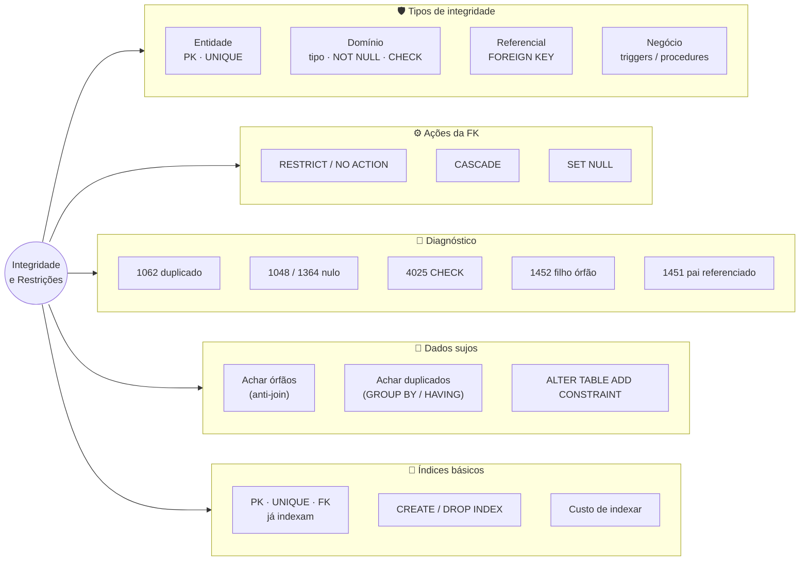
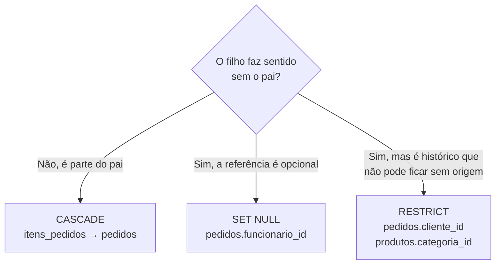

# Tópico 08 — Integridade Referencial e Restrições

**Disciplina:** Banco de Dados — Relacional (IBD015)
**Professor:** Ronan Adriel Zenatti · ronan.zenatti@cps.sp.gov.br
**Fatec Jahu — 2º Semestre/2026**

---

## 🎯 Objetivos do Tópico

Ao final deste tópico você deverá ser capaz de:

- Distinguir os quatro tipos de integridade (de entidade, de domínio, referencial e de negócio) e associar cada um à restrição que o protege;
- Reconhecer, pelo código e pela mensagem, o erro que cada violação gera (`1062`, `1048`/`1364`, `4025`, `1264`, `1452`, `1451`);
- Escolher a ação referencial correta (`RESTRICT`, `CASCADE`, `SET NULL`) a partir da pergunta de negócio "o filho faz sentido sem o pai?";
- Adicionar restrições a uma tabela que já tem dados, localizando antes os registros que as violam;
- Criar e remover índices básicos, e explicar o que o banco já indexa sozinho e quanto custa indexar demais.

---

## 🗺️ Mapa Mental do Tópico



---

## 🧭 Contexto

Dados incorretos entram em um banco por muitos caminhos: um bug na aplicação, uma planilha importada às pressas, um `UPDATE` rodado em produção sem `WHERE`, duas requisições simultâneas, uma segunda aplicação que ninguém lembrou de avisar sobre as regras do cadastro. Validar na tela e no código da aplicação é necessário — mas **não é suficiente**, porque o banco é o único ponto por onde **todos** esses caminhos passam.

Por isso o SGBD oferece **restrições de integridade** (*constraints*): regras declaradas no próprio schema que o banco **verifica sozinho, em toda escrita, venha ela de onde vier**. No Tópico 03 você aprendeu a *sintaxe* de `PRIMARY KEY`, `FOREIGN KEY`, `UNIQUE`, `CHECK` e `NOT NULL`. Neste tópico a pergunta muda: **o que exatamente cada uma protege, como ela falha, e como escolher o comportamento certo para cada relacionamento do seu modelo?**

Os exemplos usam o `loja_virtual` com a carga ampliada do [Tópico 06](Topico_06_SQL_DQL_Agregacao.md).

---

## 1. Os Quatro Tipos de Integridade

| Tipo | A pergunta que ela responde | Como o banco garante | Erro típico |
|---|---|---|---|
| **De entidade** | "Cada linha é única e identificável?" | `PRIMARY KEY`, `UNIQUE` | `1062 Duplicate entry` |
| **De domínio** | "O valor desta coluna é válido para o que ela representa?" | tipo de dado, `NOT NULL`, `DEFAULT`, `CHECK`, `ENUM` | `1048`, `1364`, `1264`, `1265`, `1406`, `4025` |
| **Referencial** | "A linha à qual eu me refiro realmente existe?" | `FOREIGN KEY` | `1452` (filho órfão) · `1451` (pai referenciado) |
| **De negócio** (definida pelo usuário) | "Esta operação respeita as regras da empresa?" | `TRIGGER`, `PROCEDURE`, transações | mensagens próprias (`SIGNAL`) — Tópicos 09 e 10 |

### 1.1 Integridade de entidade — `PRIMARY KEY` e `UNIQUE`

```sql
-- PK duplicada
INSERT INTO pessoas (id_pessoa, nome, cpf, email, data_nascimento)
VALUES (1, 'Duplicada', '99999999999', 'dup@email.com', '2000-01-01');
-- ERROR 1062 (23000): Duplicate entry '1' for key 'PRIMARY'

-- UNIQUE (cpf) duplicado
INSERT INTO pessoas (nome, cpf, email, data_nascimento)
VALUES ('Outra Ana', '11122233344', 'outra@email.com', '2000-01-01');
-- ERROR 1062 (23000): Duplicate entry '11122233344' for key 'uq_cpf'
```

Repare que a mensagem cita o **nome da constraint** (`uq_cpf`). É por isso que damos nomes explícitos às constraints (`pk_`, `fk_`, `uq_`, `ck_`): quando uma falha chegar no log de produção às 3 da manhã, o nome já diz onde olhar.

> 📌 Uma `PRIMARY KEY` nunca aceita `NULL`. Já `UNIQUE` aceita `NULL` (e vários `NULL` não são considerados duplicados entre si), a menos que a coluna também seja `NOT NULL`.

### 1.2 Integridade de domínio — o valor faz sentido?

O domínio é protegido em camadas, da mais barata para a mais expressiva:

```sql
-- 1) TIPO: INT UNSIGNED não aceita negativo, DATE não aceita "ontem à noite"
INSERT INTO produtos (categoria_id, nome, preco, estoque) VALUES (1, 'EstoqueNeg', 5, -1);
-- ERROR 1264 (22003): Out of range value for column 'estoque' at row 1

-- 2) NOT NULL (sem DEFAULT): a coluna é obrigatória
INSERT INTO pessoas (nome, cpf, email) VALUES ('Sem Nascimento', '98765432100', 'sn@email.com');
-- ERROR 1364 (HY000): Field 'data_nascimento' doesn't have a default value
INSERT INTO pessoas (nome, cpf, email, data_nascimento) VALUES (NULL, '98765432100', 'sn@email.com', '2000-01-01');
-- ERROR 1048 (23000): Column 'nome' cannot be null

-- 3) ENUM: só os valores da lista
INSERT INTO pedidos (cliente_id, status) VALUES (1, 'devolvido');
-- ERROR 1265 (01000): Data truncated for column 'status' at row 1

-- 4) Tamanho: CHAR(2) não aceita 3 letras
INSERT INTO enderecos (pessoa_id, logradouro, numero, bairro, cidade, estado, cep)
VALUES (1, 'R', '1', 'B', 'C', 'SPX', '17201000');
-- ERROR 1406 (22001): Data too long for column 'estado' at row 1

-- 5) CHECK: regra arbitrária sobre os valores da linha
INSERT INTO produtos (categoria_id, nome, preco, estoque) VALUES (1, 'Negativo', -5, 1);
-- ERROR 4025 (23000): CONSTRAINT `ck_preco` failed for `loja_virtual`.`produtos`
```

> 💡 **Curiosidade útil:** `estoque` é `INT UNSIGNED` **e** tem `CHECK (estoque >= 0)`. Quem dispara primeiro é o tipo (erro 1264), não o `CHECK`. As duas camadas se sobrepõem aqui — o `CHECK` fica como documentação explícita da regra e continua útil caso a coluna um dia deixe de ser `UNSIGNED`.

!!! info "Esses erros só aparecem porque o modo é *strict*"
    O `sql_mode` padrão do MariaDB inclui `STRICT_TRANS_TABLES`, que faz o banco **rejeitar** o dado inválido. Se esse modo estiver desligado (algumas instalações antigas), o MariaDB "conserta" o valor em silêncio — corta o texto longo, troca o valor inválido do `ENUM` por vazio, converte número fora da faixa para o limite — e emite apenas um *warning*. Confira com `SELECT @@sql_mode;` e **nunca** desligue o modo strict para "fazer o INSERT passar".

!!! example "🔍 Checkpoint 1 — Classificando violações: rede de eletropostos"
    Uma rede de carregadores de veículos elétricos tem as tabelas `eletropostos`, `carregadores` e `recargas`. Para cada situação abaixo, diga (i) **qual tipo de integridade** é violado — entidade, domínio, referencial ou de negócio — e (ii) **qual restrição** (`PRIMARY KEY`, `UNIQUE`, `NOT NULL`, `CHECK`, `FOREIGN KEY`...) deveria ter barrado, se o schema estivesse bem projetado: **(a)** duas recargas com o mesmo `id_recarga`; **(b)** uma recarga registrada com `kwh_consumidos = -12`; **(c)** uma recarga ligada a um `carregador_id` que não existe; **(d)** um carregador cadastrado sem informar a `potencia_kw`; **(e)** uma recarga que deixa o carregador `'ocupado'` ao mesmo tempo que outra, ainda em andamento, no mesmo carregador; **(f)** dois eletropostos com o mesmo `codigo_registro` (código de cadastro que deve ser único para cada posto).

    🔑 Resolução no [Gabarito do Tópico 08](Topico_08_Gabarito.md#checkpoint-1) — tente resolver antes de conferir.

---

## 2. Aprofundando o Domínio: `NULL`, `DEFAULT` e `CHECK`

### 2.1 `CHECK` e o `NULL`: a regra que passa despercebida

Uma restrição `CHECK` **só rejeita quando a expressão é falsa**. Se a expressão resulta em `NULL` (desconhecido), a linha **passa**. É a mesma lógica de três valores do `WHERE`, mas aqui ela vira um buraco de segurança se você não perceber:

```sql
CREATE TABLE periodos_demo (
    id          INT PRIMARY KEY,
    inicio      DATE,
    fim         DATE,
    CONSTRAINT ck_periodo CHECK (fim >= inicio)
);

INSERT INTO periodos_demo VALUES (1, '2026-01-10', '2026-01-01');  -- ERROR 4025: fim < inicio
INSERT INTO periodos_demo VALUES (2, '2026-01-10', NULL);          -- passa! (NULL >= data = desconhecido)
```

Duas consequências práticas:

- Se a coluna **não pode** ser vazia, declare `NOT NULL` — o `CHECK` sozinho não faz esse trabalho.
- Se `NULL` **faz sentido** (ex.: `fim` nulo = assinatura ainda ativa), deixe isso explícito na regra: `CHECK (fim IS NULL OR fim >= inicio)`.

### 2.2 O que o `CHECK` **não** pode fazer

- **Consultar outra tabela.** `CHECK (v IN (SELECT id_produto FROM produtos))` é recusado (`ERROR 1901: Function or expression 'select ...' cannot be used in the CHECK clause`). Para isso existe a `FOREIGN KEY`.
- **Usar funções não determinísticas**, como `NOW()` ou `CURDATE()` (mesmo erro 1901): o resultado mudaria com o tempo, e uma regra de integridade precisa dar a mesma resposta para o mesmo dado. "Data de nascimento não pode estar no futuro" **não** cabe em um `CHECK` — vira trabalho para um *trigger* (Tópico 10) ou para a aplicação.
- **Comparar linhas diferentes** (ex.: "no máximo 3 reservas por membro"). Isso é regra de negócio — trigger ou procedure.

### 2.3 `ENUM` × `CHECK ... IN` × tabela de domínio

Há três jeitos de restringir uma coluna a uma lista fixa de valores (como `status`):

| Opção | Vantagem | Desvantagem |
|---|---|---|
| `ENUM('a','b','c')` | Compacto, legível, o banco valida sozinho | Específico de MySQL/MariaDB; **adicionar um valor exige `ALTER TABLE`**; a ordem interna do `ENUM` afeta `ORDER BY` |
| `VARCHAR` + `CHECK (col IN (...))` | Portável para outros SGBDs; fácil de ler | Também exige `ALTER TABLE` para mudar a lista |
| **Tabela de domínio** + `FOREIGN KEY` | Lista **editável por `INSERT`**, sem alterar o schema; permite guardar descrição, ordem, ativo/inativo | Uma tabela e uma junção a mais |

Regra de bolso: valores **estáveis e poucos** (`'masculino'/'feminino'`, status de um fluxo fixo) → `ENUM` ou `CHECK`; valores que o **negócio altera com frequência** (categorias, formas de pagamento, planos) → tabela de domínio.

!!! tip "✅ Verificação Rápida — CHECK e NULL"
    Bloco conceitual — confira o entendimento com os dois quizzes abaixo. A resposta é revelada na hora.

<quiz>
Uma tabela tem CONSTRAINT ck_nota CHECK (nota BETWEEN 0 AND 10) e a coluna nota aceita NULL. O que acontece em INSERT ... (nota) VALUES (NULL)?
- [ ] Erro 4025, pois NULL não está entre 0 e 10
- [x] O INSERT é aceito, pois o CHECK só rejeita quando a expressão é falsa e, com NULL, ela é desconhecida
- [ ] O MariaDB converte o NULL em 0 antes de validar
- [ ] O INSERT é aceito, mas gera um warning

NULL BETWEEN 0 AND 10 resulta em NULL (desconhecido), e uma restrição CHECK só barra a linha quando o resultado é FALSE. Para impedir o NULL, a coluna precisa ser declarada NOT NULL.
</quiz>

<quiz>
Qual regra abaixo NÃO pode ser implementada com uma restrição CHECK no MariaDB?
- [ ] O preço de um produto não pode ser negativo
- [ ] A data de término não pode ser anterior à data de início, na mesma linha
- [x] A data de nascimento não pode ser maior que a data de hoje (CURDATE())
- [ ] O percentual de desconto deve estar entre 0 e 100

O CHECK não aceita funções não determinísticas como CURDATE() e NOW(), porque o resultado de uma regra de integridade não pode mudar com o passar do tempo. Regras desse tipo ficam para triggers ou para a aplicação.
</quiz>

!!! example "🔍 Checkpoint 2 — Domínio com CHECK: assinaturas de um app de fitness"
    Um app de fitness vende planos recorrentes. Escreva o `CREATE TABLE assinaturas` com: `id_assinatura` (PK, Regra 5), `usuario_id` (FK para `usuarios`, Regra 6, sem permitir apagar usuário com assinatura), `plano` (somente `'basico'`, `'padrao'` ou `'premium'`, **usando `CHECK` e não `ENUM`**), `valor_mensal` (maior que zero), `desconto_percentual` (de 0 a 100, padrão 0), `inicio` (obrigatória) e `fim` (opcional: `NULL` = assinatura ativa; se informada, nunca anterior ao `inicio`), além dos campos de log (Regra 9). Dê nome a todas as constraints. Em seguida, liste os cinco `INSERT` inválidos que você usaria para testar cada regra e o erro esperado.

    🔑 Resolução no [Gabarito do Tópico 08](Topico_08_Gabarito.md#checkpoint-2) — tente resolver antes de conferir.

---

## 3. Integridade Referencial — A `FOREIGN KEY` em Ação

A `FOREIGN KEY` protege **dois lados** do relacionamento pai → filho:

1. **Ao inserir/alterar o filho:** a referência precisa existir no pai (senão: erro `1452`).
2. **Ao apagar/alterar a PK do pai:** é preciso decidir o que acontece com os filhos que o referenciam (é a cláusula `ON DELETE` / `ON UPDATE`).

### 3.1 Lado do filho: não existe filho órfão

```sql
INSERT INTO produtos (categoria_id, nome, preco, estoque) VALUES (99, 'Orfão', 5, 1);
-- ERROR 1452 (23000): Cannot add or update a child row: a foreign key constraint fails
--   (`loja_virtual`.`produtos`, CONSTRAINT `fk_produto_categoria` FOREIGN KEY (`categoria_id`)
--    REFERENCES `categorias` (`id_categoria`) ON UPDATE CASCADE)
```

### 3.2 Lado do pai: as ações `ON DELETE` e `ON UPDATE`

| Ação | O que acontece com os filhos quando o pai é apagado | Quando usar |
|---|---|---|
| `RESTRICT` (e `NO ACTION`) | **Bloqueia** a exclusão do pai — erro `1451` | Padrão seguro: o filho tem valor próprio ou histórico (produtos de uma categoria, pedidos de um cliente) |
| `CASCADE` | **Apaga os filhos juntos** | O filho não faz sentido sem o pai (itens de um pedido, endereços de uma pessoa) |
| `SET NULL` | Mantém o filho, **zerando** a referência (`NULL`) | A referência é opcional e o filho continua válido (o atendente de um pedido) |
| `SET DEFAULT` | — | **Não funciona no InnoDB**: o `CREATE TABLE` é rejeitado (`errno 150`). Existe no padrão SQL, mas não aqui |

> 📌 No InnoDB (o único engine que suporta FK e o padrão do MariaDB), `NO ACTION` e `RESTRICT` se comportam igual. Se você não escrever nada, o comportamento é `RESTRICT`.

Veja cada ação funcionando no `loja_virtual`. Os experimentos usam `BEGIN ... ROLLBACK` (Tópico 04) para não alterar os dados de verdade:

```sql
-- RESTRICT: categoria com produtos não pode ser apagada
DELETE FROM categorias WHERE id_categoria = 1;
-- ERROR 1451 (23000): Cannot delete or update a parent row: a foreign key constraint fails
--   (`loja_virtual`.`produtos`, CONSTRAINT `fk_produto_categoria` ...)

-- CASCADE: apagar o pedido leva os itens junto
BEGIN;
DELETE FROM pedidos WHERE id_pedido = 1;
SELECT COUNT(*) FROM itens_pedidos WHERE pedido_id = 1;     -- 0  (eram 2)
ROLLBACK;

-- SET NULL: apagar o funcionário Diego (id 4) não apaga os pedidos que ele atendeu
BEGIN;
DELETE FROM pessoas WHERE id_pessoa = 4;
SELECT id_pedido, funcionario_id FROM pedidos WHERE id_pedido IN (3, 9, 15);   -- funcionario_id = NULL
ROLLBACK;

-- ON UPDATE CASCADE: mudar a PK do pai atualiza a FK de todos os filhos
BEGIN;
UPDATE categorias SET id_categoria = 50 WHERE id_categoria = 2;
SELECT DISTINCT categoria_id FROM produtos WHERE categoria_id = 50;            -- os produtos acompanharam
ROLLBACK;
```

Para ver todas as FKs e suas ações de uma vez, consulte o dicionário de dados:

```sql
SELECT constraint_name, table_name, referenced_table_name, delete_rule, update_rule
FROM   information_schema.referential_constraints
WHERE  constraint_schema = 'loja_virtual'
ORDER BY table_name, constraint_name;
```

### 3.3 Como escolher: a pergunta do negócio

Para cada FK, pergunte: **"se o pai desaparecer, o filho ainda faz sentido?"**



> ⚠️ **Cuidado com o `CASCADE`:** ele é conveniente, mas perigoso em cadeia — apagar um cliente poderia, em cascata, apagar seus pedidos, itens, avaliações e pagamentos num único `DELETE`. Por isso, em tabelas de negócio é comum combinar `RESTRICT` com **exclusão lógica** (*soft delete*, a coluna `deletado_em` da Regra 9): a linha não some, apenas é marcada como excluída. Reserve `CASCADE` para relações de composição claras (item ↔ pedido, endereço ↔ pessoa).

> ⚠️ **Soft delete e `UNIQUE` não combinam de graça:** se você "excluir" uma pessoa marcando `deletado_em` e depois tentar cadastrar o mesmo CPF novamente, o `UNIQUE (cpf)` rejeita (`1062`), porque a linha antiga ainda existe. A solução depende do caso (reativar o registro antigo, ou compor a unicidade com `deletado_em`) — o importante é saber que a decisão existe.

### 3.4 Chave estrangeira para a própria tabela

Uma hierarquia (funcionário → supervisor, categoria → subcategoria) é uma FK que aponta para a **própria** tabela. A regra de que `supervisor_id` só pode ser um `id_entregador` existente continua valendo, e o `ON DELETE SET NULL` evita deixar subordinados "órfãos":

```sql
CREATE TABLE entregadores (
    id_entregador  BIGINT UNSIGNED  NOT NULL AUTO_INCREMENT,
    nome           VARCHAR(255)     NOT NULL,
    supervisor_id  BIGINT UNSIGNED      NULL,
    CONSTRAINT pk_entregador            PRIMARY KEY (id_entregador),
    CONSTRAINT fk_entregador_supervisor FOREIGN KEY (supervisor_id)
                                        REFERENCES entregadores (id_entregador)
                                        ON DELETE SET NULL
                                        ON UPDATE CASCADE
);
```

(Atenção: o nome `supervisor_id` segue a Regra 7 — papel semântico — e não `entregador_id`, que não diria nada sobre o papel.)

!!! example "🔍 Checkpoint 3 — Escolhendo ações referenciais: coworking"
    Uma rede de coworking tem `unidades`, `salas` (cada sala pertence a uma unidade), `membros`, `reservas` (de uma sala por um membro; cada reserva pode ter um `aprovador_id`, também um membro, opcional) e `convidados_reserva` (nomes dos convidados de cada reserva). Escreva as **declarações `CONSTRAINT ... FOREIGN KEY`** de `salas`, `reservas` e `convidados_reserva`, escolhendo `ON DELETE` e `ON UPDATE` para cada uma e **justificando em uma frase** cada escolha com a pergunta "o filho faz sentido sem o pai?". Acrescente em `reservas` um `CHECK` que garanta `fim > inicio`.

    🔑 Resolução no [Gabarito do Tópico 08](Topico_08_Gabarito.md#checkpoint-3) — tente resolver antes de conferir.

---

## 4. Colocando Integridade em um Banco que Já Tem Dados

Em projetos reais (e no seu Projeto Integrador, se você importar dados de uma planilha), é comum precisar **adicionar** uma restrição a uma tabela que já está cheia — e o banco só aceita se **todos** os dados atuais já a respeitarem:

```sql
ALTER TABLE avaliacoes_produtos
    ADD CONSTRAINT fk_avaliacao_produto FOREIGN KEY (produto_id)
        REFERENCES produtos (id_produto)
        ON DELETE CASCADE ON UPDATE CASCADE;
-- ERROR 1452 (23000): Cannot add or update a child row: a foreign key constraint fails (...)
```

A mensagem não diz **quais** linhas violam. O procedimento é sempre o mesmo:

1. **Localizar** as violações com uma consulta;
2. **Decidir** o que fazer com elas (corrigir o dado, apagar, ou migrar para uma tabela de quarentena) — decisão de negócio, não técnica;
3. **Aplicar** a restrição.

### 4.1 Achar órfãos (para uma FK)

```sql
-- Avaliações que apontam para produtos que não existem (anti-join do Tópico 07)
SELECT a.id_avaliacao, a.produto_id
FROM   avaliacoes_produtos a
LEFT JOIN produtos p ON p.id_produto = a.produto_id
WHERE  p.id_produto IS NULL;
```

### 4.2 Achar duplicados (para um `UNIQUE`)

```sql
-- Antes de ALTER TABLE pessoas ADD CONSTRAINT uq_email UNIQUE (email)
SELECT email, COUNT(*) AS ocorrencias, GROUP_CONCAT(id_pessoa) AS ids
FROM   pessoas
GROUP BY email
HAVING COUNT(*) > 1;
```

### 4.3 Achar violações de `CHECK`

Basta a negação da regra no `WHERE`: `SELECT * FROM avaliacoes_produtos WHERE NOT (nota BETWEEN 1 AND 5);` (lembre do `NULL`: acrescente `OR nota IS NULL` se a coluna aceitar nulos e você quiser tratá-los como violação).

### 4.4 Outros motivos para uma FK não ser criada

- **Tipos diferentes:** a coluna filha e a PK referenciada precisam ter **exatamente o mesmo tipo** (e o mesmo `UNSIGNED`). Um `produto_id INT` apontando para `id_produto BIGINT UNSIGNED` falha com `ERROR 1005 ... errno: 150 "Foreign key constraint is incorrectly formed"`. É a razão da Regra 6 mandar copiar o tipo da PK.
- **Tabela referenciada não é InnoDB**, ou a coluna referenciada não é PK/UNIQUE.
- **Ordem de criação:** a tabela pai precisa existir antes.

Para investigar um erro de FK que a mensagem não explica, o InnoDB guarda o último: `SHOW ENGINE INNODB STATUS\G` e procure a seção `LATEST FOREIGN KEY ERROR`.

!!! example "🔍 Checkpoint 4 — Limpando dados antes de criar restrições: marketplace de freelancers"
    Um marketplace de freelancers importou dados de uma planilha para as tabelas `freelancers (id_freelancer PK, nome, email)` e `contratos (id_contrato PK, freelancer_id, valor)`, ambas sem nenhuma restrição além da PK. Escreva: (a) a consulta que encontra os **contratos órfãos** (cujo `freelancer_id` não existe); (b) a consulta que encontra os **e-mails duplicados** entre freelancers, mostrando quantas vezes cada um aparece; (c) os dois `ALTER TABLE` que, depois da limpeza, criam a `FOREIGN KEY` (sem permitir apagar freelancer com contrato) e o `UNIQUE` do e-mail.

    🔑 Resolução no [Gabarito do Tópico 08](Topico_08_Gabarito.md#checkpoint-4) — tente resolver antes de conferir.

---

## 5. Índices Básicos

### 5.1 O problema e a ideia

Imagine procurar o nome "Ana Lima" em uma lista de 1 milhão de pessoas **sem ordem alguma**: a única forma é ler linha por linha (*full table scan*). Um **índice** é uma estrutura auxiliar, mantida pelo banco, que guarda os valores de uma ou mais colunas **ordenados**, junto com a localização da linha — como o índice remissivo de um livro. Com ele, o banco "vai direto" ao valor, sem ler a tabela inteira. (A estrutura interna — *B-Tree* — e a análise do plano de execução são o assunto do Tópico 13.)

### 5.2 O que o banco já indexa sozinho

Não é preciso criar índice para:

- a **`PRIMARY KEY`** (índice `PRIMARY`);
- qualquer **`UNIQUE`** (o índice é o próprio mecanismo que garante a unicidade);
- toda **`FOREIGN KEY`** — o InnoDB cria automaticamente um índice na coluna filha se ainda não houver um.

```sql
SHOW INDEX FROM pedidos;
-- PRIMARY              (id_pedido)
-- fk_pedido_cliente    (cliente_id)       <- criado pela FK
-- fk_pedido_funcionario(funcionario_id)   <- criado pela FK
-- fk_pedido_endereco   (endereco_id)      <- criado pela FK
```

Um detalhe elegante: como `UNIQUE (produto_id, pessoa_id)` já é um índice cujo primeiro campo é `produto_id`, uma FK em `produto_id` **reaproveita** esse índice em vez de criar outro.

### 5.3 Criando e removendo índices

```sql
-- Índice comum: acelera filtros e ordenações por data
CREATE INDEX idx_pedidos_data_pedido ON pedidos (data_pedido);

-- Índice composto: duas colunas, nesta ordem
CREATE INDEX idx_pedidos_status_data ON pedidos (status, data_pedido);

-- Índice único (equivale a um UNIQUE): também impede duplicados
CREATE UNIQUE INDEX uq_produtos_nome ON produtos (nome);

-- Remover
DROP INDEX idx_pedidos_status_data ON pedidos;
ALTER TABLE pedidos DROP INDEX idx_pedidos_data_pedido;      -- forma equivalente
```

> 📌 **Convenção desta disciplina:** índices comuns usam o prefixo `idx_` + `tabela` + colunas (`idx_pedidos_data_pedido`), na mesma linha de `pk_`, `fk_`, `uq_` e `ck_` das constraints.

### 5.4 Quando criar — e quando não criar

Índices **não são de graça**: ocupam espaço em disco e **tornam cada `INSERT`, `UPDATE` e `DELETE` mais lento** (o banco precisa atualizar a tabela *e* cada índice). Por isso:

| Crie índice em colunas... | Não crie quando... |
|---|---|
| usadas com frequência em `WHERE` com **muitos valores distintos** (CPF, e-mail, data, `cliente_id`) | a tabela é pequena (ler tudo é mais rápido que usar o índice) |
| usadas em `JOIN` (as FKs — já indexadas automaticamente) | a coluna tem **poucos valores distintos** (`ativo`, `status` com 4 opções): o índice não filtra o bastante e o banco o ignora |
| usadas em `ORDER BY`/`GROUP BY` de consultas frequentes e pesadas | a tabela recebe muito mais escritas do que leituras |
| precisam ser **únicas** | a consulta aplica uma função à coluna (`WHERE YEAR(data_pedido) = 2026` não usa índice em `data_pedido`; prefira `WHERE data_pedido >= '2026-01-01' AND data_pedido < '2027-01-01'`) |

> 💡 **Ordem em índice composto importa.** Um índice `(status, data_pedido)` serve para filtrar por `status` e por `status + data_pedido`, mas **não** ajuda uma consulta que filtra só por `data_pedido`. Pense como uma lista telefônica ordenada por sobrenome e depois nome: dá para achar "Silva, Ana", dá para achar todos os "Silva", mas não dá para achar todos os "Ana" sem ler tudo.

Para conferir se um índice está sendo usado, antecipe o `EXPLAIN` (veremos a leitura completa no Tópico 13): a coluna `key` mostra o índice escolhido e `type` indica `ALL` (varredura completa — ruim em tabelas grandes), `ref`/`range` (usou índice) ou `const` (acesso direto pela PK).

```sql
EXPLAIN SELECT * FROM pessoas WHERE id_pessoa = 3;       -- type: const, key: PRIMARY
EXPLAIN SELECT * FROM pessoas WHERE nome = 'Ana Lima';   -- type: ALL (não há índice em nome)
```

!!! example "🔍 Checkpoint 5 — Decidindo índices: carona compartilhada"
    Um app de carona compartilhada tem `corridas (id_corrida PK, passageiro_id FK, motorista_id FK, status, solicitada_em, valor, observacao)`, com milhões de linhas, e `status` assume 4 valores distribuídos de forma parecida. As consultas mais frequentes são: **(1)** histórico de um passageiro, da corrida mais recente para a mais antiga (`WHERE passageiro_id = ? ORDER BY solicitada_em DESC`); **(2)** corridas de um motorista em um período (`WHERE motorista_id = ? AND solicitada_em >= ?`); **(3)** painel interno: todas as corridas `'concluida'` (`WHERE status = 'concluida'`); **(4)** busca livre de texto em `observacao`. Proponha os `CREATE INDEX` que você criaria (com nome seguindo a convenção) e diga **quais consultas você deixaria sem índice** e por quê.

    🔑 Resolução no [Gabarito do Tópico 08](Topico_08_Gabarito.md#checkpoint-5) — tente resolver antes de conferir.

---

## 6. Exercícios de Fixação

> 🔑 As resoluções destes seis exercícios estão no [Gabarito do Tópico 08](Topico_08_Gabarito.md) — tente resolver antes de conferir. Use o `loja_virtual` com a carga ampliada do Tópico 06.

**Exercício 1:** execute `INSERT INTO pedidos (cliente_id) VALUES (999);` e `DELETE FROM pessoas WHERE id_pessoa = 1;`. Para cada comando, informe o código do erro, qual constraint disparou e que tipo de integridade foi protegido.

**Exercício 2:** crie a tabela `avaliacoes_produtos` (nota de 1 a 5 dada por uma pessoa a um produto) com: PK, FK para `produtos` (apagar o produto apaga as avaliações), FK para `pessoas` (não permitir apagar quem avaliou), `nota` com `CHECK`, um `UNIQUE` para que cada pessoa avalie cada produto **uma única vez**, e os campos de log. Teste os quatro tipos de violação.

**Exercício 3:** sem executar, preveja o que acontece em cada caso e depois confirme dentro de `BEGIN ... ROLLBACK`: (a) `DELETE FROM pedidos WHERE id_pedido = 8;` (b) `DELETE FROM produtos WHERE id_produto = 1;` (c) `DELETE FROM produtos WHERE id_produto = 7;` (d) `DELETE FROM enderecos WHERE id_endereco = 1;` (veja o que acontece com os pedidos que usavam esse endereço).

**Exercício 4:** encontre as categorias que não têm nenhum produto (candidatas a exclusão segura) e apague apenas essas. Depois tente apagar 'Eletrônicos' e explique o resultado.

**Exercício 5:** crie um índice composto em `pedidos` para acelerar a consulta "pedidos de um cliente, mais recentes primeiro" (`WHERE cliente_id = ? ORDER BY data_pedido DESC`), confirme com `SHOW INDEX FROM pedidos` e remova-o em seguida. Por que a FK `fk_pedido_cliente` já existente não resolve totalmente a ordenação?

**Exercício 6:** explique por que `INSERT INTO produtos (...) VALUES (..., estoque = -1)` falha com o erro `1264` e não com o `4025`, embora `ck_estoque` exista.

---

## 📚 Referências deste Tópico

- ELMASRI, R.; NAVATHE, S. B. *Sistemas de Banco de Dados*. 7 ed. Cap. 5.2 — Restrições de integridade; Cap. 20 — Estruturas de indexação. São Paulo: Pearson, 2018.
- SILBERSCHATZ, A.; SUNDARSHAN, S.; KORTH, H. F. *Sistema de banco de dados*. Cap. 4.4 — Restrições de integridade. Rio de Janeiro: Elsevier Brasil, 2016.
- Documentação oficial do MariaDB — [Foreign Keys](https://mariadb.com/kb/en/foreign-keys/), [CONSTRAINT](https://mariadb.com/kb/en/constraint/), [CREATE INDEX](https://mariadb.com/kb/en/create-index/), [SQL_MODE](https://mariadb.com/kb/en/sql-mode/)

---

## 🃏 Flashcards de Revisão

??? question "Quais são os quatro tipos de integridade e que restrição protege cada um?"
    **Entidade** (linhas únicas): `PRIMARY KEY` e `UNIQUE`. **Domínio** (valor válido):
    tipo de dado, `NOT NULL`, `DEFAULT`, `CHECK`, `ENUM`. **Referencial** (referência
    existente): `FOREIGN KEY`. **De negócio** (regras da empresa): triggers e procedures.

??? question "Qual a diferença entre os erros 1452 e 1451?"
    `1452` acontece ao **inserir/alterar o filho** com uma referência que não existe no pai
    (filho órfão). `1451` acontece ao **apagar/alterar o pai** que ainda é referenciado por
    algum filho e cuja FK é `RESTRICT`/`NO ACTION`.

??? question "Como escolher entre CASCADE, SET NULL e RESTRICT?"
    Pergunte: "se o pai desaparecer, o filho ainda faz sentido?". Se o filho é parte do pai
    (item de pedido): `CASCADE`. Se faz sentido e a referência é opcional (atendente do
    pedido): `SET NULL`. Se é histórico que não pode ficar sem origem (pedido de um
    cliente): `RESTRICT`.

??? question "Pegadinha: um CHECK (nota BETWEEN 0 AND 10) barra o valor NULL?"
    Não. O `CHECK` só rejeita quando a expressão é **falsa**; com `NULL` ela é desconhecida
    e a linha passa. Para impedir `NULL`, a coluna precisa ser `NOT NULL`.

??? question "O que o banco indexa automaticamente, e qual o custo de criar índices demais?"
    A `PRIMARY KEY`, todo `UNIQUE` e toda `FOREIGN KEY` (no InnoDB). Índices extras ocupam
    espaço e deixam `INSERT`/`UPDATE`/`DELETE` mais lentos, pois cada índice também precisa
    ser atualizado — crie apenas os que consultas frequentes realmente usam.

??? question "Por que o ALTER TABLE ... ADD FOREIGN KEY falha em uma tabela com dados, e o que fazer?"
    Porque já existem linhas filhas sem pai correspondente (órfãs). A mensagem (`1452`) não
    diz quais são: localize-as com `LEFT JOIN ... WHERE pai.pk IS NULL`, corrija ou
    remova esses registros e só então adicione a restrição.

---

## ✅ Quiz de Fixação

<quiz>
Ao tentar apagar uma categoria que possui produtos, a FK fk_produto_categoria tem ON DELETE RESTRICT. Qual é o resultado?
- [ ] A categoria é apagada e os produtos ficam com categoria_id nulo
- [ ] A categoria e todos os seus produtos são apagados
- [x] O DELETE é rejeitado com o erro 1451
- [ ] O DELETE é aceito, mas o banco emite um warning

RESTRICT bloqueia a exclusão do pai enquanto houver filhos referenciando-o. O erro 1451 ("Cannot delete or update a parent row") indica exatamente isso.
</quiz>

<quiz>
Em qual cenário o ON DELETE SET NULL é a escolha mais adequada?
- [ ] Itens de um pedido, que não existem sem o pedido
- [x] O funcionário que atendeu um pedido, quando o pedido deve continuar existindo mesmo que a pessoa seja removida
- [ ] O cliente de um pedido, que não pode ficar sem origem
- [ ] A categoria de um produto, que é obrigatória

SET NULL exige que a coluna FK aceite NULL e que o filho continue válido sem a referência — o caso do atendente opcional de um pedido. Itens devem usar CASCADE; cliente e categoria, RESTRICT.
</quiz>

<quiz>
Marque todas as afirmações verdadeiras sobre índices no InnoDB/MariaDB.
- [x] A PRIMARY KEY e as colunas de FOREIGN KEY já são indexadas automaticamente
- [x] Índices aceleram leituras, mas tornam as escritas (INSERT/UPDATE/DELETE) mais custosas
- [ ] Um índice em uma coluna com apenas dois valores distintos (como ativo) é sempre a melhor escolha
- [ ] Um índice composto (a, b) acelera igualmente consultas que filtram só por b

Colunas de baixa seletividade raramente se beneficiam de índice, e em um índice composto a ordem das colunas importa: (a, b) atende filtros por a e por a+b, mas não por b isolado.
</quiz>

<quiz>
Qual consulta localiza os pedidos "órfãos" — cujo cliente_id não existe em pessoas — antes de criar uma FK?
- [ ] SELECT * FROM pedidos WHERE cliente_id IS NULL;
- [x] SELECT p.id_pedido FROM pedidos p LEFT JOIN pessoas c ON c.id_pessoa = p.cliente_id WHERE c.id_pessoa IS NULL;
- [ ] SELECT * FROM pessoas WHERE id_pessoa NOT IN (SELECT cliente_id FROM pedidos);
- [ ] SELECT COUNT(*) FROM pedidos GROUP BY cliente_id HAVING COUNT(*) > 1;

O anti-join mantém todos os pedidos e traz NULL nas colunas de pessoas quando não há correspondência; filtrar pela PK nula revela os órfãos. A terceira alternativa procura o oposto (pessoas sem pedidos) e ainda sofreria com NULL por usar NOT IN.
</quiz>

<quiz>
Por que "a data de nascimento não pode ser futura" não pode ser expressa como CHECK (data_nascimento <= CURDATE())?
- [ ] Porque o CHECK não aceita comparação de datas
- [x] Porque o CHECK não aceita funções não determinísticas, cujo resultado muda com o tempo
- [ ] Porque o MariaDB ignora CHECK em colunas DATE
- [ ] Porque CURDATE() só existe no PostgreSQL

Uma regra de integridade precisa ser avaliável de forma estável para a mesma linha. Funções como CURDATE() e NOW() são rejeitadas (erro 1901); regras que dependem do "agora" ficam para triggers ou para a aplicação.
</quiz>

---

## 📝 Resumo

A integridade dos dados é responsabilidade do **próprio banco**: a de **entidade** (`PRIMARY KEY`,
`UNIQUE`), a de **domínio** (tipo, `NOT NULL`, `DEFAULT`, `CHECK`, `ENUM`), a **referencial**
(`FOREIGN KEY`) e a de **negócio** (triggers e procedures, nos próximos tópicos). Cada violação tem
um código de erro reconhecível (`1062`, `1048`/`1364`, `4025`, `1452`, `1451`). A ação referencial
certa sai da pergunta "o filho faz sentido sem o pai?" — `CASCADE` para composição, `SET NULL` para
referência opcional, `RESTRICT` para histórico. Ao adicionar restrições a dados existentes, primeiro
se **localizam** os registros violadores com anti-joins e agrupamentos. Por fim, índices — que a PK, o
`UNIQUE` e a FK já criam — aceleram leituras ao custo de escritas mais lentas, e devem ser criados
com critério. No próximo tópico começamos a **programar dentro do banco**, com *stored procedures*.

---

## 🏆 Conquista do Tópico

!!! success "Selo desbloqueado: 🔒 Guardião(ã) da Integridade"
    Você entende como o banco se defende de dados inválidos, sabe ler os erros que ele
    devolve e escolhe com critério o comportamento de cada relacionamento. A próxima
    parada da Trilha do(a) Arquiteto(a) de Dados é levar a lógica de negócio para dentro
    do banco, com *stored procedures*.

---

## 🔑 Gabarito deste Tópico

As respostas dos 5 checkpoints espalhados pelo tópico, e dos 6 Exercícios de Fixação da
Seção 6, estão em um arquivo separado, para não estragar a tentativa de quem ainda não
chegou até aqui: [Gabarito — Tópico 08](Topico_08_Gabarito.md).

---

## 🔗 Navegação

⬅️ [Tópico 07 — JOINs, Subconsultas e Visões](./Topico_07_Joins_Subconsultas_Visoes.md) · ➡️ [Tópico 09 — Stored Procedures](./Topico_09_Stored_Procedures.md)

---

*Fatec Jahu · IBD015 · Prof. Ronan Adriel Zenatti · 2026*
