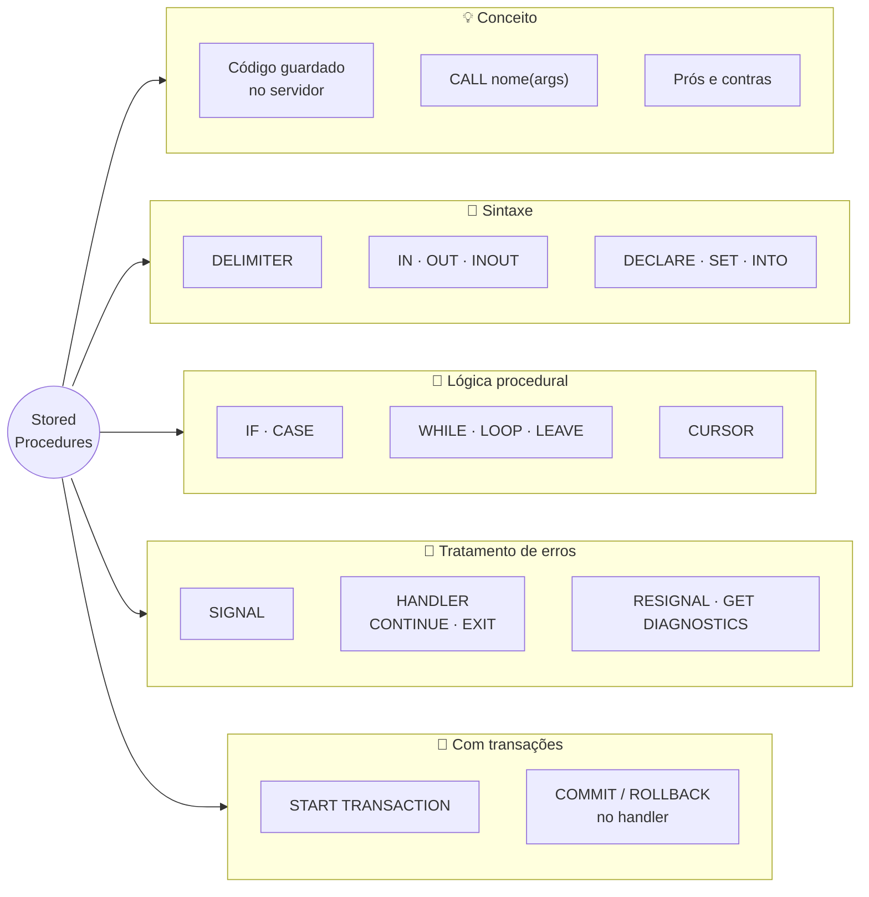
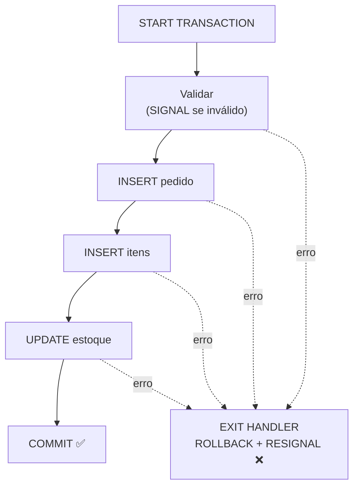

# Tópico 09 — Stored Procedures

**Disciplina:** Banco de Dados — Relacional (IBD015)
**Professor:** Ronan Adriel Zenatti · ronan.zenatti@cps.sp.gov.br
**Fatec Jahu — 2º Semestre/2026**

---

## 🎯 Objetivos do Tópico

Ao final deste tópico você deverá ser capaz de:

- Explicar o que é uma *stored procedure*, quando ela vale a pena e quais são seus custos;
- Criar e executar procedures no MariaDB com parâmetros `IN`, `OUT` e `INOUT`, variáveis locais e a instrução `DELIMITER`;
- Aplicar lógica procedural: `IF`/`CASE`, laços (`WHILE`, `LOOP`) e cursores;
- Validar entradas e tratar erros com `SIGNAL`, `DECLARE ... HANDLER`, `RESIGNAL` e `GET DIAGNOSTICS`;
- Combinar procedures e transações para garantir que uma operação de negócio aconteça por inteiro ou não aconteça.

---

## 🗺️ Mapa Mental do Tópico



---

## 🧭 Contexto

Até aqui, toda a lógica que você escreveu em SQL vivia **fora** do banco: cada comando era enviado por um cliente (o terminal, o phpMyAdmin, uma aplicação), executado e esquecido. Mas pense no que acontece quando alguém cadastra um pedido no `loja_virtual`: conferir o estoque, criar o pedido, criar os itens, baixar o estoque, tudo dentro de uma transação. São cinco ou seis comandos, e **todo sistema** que vende produtos (o site, o app, o PDV da loja física) precisa repetir exatamente a mesma sequência, sem errar nenhum passo.

Uma ***stored procedure*** (procedimento armazenado) é um **bloco de código SQL com nome, guardado no servidor**. Em vez de cada sistema reimplementar a sequência, todos chamam `CALL sp_registrar_pedido(...)` e o banco executa. Os exemplos usam o `loja_virtual` com a carga ampliada do [Tópico 06](Topico_06_SQL_DQL_Agregacao.md).

### Para que serve — e quando não usar

| Vantagens | Desvantagens |
|---|---|
| **Reuso e consistência:** a regra mora em um só lugar; todos os sistemas a seguem | **Lógica de negócio dividida** entre a aplicação e o banco — mais difícil de entender e versionar |
| **Menos tráfego de rede:** uma chamada no lugar de várias idas e vindas | **Portabilidade baixa:** a linguagem procedural muda de SGBD (PL/pgSQL, T-SQL, PL/SQL...) |
| **Segurança:** o usuário pode ter permissão de `EXECUTE` na procedure sem acesso direto às tabelas (Tópico 12) | **Depuração e testes** mais difíceis que no código da aplicação |
| **Atomicidade:** transações inteiras encapsuladas | Consome CPU do servidor de banco (um recurso mais caro de escalar) |

> 💡 Não existe resposta universal. Regras que precisam ser **impostas a qualquer cliente** e operações que fazem muitas escritas encadeadas costumam ser boas candidatas; lógica de apresentação, formatação e regras que mudam toda semana normalmente ficam melhor na aplicação.

> 📌 **Convenção de nomes desta disciplina** (extensão das 9 regras para objetos programáveis): procedures levam o prefixo `sp_` (*stored procedure*) e `snake_case` em minúsculas — `sp_registrar_pedido`; **parâmetros** levam o prefixo `p_` (`p_cliente_id`) e **variáveis locais** o prefixo `v_` (`v_estoque`). Veja na Seção 2.3 por que o prefixo nos parâmetros não é só estética.

---

## 1. Criando e Chamando uma Procedure

### 1.1 O comando `DELIMITER`

O terminal do MariaDB (e o phpMyAdmin) termina cada comando no primeiro `;` que encontra. Só que o **corpo** de uma procedure tem vários `;` dentro. Sem ajuda, o cliente cortaria a definição no primeiro. Por isso trocamos temporariamente o terminador:

```sql
DELIMITER $$                      -- agora o fim de um comando é $$, não ;

CREATE PROCEDURE sp_listar_pedidos_cliente(IN p_cliente_id BIGINT UNSIGNED)
BEGIN
    SELECT id_pedido, data_pedido, status, valor_total
    FROM   pedidos
    WHERE  cliente_id = p_cliente_id
    ORDER BY data_pedido DESC;
END$$                             -- encerra o CREATE PROCEDURE

DELIMITER ;                       -- volta ao ; normal
```

(`DELIMITER` é um comando do **cliente** `mysql`, não do servidor — por isso ele não existe em chamadas feitas por uma aplicação. No phpMyAdmin, use o campo "Delimitador" abaixo da caixa de SQL.)

```sql
CALL sp_listar_pedidos_cliente(1);       -- devolve os 3 pedidos da Ana Lima
```

### 1.2 Gerenciando procedures

```sql
SHOW PROCEDURE STATUS WHERE Db = 'loja_virtual';        -- lista as procedures do banco
SHOW CREATE PROCEDURE sp_listar_pedidos_cliente;        -- mostra o código completo

DROP PROCEDURE IF EXISTS sp_listar_pedidos_cliente;     -- remove (use antes de recriar)
```

> 📌 Procedures **não têm o corpo alterado** com `ALTER PROCEDURE` (que só muda características como `SQL SECURITY` e o comentário) — para mudar a lógica, recria-se. No MariaDB isso pode ser feito em um só comando com `CREATE OR REPLACE PROCEDURE ...` (disponível desde a versão 10.1.3), mas essa forma **não existe no MySQL**; o par `DROP PROCEDURE IF EXISTS` + `CREATE PROCEDURE` funciona nos dois e é o que usamos nos scripts da disciplina.

!!! example "🔍 Checkpoint 1 — Procedure simples: clínica veterinária digital"
    Uma clínica veterinária digital tem `consultas_vet (id_consulta PK, pet_id FK, veterinario_id FK, data_hora, status)`, com `status` em `'agendada'`, `'realizada'` ou `'cancelada'`. Escreva a procedure `sp_agenda_do_veterinario(p_veterinario_id, p_data)` que devolva `id_consulta`, `pet_id`, o horário (apenas a hora, como `horario`) e o `status` das consultas **não canceladas** daquele veterinário naquele dia, em ordem de horário. Mostre também a chamada para o veterinário 5 no dia `2026-11-03`.

    🔑 Resolução no [Gabarito do Tópico 09](Topico_09_Gabarito.md#checkpoint-1) — tente resolver antes de conferir.

---

## 2. Parâmetros, Variáveis e Expressões

### 2.1 Os três modos de parâmetro

| Modo | Direção | Uso típico |
|---|---|---|
| `IN` (padrão) | Valor entra na procedure; alterações dentro dela **não** voltam | Filtros e dados de entrada (`p_cliente_id`) |
| `OUT` | Procedure devolve um valor ao chamador; o valor inicial é ignorado | Resultados escalares (total, id gerado, mensagem) |
| `INOUT` | Entra com um valor e sai (possivelmente alterado) | Acumuladores, contadores |

```sql
DELIMITER $$
CREATE PROCEDURE sp_total_gasto_cliente(
    IN  p_cliente_id  BIGINT UNSIGNED,
    OUT p_total       DECIMAL(12, 2)
)
BEGIN
    SELECT COALESCE(SUM(valor_total), 0)
    INTO   p_total                                -- SELECT ... INTO grava o resultado na variável
    FROM   pedidos
    WHERE  cliente_id = p_cliente_id
      AND  status <> 'cancelado';
END$$
DELIMITER ;

-- Parâmetros OUT recebem uma variável de sessão (prefixo @) para guardar o resultado:
CALL sp_total_gasto_cliente(1, @total);
SELECT @total AS total_da_ana;                    -- 4689.51
```

> ⚠️ **`SELECT ... INTO` espera exatamente uma linha.** Com zero linhas, as variáveis **ficam como estavam** (`NULL`, se nunca receberam valor) e o MariaDB só emite um *warning* de "No data" (a condição `NOT FOUND`, que um handler pode capturar); com mais de uma linha há erro `1172 Result consisted of more than one row`. Quando houver risco de várias linhas, agregue (`SUM`, `MAX`) ou use `LIMIT 1`.

### 2.2 Variáveis locais e `SET`

Variáveis locais são declaradas com `DECLARE` **no início do bloco** (antes de qualquer outro comando) e só existem dentro dele:

```sql
DECLARE v_total   DECIMAL(12, 2) DEFAULT 0;     -- tipo obrigatório; DEFAULT opcional
DECLARE v_nivel   VARCHAR(20);

SET v_total = v_total + 100;                    -- atribuição de expressão
SELECT SUM(valor_total) INTO v_total FROM pedidos;   -- atribuição por consulta
```

Não confunda com as **variáveis de sessão** `@nome`, que não precisam de `DECLARE`, vivem enquanto a conexão estiver aberta e servem para passar valores de/para procedures (`CALL ..., @saida`).

### 2.3 A armadilha do parâmetro com nome de coluna

Se o parâmetro tiver o **mesmo nome** de uma coluna, dentro da consulta o nome é interpretado como a **coluna** — e o erro é silencioso:

```sql
CREATE PROCEDURE sp_armadilha(IN cliente_id BIGINT UNSIGNED)
BEGIN
    SELECT COUNT(*) FROM pedidos WHERE cliente_id = cliente_id;   -- sempre verdadeiro!
END;

CALL sp_armadilha(1);     -- devolve a contagem de TODOS os pedidos, não só os do cliente 1
```

O prefixo `p_` (parâmetros) e `v_` (variáveis) elimina esse problema de raiz: `WHERE cliente_id = p_cliente_id` não deixa dúvida de quem é quem.

### 2.4 `IF` e `CASE`

```sql
DELIMITER $$
CREATE PROCEDURE sp_classificar_cliente(
    IN  p_cliente_id  BIGINT UNSIGNED,
    OUT p_nivel       VARCHAR(20)
)
BEGIN
    DECLARE v_total DECIMAL(12, 2) DEFAULT 0;

    CALL sp_total_gasto_cliente(p_cliente_id, v_total);    -- procedures podem chamar procedures

    IF v_total >= 5000 THEN
        SET p_nivel = 'ouro';
    ELSEIF v_total >= 3000 THEN
        SET p_nivel = 'prata';
    ELSEIF v_total > 0 THEN
        SET p_nivel = 'bronze';
    ELSE
        SET p_nivel = 'sem compras';
    END IF;
END$$
DELIMITER ;

CALL sp_classificar_cliente(7, @nivel);  SELECT @nivel;     -- ouro   (R$ 5.423,71)
CALL sp_classificar_cliente(3, @nivel);  SELECT @nivel;     -- bronze (R$ 1.518,80)
```

> 📌 Repare que `p_nivel` é `VARCHAR(20)` — com `VARCHAR(10)`, o valor `'sem compras'` (11 caracteres) seria rejeitado pelo modo estrito com `ERROR 1406 Data too long`. Dimensione parâmetros e variáveis como colunas: com o maior valor possível em mente (Regra 8).

Além do `IF`, a procedure pode usar a instrução `CASE` com a mesma ideia do `CASE` de expressão que você viu no Tópico 06:

```sql
CASE v_nivel
    WHEN 'ouro'  THEN SET v_desconto = 15;
    WHEN 'prata' THEN SET v_desconto = 8;
    ELSE              SET v_desconto = 0;
END CASE;
```

!!! example "🔍 Checkpoint 2 — Parâmetro OUT: carteira digital"
    Uma fintech guarda cada lançamento em `movimentacoes (id_movimentacao PK, conta_id FK, tipo, valor, ocorrida_em)`, com `tipo` em `'credito'` ou `'debito'`. Escreva a procedure `sp_saldo_conta(p_conta_id, p_saldo)` com `p_saldo` como parâmetro `OUT`, que calcule o saldo (créditos menos débitos) e devolva `0` — e não `NULL` — para uma conta sem nenhum lançamento. Mostre as duas linhas de SQL que chamam a procedure e exibem o resultado.

    🔑 Resolução no [Gabarito do Tópico 09](Topico_09_Gabarito.md#checkpoint-2) — tente resolver antes de conferir.

---

## 3. Validação e Tratamento de Erros

Uma procedure de verdade precisa **recusar entradas inválidas** e **reagir a falhas** sem deixar o banco pela metade. O MariaDB oferece três ferramentas que trabalham juntas.

### 3.1 `SIGNAL` — gerando um erro de propósito

O `SIGNAL` interrompe a procedure e devolve ao chamador um erro **com a mensagem que você escolher**. O `SQLSTATE '45000'` é, por convenção, o código para "exceção definida pelo usuário":

```sql
DELIMITER $$
CREATE PROCEDURE sp_reajustar_precos_categoria(
    IN p_categoria_id  BIGINT UNSIGNED,
    IN p_percentual    DECIMAL(5, 2)
)
BEGIN
    IF p_percentual < -50 OR p_percentual > 100 THEN
        SIGNAL SQLSTATE '45000'
            SET MESSAGE_TEXT = 'Percentual de reajuste fora do intervalo permitido (-50 a 100)';
    END IF;

    IF NOT EXISTS (SELECT 1 FROM categorias WHERE id_categoria = p_categoria_id) THEN
        SIGNAL SQLSTATE '45000' SET MESSAGE_TEXT = 'Categoria inexistente';
    END IF;

    UPDATE produtos
    SET    preco = ROUND(preco * (1 + p_percentual / 100), 2)
    WHERE  categoria_id = p_categoria_id
      AND  ativo = 1;

    SELECT ROW_COUNT() AS produtos_reajustados;      -- linhas afetadas pelo UPDATE
END$$
DELIMITER ;

CALL sp_reajustar_precos_categoria(2, 10);      -- reajusta 4 produtos
CALL sp_reajustar_precos_categoria(2, 500);
-- ERROR 1644 (45000): Percentual de reajuste fora do intervalo permitido (-50 a 100)
```

### 3.2 `DECLARE ... HANDLER` — reagindo a erros

Um *handler* diz ao MariaDB o que fazer quando uma condição de erro ocorre **dentro do bloco**:

```sql
DECLARE {CONTINUE | EXIT} HANDLER FOR condicao  ação;
```

| Parte | Opções | Significado |
|---|---|---|
| Tipo | `CONTINUE` | Executa a ação e **segue** com o próximo comando |
| | `EXIT` | Executa a ação e **sai** do bloco `BEGIN...END` atual |
| Condição | `SQLEXCEPTION` | Qualquer erro SQL (violações de constraint, tabela inexistente...) |
| | `NOT FOUND` | Um cursor chegou ao fim (ou `SELECT INTO` sem linhas) |
| | `1062` / `SQLSTATE '23000'` | Um código de erro ou `SQLSTATE` específico |

```sql
DELIMITER $$
CREATE PROCEDURE sp_tentar_inserir_categoria(IN p_nome VARCHAR(255), OUT p_mensagem VARCHAR(255))
BEGIN
    -- Handler específico: nome duplicado (erro 1062)
    DECLARE EXIT HANDLER FOR 1062
    BEGIN
        SET p_mensagem = CONCAT('Categoria "', p_nome, '" já existe');
    END;

    -- Handler genérico: qualquer outro erro, com o diagnóstico completo
    DECLARE EXIT HANDLER FOR SQLEXCEPTION
    BEGIN
        GET DIAGNOSTICS CONDITION 1
            @codigo = MYSQL_ERRNO, @texto = MESSAGE_TEXT;
        SET p_mensagem = CONCAT('Erro ', @codigo, ': ', @texto);
    END;

    INSERT INTO categorias (nome) VALUES (p_nome);
    SET p_mensagem = 'Categoria criada com sucesso';
END$$
DELIMITER ;

CALL sp_tentar_inserir_categoria('Brinquedos', @m);  SELECT @m;   -- Categoria criada com sucesso
CALL sp_tentar_inserir_categoria('Brinquedos', @m);  SELECT @m;   -- Categoria "Brinquedos" já existe
CALL sp_tentar_inserir_categoria(NULL, @m);          SELECT @m;   -- Erro 1048: Column 'nome' cannot be null
```

O `GET DIAGNOSTICS` lê detalhes do erro corrente (`MYSQL_ERRNO`, `RETURNED_SQLSTATE`, `MESSAGE_TEXT`). O `RESIGNAL` (usado na próxima seção) **relança** o erro original depois que o handler fez sua limpeza.

!!! tip "✅ Verificação Rápida — SIGNAL, HANDLER e tipos de handler"
    Bloco conceitual — confira o entendimento com os dois quizzes abaixo. A resposta é revelada na hora.

<quiz>
Qual a diferença entre um handler CONTINUE e um handler EXIT?
- [ ] CONTINUE trata erros de SQL e EXIT trata apenas warnings
- [x] Após executar a ação, CONTINUE segue com o comando seguinte; EXIT abandona o bloco BEGIN...END atual
- [ ] CONTINUE reverte a transação e EXIT a confirma
- [ ] Não há diferença: são apelidos um do outro

O CONTINUE HANDLER é útil para eventos esperados que não devem interromper a rotina (como o fim de um cursor, com NOT FOUND). O EXIT HANDLER encerra o bloco onde foi declarado, típico para tratar falhas com limpeza (ROLLBACK).
</quiz>

<quiz>
Para que serve o SIGNAL SQLSTATE '45000' SET MESSAGE_TEXT = '...' dentro de uma procedure?
- [ ] Para registrar uma mensagem em um arquivo de log do servidor
- [x] Para interromper a procedure e devolver ao chamador um erro com mensagem personalizada
- [ ] Para exibir uma mensagem na tela sem interromper a execução
- [ ] Para criar um novo handler automaticamente

O SIGNAL levanta uma condição de erro definida pelo desenvolvedor (SQLSTATE 45000 = exceção do usuário), que interrompe a execução e chega ao chamador como um erro normal (1644), podendo ser capturado por handlers.
</quiz>

!!! example "🔍 Checkpoint 3 — IF/CASE com validação: ranking de e-sports"
    Um jogo competitivo classifica os jogadores por pontos: abaixo de 1000, `'Bronze'`; de 1000 a 1999, `'Prata'`; de 2000 a 2999, `'Ouro'`; 3000 ou mais, `'Diamante'`. Escreva `sp_definir_tier(p_pontos, p_tier)` (com `p_tier` `OUT`) que devolva a categoria e **rejeite pontuação negativa** com a mensagem `'Pontuação não pode ser negativa'`.

    🔑 Resolução no [Gabarito do Tópico 09](Topico_09_Gabarito.md#checkpoint-3) — tente resolver antes de conferir.

### 3.3 Laços: `WHILE`, `REPEAT` e `LOOP`

```sql
DELIMITER $$
CREATE PROCEDURE sp_gerar_parcelas(
    IN p_contrato_id         BIGINT UNSIGNED,
    IN p_valor_total         DECIMAL(10, 2),
    IN p_qtd                 TINYINT UNSIGNED,
    IN p_primeiro_vencimento DATE
)
BEGIN
    DECLARE v_numero         TINYINT UNSIGNED DEFAULT 1;
    DECLARE v_valor_parcela  DECIMAL(10, 2);

    IF p_qtd = 0 THEN
        SIGNAL SQLSTATE '45000' SET MESSAGE_TEXT = 'Informe ao menos 1 parcela';
    END IF;

    SET v_valor_parcela = ROUND(p_valor_total / p_qtd, 2);

    WHILE v_numero <= p_qtd DO
        INSERT INTO parcelas (contrato_id, numero, valor, vencimento)
        VALUES (
            p_contrato_id,
            v_numero,
            -- a última parcela absorve a diferença de centavos do arredondamento
            IF(v_numero = p_qtd, p_valor_total - v_valor_parcela * (p_qtd - 1), v_valor_parcela),
            DATE_ADD(p_primeiro_vencimento, INTERVAL v_numero - 1 MONTH)
        );
        SET v_numero = v_numero + 1;
    END WHILE;
END$$
DELIMITER ;

CALL sp_gerar_parcelas(1, 1000.00, 3, '2026-11-10');
-- 333,33 em 10/11/2026 · 333,33 em 10/12/2026 · 333,34 em 10/01/2027  (soma: 1000,00)
```

(Para executar esse exemplo, crie antes uma tabela `parcelas` com `id_parcela`, `contrato_id`, `numero`, `valor` e `vencimento` — é o tipo de tabela que um financiamento de painéis solares usaria.)

Os três laços do MariaDB:

| Laço | Condição testada | Quando usar |
|---|---|---|
| `WHILE cond DO ... END WHILE` | **antes** de cada volta | Quando pode não rodar nenhuma vez |
| `REPEAT ... UNTIL cond END REPEAT` | **depois** de cada volta | Quando precisa rodar pelo menos uma vez |
| `LOOP ... END LOOP` | nenhuma — sai com `LEAVE rótulo` | Laços com saída no meio (típico com cursor); `ITERATE rótulo` pula para a próxima volta |

### 3.4 Cursores — percorrendo um resultado linha a linha

SQL costuma trabalhar com **conjuntos** (um `UPDATE` age em todas as linhas de uma vez). Raramente é preciso processar linha por linha; quando é (por exemplo, para chamar outra procedure para cada linha), usa-se um **cursor**: `DECLARE` do cursor → `OPEN` → `FETCH` em laço → `CLOSE`. O fim das linhas é sinalizado pelo handler `NOT FOUND`.

```sql
DELIMITER $$
CREATE PROCEDURE sp_gerar_alertas_reposicao(IN p_limite INT UNSIGNED, OUT p_alertas INT)
BEGIN
    DECLARE v_produto_id  BIGINT UNSIGNED;
    DECLARE v_estoque     INT UNSIGNED;
    DECLARE v_fim         TINYINT DEFAULT 0;

    DECLARE cur_baixo CURSOR FOR                       -- 1) declara o cursor (a consulta)
        SELECT id_produto, estoque
        FROM   produtos
        WHERE  ativo = 1 AND estoque < p_limite;

    DECLARE CONTINUE HANDLER FOR NOT FOUND SET v_fim = 1;   -- 2) quando acabar, liga a "bandeira"

    SET p_alertas = 0;
    OPEN cur_baixo;                                    -- 3) abre

    laco: LOOP
        FETCH cur_baixo INTO v_produto_id, v_estoque;  -- 4) lê a próxima linha
        IF v_fim = 1 THEN
            LEAVE laco;
        END IF;

        INSERT INTO alertas_reposicao (produto_id, estoque_atual)
        VALUES (v_produto_id, v_estoque);
        SET p_alertas = p_alertas + 1;
    END LOOP laco;

    CLOSE cur_baixo;                                   -- 5) fecha
END$$
DELIMITER ;

CALL sp_gerar_alertas_reposicao(10, @n);
SELECT @n;     -- 3 produtos com estoque < 10: Monitor LG, Headset e Cadeira
```

> ⚠️ **Cursor é a última opção, não a primeira.** Percorrer linha a linha é muito mais lento que uma operação em conjunto. O exemplo acima faria o mesmo, mais rápido e em uma linha, com `INSERT INTO alertas_reposicao (produto_id, estoque_atual) SELECT id_produto, estoque FROM produtos WHERE ativo = 1 AND estoque < 10;`. Use cursor somente quando cada linha exigir uma lógica que o SQL em conjunto não consegue expressar.

!!! example "🔍 Checkpoint 4 — Cursor e alternativa em conjunto: manutenção de drones"
    Uma operação de entrega por drone registra `drones (id_drone PK, modelo, horas_voo, em_manutencao)` e `manutencoes (id_manutencao PK, drone_id FK, motivo, aberta_em)`. Escreva `sp_abrir_manutencoes(p_limite_horas, p_abertas)` que, **com um cursor**, abra uma manutenção (motivo `'Revisão preventiva por horas de voo'`) para cada drone com `horas_voo >= p_limite_horas` que ainda **não** esteja em manutenção, marque o drone como `em_manutencao = 1` e devolva em `p_abertas` quantas foram abertas. Depois escreva a mesma lógica **sem cursor** (em conjunto) e diga qual das duas você usaria em produção.

    🔑 Resolução no [Gabarito do Tópico 09](Topico_09_Gabarito.md#checkpoint-4) — tente resolver antes de conferir.

---

## 4. Procedures e Transações: Tudo ou Nada

O caso de uso que mais justifica uma procedure é a **operação de negócio composta** — várias escritas que só fazem sentido juntas. Você viu `BEGIN/COMMIT/ROLLBACK` no Tópico 04; dentro de uma procedure, o padrão é combiná-los com um `EXIT HANDLER FOR SQLEXCEPTION`:



```sql
DELIMITER $$
CREATE PROCEDURE sp_registrar_pedido(
    IN  p_cliente_id  BIGINT UNSIGNED,
    IN  p_produto_id  BIGINT UNSIGNED,
    IN  p_quantidade  INT UNSIGNED,
    OUT p_pedido_id   BIGINT UNSIGNED
)
BEGIN
    DECLARE v_preco    DECIMAL(10, 2);
    DECLARE v_estoque  INT UNSIGNED;

    -- Qualquer erro SQL abaixo desfaz tudo e reenvia o erro original ao chamador
    DECLARE EXIT HANDLER FOR SQLEXCEPTION
    BEGIN
        ROLLBACK;
        RESIGNAL;
    END;

    IF p_quantidade = 0 THEN
        SIGNAL SQLSTATE '45000' SET MESSAGE_TEXT = 'Quantidade deve ser maior que zero';
    END IF;

    START TRANSACTION;

    -- FOR UPDATE trava a linha do produto até o fim da transação (detalhes no Tópico 11)
    SELECT preco, estoque
    INTO   v_preco, v_estoque
    FROM   produtos
    WHERE  id_produto = p_produto_id AND ativo = 1
    FOR UPDATE;

    IF v_preco IS NULL THEN
        SIGNAL SQLSTATE '45000' SET MESSAGE_TEXT = 'Produto inexistente ou inativo';
    END IF;

    IF v_estoque < p_quantidade THEN
        SIGNAL SQLSTATE '45000' SET MESSAGE_TEXT = 'Estoque insuficiente';
    END IF;

    INSERT INTO pedidos (cliente_id, status, valor_total)
    VALUES (p_cliente_id, 'pendente', v_preco * p_quantidade);

    SET p_pedido_id = LAST_INSERT_ID();

    INSERT INTO itens_pedidos (pedido_id, produto_id, quantidade, preco_unitario)
    VALUES (p_pedido_id, p_produto_id, p_quantidade, v_preco);

    UPDATE produtos
    SET    estoque = estoque - p_quantidade
    WHERE  id_produto = p_produto_id;

    COMMIT;
END$$
DELIMITER ;
```

Testando os caminhos feliz e de erro:

```sql
CALL sp_registrar_pedido(11, 3, 2, @novo);     -- ok: estoque do mouse 50 → 48, pedido 16 criado
SELECT @novo;                                  -- 16

CALL sp_registrar_pedido(11, 3, 9999, @x);     -- ERROR 1644: Estoque insuficiente
CALL sp_registrar_pedido(11, 777, 1, @x);      -- ERROR 1644: Produto inexistente ou inativo
CALL sp_registrar_pedido(999, 3, 1, @x);       -- ERROR 1452: cliente inexistente (FK) → ROLLBACK automático pelo handler
```

Repare no último caso: o erro `1452` **não** foi escrito por nós — veio da `FOREIGN KEY`. O `EXIT HANDLER FOR SQLEXCEPTION` captura **qualquer** erro, executa o `ROLLBACK` e o `RESIGNAL` repassa o erro original ao chamador. Nenhum registro parcial fica no banco.

### E sem o handler?

```sql
CREATE PROCEDURE sp_sem_handler()
BEGIN
    START TRANSACTION;
    UPDATE produtos SET estoque = estoque - 1 WHERE id_produto = 3;
    INSERT INTO pedidos (cliente_id) VALUES (999);     -- falha: FK
    COMMIT;
END;

CALL sp_sem_handler();            -- ERROR 1452
SELECT @@in_transaction;          -- 1  ← a transação continua ABERTA!
SELECT estoque FROM produtos WHERE id_produto = 3;    -- 49 (o UPDATE ficou "pendurado")
```

O erro interrompe a procedure **antes** do `COMMIT`, mas **não** desfaz nada sozinho: a transação continua aberta, segurando travas e com o `UPDATE` visível apenas para a sua conexão. Quem chamou precisa lembrar de dar `ROLLBACK`. Colocar o handler dentro da própria procedure elimina essa dependência.

### Outro exemplo: cancelar um pedido

```sql
DELIMITER $$
CREATE PROCEDURE sp_cancelar_pedido(IN p_pedido_id BIGINT UNSIGNED)
BEGIN
    DECLARE v_status VARCHAR(20);

    DECLARE EXIT HANDLER FOR SQLEXCEPTION
    BEGIN
        ROLLBACK;
        RESIGNAL;
    END;

    START TRANSACTION;

    SELECT status INTO v_status FROM pedidos WHERE id_pedido = p_pedido_id FOR UPDATE;

    IF v_status IS NULL THEN
        SIGNAL SQLSTATE '45000' SET MESSAGE_TEXT = 'Pedido inexistente';
    ELSEIF v_status IN ('cancelado', 'entregue') THEN
        SIGNAL SQLSTATE '45000' SET MESSAGE_TEXT = 'Pedido já finalizado ou cancelado não pode ser cancelado';
    END IF;

    -- devolve ao estoque as unidades de cada item do pedido
    UPDATE produtos p
    INNER JOIN itens_pedidos i ON i.produto_id = p.id_produto
    SET    p.estoque = p.estoque + i.quantidade
    WHERE  i.pedido_id = p_pedido_id;

    UPDATE pedidos SET status = 'cancelado' WHERE id_pedido = p_pedido_id;

    COMMIT;
END$$
DELIMITER ;
```

Compare com o cancelamento "manual" do Tópico 04 (Seção 4.3): lá o aluno digitava as duas atualizações a cada cancelamento; aqui a regra inteira — inclusive as validações — está encapsulada e é a mesma para todos os sistemas.

!!! example "🔍 Checkpoint 5 — Procedure transacional: aluguel de bicicletas elétricas"
    Um sistema de bike-sharing elétrico tem `bicicletas (id_bicicleta PK, modelo, nivel_bateria, disponivel)` e `alugueis (id_aluguel PK, usuario_id FK, bicicleta_id FK, iniciado_em, finalizado_em)`. Escreva `sp_iniciar_aluguel(p_usuario_id, p_bicicleta_id, p_aluguel_id)` que, **dentro de uma transação**: (1) rejeite com mensagens claras se a bicicleta **não existir**, **estiver indisponível** ou tiver **bateria abaixo de 20%**; (2) caso contrário, crie o registro em `alugueis`, devolva o id gerado em `p_aluguel_id` e marque a bicicleta como indisponível; (3) em qualquer erro, desfaça tudo e relance o erro original.

    🔑 Resolução no [Gabarito do Tópico 09](Topico_09_Gabarito.md#checkpoint-5) — tente resolver antes de conferir.

---

## 5. Segurança e Comparação com o PostgreSQL

### 5.1 `SQL SECURITY` e permissão de execução

Toda procedure roda com os privilégios de alguém. Duas opções:

| Opção | Roda com os privilégios de... | Uso |
|---|---|---|
| `SQL SECURITY DEFINER` (padrão) | quem **criou** a procedure | Dá a um usuário acesso a **operações** específicas sem dar acesso às tabelas |
| `SQL SECURITY INVOKER` | quem **chamou** | A procedure respeita exatamente as permissões do chamador |

Com `DEFINER`, um usuário que só tenha `GRANT EXECUTE ON PROCEDURE loja_virtual.sp_registrar_pedido` consegue registrar pedidos mas **não** consegue fazer `SELECT` nem `DELETE` direto nas tabelas — a procedure vira a única porta de entrada. Voltaremos a isso no Tópico 12.

```sql
ALTER PROCEDURE sp_total_gasto_cliente SQL SECURITY INVOKER COMMENT 'Total gasto por cliente (sem cancelados)';
```

### 5.2 MariaDB × PostgreSQL

No 1º semestre você usou o PostgreSQL. Os conceitos se repetem, a sintaxe muda:

| Aspecto | MariaDB / MySQL | PostgreSQL |
|---|---|---|
| Criar | `CREATE PROCEDURE ... BEGIN ... END` (com `DELIMITER` no cliente) | `CREATE PROCEDURE ... LANGUAGE plpgsql AS $$ ... $$` |
| Chamar | `CALL sp_nome(args)` | `CALL sp_nome(args)` (procedures a partir do PG 11) |
| Variáveis | `DECLARE v_x INT;` no início do bloco | `DECLARE v_x INT;` na seção `DECLARE` |
| Lançar erro | `SIGNAL SQLSTATE '45000' SET MESSAGE_TEXT = '...'` | `RAISE EXCEPTION '...'` |
| Capturar erro | `DECLARE ... HANDLER FOR ...` | Bloco `EXCEPTION WHEN ... THEN ...` |
| Parâmetro `OUT` | Variável de sessão `@x` na chamada | Valor retornado pela própria chamada `CALL` |

(O MariaDB também oferece, desde a versão 10.3, um modo de compatibilidade com a sintaxe PL/SQL do Oracle — `SET sql_mode = 'ORACLE'` —, que fica fora do escopo da disciplina.)

---

## 6. Exercícios de Fixação

> 🔑 As resoluções destes cinco exercícios estão no [Gabarito do Tópico 09](Topico_09_Gabarito.md) — tente resolver antes de conferir. Use o `loja_virtual` com a carga ampliada do Tópico 06.

**Exercício 1:** crie `sp_listar_produtos_categoria(p_categoria_id)` que devolva `id_produto`, `nome`, `preco` e `estoque` dos produtos **ativos** da categoria, do mais caro para o mais barato. Teste com a categoria 2.

**Exercício 2:** crie `sp_total_vendido_periodo(p_inicio, p_fim, p_total)` (com `p_total` `OUT`) que devolva o valor total dos pedidos **não cancelados** feitos entre as duas datas (inclusive). Cuidado: `data_pedido` é `DATETIME`. Teste com o período de `2026-04-01` a `2026-06-30`.

**Exercício 3:** crie `sp_reajustar_estoque_minimo(p_categoria_id, p_quantidade)` que **some** `p_quantidade` ao estoque de todos os produtos ativos da categoria. Valide: a quantidade deve estar entre 1 e 1000 e a categoria deve existir. Devolva quantos produtos foram afetados.

**Exercício 4:** crie `sp_classificar_produto(p_produto_id, p_faixa)` que devolva `'econômico'` (preço < 200), `'intermediário'` (< 1000) ou `'premium'`, e erro `'Produto inexistente'` se o id não existir. Use `IF`/`ELSEIF`.

**Exercício 5:** explique, com suas palavras, o que acontece se a procedure `sp_registrar_pedido` **não** tivesse o `EXIT HANDLER ... ROLLBACK; RESIGNAL;` e a inserção em `itens_pedidos` falhasse. Quais registros ficariam no banco e por quê?

---

## 📚 Referências deste Tópico

- ELMASRI, R.; NAVATHE, S. B. *Sistemas de Banco de Dados*. 7 ed. Cap. 10.2 — Procedimentos armazenados. São Paulo: Pearson, 2018.
- SILBERSCHATZ, A.; SUNDARSHAN, S.; KORTH, H. F. *Sistema de banco de dados*. Cap. 5.2 — Funções e procedimentos. Rio de Janeiro: Elsevier Brasil, 2016.
- Documentação oficial do MariaDB — [Stored Procedures](https://mariadb.com/kb/en/stored-procedures/), [SIGNAL](https://mariadb.com/kb/en/signal/), [DECLARE HANDLER](https://mariadb.com/kb/en/declare-handler/), [Cursors](https://mariadb.com/kb/en/cursors/), [GET DIAGNOSTICS](https://mariadb.com/kb/en/get-diagnostics/)

---

## 🃏 Flashcards de Revisão

??? question "O que é uma stored procedure e como ela é executada?"
    É um bloco de código SQL com nome, guardado e executado **no servidor**. Executa-se
    com `CALL nome(argumentos)`. Pode ter parâmetros `IN`, `OUT` e `INOUT`, variáveis
    locais, condicionais, laços e tratamento de erros.

??? question "Para que serve o DELIMITER e por que ele existe?"
    O cliente `mysql` termina cada comando no primeiro `;`. Como o corpo da procedure
    contém vários `;`, troca-se temporariamente o terminador (`DELIMITER $$`) para que o
    `CREATE PROCEDURE` seja enviado inteiro. É um comando do cliente, não do servidor.

??? question "Qual a diferença entre parâmetros IN, OUT e INOUT?"
    `IN` só entra (padrão); `OUT` só sai — é a forma de devolver um valor escalar; `INOUT`
    entra com um valor e sai possivelmente modificado. Para receber um `OUT` usa-se uma
    variável de sessão (`CALL sp(1, @saida)`).

??? question "Qual a combinação clássica para tornar uma procedure 'tudo ou nada'?"
    `START TRANSACTION` + `DECLARE EXIT HANDLER FOR SQLEXCEPTION BEGIN ROLLBACK; RESIGNAL; END`
    + `COMMIT` no final. Qualquer erro desfaz tudo e o erro original é repassado ao chamador.

??? question "Pegadinha: por que um parâmetro com o mesmo nome de uma coluna é perigoso?"
    Dentro da consulta, o nome é interpretado como a **coluna**, não como o parâmetro:
    `WHERE cliente_id = cliente_id` é sempre verdadeiro e traz todas as linhas, sem
    nenhum erro. Prefixar parâmetros com `p_` (e variáveis com `v_`) elimina o problema.

??? question "Por que evitar cursores quando possível?"
    Porque processam linha a linha, muito mais lentamente que operações em conjunto (um
    `INSERT ... SELECT` ou `UPDATE` único). Cursor é a última opção, para lógica que o SQL
    declarativo não consegue expressar.

---

## ✅ Quiz de Fixação

<quiz>
Dada CREATE PROCEDURE sp_x(IN p_id INT, OUT p_resultado VARCHAR(20)), qual é a forma correta de chamá-la e ler o resultado?
- [ ] SELECT sp_x(1);
- [ ] CALL sp_x(1); SELECT p_resultado;
- [x] CALL sp_x(1, @r); SELECT @r;
- [ ] EXEC sp_x 1;

Procedures são chamadas com CALL; o parâmetro OUT precisa receber uma variável de sessão (@r), que depois pode ser consultada com SELECT. SELECT nome(...) é a sintaxe de funções, não de procedures.
</quiz>

<quiz>
O que acontece se uma procedure com START TRANSACTION falha no meio, e ela NÃO tem nenhum handler de erro?
- [ ] O MariaDB desfaz automaticamente a transação
- [x] A transação continua aberta, com as alterações anteriores pendentes, até alguém dar COMMIT ou ROLLBACK
- [ ] O MariaDB confirma automaticamente o que já foi feito
- [ ] A conexão é encerrada

O erro interrompe a procedure, mas não encerra a transação. Por isso o padrão é incluir um EXIT HANDLER FOR SQLEXCEPTION com ROLLBACK (e RESIGNAL) dentro da própria procedure.
</quiz>

<quiz>
Marque todas as afirmações corretas sobre stored procedures no MariaDB.
- [x] Podem receber e devolver valores por meio de parâmetros IN, OUT e INOUT
- [x] Podem conter laços, condicionais e tratamento de erros
- [ ] Têm o corpo modificável com ALTER PROCEDURE, sem precisar recriar
- [ ] São executadas com SELECT nome_da_procedure()

ALTER PROCEDURE só altera características (como SQL SECURITY e comentário); para mudar a lógica é preciso DROP e CREATE de novo. A execução é feita com CALL.
</quiz>

<quiz>
Em um cursor, qual a função do handler DECLARE CONTINUE HANDLER FOR NOT FOUND SET v_fim = 1?
- [ ] Reiniciar o cursor quando ele chega ao fim
- [ ] Tratar erros de sintaxe na consulta do cursor
- [x] Sinalizar que o FETCH não encontrou mais linhas, para que o laço possa terminar
- [ ] Fechar o cursor automaticamente

Ao acabar as linhas, o FETCH dispara a condição NOT FOUND. O handler CONTINUE liga a bandeira v_fim e a execução segue; o laço testa a bandeira e sai com LEAVE.
</quiz>

<quiz>
Qual alternativa descreve melhor uma desvantagem de colocar muita lógica de negócio em stored procedures?
- [ ] Elas não podem acessar mais de uma tabela
- [ ] Elas impedem o uso de transações
- [x] A lógica fica dividida entre aplicação e banco, o que dificulta versionamento, testes e portabilidade entre SGBDs
- [ ] Elas só funcionam com o storage engine MyISAM

Procedures podem usar várias tabelas e transações sem problemas. O custo é arquitetural: código em dois lugares, ferramentas de teste e versionamento menos maduras e sintaxe específica de cada SGBD.
</quiz>

---

## 📝 Resumo

Uma ***stored procedure*** é lógica SQL com nome guardada no servidor e executada com `CALL`.
Ela recebe parâmetros `IN`/`OUT`/`INOUT`, usa variáveis locais (`DECLARE`/`SET`), controla o fluxo
com `IF`, `CASE`, `WHILE`/`LOOP` e — quando indispensável — cursores. Valida entradas e recusa
operações inválidas com `SIGNAL`, e reage a falhas com `DECLARE ... HANDLER`. A combinação com
transações — `START TRANSACTION` + `EXIT HANDLER ... ROLLBACK; RESIGNAL` + `COMMIT` — é o padrão para
operações de negócio "tudo ou nada". Os custos são reais (lógica dividida, portabilidade, depuração),
então o critério é usá-las onde a regra precisa ser imposta a todos os clientes. No próximo tópico,
veremos o outro mecanismo de lógica no banco, que roda **sozinho**, sem ninguém chamar: os gatilhos.

---

## 🏆 Conquista do Tópico

!!! success "Selo desbloqueado: ⚙️ Engenheiro(a) de Procedures"
    Você já sabe encapsular regras de negócio no próprio banco, validar entradas, tratar
    erros e garantir que operações compostas sejam atômicas. A próxima parada da Trilha
    do(a) Arquiteto(a) de Dados é a lógica que dispara **automaticamente**: os gatilhos
    (*triggers*).

---

## 🔑 Gabarito deste Tópico

As respostas dos 5 checkpoints espalhados pelo tópico, e dos 5 Exercícios de Fixação da
Seção 6, estão em um arquivo separado, para não estragar a tentativa de quem ainda não
chegou até aqui: [Gabarito — Tópico 09](Topico_09_Gabarito.md).

---

## 🔗 Navegação

⬅️ [Tópico 08 — Integridade Referencial e Restrições](./Topico_08_Integridade_Restricoes.md) · ➡️ [Tópico 10 — Triggers (Gatilhos)](./Topico_10_Triggers.md)

---

*Fatec Jahu · IBD015 · Prof. Ronan Adriel Zenatti · 2026*
