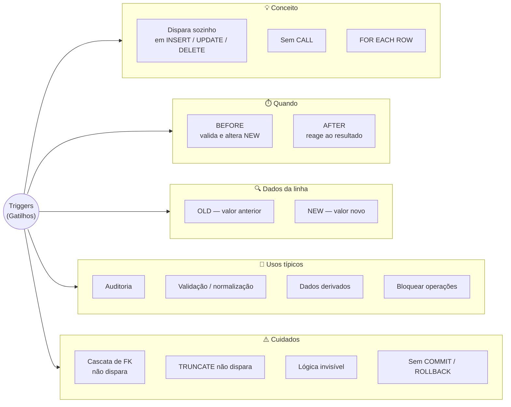
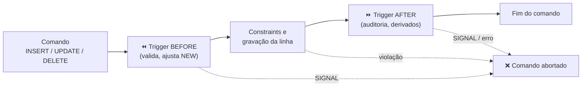

# Tópico 10 — Triggers (Gatilhos)

**Disciplina:** Banco de Dados — Relacional (IBD015)
**Professor:** Ronan Adriel Zenatti · ronan.zenatti@cps.sp.gov.br
**Fatec Jahu — 2º Semestre/2026**

---

## 🎯 Objetivos do Tópico

Ao final deste tópico você deverá ser capaz de:

- Explicar o que é um *trigger*, em que ele difere de uma *stored procedure* e de uma restrição declarativa;
- Escolher o momento (`BEFORE` ou `AFTER`) e o evento (`INSERT`, `UPDATE` ou `DELETE`) corretos e usar `OLD` e `NEW`;
- Implementar gatilhos de **auditoria**, de **validação/normalização**, de **manutenção de dados derivados** e de **bloqueio de operações**;
- Reconhecer os limites e as armadilhas dos gatilhos no MariaDB (somente por linha, cascata que não dispara gatilho, `TRUNCATE`, restrições de transação);
- Aplicar boas práticas e decidir quando **não** usar um gatilho.

---

## 🗺️ Mapa Mental do Tópico



---

## 🧭 Contexto

No Tópico 09, a lógica no banco só executava quando alguém fazia `CALL`. Mas existem regras que precisam valer **sempre, para qualquer comando, vindo de qualquer sistema**: "toda alteração de preço deve ser registrada", "e-mail é sempre guardado em minúsculas", "pedido entregue não pode ser excluído". Se essa regra depender de cada programador lembrar de chamar a procedure certa, mais cedo ou mais tarde alguém esquece — um `UPDATE` direto no terminal, um script de manutenção, um sistema legado.

Um ***trigger*** (gatilho) é um bloco de código associado a uma **tabela** e a um **evento** (`INSERT`, `UPDATE` ou `DELETE`) que o banco executa **automaticamente** quando o evento acontece. Ninguém chama o gatilho: ele dispara sozinho.

| | Constraint (`CHECK`, `FK`...) | Stored procedure | **Trigger** |
|---|---|---|---|
| Quem aciona | O banco, em toda escrita | Quem faz `CALL` | O banco, em toda escrita da tabela |
| Pode ser esquecida? | Não | **Sim** | Não |
| Expressividade | Baixa (regra sobre a linha) | Alta | **Alta** (consulta outras tabelas, grava em outras) |
| Visibilidade | Aparece no `CREATE TABLE` | Chamada explícita no código | **Invisível** para quem só lê o `INSERT`/`UPDATE` |

Os exemplos usam o `loja_virtual` com a carga ampliada do [Tópico 06](Topico_06_SQL_DQL_Agregacao.md).

---

## 1. Anatomia de um Trigger

```sql
CREATE TRIGGER nome_do_trigger
{BEFORE | AFTER} {INSERT | UPDATE | DELETE}
ON nome_da_tabela
FOR EACH ROW
BEGIN
    -- corpo: comandos SQL, usando OLD e NEW
END
```

### 1.1 Quando: `BEFORE` × `AFTER`

| | `BEFORE` | `AFTER` |
|---|---|---|
| Roda | **antes** de a linha ser gravada | **depois** de a linha ser gravada |
| Pode alterar `NEW`? | ✅ Sim (`SET NEW.coluna = ...`) | ❌ Não (`ERROR 1362: Updating of NEW row is not allowed in after trigger`) |
| Pode impedir a operação? | ✅ Sim, com `SIGNAL` | ✅ Sim, com `SIGNAL` (desfaz a gravação), mas é tarde para "corrigir" o dado |
| Uso típico | **Validar** e **normalizar** os dados que estão chegando | **Reagir** ao que aconteceu: auditoria, atualizar outras tabelas |



Se qualquer etapa falhar, **o comando inteiro** (incluindo o que os gatilhos já tinham feito) é desfeito pelo InnoDB.

### 1.2 `OLD` e `NEW`

Dentro do corpo, duas "linhas virtuais" dão acesso aos valores:

| Evento | `OLD` (valor antes) | `NEW` (valor depois) |
|---|---|---|
| `INSERT` | — não existe | ✅ os valores sendo inseridos |
| `UPDATE` | ✅ valores atuais | ✅ valores que serão gravados |
| `DELETE` | ✅ valores da linha removida | — não existe |

### 1.3 Somente `FOR EACH ROW`

O padrão SQL define dois níveis de gatilho: **por linha** (`FOR EACH ROW`: o corpo executa uma vez para cada linha afetada) e **por comando** (`FOR EACH STATEMENT`: executa uma única vez por comando, qualquer que seja o número de linhas). O **MariaDB só oferece o nível por linha**. Consequência prática: um `UPDATE` que altera 10 mil produtos executa o corpo do gatilho 10 mil vezes — gatilhos pesados em tabelas grandes são um risco real de desempenho.

| | MariaDB / MySQL | PostgreSQL |
|---|---|---|
| Nível | Somente `FOR EACH ROW` | `FOR EACH ROW` **ou** `FOR EACH STATEMENT` |
| Onde fica o código | No próprio `CREATE TRIGGER` | Em uma **função** separada (`RETURNS trigger`) que o `CREATE TRIGGER` aponta |
| Vários eventos num gatilho | Não: um gatilho por evento | Sim: `BEFORE INSERT OR UPDATE ON ...` |

Em consequência, no MariaDB são necessários **gatilhos separados** para `INSERT` e `UPDATE`, mesmo que a lógica seja igual (veja a Seção 3).

### 1.4 Gerenciando gatilhos

```sql
SHOW TRIGGERS;                                   -- lista os gatilhos do banco atual
SHOW CREATE TRIGGER trg_produtos_auditar_preco;  -- mostra o código completo
DROP TRIGGER IF EXISTS trg_produtos_auditar_preco;
```

(Assim como as procedures, os gatilhos não são "editados": recria-se com `DROP` + `CREATE`.)

> 📌 **Convenção de nomes desta disciplina:** gatilhos levam o prefixo `trg_` + tabela + o que fazem, em `snake_case` minúsculo: `trg_produtos_auditar_preco`, `trg_pessoas_validar_inserir`. Quem lê `SHOW TRIGGERS` entende na hora onde cada um atua.

---

## 2. Gatilho de Auditoria (`AFTER UPDATE`)

O caso de uso mais clássico: **registrar quem mudou o quê**. Vamos guardar o histórico de preços dos produtos, com a tabela de auditoria seguindo as 9 regras (PK `id_auditoria` — Regra 5; FK `produto_id` — Regra 6; campos de log — Regra 9):

```sql
CREATE TABLE auditoria_precos (
    id_auditoria   BIGINT UNSIGNED  NOT NULL AUTO_INCREMENT,
    produto_id     BIGINT UNSIGNED  NOT NULL,
    preco_antigo   DECIMAL(10, 2)   NOT NULL,
    preco_novo     DECIMAL(10, 2)   NOT NULL,
    usuario_banco  VARCHAR(255)     NOT NULL,
    criado_em      DATETIME         NOT NULL DEFAULT CURRENT_TIMESTAMP,
    alterado_em    DATETIME         NOT NULL DEFAULT CURRENT_TIMESTAMP
                                             ON UPDATE CURRENT_TIMESTAMP,
    deletado_em    DATETIME             NULL,

    CONSTRAINT pk_auditoria_preco   PRIMARY KEY (id_auditoria),
    CONSTRAINT fk_auditoria_produto FOREIGN KEY (produto_id)
                                    REFERENCES produtos (id_produto)
                                    ON DELETE RESTRICT
                                    ON UPDATE CASCADE
);

DELIMITER $$
CREATE TRIGGER trg_produtos_auditar_preco
AFTER UPDATE ON produtos
FOR EACH ROW
BEGIN
    -- só audita se o preço realmente mudou (<=> é a igualdade que trata NULL)
    IF NOT (OLD.preco <=> NEW.preco) THEN
        INSERT INTO auditoria_precos (produto_id, preco_antigo, preco_novo, usuario_banco)
        VALUES (OLD.id_produto, OLD.preco, NEW.preco, CURRENT_USER());
    END IF;
END$$
DELIMITER ;
```

Experimente:

```sql
UPDATE produtos SET preco = 3299.90 WHERE id_produto = 1;          -- registra (3499.90 → 3299.90)
UPDATE produtos SET estoque = estoque + 1 WHERE id_produto = 1;    -- NÃO registra (preço não mudou)
UPDATE produtos SET preco = preco * 1.05 WHERE categoria_id = 3;   -- registra 3 linhas (o gatilho roda por linha)

SELECT id_auditoria, produto_id, preco_antigo, preco_novo, usuario_banco FROM auditoria_precos;
```

| id_auditoria | produto_id | preco_antigo | preco_novo | usuario_banco |
|---|---|---|---|---|
| 1 | 1 | 3499.90 | 3299.90 | root@localhost |
| 2 | 5 | 189.90 | 199.40 | root@localhost |
| 3 | 9 | 129.90 | 136.40 | root@localhost |
| 4 | 10 | 159.90 | 167.90 | root@localhost |

Pontos de atenção:

- É `AFTER` porque a auditoria só deve registrar mudanças que **de fato aconteceram**; se a gravação falhar por uma constraint, a linha de auditoria também é desfeita.
- `CURRENT_USER()` devolve a conta com que o **banco** autenticou a conexão (`root@localhost`) — se a aplicação usa um único usuário de banco para todos os seus usuários, o gatilho não sabe *qual pessoa* alterou. Para isso a aplicação precisa informar quem é (por exemplo, por uma variável de sessão).
- A comparação `OLD.preco <=> NEW.preco` (operador *null-safe equal*) trata `NULL` corretamente; um simples `<>` devolveria "desconhecido" quando algum lado fosse `NULL` (Tópico 06).
- A própria tabela de auditoria segue a Regra 9, ainda que `alterado_em` e `deletado_em` quase nunca sejam usados em um registro que, por natureza, nunca se altera.

!!! example "🔍 Checkpoint 1 — Auditoria: carteira digital"
    Uma fintech guarda `contas (id_conta PK, titular, saldo)`. Crie a tabela `historico_saldos (id_historico PK, conta_id FK, saldo_anterior, saldo_novo, diferenca, ...)` e o gatilho `trg_contas_registrar_saldo` que, a cada `UPDATE` em `contas` **que altere o saldo**, grave uma linha com o saldo antes, o saldo depois e a diferença (`saldo_novo - saldo_anterior`). Mostre que um `UPDATE` que muda só o `titular` não gera registro.

    🔑 Resolução no [Gabarito do Tópico 10](Topico_10_Gabarito.md#checkpoint-1) — tente resolver antes de conferir.

---

## 3. Gatilhos de Validação e Normalização (`BEFORE`)

Como o `BEFORE` roda antes da gravação, ele pode **corrigir** o dado que está chegando (`SET NEW.coluna = ...`) ou **recusá-lo** (`SIGNAL`). Lembra do "data de nascimento não pode estar no futuro", que o Tópico 08 mostrou que o `CHECK` não consegue expressar (por usar `CURDATE()`)? Aqui ele cabe:

```sql
DELIMITER $$

CREATE TRIGGER trg_pessoas_validar_inserir
BEFORE INSERT ON pessoas
FOR EACH ROW
BEGIN
    SET NEW.nome  = TRIM(NEW.nome);                 -- normaliza: tira espaços das pontas
    SET NEW.email = LOWER(TRIM(NEW.email));         -- normaliza: e-mail sempre minúsculo

    IF NEW.data_nascimento > CURDATE() THEN
        SIGNAL SQLSTATE '45000' SET MESSAGE_TEXT = 'Data de nascimento não pode estar no futuro';
    END IF;
END$$

CREATE TRIGGER trg_pessoas_validar_atualizar
BEFORE UPDATE ON pessoas
FOR EACH ROW
BEGIN
    SET NEW.nome  = TRIM(NEW.nome);
    SET NEW.email = LOWER(TRIM(NEW.email));

    IF NEW.data_nascimento > CURDATE() THEN
        SIGNAL SQLSTATE '45000' SET MESSAGE_TEXT = 'Data de nascimento não pode estar no futuro';
    END IF;
END$$

DELIMITER ;
```

```sql
INSERT INTO pessoas (nome, cpf, email, data_nascimento)
VALUES ('  Paulo Nunes ', '31231231231', '  PAULO@Email.COM ', '1999-09-09');

SELECT nome, email FROM pessoas WHERE cpf = '31231231231';
-- Paulo Nunes | paulo@email.com      ← o gatilho limpou os dados antes de gravar

INSERT INTO pessoas (nome, cpf, email, data_nascimento)
VALUES ('Viajante', '41241241241', 'v@email.com', '2099-01-01');
-- ERROR 1644 (45000): Data de nascimento não pode estar no futuro
```

> 💡 Repare no custo de não haver um gatilho de dois eventos: o corpo foi **duplicado**. Uma saída é colocar a lógica comum numa *stored procedure* (que pode receber valores e devolver via `OUT`) ou numa função (Tópico 11) e chamá-la dos dois gatilhos.

### 3.1 `BEFORE` × `CHECK`: qual usar?

Se a regra é só sobre os valores **da própria linha** e é determinística, prefira o `CHECK` — é declarativo, visível no `CREATE TABLE` e mais barato. O gatilho entra quando a regra: usa funções não determinísticas (`CURDATE()`, `NOW()`), consulta **outras tabelas**, ou precisa **alterar** o dado em vez de só rejeitá-lo.

!!! tip "✅ Verificação Rápida — BEFORE × AFTER"
    Bloco conceitual — confira o entendimento com os dois quizzes abaixo. A resposta é revelada na hora.

<quiz>
Você quer garantir que o e-mail seja sempre gravado em minúsculas, não importa como o INSERT foi escrito. Qual gatilho resolve?
- [ ] AFTER INSERT, com SET NEW.email = LOWER(NEW.email)
- [x] BEFORE INSERT, com SET NEW.email = LOWER(NEW.email)
- [ ] AFTER INSERT, com um UPDATE na própria tabela de pessoas
- [ ] BEFORE DELETE, com SET OLD.email = LOWER(OLD.email)

Só um gatilho BEFORE pode alterar NEW, e isso acontece antes da gravação, sem custo extra. Em AFTER, o SET NEW é proibido (erro 1362) e atualizar a própria tabela dentro do gatilho gera o erro 1442.
</quiz>

<quiz>
Para registrar numa tabela de auditoria que um produto foi excluído, qual é a escolha mais adequada?
- [ ] BEFORE INSERT, lendo NEW
- [ ] AFTER INSERT, lendo OLD
- [x] AFTER DELETE (ou BEFORE DELETE), lendo OLD
- [ ] AFTER UPDATE, lendo NEW

Em um DELETE só existe OLD (a linha removida); NEW não existe. Usa-se AFTER para registrar só o que de fato foi excluído; BEFORE DELETE também funciona, mas registraria mesmo que a exclusão depois falhasse por outra constraint — embora tudo seja desfeito junto, pois é a mesma instrução.
</quiz>

!!! example "🔍 Checkpoint 2 — BEFORE INSERT: monitoramento de energia solar"
    Uma empresa de energia solar guarda `leituras_inversores (id_leitura PK, inversor_id FK, kwh_gerado, registrado_em)`. Crie o gatilho `trg_leituras_inversores_antes_inserir` que: (a) **rejeite** leituras com `kwh_gerado` negativo, com a mensagem `'Geração (kWh) não pode ser negativa'`; e (b) quando `registrado_em` vier `NULL`, **preencha** com o instante atual. Teste com um `INSERT` sem data, um com data informada e um com valor negativo.

    🔑 Resolução no [Gabarito do Tópico 10](Topico_10_Gabarito.md#checkpoint-2) — tente resolver antes de conferir.

---

## 4. Gatilhos que Mantêm Dados Derivados

Às vezes o modelo guarda um valor **calculável** a partir de outras linhas, por desempenho — como `pedidos.valor_total`, que é a soma dos itens. O risco é o valor derivado ficar desatualizado. Um gatilho pode refazer a conta sempre que os itens mudam. Como são três eventos, encapsulamos o cálculo em uma procedure e os três gatilhos apenas a chamam:

```sql
DELIMITER $$

CREATE PROCEDURE sp_recalcular_total_pedido(IN p_pedido_id BIGINT UNSIGNED)
BEGIN
    UPDATE pedidos
    SET    valor_total = (SELECT COALESCE(SUM(quantidade * preco_unitario * (1 - desconto / 100)), 0)
                          FROM   itens_pedidos
                          WHERE  pedido_id = p_pedido_id)
    WHERE  id_pedido = p_pedido_id;
END$$

CREATE TRIGGER trg_itens_pedidos_apos_inserir
AFTER INSERT ON itens_pedidos
FOR EACH ROW
BEGIN
    CALL sp_recalcular_total_pedido(NEW.pedido_id);
END$$

CREATE TRIGGER trg_itens_pedidos_apos_atualizar
AFTER UPDATE ON itens_pedidos
FOR EACH ROW
BEGIN
    CALL sp_recalcular_total_pedido(NEW.pedido_id);
    IF OLD.pedido_id <> NEW.pedido_id THEN          -- item movido para outro pedido: recalcula os dois
        CALL sp_recalcular_total_pedido(OLD.pedido_id);
    END IF;
END$$

CREATE TRIGGER trg_itens_pedidos_apos_excluir
AFTER DELETE ON itens_pedidos
FOR EACH ROW
BEGIN
    CALL sp_recalcular_total_pedido(OLD.pedido_id);
END$$

DELIMITER ;
```

```sql
SELECT valor_total FROM pedidos WHERE id_pedido = 12;                                   -- 129.90

INSERT INTO itens_pedidos (pedido_id, produto_id, quantidade, preco_unitario)
VALUES (12, 11, 2, 89.90);
SELECT valor_total FROM pedidos WHERE id_pedido = 12;                                   -- 309.70

UPDATE itens_pedidos SET quantidade = 5 WHERE pedido_id = 12 AND produto_id = 11;
SELECT valor_total FROM pedidos WHERE id_pedido = 12;                                   -- 579.40

DELETE FROM itens_pedidos WHERE pedido_id = 12 AND produto_id = 11;
SELECT valor_total FROM pedidos WHERE id_pedido = 12;                                   -- 129.90 (voltou)
```

> ⚠️ **Conflito de responsabilidades:** com esses gatilhos instalados, a procedure `sp_registrar_pedido` do Tópico 09 (que já calcula o `valor_total` na criação do pedido) continua funcionando — o resultado do gatilho confere com o dela. Mas o **estoque** continua sendo baixado pela procedure; se você criasse também um gatilho `AFTER INSERT` em `itens_pedidos` que baixasse o estoque, o estoque seria baixado **duas vezes**. Quando uma regra é implementada em dois lugares, algum deles está errado — escolha um dono para cada regra.

!!! example "🔍 Checkpoint 3 — Contadores derivados: plataforma de criadores"
    Uma plataforma de criadores guarda `videos (id_video PK, titulo, total_curtidas)` e `curtidas (usuario_id FK, video_id FK, criado_em)`, com PK composta `(usuario_id, video_id)` (cada usuário curte um vídeo uma vez). Para evitar um `COUNT(*)` a cada exibição, `videos.total_curtidas` é um contador mantido por gatilhos. Escreva os dois gatilhos (`AFTER INSERT` e `AFTER DELETE` em `curtidas`) que mantêm o contador, sem deixá-lo ficar negativo. Depois explique o que aconteceria com o contador se `curtidas.video_id` tivesse `ON DELETE CASCADE` e um vídeo fosse excluído (veja a Seção 6.1 antes de responder).

    🔑 Resolução no [Gabarito do Tópico 10](Topico_10_Gabarito.md#checkpoint-3) — tente resolver antes de conferir.

---

## 5. Bloqueando Operações e Garantindo Fluxos

Um gatilho `BEFORE` com `SIGNAL` funciona como uma "trava": a operação é recusada com a sua mensagem. Isso é muito usado para proteger **registros que não podem mais mudar** ou **fluxos de estado**:

```sql
DELIMITER $$
CREATE TRIGGER trg_pedidos_bloquear_exclusao
BEFORE DELETE ON pedidos
FOR EACH ROW
BEGIN
    IF OLD.status IN ('enviado', 'entregue') THEN
        SIGNAL SQLSTATE '45000'
            SET MESSAGE_TEXT = 'Pedido enviado ou entregue não pode ser excluído; use o cancelamento';
    END IF;
END$$
DELIMITER ;

DELETE FROM pedidos WHERE id_pedido = 2;     -- ERROR 1644: Pedido enviado ou entregue não pode ser excluído...
DELETE FROM pedidos WHERE id_pedido = 4;     -- ok: o pedido 4 estava 'cancelado'
```

Um bloqueio também pode proteger uma **máquina de estados** (o `status` de um pedido só avança em certos caminhos), comparando `OLD.status` com `NEW.status` em um `BEFORE UPDATE`.

!!! example "🔍 Checkpoint 4 — BEFORE UPDATE como trava: campeonato de e-sports"
    Um campeonato guarda `partidas_campeonato (id_partida PK, status, placar_a, placar_b)`, com `status` em `'agendada'`, `'em_andamento'` ou `'finalizada'`. Escreva um gatilho `BEFORE UPDATE` que: (a) **proíba qualquer alteração** em partida já `'finalizada'`; (b) proíba voltar de `'em_andamento'` para `'agendada'`. Use mensagens diferentes para cada regra e mostre quatro `UPDATE`s de teste (dois que passam e dois bloqueados).

    🔑 Resolução no [Gabarito do Tópico 10](Topico_10_Gabarito.md#checkpoint-4) — tente resolver antes de conferir.

---

## 6. Limites, Armadilhas e Boas Práticas

### 6.1 O que o gatilho **não** faz (ou não pode fazer)

| Armadilha | O que acontece |
|---|---|
| **Ações em cascata de FK não disparam gatilhos** | Se `itens_pedidos` tem `ON DELETE CASCADE` e você apaga o pedido, os itens somem **sem** disparar o `AFTER DELETE` de `itens_pedidos` — o log de exclusão não registra, o recálculo do total não acontece. Teste: apagar o pedido 7 não gravou os itens no log, ao contrário de um `DELETE` direto nos itens |
| **`TRUNCATE` não dispara `DELETE`** | `TRUNCATE TABLE` não aciona gatilhos (ele recria a tabela); `DELETE FROM tabela` aciona um por linha |
| **Alterar a própria tabela** | Um gatilho `AFTER INSERT` em `categorias` não pode fazer `UPDATE categorias`: `ERROR 1442 Can't update table 'categorias' in stored function/trigger because it is already used by statement which invoked this trigger` |
| **`COMMIT`/`ROLLBACK`** | Proibidos (`ERROR 1422`): o gatilho faz parte da transação do comando que o disparou. Para desfazer, use `SIGNAL` — o InnoDB desfaz a instrução inteira |
| **Alterar `NEW` em `AFTER`** | `ERROR 1362` — só `BEFORE` pode |
| **Um gatilho por evento e momento** (versões antigas) | Desde o MariaDB 10.2.3 é possível ter vários para o mesmo evento, definindo a ordem com `FOLLOWS`/`PRECEDES` |

Comprovando a primeira armadilha:

```sql
-- Gatilho que registra cada item excluído
CREATE TRIGGER trg_itens_pedidos_logar_exclusao AFTER DELETE ON itens_pedidos FOR EACH ROW
    INSERT INTO log_itens_excluidos (pedido_id, produto_id) VALUES (OLD.pedido_id, OLD.produto_id);

BEGIN;
DELETE FROM itens_pedidos WHERE pedido_id = 7 AND produto_id = 5;   -- gatilho dispara: log = 1
DELETE FROM pedidos WHERE id_pedido = 7;                            -- itens restantes somem por CASCADE
SELECT COUNT(*) FROM log_itens_excluidos;                           -- continua 1: a cascata NÃO disparou
ROLLBACK;
```

### 6.2 Boas práticas

- **Poucos e simples.** Cada gatilho é lógica "escondida": quem lê o `UPDATE` na aplicação não vê o que mais acontece. Reserve-os para regras que **precisam** valer para qualquer cliente.
- **Rápidos.** Eles rodam dentro da transação do comando, por linha. Evite consultas pesadas e chamadas em cascata de um gatilho para outro.
- **Um dono para cada regra.** Nunca implemente a mesma regra em gatilho *e* em procedure *e* na aplicação.
- **Mensagens de erro claras** em todo `SIGNAL` — é a única pista que a pessoa que levou o erro terá.
- **Documente.** Liste os gatilhos do projeto (`SHOW TRIGGERS`, ou `information_schema.triggers`) no README, e prefira a convenção `trg_tabela_acao`.
- **Quando preferir outra ferramenta:**

| Se a regra é... | Use |
|---|---|
| sobre a própria linha e determinística | `CHECK` / `NOT NULL` / `UNIQUE` |
| referência entre tabelas | `FOREIGN KEY` |
| uma operação de negócio chamada explicitamente | *stored procedure* |
| auditoria, normalização, dados derivados, trava que vale para **qualquer** escrita | **trigger** |
| complexa ou que muda toda semana | código da aplicação |

```sql
-- Inventário dos gatilhos do banco
SELECT trigger_name, event_manipulation AS evento, action_timing AS momento, event_object_table AS tabela
FROM   information_schema.triggers
WHERE  trigger_schema = 'loja_virtual'
ORDER BY event_object_table, action_timing, event_manipulation;
```

!!! example "🔍 Checkpoint 5 — BEFORE + AFTER juntos: venda de ingressos"
    Um marketplace de ingressos tem `eventos (id_evento PK, nome, ingressos_disponiveis)` e `vendas_ingressos (id_venda PK, evento_id FK, comprador_id FK, quantidade)`. Escreva os dois gatilhos: um `BEFORE INSERT` que **recuse** a venda quando o evento não existe ou quando `quantidade` excede os ingressos disponíveis (mensagens distintas), e um `AFTER INSERT` que **baixe** `ingressos_disponiveis`. Depois responda: se o gatilho `BEFORE` não existisse, o que ainda impediria a venda de ingressos que não existem, supondo que `eventos` tenha `CHECK (ingressos_disponiveis >= 0)`?

    🔑 Resolução no [Gabarito do Tópico 10](Topico_10_Gabarito.md#checkpoint-5) — tente resolver antes de conferir.

---

## 7. Exercícios de Fixação

> 🔑 As resoluções destes cinco exercícios estão no [Gabarito do Tópico 10](Topico_10_Gabarito.md) — tente resolver antes de conferir. Use o `loja_virtual` com a carga ampliada do Tópico 06.

**Exercício 1:** crie a tabela `log_status_pedidos` (PK, FK para `pedidos`, `status_anterior`, `status_novo` e campos de log) e um gatilho `AFTER UPDATE` em `pedidos` que registre **toda mudança de status**. Teste mudando o pedido 12 de `'pendente'` para `'confirmado'` e depois para `'enviado'`.

**Exercício 2:** crie um gatilho `BEFORE UPDATE` em `pedidos` que impeça alterar o `status` de um pedido que já esteja `'entregue'` ou `'cancelado'`. Teste com os pedidos 2 (entregue) e 3 (entregue).

**Exercício 3:** com o gatilho de auditoria de preços instalado, esvazie `auditoria_precos` e execute um reajuste de 10% na categoria 2 (use um `UPDATE` direto ou a procedure `sp_reajustar_precos_categoria`). Quantas linhas de auditoria foram geradas? Escreva uma consulta que mostre o **nome** do produto, o preço antigo e o novo.

**Exercício 4:** liste os gatilhos do banco com `SHOW TRIGGERS` e com a consulta ao `information_schema.triggers`. Remova um deles. Depois execute `TRUNCATE TABLE` em uma tabela que tenha gatilho `AFTER DELETE` e explique por que o gatilho não disparou.

**Exercício 5:** explique, em um parágrafo, por que "baixar o estoque ao inserir um item" é um candidato a gatilho **e** a procedure, e qual escolha você defenderia para o `loja_virtual`, considerando o risco de a regra ser implementada duas vezes.

---

## 📚 Referências deste Tópico

- ELMASRI, R.; NAVATHE, S. B. *Sistemas de Banco de Dados*. 7 ed. Cap. 26.1 — Gatilhos (*triggers*) e bancos de dados ativos. São Paulo: Pearson, 2018.
- SILBERSCHATZ, A.; SUNDARSHAN, S.; KORTH, H. F. *Sistema de banco de dados*. Cap. 5.3 — Gatilhos. Rio de Janeiro: Elsevier Brasil, 2016.
- Documentação oficial do MariaDB — [Triggers](https://mariadb.com/kb/en/triggers/), [CREATE TRIGGER](https://mariadb.com/kb/en/create-trigger/), [Trigger Limitations](https://mariadb.com/kb/en/trigger-limitations/)

---

## 🃏 Flashcards de Revisão

??? question "O que é um trigger e como ele é executado?"
    É um bloco de código ligado a uma tabela e a um evento (`INSERT`, `UPDATE` ou `DELETE`)
    que o banco executa **automaticamente** quando o evento ocorre — ninguém o chama com
    `CALL`. No MariaDB, sempre uma vez **por linha** afetada (`FOR EACH ROW`).

??? question "Qual a diferença entre BEFORE e AFTER?"
    `BEFORE` roda antes da gravação: pode validar, recusar (`SIGNAL`) e alterar `NEW`.
    `AFTER` roda depois: serve para reagir (auditoria, atualizar outras tabelas), mas não
    pode alterar `NEW`.

??? question "O que são OLD e NEW, e onde cada um existe?"
    `OLD` é a linha antes da operação; `NEW`, depois. `INSERT` só tem `NEW`; `DELETE` só
    tem `OLD`; `UPDATE` tem os dois.

??? question "Pegadinha: um DELETE em cascata dispara os gatilhos da tabela filha?"
    **Não.** Ações referenciais (`ON DELETE CASCADE`, `SET NULL`) executadas pelo InnoDB não
    ativam gatilhos. Se a regra depende do gatilho (um log, um recálculo), ela não
    acontece para as linhas apagadas em cascata.

??? question "Por que não se pode usar COMMIT ou ROLLBACK dentro de um trigger?"
    Porque o gatilho faz parte da transação do comando que o disparou. Para abortar,
    usa-se `SIGNAL` — o InnoDB desfaz a instrução inteira, incluindo o que o gatilho já
    havia feito.

??? question "Quando preferir um CHECK a um BEFORE trigger?"
    Quando a regra só depende dos valores da própria linha e é determinística: o `CHECK`
    é declarativo, visível no `CREATE TABLE` e mais barato. O trigger entra quando a regra
    precisa de outras tabelas, de funções como `NOW()`/`CURDATE()` ou de alterar o dado.

---

## ✅ Quiz de Fixação

<quiz>
No MariaDB, um UPDATE que altera 500 linhas de produtos e existe um gatilho AFTER UPDATE em produtos. Quantas vezes o corpo do gatilho executa?
- [ ] Uma vez, por comando
- [x] 500 vezes, uma por linha afetada
- [ ] Zero, pois gatilhos só disparam em INSERT
- [ ] Depende do valor de autocommit

O MariaDB suporta apenas gatilhos de nível de linha (FOR EACH ROW). O nível por comando (FOR EACH STATEMENT) existe em outros SGBDs, como o PostgreSQL.
</quiz>

<quiz>
Marque todas as afirmações corretas sobre gatilhos no MariaDB.
- [x] Em um gatilho BEFORE é possível alterar NEW antes da gravação
- [x] Um SIGNAL dentro do gatilho aborta o comando que o disparou
- [ ] Um gatilho AFTER INSERT pode executar COMMIT para confirmar a auditoria
- [ ] Um gatilho dispara quando a linha é apagada por ON DELETE CASCADE

COMMIT/ROLLBACK são proibidos em gatilhos (erro 1422), e as ações referenciais em cascata do InnoDB não ativam gatilhos da tabela filha.
</quiz>

<quiz>
Qual evento NÃO dispara um gatilho AFTER DELETE da tabela?
- [ ] DELETE FROM tabela WHERE ...; (afetando algumas linhas)
- [ ] DELETE FROM tabela; (sem WHERE)
- [x] TRUNCATE TABLE tabela;
- [ ] Um DELETE executado de dentro de uma stored procedure

O TRUNCATE recria a tabela em vez de excluir linha a linha, portanto não aciona os gatilhos de DELETE. Já o DELETE (com ou sem WHERE, direto ou dentro de uma procedure) dispara o gatilho uma vez para cada linha removida.
</quiz>

<quiz>
Qual a melhor justificativa para colocar uma regra de auditoria em um gatilho, e não na aplicação?
- [ ] Gatilhos são sempre mais rápidos que código da aplicação
- [x] O gatilho vale para toda escrita na tabela, venha ela de qualquer sistema ou comando manual
- [ ] Gatilhos dispensam transações
- [ ] A aplicação não consegue acessar a tabela de auditoria

O ponto forte do gatilho é a garantia: como ele dispara em qualquer INSERT/UPDATE/DELETE, a regra não depende de cada sistema lembrar de aplicá-la. O custo é a lógica ficar menos visível e executar por linha.
</quiz>

<quiz>
Um gatilho AFTER INSERT em categorias tenta executar UPDATE categorias SET ativa = 1 WHERE id_categoria = NEW.id_categoria. O que acontece ao inserir uma categoria?
- [ ] A categoria é inserida e ativada normalmente
- [x] Erro 1442: não se pode atualizar a tabela que já está sendo usada pelo comando que disparou o gatilho
- [ ] Erro 1062: chave duplicada
- [ ] Nada, o gatilho é ignorado

O MariaDB proíbe que um gatilho altere a própria tabela do evento (evita recursão). Se a intenção é ajustar o valor da linha que está sendo inserida, use um gatilho BEFORE INSERT com SET NEW.ativa = 1.
</quiz>

---

## 📝 Resumo

Um ***trigger*** é código que o banco executa **sozinho**, por linha, antes (`BEFORE`) ou depois
(`AFTER`) de um `INSERT`, `UPDATE` ou `DELETE`, com acesso aos valores `OLD` e `NEW`. O `BEFORE` valida,
normaliza (`SET NEW.col`) e recusa (`SIGNAL`); o `AFTER` reage ao que foi gravado — auditoria, dados
derivados. Cinco armadilhas merecem memória: o MariaDB só tem gatilhos por linha, a cascata de FK e o
`TRUNCATE` não os disparam, o gatilho não altera a própria tabela, não faz `COMMIT`/`ROLLBACK` e a
lógica fica invisível para quem lê só o comando. Por isso: poucos, simples, rápidos, um dono para cada
regra, e `CHECK`/`FK` sempre que bastarem. No próximo tópico, funções definidas pelo usuário e,
principalmente, **transações** e controle de concorrência.

---

## 🏆 Conquista do Tópico

!!! success "Selo desbloqueado: ⚡ Vigilante de Gatilhos"
    Você sabe fazer o banco reagir sozinho — auditar, normalizar, manter derivados e
    travar operações indevidas — e conhece as armadilhas que fazem um gatilho "não
    disparar" quando se espera que dispare. A próxima parada da Trilha do(a) Arquiteto(a)
    de Dados é garantir que tudo isso funcione mesmo com muita gente escrevendo ao mesmo
    tempo: funções, transações e concorrência.

---

## 🔑 Gabarito deste Tópico

As respostas dos 5 checkpoints espalhados pelo tópico, e dos 5 Exercícios de Fixação da
Seção 7, estão em um arquivo separado, para não estragar a tentativa de quem ainda não
chegou até aqui: [Gabarito — Tópico 10](Topico_10_Gabarito.md).

---

## 🔗 Navegação

⬅️ [Tópico 09 — Stored Procedures](./Topico_09_Stored_Procedures.md) · ➡️ [Tópico 11 — Functions (UDF) e Transações](./Topico_11_Functions_Transacoes.md)

---

*Fatec Jahu · IBD015 · Prof. Ronan Adriel Zenatti · 2026*
