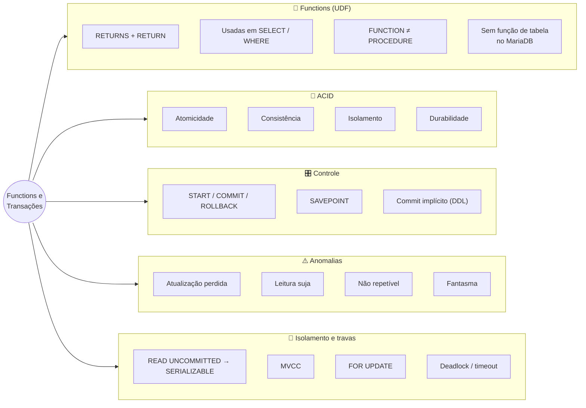
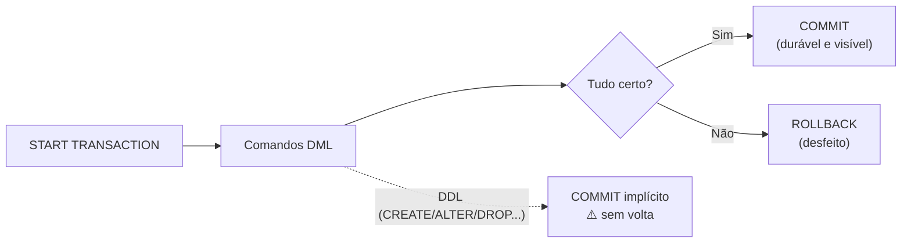
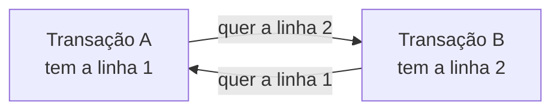

# Tópico 11 — Functions (UDF) e Transações

**Disciplina:** Banco de Dados — Relacional (IBD015)
**Professor:** Ronan Adriel Zenatti · ronan.zenatti@cps.sp.gov.br
**Fatec Jahu — 2º Semestre/2026**

---

## 🎯 Objetivos do Tópico

Ao final deste tópico você deverá ser capaz de:

- Criar funções definidas pelo usuário (UDF) escalares no MariaDB e usá-las em consultas, distinguindo `FUNCTION` de `PROCEDURE`;
- Explicar por que o MariaDB não possui funções de tabela e quais alternativas existem;
- Descrever as quatro propriedades **ACID** e indicar o mecanismo do banco que garante cada uma;
- Controlar transações com `START TRANSACTION`, `COMMIT`, `ROLLBACK` e `SAVEPOINT`, reconhecendo comandos que causam *commit* implícito;
- Reconhecer as anomalias de concorrência (atualização perdida, leitura suja, leitura não repetível, fantasma) e relacioná-las aos **níveis de isolamento**;
- Usar travas (`SELECT ... FOR UPDATE`), tratar *deadlocks* e escolher entre controle pessimista e otimista.

---

## 🗺️ Mapa Mental do Tópico



---

## 🧭 Contexto

Este tópico tem duas metades que se encontram no fim.

Na primeira, completamos a "caixa de ferramentas" de programação do banco com as **funções definidas pelo usuário**: aquele pedaço de lógica reutilizável que devolve **um valor** e pode ser usado dentro de qualquer consulta, como se fosse `UPPER()` ou `ROUND()`.

Na segunda, voltamos à **transação** — que você conheceu no Tópico 04 só pela letra **A** (Atomicidade) do ACID — e vamos até onde ela fica realmente interessante: o que acontece quando **muitas pessoas usam o banco ao mesmo tempo**. É aqui que aparecem as perguntas difíceis: dois clientes comprando o último item do estoque, um relatório lendo dados enquanto outra pessoa os altera, duas transferências bancárias cruzadas se travando mutuamente.

Os exemplos usam o `loja_virtual` com a carga ampliada do [Tópico 06](Topico_06_SQL_DQL_Agregacao.md).

---

## 1. Funções Definidas pelo Usuário (UDF)

### 1.1 `FUNCTION` × `PROCEDURE`

Ambas guardam lógica com nome no servidor. A diferença está em **como se usam** e no que podem fazer:

| | `FUNCTION` | `PROCEDURE` |
|---|---|---|
| Retorno | **Exatamente um valor** (`RETURNS tipo` + `RETURN`) | Nenhum, ou vários via `OUT` / conjuntos de resultado |
| Como se usa | **Dentro de uma expressão**: `SELECT fn_idade(data_nascimento)`, `WHERE fn_x(col) > 10` | Com `CALL` — nunca dentro de um `SELECT` |
| Parâmetros | Somente de entrada (`IN` implícito) | `IN`, `OUT`, `INOUT` |
| Pode controlar transação (`COMMIT`/`ROLLBACK`)? | ❌ Não (erro 1422) | ✅ Sim |
| Pode devolver um `SELECT` ao cliente? | ❌ Não | ✅ Sim |
| Uso típico | **Cálculos e transformações** reutilizáveis | **Operações de negócio** com várias etapas |

### 1.2 Sintaxe e características

```sql
DELIMITER $$
CREATE FUNCTION fn_valor_liquido_item(
    p_quantidade      INT UNSIGNED,
    p_preco_unitario  DECIMAL(10, 2),
    p_desconto        DECIMAL(5, 2)
)
RETURNS DECIMAL(12, 2)          -- tipo do valor devolvido
DETERMINISTIC                   -- mesma entrada → mesma saída, sempre
BEGIN
    RETURN ROUND(p_quantidade * p_preco_unitario * (1 - p_desconto / 100), 2);
END$$
DELIMITER ;

SELECT fn_valor_liquido_item(2, 399.90, 10) AS liquido;      -- 719.82
```

A função declara uma **característica** que diz ao banco o que ela faz:

| Característica | Significa | Exemplo |
|---|---|---|
| `DETERMINISTIC` | Sempre devolve o mesmo resultado para os mesmos argumentos | cálculo puro (`fn_valor_liquido_item`) |
| `NOT DETERMINISTIC` (padrão) | O resultado pode mudar com o tempo ou o estado do banco | depende de `CURDATE()`/`NOW()` |
| `NO SQL` | Não executa nenhum comando SQL | cálculo, formatação |
| `READS SQL DATA` | Só lê dados (`SELECT`) | consulta a outra tabela |
| `MODIFIES SQL DATA` | Pode alterar dados | uso raro e desencorajado |

> 📌 **Por que declarar?** Com o *log binário* ativo (comum em produção, usado para replicação e recuperação — Tópico 12), o MariaDB recusa criar uma função sem `DETERMINISTIC`, `NO SQL` ou `READS SQL DATA`, com o erro `1418 This function has none of DETERMINISTIC, NO SQL, or READS SQL DATA in its declaration and binary logging is enabled`. No XAMPP o log binário vem desligado, então o erro não aparece — mas declare a característica sempre, para o script funcionar em qualquer servidor. **Nunca declare `DETERMINISTIC` mentindo**: o banco pode confiar e guardar/reaproveitar resultados incorretos.
>
> **Convenção desta disciplina:** funções levam o prefixo `fn_` (como `sp_` nas procedures), `snake_case` minúsculo e parâmetros com `p_`.

### 1.3 Mais exemplos

```sql
DELIMITER $$

-- Cálculo com data: depende de CURDATE(), logo NOT DETERMINISTIC
CREATE FUNCTION fn_idade(p_data_nascimento DATE)
RETURNS INT
NOT DETERMINISTIC
NO SQL
BEGIN
    RETURN TIMESTAMPDIFF(YEAR, p_data_nascimento, CURDATE());
END$$

-- Formatação pura: DETERMINISTIC
CREATE FUNCTION fn_formatar_cpf(p_cpf CHAR(11))
RETURNS VARCHAR(14)
DETERMINISTIC
BEGIN
    RETURN CONCAT(SUBSTRING(p_cpf, 1, 3), '.', SUBSTRING(p_cpf, 4, 3), '.',
                  SUBSTRING(p_cpf, 7, 3), '-', SUBSTRING(p_cpf, 10, 2));
END$$

-- Função que consulta o banco: READS SQL DATA
CREATE FUNCTION fn_total_gasto_cliente(p_cliente_id BIGINT UNSIGNED)
RETURNS DECIMAL(12, 2)
READS SQL DATA
BEGIN
    DECLARE v_total DECIMAL(12, 2);

    SELECT COALESCE(SUM(valor_total), 0)
    INTO   v_total
    FROM   pedidos
    WHERE  cliente_id = p_cliente_id
      AND  status <> 'cancelado';

    RETURN v_total;
END$$

-- Uma função pode chamar outra função
CREATE FUNCTION fn_nivel_cliente(p_cliente_id BIGINT UNSIGNED)
RETURNS VARCHAR(20)
READS SQL DATA
BEGIN
    DECLARE v_total DECIMAL(12, 2);
    SET v_total = fn_total_gasto_cliente(p_cliente_id);

    RETURN CASE
        WHEN v_total >= 5000 THEN 'ouro'
        WHEN v_total >= 3000 THEN 'prata'
        WHEN v_total >  0    THEN 'bronze'
        ELSE                      'sem compras'
    END;
END$$

DELIMITER ;
```

E agora o ganho: elas viram parte do SQL, em qualquer cláusula.

```sql
SELECT id_pessoa, nome, fn_formatar_cpf(cpf) AS cpf_formatado, fn_idade(data_nascimento) AS idade
FROM   pessoas
WHERE  id_pessoa <= 3;

SELECT p.nome,
       fn_nivel_cliente(p.id_pessoa)       AS nivel,
       fn_total_gasto_cliente(p.id_pessoa) AS total
FROM   pessoas p
ORDER BY total DESC
LIMIT 5;                                    -- Gustavo Lima é 'ouro'; os demais, 'prata'

SELECT SUM(fn_valor_liquido_item(quantidade, preco_unitario, desconto)) AS total_dos_itens
FROM   itens_pedidos;                       -- 29583.43 (todos os itens, já com desconto)
```

Compare com a procedure `sp_classificar_cliente` do Tópico 09: a **lógica é a mesma**, mas a função pode ser usada *dentro* do `SELECT` para todas as pessoas de uma vez, o que a procedure não consegue.

### 1.4 Cuidados de desempenho

- A função executa **uma vez por linha** do resultado (ou do filtro). Uma função que faz um `SELECT` dentro, usada sobre 100 mil linhas, dispara 100 mil consultas escondidas — o clássico problema "N+1". Para volumes grandes, uma junção com agregação costuma ser muito mais rápida.
- Uma função aplicada a uma coluna no `WHERE` (`WHERE fn_idade(data_nascimento) >= 35`) **impede o uso de índice** nessa coluna (o banco teria de calcular a função para cada linha). Prefira comparar a coluna "crua" (`WHERE data_nascimento <= CURDATE() - INTERVAL 35 YEAR`).
- Funções devem ser **simples e previsíveis**. Regras complexas com várias etapas pedem uma procedure.

### 1.5 E as "funções de tabela"?

Em alguns SGBDs, uma função pode devolver uma **tabela inteira** e ser usada no `FROM` — são as *table-valued functions* (TVF). No PostgreSQL:

```sql
-- PostgreSQL (NÃO funciona no MariaDB):
CREATE FUNCTION pedidos_do_cliente(p_cliente_id bigint)
RETURNS TABLE (id_pedido bigint, valor_total numeric)
LANGUAGE sql AS $$
    SELECT id_pedido, valor_total FROM pedidos WHERE cliente_id = p_cliente_id
$$;

SELECT * FROM pedidos_do_cliente(1);          -- usada como se fosse uma tabela
```

**O MariaDB não tem esse recurso**: toda função devolve um único valor escalar. As alternativas são:

| Necessidade | Alternativa no MariaDB |
|---|---|
| Consulta reutilizável **sem** parâmetro | `VIEW` (Tópico 07) |
| Consulta reutilizável **com** parâmetro | `PROCEDURE` que devolve um `SELECT` (`CALL sp_listar_pedidos_cliente(1)`) |
| Resultado para ser combinado com outras tabelas em SQL | Uma `VIEW` filtrada na consulta externa (`SELECT * FROM vw_pedidos WHERE cliente_id = 1`) |

### 1.6 Gerenciando funções

```sql
SHOW FUNCTION STATUS WHERE Db = 'loja_virtual';
SHOW CREATE FUNCTION fn_idade;
DROP FUNCTION IF EXISTS fn_idade;
```

!!! tip "✅ Verificação Rápida — FUNCTION × PROCEDURE"
    Bloco conceitual — confira o entendimento com os dois quizzes abaixo. A resposta é revelada na hora.

<quiz>
Qual comando usa corretamente uma função fn_idade(DATE) para listar pessoas com 40 anos ou mais?
- [ ] CALL fn_idade(data_nascimento);
- [x] SELECT nome FROM pessoas WHERE fn_idade(data_nascimento) >= 40;
- [ ] EXEC fn_idade;
- [ ] SELECT nome FROM pessoas WHERE CALL fn_idade(data_nascimento) >= 40;

Funções são expressões: usam-se dentro do SELECT, do WHERE, do ORDER BY etc. O CALL é exclusivo de procedures.
</quiz>

<quiz>
Qual destas tarefas NÃO pode ser feita dentro de uma FUNCTION no MariaDB?
- [ ] Declarar variáveis locais e usar IF/CASE
- [ ] Ler dados de uma tabela com SELECT ... INTO
- [x] Executar COMMIT ou ROLLBACK
- [ ] Chamar outra função

Funções rodam dentro do comando que as chamou, que já está em uma transação; por isso não podem controlar a transação (erro 1422). Elas aceitam variáveis, condicionais, consultas e chamadas a outras funções.
</quiz>

!!! example "🔍 Checkpoint 1 — Função escalar com validação: entrega por drone"
    Uma operação de entrega por drone cobra frete de **R$ 8,00 de base + R$ 2,50 por km + R$ 4,00 por kg**. Escreva a função `fn_frete_drone(p_peso_kg, p_distancia_km)` que devolva o frete (2 casas decimais), **recuse** peso ou distância menores ou iguais a zero e peso acima de 5 kg (cada caso com mensagem própria, usando `SIGNAL`). Escolha e justifique a característica correta (`DETERMINISTIC`, `READS SQL DATA`...). Mostre o resultado para 1,5 kg a 4 km.

    🔑 Resolução no [Gabarito do Tópico 11](Topico_11_Gabarito.md#checkpoint-1) — tente resolver antes de conferir.

!!! example "🔍 Checkpoint 2 — Função que consulta tabelas: programa de fidelidade"
    Um app de compras guarda `compras_app (id_compra PK, usuario_id FK, valor, status)`, com `status` em `'paga'` ou `'estornada'`. O programa de fidelidade dá **1 ponto a cada R$ 10,00** (valores inteiros, arredondados para baixo) em compras **pagas**. Escreva a função `fn_pontos_fidelidade(p_usuario_id)` (retorno `INT`; `0` para quem não tem compras) e uma consulta que liste cada usuário com seus pontos. Qual característica você declararia?

    🔑 Resolução no [Gabarito do Tópico 11](Topico_11_Gabarito.md#checkpoint-2) — tente resolver antes de conferir.

---

## 2. Transações e as Propriedades ACID

No Tópico 04 você viu que uma **transação** é uma unidade de trabalho que deve ser executada por completo ou não ser executada. Essa ideia é uma das quatro garantias da sigla **ACID**, que define o que um SGBD transacional promete:

| Letra | Propriedade | Promessa | Como o InnoDB garante |
|---|---|---|---|
| **A** | **Atomicidade** | Tudo ou nada: a transação inteira é aplicada ou nenhuma parte | *Undo log*: guarda os valores anteriores para desfazer no `ROLLBACK` |
| **C** | **Consistência** | A transação leva o banco de um estado **válido** a outro estado válido | Constraints (`PK`, `FK`, `CHECK`, `UNIQUE`), gatilhos e as regras de negócio do desenvolvedor |
| **I** | **Isolamento** | Transações simultâneas não "enxergam" o trabalho incompleto umas das outras como se rodassem sozinhas | MVCC e travas de linha (Seções 3 a 5) |
| **D** | **Durabilidade** | Depois do `COMMIT`, o dado sobrevive a falta de energia ou queda do servidor | *Redo log* (registro de escrita prévia — *write-ahead log*): o `COMMIT` só retorna depois que a mudança foi gravada no log em disco |

> 💡 **Consistência é uma responsabilidade compartilhada.** O banco garante que as constraints declaradas nunca sejam violadas, mas "o saldo não pode ficar negativo" ou "o estoque tem de bater com os itens vendidos" só são consistência *de verdade* se alguém escreveu essas regras (como `CHECK`, gatilho ou lógica na transação). Se a regra não foi escrita, o banco não tem como protegê-la.

### 2.1 Controle da transação (revisão e aprofundamento)

```sql
START TRANSACTION;          -- (ou BEGIN) inicia — desliga o autocommit só até o COMMIT/ROLLBACK
    -- ... comandos DML ...
COMMIT;                     -- confirma tudo; torna permanente e visível aos outros
-- ou
ROLLBACK;                   -- desfaz tudo desde o START TRANSACTION

SAVEPOINT antes_dos_itens;                  -- marca um ponto dentro da transação
ROLLBACK TO SAVEPOINT antes_dos_itens;      -- desfaz só o que veio depois dele
RELEASE SAVEPOINT antes_dos_itens;          -- descarta a marca (sem desfazer nada)
```

Três pontos que costumam causar bug:

**1) Um comando que falha NÃO encerra a transação.** Se um dos comandos der erro (por exemplo, violar um `CHECK`), só *aquele comando* é desfeito; a transação continua aberta, com o que foi feito antes dele. A aplicação precisa decidir e dar `ROLLBACK` (ou `COMMIT`, se aquilo for aceitável):

```sql
START TRANSACTION;
UPDATE carteiras SET saldo = saldo - 900 WHERE id_carteira = 1;   -- ERROR 4025: saldo ficaria negativo (CHECK)
SELECT @@in_transaction;                                           -- 1  ← a transação continua aberta!
ROLLBACK;
```

**2) Comandos DDL fazem *commit* implícito.** `CREATE`, `ALTER`, `DROP`, `TRUNCATE`, `RENAME` e outros confirmam automaticamente a transação em andamento — e **não** podem ser desfeitos:

```sql
BEGIN;
UPDATE produtos SET estoque = estoque + 100 WHERE id_produto = 3;
CREATE TABLE tmp_ddl (id INT);       -- ← commit implícito: o UPDATE acima foi CONFIRMADO aqui
ROLLBACK;                            -- não desfaz nada
SELECT estoque FROM produtos WHERE id_produto = 3;     -- o +100 permanece
```

**3) O modo `autocommit`.** Com `autocommit = 1` (padrão), cada comando é uma transação própria, confirmada ao terminar. Um `UPDATE` isolado é atômico — mas **dois** `UPDATE`s seguidos são duas transações independentes; se o segundo falhar, o primeiro já foi confirmado. Operações que precisam andar juntas exigem `START TRANSACTION`.



!!! example "🔍 Checkpoint 3 — Transação ACID: transferência entre carteiras"
    Uma fintech tem `carteiras (id_carteira PK, titular, saldo)` com `CHECK (saldo >= 0)` e `transferencias (id_transferencia PK, origem_id FK, destino_id FK, valor, criado_em)`. (a) Escreva a transação que transfere R$ 200,00 da carteira 1 para a 2 (debitar, creditar e registrar a transferência). (b) Indique, para cada propriedade A, C, I e D, **o que a protege neste exemplo**. (c) O que acontece com a transação se o débito violar o `CHECK` — e o que a aplicação precisa fazer?

    🔑 Resolução no [Gabarito do Tópico 11](Topico_11_Gabarito.md#checkpoint-3) — tente resolver antes de conferir.

---

## 3. Concorrência: o que Pode Dar Errado

Com um único usuário, o banco se comporta como esperado. O problema nasce quando **duas ou mais transações rodam ao mesmo tempo** sobre os mesmos dados. Quatro anomalias clássicas (os experimentos abaixo foram executados de fato com duas conexões no MariaDB 10.4):

### 3.1 Atualização perdida (*lost update*)

Duas transações leem o mesmo valor, calculam em cima dele e gravam — a segunda sobrescreve a primeira sem saber.

| Tempo | Sessão A | Sessão B | `estoque` do produto 3 |
|---|---|---|---|
| t1 | `BEGIN; SELECT estoque` → lê **50** | | 50 |
| t2 | | `BEGIN; SELECT estoque` → lê **50** | 50 |
| t3 | | `UPDATE ... SET estoque = 50 - 2; COMMIT` | 48 |
| t4 | `UPDATE ... SET estoque = 50 - 1; COMMIT` | | **49** ❌ |

Foram vendidas 3 unidades, mas o estoque só baixou 1 — o resultado correto era **47**. A venda de B foi "perdida". O erro está em A ter calculado o novo valor **na aplicação**, com um dado já velho.

### 3.2 Leitura suja (*dirty read*)

Uma transação lê dado que outra **ainda não confirmou** — e que pode ser desfeito depois.

| Tempo | Sessão A | Sessão B |
|---|---|---|
| t1 | | `BEGIN; UPDATE produtos SET preco = 1.00 WHERE id_produto = 3;` |
| t2 | `SELECT preco` → vê **1.00** ❌ | |
| t3 | | `ROLLBACK;` (o preço volta a 399.90) |
| t4 | `SELECT preco` → 399.90 | |

A decidiu algo com base em um preço que nunca existiu de verdade.

### 3.3 Leitura não repetível (*non-repeatable read*)

A mesma consulta, repetida **dentro da mesma transação**, devolve valores diferentes porque outra transação confirmou uma alteração no meio.

| Tempo | Sessão A | Sessão B |
|---|---|---|
| t1 | `BEGIN; SELECT preco` → **399.90** | |
| t2 | | `UPDATE ... SET preco = 1.00; COMMIT` |
| t3 | `SELECT preco` → **1.00** ❌ (mudou na mesma transação) | |

### 3.4 Leitura fantasma (*phantom read*)

Uma consulta repetida na mesma transação traz **linhas a mais (ou a menos)**, porque outra transação inseriu/removeu linhas que satisfazem o filtro — por exemplo, `SELECT COUNT(*) FROM pedidos WHERE status = 'pendente'` passando de 1 para 2.

!!! tip "✅ Verificação Rápida — identificando a anomalia"
    Bloco conceitual — confira o entendimento com os dois quizzes abaixo. A resposta é revelada na hora.

<quiz>
A transação A lê o saldo de uma conta (R$ 300). A transação B confirma um saque de R$ 100 na mesma conta. A relê o saldo, dentro da mesma transação, e vê R$ 200. Que anomalia ocorreu?
- [ ] Leitura suja
- [x] Leitura não repetível
- [ ] Leitura fantasma
- [ ] Atualização perdida

A mesma linha, lida duas vezes dentro da mesma transação, devolveu valores diferentes porque B confirmou uma alteração no intervalo. Leitura suja seria ler dado ainda não confirmado; fantasma envolveria linhas novas/removidas, não o valor de uma linha existente.
</quiz>

<quiz>
Duas pessoas leem estoque = 10, cada uma calcula 10 − 1 na aplicação e grava estoque = 9. O estoque final é 9, mas duas unidades foram vendidas. Qual o nome do problema e a correção mais simples?
- [ ] Leitura suja; usar READ COMMITTED
- [ ] Deadlock; reduzir o tempo da transação
- [x] Atualização perdida; usar UPDATE produtos SET estoque = estoque - 1 (cálculo no banco) ou SELECT ... FOR UPDATE
- [ ] Leitura fantasma; usar SERIALIZABLE sem alterar a lógica

A segunda gravação sobrescreveu a primeira com base em um valor lido antes dela. A correção mais simples é deixar o banco fazer a conta atomicamente (estoque = estoque - 1) ou travar a linha na leitura (FOR UPDATE).
</quiz>

---

## 4. Níveis de Isolamento

O padrão SQL define **quatro níveis de isolamento**, do menos ao mais rígido. Cada nível impede mais anomalias — ao custo de menos concorrência (mais espera):

| Nível | Leitura suja | Leitura não repetível | Fantasma |
|---|:-:|:-:|:-:|
| `READ UNCOMMITTED` | possível | possível | possível |
| `READ COMMITTED` | **impedida** | possível | possível |
| `REPEATABLE READ` (**padrão do InnoDB**) | impedida | **impedida** | possível no padrão SQL* |
| `SERIALIZABLE` | impedida | impedida | **impedida** |

\* No InnoDB, o `REPEATABLE READ` já evita fantasmas nas leituras comuns (o *snapshot* da transação é congelado), embora travas de leitura/atualização ainda enxerguem linhas novas confirmadas por outros (veja o experimento abaixo).

```sql
SELECT @@tx_isolation;                                      -- REPEATABLE-READ (no MariaDB 10.4)

SET SESSION TRANSACTION ISOLATION LEVEL READ COMMITTED;     -- vale para a sessão inteira
SET TRANSACTION ISOLATION LEVEL SERIALIZABLE;               -- vale só para a PRÓXIMA transação
```

### 4.1 Como o InnoDB entrega o isolamento: MVCC

O InnoDB usa **MVCC** (*Multi-Version Concurrency Control*, controle de concorrência multiversão): para leituras comuns (`SELECT`) ele **não trava nada**; em vez disso, cada transação enxerga uma "fotografia" (*snapshot*) consistente do banco, reconstruída a partir do *undo log*. Resultado: **leitores não bloqueiam escritores, e escritores não bloqueiam leitores**. As travas só entram quando uma transação escreve ou pede explicitamente (Seção 5).

A diferença entre os dois níveis mais comuns, no mesmo cenário de leitura não repetível:

| | `READ COMMITTED` | `REPEATABLE READ` |
|---|---|---|
| Quando o snapshot é criado | A cada **comando** | Na **primeira leitura** da transação |
| A relê o preço após B confirmar `UPDATE preco = 1.00` | vê **1.00** | continua vendo **399.90** |
| Anomalia | leitura não repetível | evitada |

(Resultado dos experimentos: sessão A leu `399.90`; após o `COMMIT` de B, a segunda leitura de A foi `1.00` em `READ COMMITTED` e `399.90` em `REPEATABLE READ`.)

E o `READ UNCOMMITTED`: no experimento, enquanto B mantinha `preco = 1.00` **sem confirmar**, A leu `1.00`; depois do `ROLLBACK` de B, A voltou a ver `399.90`. É o nível que permite leitura suja — raramente aceitável em dados de negócio.

> ⚠️ **Dois detalhes do `REPEATABLE READ` do InnoDB.** (1) O *snapshot* vale só para leituras comuns: um `UPDATE`, `DELETE` ou `SELECT ... FOR UPDATE` sempre opera sobre os **dados mais recentes confirmados**. No experimento, a sessão A contou 1 pedido pendente na leitura comum, mas 2 no `SELECT ... FOR UPDATE`, depois de B inserir e confirmar um novo pedido. (2) Por isso, um `UPDATE ... SET saldo = saldo + 10` feito por A **soma sobre o valor atual** (confirmado por B), mesmo que o `SELECT` anterior de A mostrasse o valor antigo.

**Como escolher:**

| Cenário | Nível recomendado |
|---|---|
| Padrão do dia a dia (compras, cadastros) | `REPEATABLE READ` (padrão) |
| Relatório que precisa enxergar dados confirmados mais recentes, com menos conflito | `READ COMMITTED` |
| Cálculo que **não pode** ver nenhuma interferência (saldos, reconciliação) | `SERIALIZABLE`, ou `REPEATABLE READ` + `FOR UPDATE` |
| Dado aproximado e descartável (contagem de curtidas ao vivo) | `READ UNCOMMITTED` (raro) |

!!! example "🔍 Checkpoint 4 — Prevendo o que cada sessão enxerga: estoque de vacinas"
    Um sistema de saúde digital guarda `lotes_vacina (id_lote PK, doses_disponiveis)`, com o lote 1 em **300 doses**. Duas sessões executam, nesta ordem: **t1** — A: `START TRANSACTION; SELECT doses_disponiveis FROM lotes_vacina WHERE id_lote = 1;` · **t2** — B: `UPDATE lotes_vacina SET doses_disponiveis = doses_disponiveis - 100 WHERE id_lote = 1; COMMIT;` · **t3** — A: `SELECT doses_disponiveis ...;` · **t4** — A: `UPDATE lotes_vacina SET doses_disponiveis = doses_disponiveis - 10 WHERE id_lote = 1; COMMIT;`. (a) O que A lê em t3 em `READ COMMITTED` e em `REPEATABLE READ`? Que anomalia há em cada caso? (b) Qual o valor final de `doses_disponiveis` nos dois níveis? (c) Por que a aplicação que, em t3, "confia" no valor lido para calcular `UPDATE ... SET doses_disponiveis = 290` sofreria uma atualização perdida?

    🔑 Resolução no [Gabarito do Tópico 11](Topico_11_Gabarito.md#checkpoint-4) — tente resolver antes de conferir.

---

## 5. Travas, Deadlocks e Estratégias de Controle

### 5.1 Travas de linha

Quando uma transação **escreve** em uma linha (`UPDATE`, `DELETE`, `INSERT`), o InnoDB coloca uma **trava exclusiva (X)** nela até o fim da transação. Outra transação que tente escrever na mesma linha **espera**. Você também pode travar explicitamente ao ler:

| Comando | Trava | Efeito |
|---|---|---|
| `SELECT ... FOR UPDATE` | **Exclusiva (X)** | Ninguém mais escreve **nem trava** essas linhas até o seu `COMMIT`; use quando vai ler e depois alterar |
| `SELECT ... LOCK IN SHARE MODE` | **Compartilhada (S)** | Outros podem ler/travar em modo compartilhado, mas ninguém escreve; use para garantir que o dado lido não mude |

### 5.2 Corrigindo a atualização perdida

Três soluções, da mais simples à mais elaborada:

```sql
-- (1) Deixar o banco calcular: a operação é atômica e a trava é automática
UPDATE produtos SET estoque = estoque - 1 WHERE id_produto = 3;

-- (2) Pessimista: travar na leitura — a outra transação ESPERA até o COMMIT
START TRANSACTION;
SELECT estoque INTO @e FROM produtos WHERE id_produto = 3 FOR UPDATE;
-- ... a aplicação decide / calcula com @e ...
UPDATE produtos SET estoque = @e - 1 WHERE id_produto = 3;
COMMIT;

-- (3) Otimista: não trava; a gravação confere se ninguém mexeu no meio
UPDATE leiloes
SET    lance_atual = 150, lider_id = 2
WHERE  id_leilao = 1
  AND  lance_atual < 150;            -- condição de "ainda vale o que eu li"
-- ROW_COUNT() = 1 → aceito; = 0 → alguém passou na frente: avisar o usuário / tentar de novo
```

No experimento da solução (2), a sessão B tentou travar o mesmo produto logo depois de A e **ficou esperando cerca de 2 segundos**, até o `COMMIT` de A; ao conseguir, leu o estoque já atualizado (49) e gravou 47 — o resultado correto.

| | **Pessimista** (`FOR UPDATE`) | **Otimista** (condição / coluna de versão) |
|---|---|---|
| Ideia | "Vai haver conflito: travo antes" | "Raramente haverá conflito: confiro na hora de gravar" |
| Custo | Bloqueia quem concorre (espera) | Pode falhar na gravação e exigir nova tentativa |
| Bom quando | Conflito frequente; transação curta | Conflito raro; usuário leva tempo (formulário aberto) |

Uma forma comum de controle otimista é uma coluna `versao`: lê-se a linha com sua versão, e o `UPDATE` só vale se a versão não mudou — `UPDATE tabela SET ..., versao = versao + 1 WHERE id = ? AND versao = ?`; se `ROW_COUNT()` for 0, outra pessoa alterou antes.

### 5.3 Esperas longas e *timeout*

Se uma transação espera uma trava por mais de `innodb_lock_wait_timeout` segundos (padrão **50**), o comando falha com `ERROR 1205 Lock wait timeout exceeded; try restarting transaction`. Transações **longas** são a causa mais comum: uma tela que abre a transação e espera o usuário clicar "confirmar" segura travas por minutos.

### 5.4 *Deadlock*

Um *deadlock* acontece quando duas transações se esperam mutuamente, formando um ciclo:

| Tempo | Sessão A | Sessão B |
|---|---|---|
| t1 | `UPDATE ... WHERE id_produto = 1` (trava a linha 1) | `UPDATE ... WHERE id_produto = 2` (trava a linha 2) |
| t2 | `UPDATE ... WHERE id_produto = 2` → **espera B** | |
| t3 | | `UPDATE ... WHERE id_produto = 1` → **espera A** — ciclo! |



Ninguém pode avançar. O InnoDB **detecta o ciclo automaticamente** e escolhe uma **vítima**, desfazendo-a:

```
ERROR 1213 (40001): Deadlock found when trying to get lock; try restarting transaction
```

A outra transação continua e termina normalmente. Como se defender:

- **Trate o erro 1213 como esperado**: a aplicação deve capturá-lo e **repetir a transação inteira**.
- **Acesse as linhas sempre na mesma ordem** (por exemplo, sempre o menor `id` primeiro). Se A e B travassem 1 e depois 2, não haveria ciclo.
- Mantenha as transações **curtas** e sem espera pelo usuário.
- Para investigar: `SHOW ENGINE INNODB STATUS\G` mostra a seção `LATEST DETECTED DEADLOCK` com as duas transações e os comandos envolvidos.

Para ver quem está bloqueando quem em tempo real:

```sql
SELECT trx_id, trx_state, trx_started, trx_query FROM information_schema.INNODB_TRX;
```

!!! example "🔍 Checkpoint 5 — Controle otimista: leilão de itens de jogo"
    Um marketplace de itens de jogo guarda `leiloes (id_leilao PK, item, lance_atual, lider_id, encerra_em)`. Dois jogadores dão lances quase ao mesmo tempo. Escreva o **único `UPDATE`** que registra um novo lance de R$ 150,00 do jogador 2 no leilão 1 **somente se** (i) o lance for maior que o atual e (ii) o leilão ainda não tiver encerrado, e diga como a aplicação descobre se o lance foi aceito. Explique por que esse comando evita a atualização perdida **sem** `SELECT ... FOR UPDATE`.

    🔑 Resolução no [Gabarito do Tópico 11](Topico_11_Gabarito.md#checkpoint-5) — tente resolver antes de conferir.

!!! example "🔍 Checkpoint 6 — Deadlock em transferências cruzadas"
    Em uma carteira digital, a transação A transfere de `carteiras` 1 → 2 (`UPDATE ... id = 1` depois `UPDATE ... id = 2`) e, ao mesmo tempo, a transação B transfere de 2 → 1 (`UPDATE ... id = 2` depois `UPDATE ... id = 1`). (a) Desenhe a linha do tempo que produz o *deadlock*. (b) Reescreva o procedimento de transferência para que **nunca** gere esse deadlock, mesmo com transferências cruzadas simultâneas. (c) O que a aplicação deve fazer se, mesmo assim, receber o erro 1213?

    🔑 Resolução no [Gabarito do Tópico 11](Topico_11_Gabarito.md#checkpoint-6) — tente resolver antes de conferir.

---

## 6. Exercícios de Fixação

> 🔑 As resoluções destes cinco exercícios estão no [Gabarito do Tópico 11](Topico_11_Gabarito.md) — tente resolver antes de conferir. Use o `loja_virtual` com a carga ampliada do Tópico 06.

**Exercício 1:** crie `fn_preco_com_desconto(p_preco, p_percentual)` (retorno `DECIMAL(10,2)`; desconto entre 0 e 100, caso contrário `SIGNAL`) e use-a para listar `nome`, `preco` e o preço com 15% de desconto dos produtos ativos da categoria 1.

**Exercício 2:** crie `fn_dias_desde_pedido(p_pedido_id)` que devolva quantos dias se passaram desde a `data_pedido` (ou `NULL` se o pedido não existir) e use-a para listar os pedidos `'pendente'` ou `'confirmado'` com mais de 30 dias. Qual característica (`DETERMINISTIC`, `READS SQL DATA`...) você declara, e por quê?

**Exercício 3:** reproduza a **atualização perdida** com duas janelas do cliente MariaDB (ou duas abas do phpMyAdmin) sobre o estoque do produto 3 — cada sessão lê o estoque, guarda em uma variável `@e` e depois grava `@e - 1`. Anote o resultado. Em seguida repita usando `SELECT ... FOR UPDATE` na leitura e descreva o que muda.

**Exercício 4:** escreva uma transação que **mova 5 unidades de estoque** do produto 3 para o produto 4, usando um `SAVEPOINT` entre o débito e o crédito. Mostre como o `ROLLBACK TO SAVEPOINT` desfaz apenas o crédito se ele for descartado, mantendo o débito até o `COMMIT` — e explique por que, neste caso específico, a decisão de ficar com apenas o débito seria um erro de negócio.

**Exercício 5:** em uma frase cada, escolha e justifique o nível de isolamento mais adequado para: (a) um relatório gerencial de vendas do mês; (b) o cálculo do saldo em uma conciliação bancária; (c) o contador de visualizações "ao vivo" de uma página.

---

## 📚 Referências deste Tópico

- ELMASRI, R.; NAVATHE, S. B. *Sistemas de Banco de Dados*. 7 ed. Caps. 20–22 — Processamento de transações, controle de concorrência e recuperação. São Paulo: Pearson, 2018.
- SILBERSCHATZ, A.; SUNDARSHAN, S.; KORTH, H. F. *Sistema de banco de dados*. Caps. 14–16 — Transações, concorrência e recuperação. Rio de Janeiro: Elsevier Brasil, 2016.
- Documentação oficial do MariaDB — [Stored Functions](https://mariadb.com/kb/en/stored-functions/), [START TRANSACTION](https://mariadb.com/kb/en/start-transaction/), [SET TRANSACTION (níveis de isolamento)](https://mariadb.com/kb/en/set-transaction/), [InnoDB Lock Modes](https://mariadb.com/kb/en/innodb-lock-modes/)

---

## 🃏 Flashcards de Revisão

??? question "Qual a diferença entre FUNCTION e PROCEDURE?"
    A função devolve **um único valor** e é usada **dentro de expressões** SQL (`SELECT`,
    `WHERE`); não controla transação. A procedure é chamada com `CALL`, aceita `OUT`/`INOUT`,
    pode devolver conjuntos de resultado e controlar transações.

??? question "O que significa cada letra de ACID?"
    **Atomicidade** (tudo ou nada), **Consistência** (de um estado válido a outro),
    **Isolamento** (transações simultâneas não interferem) e **Durabilidade** (o que foi
    confirmado sobrevive a falhas). O InnoDB usa undo log, constraints, MVCC/travas e redo log.

??? question "Pegadinha: por que ROLLBACK não desfaz um CREATE TABLE feito no meio da transação?"
    Comandos DDL (`CREATE`, `ALTER`, `DROP`, `TRUNCATE`...) fazem **commit implícito**: confirmam
    a transação corrente antes de executar. Tudo o que veio antes deles já não pode ser
    desfeito.

??? question "Cite as quatro anomalias de concorrência."
    Atualização perdida, leitura suja (dado não confirmado), leitura não repetível
    (valor da mesma linha muda entre duas leituras) e leitura fantasma (aparecem/somem
    linhas entre duas leituras da mesma consulta).

??? question "Qual o nível de isolamento padrão do InnoDB e como ele funciona?"
    `REPEATABLE READ`. Usa MVCC: leituras comuns enxergam um *snapshot* congelado na
    primeira leitura da transação, sem travar nada. Comandos que escrevem ou usam
    `FOR UPDATE` enxergam sempre os dados confirmados mais recentes.

??? question "O que é um deadlock e o que o MariaDB faz quando detecta um?"
    Duas ou mais transações esperando travas umas das outras em ciclo. O InnoDB detecta o
    ciclo, escolhe uma vítima, desfaz-a e devolve o erro 1213 (`Deadlock found ... try
    restarting transaction`); a aplicação deve repetir a transação.

---

## ✅ Quiz de Fixação

<quiz>
Qual propriedade ACID é garantida pelo redo log do InnoDB?
- [ ] Atomicidade
- [ ] Consistência
- [ ] Isolamento
- [x] Durabilidade

O redo log registra as mudanças em disco antes de o COMMIT retornar; em caso de queda, o servidor refaz o que foi confirmado. A atomicidade vem do undo log; o isolamento, do MVCC e das travas.
</quiz>

<quiz>
Uma transação executa UPDATE e, em seguida, um CREATE TABLE. Depois executa ROLLBACK. O que acontece com o UPDATE?
- [ ] É desfeito, como todo o resto da transação
- [x] Permanece confirmado, pois o CREATE TABLE causou um commit implícito antes do ROLLBACK
- [ ] É desfeito, mas o CREATE TABLE permanece
- [ ] O MariaDB retorna erro e bloqueia o ROLLBACK

Comandos DDL fazem commit implícito da transação em andamento. Tudo o que veio antes do DDL já foi confirmado e o ROLLBACK posterior nada desfaz.
</quiz>

<quiz>
Marque todas as afirmações corretas sobre o nível REPEATABLE READ no InnoDB.
- [x] É o nível padrão
- [x] Uma leitura comum (SELECT) enxerga sempre o mesmo snapshot dentro da transação
- [ ] Impede que dois UPDATEs na mesma linha esperem um pelo outro
- [ ] Permite leitura suja

O REPEATABLE READ é o padrão e usa MVCC para dar uma visão estável às leituras comuns. Mas a escrita na mesma linha ainda exige trava exclusiva (a segunda transação espera), e leitura suja só existe em READ UNCOMMITTED.
</quiz>

<quiz>
Qual o efeito de SELECT ... FOR UPDATE dentro de uma transação?
- [ ] Atualiza as linhas lidas automaticamente
- [x] Trava as linhas lidas com trava exclusiva até o fim da transação, fazendo outras transações que queiram escrevê-las ou travá-las esperarem
- [ ] Impede qualquer leitura das linhas por outras sessões, inclusive SELECT comum
- [ ] Desliga o MVCC para a sessão

O FOR UPDATE é uma leitura com trava de escrita: bloqueia quem tenta escrever ou travar as mesmas linhas, mas leituras comuns de outras sessões continuam funcionando (via snapshot). Use-o quando a transação vai ler e depois alterar com base no que leu.
</quiz>

<quiz>
Recebi ERROR 1213 (Deadlock found when trying to get lock). Qual a atitude correta da aplicação?
- [ ] Ignorar o erro: a operação foi concluída pela outra sessão
- [ ] Desativar o InnoDB
- [x] Capturar o erro e repetir a transação inteira, e revisar se as linhas são acessadas sempre na mesma ordem
- [ ] Aumentar o nível de isolamento para SERIALIZABLE, que elimina deadlocks

O InnoDB já desfez a transação-vítima; repeti-la normalmente funciona. Padronizar a ordem de acesso e encurtar as transações reduz a frequência. SERIALIZABLE aumenta travas e tende a piorar.
</quiz>

---

## 📝 Resumo

Uma **função definida pelo usuário** devolve um único valor e é usada dentro de expressões SQL
— diferente da procedure, que é chamada com `CALL`. O MariaDB não tem funções de tabela
(use `VIEW` ou procedure). Uma **transação** tem as propriedades **ACID**; `COMMIT` e `ROLLBACK`
controlam o resultado, um comando que falha **não** encerra a transação e comandos DDL fazem
*commit* implícito. Com muitos usuários simultâneos surgem a atualização perdida e as leituras
suja, não repetível e fantasma; os **níveis de isolamento** (padrão do InnoDB: `REPEATABLE READ`,
via MVCC) trocam rigor por concorrência. Para garantir exclusividade, usa-se `SELECT ... FOR UPDATE`
(pessimista) ou condições/versão no `UPDATE` (otimista); *deadlocks* são resolvidos pelo InnoDB
com um erro `1213` que a aplicação trata repetindo a transação, e evitados com acesso às linhas em
ordem consistente e transações curtas. No próximo tópico, protegemos o banco contra **falhas** e
**acessos indevidos**: backup, restauração e segurança.

---

## 🏆 Conquista do Tópico

!!! success "Selo desbloqueado: 🔁 Mestre das Transações"
    Você domina as funções do banco e sabe manter os dados corretos mesmo com várias
    pessoas escrevendo ao mesmo tempo — das propriedades ACID aos deadlocks. A próxima
    parada da Trilha do(a) Arquiteto(a) de Dados é proteger o banco contra falhas e
    acessos indevidos: backup, restauração e segurança.

---

## 🔑 Gabarito deste Tópico

As respostas dos 6 checkpoints espalhados pelo tópico, e dos 5 Exercícios de Fixação da
Seção 6, estão em um arquivo separado, para não estragar a tentativa de quem ainda não
chegou até aqui: [Gabarito — Tópico 11](Topico_11_Gabarito.md).

---

## 🔗 Navegação

⬅️ [Tópico 10 — Triggers (Gatilhos)](./Topico_10_Triggers.md) · ➡️ [Tópico 12 — Backup, Restauração e Segurança](./Topico_12_Backup_Seguranca.md)

---

*Fatec Jahu · IBD015 · Prof. Ronan Adriel Zenatti · 2026*
