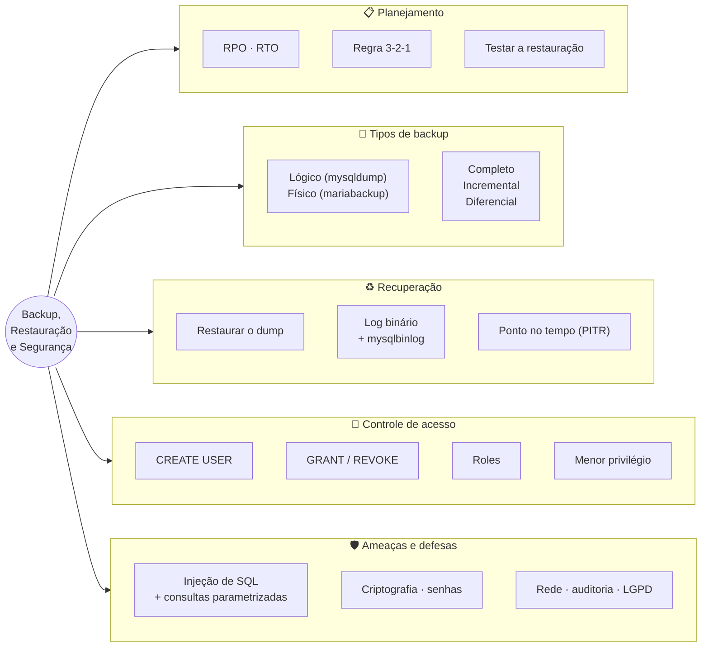
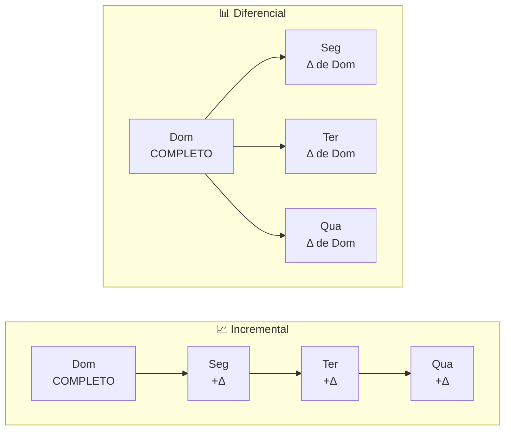
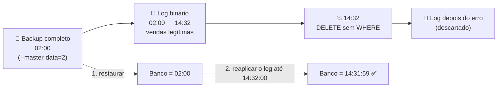

# Tópico 12 — Backup, Restauração e Segurança

**Disciplina:** Banco de Dados — Relacional (IBD015)
**Professor:** Ronan Adriel Zenatti · ronan.zenatti@cps.sp.gov.br
**Fatec Jahu — 2º Semestre/2026**

---

## 🎯 Objetivos do Tópico

Ao final deste tópico você deverá ser capaz de:

- Explicar por que backup é obrigatório e definir **RPO** e **RTO** para um sistema;
- Distinguir backup **lógico** e **físico**, e backup **completo**, **incremental** e **diferencial**, escolhendo a combinação adequada a um cenário;
- Gerar e restaurar backups com `mysqldump` e `mariabackup`, e recuperar o banco até um **ponto no tempo** usando o log binário;
- Criar usuários, conceder e revogar privilégios (`CREATE USER`, `GRANT`, `REVOKE`) aplicando o princípio do **menor privilégio**, incluindo privilégios por coluna e **roles**;
- Reconhecer e prevenir **injeção de SQL** com consultas parametrizadas, e listar medidas básicas de proteção (senhas, rede, criptografia, auditoria).

---

## 🗺️ Mapa Mental do Tópico



---

## 🧭 Contexto

Você pode ter o melhor modelo, as melhores constraints e as transações mais bem escritas — e ainda assim perder tudo em um instante. Um disco que falha, um `DROP DATABASE` no servidor errado, um `DELETE` sem `WHERE` rodado às 16h, um ransomware, um incêndio no data center. Ao mesmo tempo, o banco guarda justamente o que mais interessa a quem quer fazer mal: CPFs, e-mails, histórico de compras, saldos.

Este tópico responde a duas perguntas que todo profissional de dados precisa saber responder:

1. **E se o dado desaparecer ou for corrompido?** → backup e restauração.
2. **E se a pessoa errada tiver acesso ao dado?** → usuários, privilégios e segurança.

Os exemplos usam o `loja_virtual` com a carga ampliada do [Tópico 06](Topico_06_SQL_DQL_Agregacao.md). Os comandos de linha foram escritos para o **XAMPP no Windows** (executáveis em `C:\xampp\mysql\bin`) e todos foram testados em MariaDB 10.4.

---

## 💾 Parte 1 — Backup e Restauração

## 1. Planejando: o que um backup precisa garantir

### 1.1 RPO e RTO

Dois números definem qualquer estratégia de backup — e são decisões de **negócio**, não técnicas:

| Sigla | Nome | Pergunta | Exemplo |
|---|---|---|---|
| **RPO** | *Recovery Point Objective* | Quanto de **dados** posso aceitar perder? (distância entre o último ponto recuperável e a falha) | RPO de 15 min → os últimos 15 min de transações podem se perder |
| **RTO** | *Recovery Time Objective* | Quanto **tempo** posso ficar fora do ar até restaurar? | RTO de 2 h → o banco precisa voltar em até 2 horas |

Quanto menores o RPO e o RTO, mais caro e complexo o esquema. Uma loja virtual pequena pode aceitar RPO de 24 h (backup diário); um banco digital não aceita perder nenhuma transação confirmada.

### 1.2 Três princípios que valem em qualquer cenário

- **Regra 3-2-1:** pelo menos **3** cópias dos dados, em **2** tipos de mídia diferentes, com **1** cópia **fora do local** (outro prédio, outra nuvem). Backup guardado no mesmo disco do banco não é backup — morre junto.
- **Backup não é replicação.** Uma réplica copia fielmente **inclusive o erro**: se alguém executar `DROP TABLE pedidos`, a réplica também perde a tabela segundos depois. Só um backup (ou o log binário) permite voltar no tempo.
- **Backup que nunca foi restaurado é uma hipótese, não um backup.** Teste a restauração periodicamente, em outro servidor, e meça quanto tempo ela leva (esse é o seu RTO real).

---

## 2. Tipos de Backup

### 2.1 Lógico × físico

| | **Lógico** | **Físico** |
|---|---|---|
| O que é | Um arquivo de **comandos SQL** (`CREATE TABLE`, `INSERT`...) que recria o banco | Uma **cópia dos arquivos** de dados do servidor (InnoDB, logs) |
| Ferramenta (MariaDB) | `mysqldump` | `mariabackup` |
| Velocidade de backup | Mais lento (lê as linhas e gera SQL) | **Rápido** (copia arquivos) |
| Velocidade de restauração | **Lenta** (reexecuta todos os `INSERT`s e recria índices) | **Rápida** (copia os arquivos de volta) |
| Tamanho | Texto, comprime bem | Em geral maior, mas incrementável |
| Portabilidade | **Alta**: legível, editável, funciona entre versões e até outros SGBDs com ajustes | Baixa: mesma versão/arquitetura |
| Granularidade | Fácil restaurar **uma tabela** ou um banco | Em regra restaura a instância toda |
| Uso típico | Bancos pequenos/médios, migrações, versionar esquema | Bancos grandes, RTO curto |

### 2.2 Completo, incremental e diferencial

| Tipo | O que copia | Para restaurar você precisa de... |
|---|---|---|
| **Completo** (*full*) | **Tudo** | Só ele |
| **Incremental** | Só o que mudou desde o **último backup de qualquer tipo** | O completo + **todos** os incrementais, em ordem |
| **Diferencial** | Só o que mudou desde o **último completo** | O completo + **o último** diferencial |



| | Incremental | Diferencial |
|---|---|---|
| Tamanho de cada backup | **Pequeno** (só o último dia) | Cresce a cada dia (acumula desde o completo) |
| Tempo de backup | Mais rápido | Um pouco mais lento |
| **Restauração na quarta-feira** | Completo + seg + ter + qua (4 passos; se um incremental estiver corrompido, a cadeia quebra) | Completo + **qua** (2 passos) |
| Em geral | Menor custo de armazenamento | Restauração mais simples e rápida |

> 📌 No MariaDB, o `mysqldump` faz só backup **completo**. Incremental e diferencial existem no backup **físico** com o `mariabackup`: o "diferencial" é simplesmente um incremental cuja base (`--incremental-basedir`) é sempre o **backup completo**, enquanto no incremental a base é o backup **anterior**. Há também o caminho do **log binário** (Seção 5), que funciona como um "incremental contínuo".

### 2.3 Quente, morno e frio

- **A quente** (*hot*): o banco continua **online**, lendo e escrevendo, durante o backup (`mysqldump --single-transaction` e `mariabackup` com tabelas InnoDB).
- **Morno** (*warm*): o banco fica online mas **somente leitura**.
- **A frio** (*cold*): o servidor é **desligado** e os arquivos são copiados. Simples e consistente, mas com indisponibilidade.

!!! tip "✅ Verificação Rápida — escolhendo o tipo de backup"
    Bloco conceitual — confira o entendimento com os dois quizzes abaixo. A resposta é revelada na hora.

<quiz>
O backup completo é feito aos domingos e, a cada dia, é feito um backup incremental. Na quinta-feira, o banco corrompe. O que é necessário restaurar?
- [ ] Apenas o backup incremental de quarta-feira
- [ ] O completo de domingo e o incremental de quarta-feira
- [x] O completo de domingo e todos os incrementais de segunda a quarta, em ordem
- [ ] Apenas o completo de domingo

Cada incremental contém só as mudanças desde o backup imediatamente anterior; para chegar ao estado de quarta é preciso aplicar a cadeia inteira em ordem. Com o diferencial, bastaria o completo mais o último diferencial.
</quiz>

<quiz>
Qual afirmação sobre replicação e backup está correta?
- [ ] Ter uma réplica do banco dispensa o backup
- [x] Uma réplica reproduz também erros como um DROP TABLE acidental, portanto não substitui o backup
- [ ] Backup só é necessário para bancos sem réplica
- [ ] A réplica permite voltar o banco ao estado de ontem

A replicação mantém uma cópia atual (útil para disponibilidade). Como ela aplica os mesmos comandos, o erro se propaga. Para voltar no tempo é preciso backup mais o log binário.
</quiz>

!!! example "🔍 Checkpoint 1 — Definindo a estratégia: telemedicina"
    Uma plataforma de telemedicina tem um banco de **200 GB**, com cerca de **5% dos dados alterados por dia**. Um backup completo leva **3 horas** (e pode rodar a qualquer hora, sem tirar o sistema do ar). O negócio definiu **RPO de 15 minutos** e **RTO de 2 horas**. (a) Monte uma estratégia combinando backups completo, incremental/diferencial e log binário, informando a **frequência** de cada um. (b) Justifique a escolha entre incremental e diferencial. (c) O que você faria para ter confiança de que o RTO de 2 horas é realista? (d) Qual a falha da estratégia "um `mysqldump` por noite, salvo no próprio servidor do banco"?

    🔑 Resolução no [Gabarito do Tópico 12](Topico_12_Gabarito.md#checkpoint-1) — tente resolver antes de conferir.

---

## 3. Backup Lógico com `mysqldump`

O `mysqldump` (em `C:\xampp\mysql\bin\mysqldump.exe`) lê o banco e escreve um arquivo SQL com tudo o que é preciso para recriá-lo.

### 3.1 O comando essencial

```powershell
# PowerShell (Windows) — backup completo e consistente do loja_virtual
& "C:\xampp\mysql\bin\mysqldump.exe" -u root -p `
    --default-character-set=utf8mb4 `
    --single-transaction --routines --triggers --events `
    --databases loja_virtual `
    --result-file="C:\backup\loja_virtual_2026-10-23.sql"
```

(O `-p` sozinho pede a senha de forma interativa — melhor que escrevê-la no comando, onde ela ficaria no histórico. Em uma linha só, no `cmd`, remova as crases e junte as opções.)

| Opção | O que faz | Por que importa |
|---|---|---|
| `--databases loja_virtual` | Inclui `CREATE DATABASE` e `USE` no arquivo | Sem ela, o dump contém só as tabelas, sem o comando de criar o banco |
| `--single-transaction` | Lê tudo dentro de **uma transação** com snapshot consistente (usa o MVCC do Tópico 11) | Backup **a quente** e consistente de tabelas InnoDB, **sem travar** escritas |
| `--routines` | Inclui *stored procedures* e *functions* | **Sem ela, as procedures não vão para o backup** |
| `--triggers` | Inclui gatilhos (já é padrão) | Mantida por clareza |
| `--events` | Inclui eventos agendados | Idem |
| `--default-character-set=utf8mb4` | Define a codificação de saída | Evita corromper acentos |
| `--result-file=ARQ` | Grava direto no arquivo | Evita o problema do `>` do PowerShell (veja abaixo) |
| `--no-data` | Só estrutura (sem `INSERT`s) | Exporta o esquema |
| `--no-create-info` | Só dados | Recarregar dados |
| `--flush-logs` | Troca o arquivo de log binário ao começar | Marca um novo ponto de partida (precisa do privilégio `RELOAD`) |
| `--master-data=2` | Grava em comentário o arquivo/posição do log binário no momento do backup | Base da recuperação até um ponto no tempo (Seção 5) |

> ⚠️ **Pegadinha de Windows:** em versões antigas do PowerShell (Windows PowerShell 5.1), `mysqldump ... > arquivo.sql` grava o arquivo em **UTF-16**, e o `mysql` não consegue ler o resultado ("cannot read ... invalid"). Use sempre `--result-file=` (como acima) ou o `cmd`.

Backups parciais:

```powershell
# Somente a estrutura (esquema), sem dados
& "C:\xampp\mysql\bin\mysqldump.exe" -u root -p --no-data --databases loja_virtual --result-file="C:\backup\loja_schema.sql"

# Somente os dados de duas tabelas (sem CREATE TABLE)
& "C:\xampp\mysql\bin\mysqldump.exe" -u root -p --no-create-info loja_virtual produtos categorias --result-file="C:\backup\loja_dados.sql"

# Um banco sem o CREATE DATABASE (para restaurar com outro nome)
& "C:\xampp\mysql\bin\mysqldump.exe" -u root -p --single-transaction --routines loja_virtual --result-file="C:\backup\loja_sem_db.sql"
```

### 3.2 Conferindo o backup

Um arquivo gerado não é prova de um backup bom. Confira o mínimo:

```powershell
Get-Item C:\backup\loja_virtual_2026-10-23.sql | Select-Object Name, Length    # tamanho razoável?
Get-Content C:\backup\loja_virtual_2026-10-23.sql -Tail 2                       # termina com "-- Dump completed on ..."?
(Select-String -Path C:\backup\loja_virtual_2026-10-23.sql -Pattern "CREATE TABLE").Count   # 7 tabelas no loja_virtual
Select-String -Path C:\backup\loja_virtual_2026-10-23.sql -Pattern "CREATE .*PROCEDURE|CREATE .*FUNCTION|TRIGGER"   # rotinas e gatilhos presentes?
```

> ⚠️ **Um backup pode omitir objetos sem avisar.** Num teste, o `mysqldump --routines` executado por um usuário **sem** permissão para ler as definições das rotinas gerou o arquivo normalmente, **sem nenhuma procedure ou função** e sem erro algum. No MariaDB 10.4, o usuário de backup precisa de `SELECT` em `mysql.proc` para as rotinas entrarem no dump (veja o usuário de backup na Seção 7.3). Por isso o passo "conferir se o arquivo contém o que deveria" não é opcional.

### 3.3 Restaurando

No `cmd`, o redirecionamento `<` envia o arquivo para o cliente; no PowerShell, o `<` **não existe** — use o comando `source`:

```powershell
# Opção 1 (cmd.exe):
#   "C:\xampp\mysql\bin\mysql.exe" -u root -p < C:\backup\loja_virtual_2026-10-23.sql

# Opção 2 (PowerShell ou cmd) — comando source do cliente, com barras normais:
& "C:\xampp\mysql\bin\mysql.exe" -u root -p -e "source C:/backup/loja_virtual_2026-10-23.sql"
```

Como o dump foi gerado com `--databases`, ele recria o banco `loja_virtual` (apagando e criando as tabelas). Para **restaurar em outro nome** (ideal para testar o backup sem tocar no banco real), use o dump sem o `CREATE DATABASE`:

```powershell
& "C:\xampp\mysql\bin\mysql.exe" -u root -p -e "CREATE DATABASE loja_virtual_teste CHARACTER SET utf8mb4 COLLATE utf8mb4_unicode_ci"
& "C:\xampp\mysql\bin\mysql.exe" -u root -p loja_virtual_teste -e "source C:/backup/loja_sem_db.sql"
```

Confirme comparando contagens (num teste, `loja_virtual` e `loja_virtual_teste` devolveram 15 pedidos cada, e as rotinas foram recriadas):

```sql
SELECT 'original' AS origem, COUNT(*) AS pedidos FROM loja_virtual.pedidos
UNION ALL
SELECT 'copia', COUNT(*) FROM loja_virtual_teste.pedidos;
```

### 3.4 Cuidados com o arquivo de backup

- É **texto puro** com todos os dados pessoais (CPFs, e-mails). Trate-o como o próprio banco: **nunca** em pasta pública, em repositório Git ou enviado por mensagem. Proteja com permissão de acesso e, de preferência, comprima e **criptografe**.
- Inclua a data no nome (`loja_virtual_2026-10-23.sql`) e defina uma **política de retenção** (ex.: 7 diários, 4 semanais, 12 mensais) para não encher o disco nem apagar cedo demais.
- Automatize: um script (`.ps1` ou `.bat`) chamado pelo **Agendador de Tarefas** do Windows (no Linux, o `cron`). Backup manual é backup que um dia será esquecido.

!!! example "🔍 Checkpoint 2 — Montando os comandos: monitoramento de energia solar"
    Uma empresa de energia solar mantém o banco `energia_solar` no XAMPP. Escreva os comandos `mysqldump`/`mysql` para: **(a)** backup completo e consistente, incluindo procedures, funções e gatilhos, em `C:\backup\energia_solar.sql`; **(b)** exportar somente a **estrutura** do banco; **(c)** exportar somente os **dados** das tabelas `inversores` e `leituras_inversores`; **(d)** restaurar o backup (a) em um banco de teste chamado `energia_solar_teste`, sem alterar o banco real; **(e)** um comando ou consulta que ajude a confirmar que a restauração funcionou.

    🔑 Resolução no [Gabarito do Tópico 12](Topico_12_Gabarito.md#checkpoint-2) — tente resolver antes de conferir.

---

## 4. Backup Físico com `mariabackup`

Para bancos grandes, reler todas as linhas para gerar SQL é lento demais, e reexecutar milhões de `INSERT`s na restauração, mais ainda. O `mariabackup` (`C:\xampp\mysql\bin\mariabackup.exe`) copia os **arquivos de dados do InnoDB** com o servidor no ar, junto com o trecho do *redo log* necessário para deixá-los consistentes, e suporta **backups incrementais**.

```powershell
# 1) Backup COMPLETO
& "C:\xampp\mysql\bin\mariabackup.exe" --backup --user=root --password=SENHA `
    --target-dir="C:\backup\fisico\completo"

# 2) Backup INCREMENTAL: a base é o backup ANTERIOR (completo ou outro incremental)
& "C:\xampp\mysql\bin\mariabackup.exe" --backup --user=root --password=SENHA `
    --target-dir="C:\backup\fisico\inc1" --incremental-basedir="C:\backup\fisico\completo"
& "C:\xampp\mysql\bin\mariabackup.exe" --backup --user=root --password=SENHA `
    --target-dir="C:\backup\fisico\inc2" --incremental-basedir="C:\backup\fisico\inc1"

# 2b) Backup DIFERENCIAL: a base é SEMPRE o completo
& "C:\xampp\mysql\bin\mariabackup.exe" --backup --user=root --password=SENHA `
    --target-dir="C:\backup\fisico\dif1" --incremental-basedir="C:\backup\fisico\completo"
```

Num teste de cinco minutos com um banco pequeno, o completo ocupou 18 MB e cada incremental ou diferencial cerca de 3,7 MB — a diferença entre "tudo" e "só o que mudou" já aparece.

### 4.1 Restaurando um backup físico

O backup físico **não** pode ser usado direto: antes é preciso **preparar** (`--prepare`), aplicando o redo log para deixar os arquivos consistentes. Com incrementais, prepara-se o completo e depois cada incremental **na ordem**:

```powershell
# Prepara o completo
& "C:\xampp\mysql\bin\mariabackup.exe" --prepare --target-dir="C:\backup\fisico\completo"
# Aplica os incrementais em ordem (para um diferencial: apenas o último)
& "C:\xampp\mysql\bin\mariabackup.exe" --prepare --target-dir="C:\backup\fisico\completo" --incremental-dir="C:\backup\fisico\inc1"
& "C:\xampp\mysql\bin\mariabackup.exe" --prepare --target-dir="C:\backup\fisico\completo" --incremental-dir="C:\backup\fisico\inc2"

# Restaura: o servidor precisa estar PARADO e o diretório de dados VAZIO
& "C:\xampp\mysql\bin\mariabackup.exe" --copy-back --target-dir="C:\backup\fisico\completo" --datadir="C:\xampp\mysql\data"
```

(No Linux, depois do `--copy-back` ajuste o dono dos arquivos para o usuário do servidor — `chown -R mysql:mysql`.) No teste da disciplina, o completo + 2 incrementais, preparados em ordem, foram restaurados em um segundo servidor e devolveram exatamente os mesmos dados do original.

> 📌 `mysqldump` e `mariabackup` não competem: o dump lógico é ótimo para migrar e para recuperar uma tabela; o físico, para restaurar rápido bancos grandes. Muitos ambientes usam os dois.

---

## 5. Log Binário e Recuperação até um Ponto no Tempo (PITR)

Imagine: o último backup é das 02h; às 14h32 alguém executa `DELETE FROM itens_pedidos;` sem `WHERE`. Restaurar o backup das 02h devolve o banco ao estado de 12 horas atrás — **perdendo todas as vendas legítimas da manhã**. A saída é o **log binário** (*binary log*): um registro sequencial de **todos os comandos que alteram dados**. Combinando o último backup completo com o log, dá para "reexecutar o filme" **até o instante imediatamente anterior ao erro**: é a ***Point-in-Time Recovery* (PITR)**, e é o que permite um RPO de minutos.

### 5.1 Habilitando no XAMPP

No arquivo `C:\xampp\mysql\bin\my.ini`, seção `[mysqld]`, ative (o XAMPP vem com `#log-bin=mysql-bin` comentado):

```ini
log-bin=mysql-bin
server-id=1
expire_logs_days=7        # apaga logs com mais de 7 dias (ajuste ao seu ciclo de backup)
```

Reinicie o MySQL no painel do XAMPP. Os arquivos `mysql-bin.000001`, `000002`... aparecem em `C:\xampp\mysql\data`. Para conferir:

```sql
SELECT @@log_bin;          -- 1
SHOW BINARY LOGS;          -- lista os arquivos e tamanhos
```

### 5.2 O roteiro da recuperação



**Passo 0 — antes do backup (rotina):** gere o dump com `--master-data=2` (grava no arquivo a posição do log binário em que ele foi tirado) e, se quiser, `--flush-logs`:

```powershell
& "C:\xampp\mysql\bin\mysqldump.exe" -u root -p --single-transaction --flush-logs --master-data=2 `
    --routines --triggers --databases loja_virtual --result-file="C:\backup\loja_pitr.sql"
```

No topo do arquivo aparece um comentário como `-- CHANGE MASTER TO MASTER_LOG_FILE='mysql-bin.000002', MASTER_LOG_POS=385;` — é o ponto de partida do log.

**Quando acontece o acidente:**

1. **Pare as escritas** (tire a aplicação do ar) e **faça uma cópia dos arquivos de log binário** — eles são a prova do que aconteceu e a fonte da recuperação.
2. **Restaure o último backup completo**:
   ```powershell
   & "C:\xampp\mysql\bin\mysql.exe" -u root -p -e "source C:/backup/loja_pitr.sql"
   ```
3. **Descubra o instante do erro**, lendo o log (o comando `mysqlbinlog` traduz o arquivo binário em texto; cada comando vem precedido de uma linha `#AAMMDD hh:mm:ss ... end_log_pos N` com a data e a posição):
   ```powershell
   & "C:\xampp\mysql\bin\mysqlbinlog.exe" --database=loja_virtual --start-position=385 "C:\xampp\mysql\data\mysql-bin.000002" |
       Select-String -Pattern "DELETE FROM" -Context 6,0
   ```
   (Se o `binlog_format` do servidor for `ROW`, acrescente `--base64-output=DECODE-ROWS --verbose` para ler as linhas alteradas; no padrão `MIXED` do MariaDB 10.4, a maioria dos comandos aparece como texto SQL.)
4. **Reaplique o log até imediatamente antes do erro**, usando a posição inicial do dump e um limite de tempo (ou de posição) logo antes do `DELETE`:
   ```powershell
   & "C:\xampp\mysql\bin\mysqlbinlog.exe" --database=loja_virtual `
       --start-position=385 --stop-datetime="2026-10-23 14:32:00" `
       "C:\xampp\mysql\data\mysql-bin.000002" --result-file="C:\backup\replay.sql"
   & "C:\xampp\mysql\bin\mysql.exe" -u root -p -e "source C:/backup/replay.sql"
   ```
5. **Valide** (contagens, uma venda do período) e só então religue a aplicação.

Num experimento da disciplina: um backup completo (27 itens de pedido, 15 pedidos) → um novo pedido e um `UPDATE` de estoque → `DELETE FROM itens_pedidos` (0 itens) → restauração do completo (27 itens, 15 pedidos, o pedido novo perdido) → reaplicação do log até um instante antes do `DELETE` → **27 itens, 16 pedidos, estoque correto**: o banco voltou ao instante exato anterior ao erro, com o trabalho legítimo preservado.

> 💡 `--stop-position=N` (a posição exata do evento) é mais preciso que `--stop-datetime` quando vários comandos ocorrem no mesmo segundo. Quando o log tem muitos arquivos, passe todos em ordem. Em produção, treine esse procedimento **antes** da emergência — ninguém quer aprender `mysqlbinlog` durante um incidente.

!!! example "🔍 Checkpoint 3 — Recuperação até um ponto no tempo: gig economy"
    Uma plataforma de entregas faz backup completo (com `--master-data=2`) todo dia às 03h e mantém o log binário ligado. Às 15h07 um desenvolvedor executa, no banco de produção, `DELETE FROM entregas;` (sem `WHERE`) em vez de rodar em ambiente de teste. O último backup tem posição `mysql-bin.000014`, `MASTER_LOG_POS=120`. Descreva, em ordem, **todos os passos** da recuperação (inclusive o que fazer **antes** de restaurar) e escreva os comandos principais. Por que simplesmente restaurar o backup das 03h seria insuficiente?

    🔑 Resolução no [Gabarito do Tópico 12](Topico_12_Gabarito.md#checkpoint-3) — tente resolver antes de conferir.

---

## 🔐 Parte 2 — Segurança

## 6. Conceitos Básicos de Segurança em Banco de Dados

A segurança da informação se apoia em três objetivos (tríade **CID**):

| Objetivo | Significa | Exemplo de violação |
|---|---|---|
| **C**onfidencialidade | Só quem deve ver, vê | Vazamento da tabela `pessoas` com CPFs |
| **I**ntegridade | Só quem deve alterar, altera — e corretamente | Um estagiário atualizando preços |
| **D**isponibilidade | O dado está acessível quando necessário | Ransomware ou backup inexistente |

E o controle de acesso se organiza em três perguntas: **autenticação** (*quem é você?* — usuário e senha), **autorização** (*o que você pode fazer?* — privilégios) e **auditoria** (*o que você fez?* — registro das ações). O princípio que guia tudo isso é o do **menor privilégio**: cada usuário e cada aplicação recebem **somente** as permissões de que realmente precisam — nem uma a mais. Se a conta da aplicação for invadida, o estrago fica limitado ao que ela podia fazer.

### 6.1 A situação do XAMPP "de fábrica"

Uma instalação padrão do XAMPP serve para **estudo e desenvolvimento**, não para produção: o usuário `root` do banco vem **sem senha**, existem contas `root` para vários hosts, e o banco de exemplo `test` pode ser acessado por qualquer usuário. Um mínimo de endurecimento (*hardening*):

```sql
-- 1) Defina senha para o root (e depois atualize a senha em phpMyAdmin\config.inc.php,
--    senão o phpMyAdmin deixa de conseguir entrar)
ALTER USER 'root'@'localhost' IDENTIFIED BY 'Uma#Senha#Forte2026';

-- 2) Veja quem existe e quem está sem senha
SELECT user, host, IF(password = '', 'SEM SENHA', 'com senha') AS senha FROM mysql.user;

-- 3) Remova contas e bancos desnecessários
DROP DATABASE IF EXISTS test;
```

Além disso: **não exponha a porta 3306 à internet** (mantenha `bind-address=127.0.0.1` ou use firewall), mantenha o servidor atualizado, e **nunca use `root` na aplicação** (próxima seção).

---

## 7. Usuários e Privilégios

### 7.1 Criando e gerenciando usuários

No MariaDB, uma conta é identificada por **usuário + host de origem**: `'app_loja'@'localhost'` e `'app_loja'@'%'` são contas **diferentes**.

```sql
-- Cria a conta (somente conexões a partir da própria máquina)
CREATE USER 'app_loja'@'localhost' IDENTIFIED BY 'Troque#Esta123';

-- Troca a senha
ALTER USER 'app_loja'@'localhost' IDENTIFIED BY 'NovaSenha#2026';
SET PASSWORD FOR 'app_loja'@'localhost' = PASSWORD('NovaSenha#2026');   -- forma alternativa

-- Limita recursos da conta
ALTER USER 'app_loja'@'localhost' WITH MAX_USER_CONNECTIONS 20;

-- Remove
DROP USER 'app_loja'@'localhost';
```

| Host | Quem pode usar a conta |
|---|---|
| `'localhost'` | Apenas conexões da própria máquina do servidor |
| `'192.168.0.10'` | Apenas desse IP |
| `'192.168.0.%'` | Qualquer IP da rede |
| `'%'` | **Qualquer origem** — evite, a menos que haja firewall e senha forte |

### 7.2 `GRANT`, `REVOKE` e `SHOW GRANTS`

Um usuário recém-criado **não pode fazer nada** (só conectar). Cada permissão é concedida explicitamente:

```sql
GRANT privilegios ON nivel TO 'usuario'@'host';
REVOKE privilegios ON nivel FROM 'usuario'@'host';
SHOW GRANTS FOR 'usuario'@'host';
```

**Níveis (escopo) de concessão**, do mais amplo ao mais restrito:

| Nível | Sintaxe | Exemplo |
|---|---|---|
| Global (servidor inteiro) | `*.*` | `GRANT ALL ON *.* ...` (administrador — **perigoso**) |
| Banco de dados | `banco.*` | `GRANT SELECT, INSERT ON loja_virtual.* ...` |
| Tabela | `banco.tabela` | `GRANT SELECT ON loja_virtual.pedidos ...` |
| **Coluna** | `GRANT SELECT (col1, col2) ON banco.tabela` | só algumas colunas |
| Rotina | `ON PROCEDURE banco.rotina` | `GRANT EXECUTE ON PROCEDURE loja_virtual.sp_registrar_pedido ...` |

**Privilégios mais usados:**

| Privilégio | Permite |
|---|---|
| `SELECT`, `INSERT`, `UPDATE`, `DELETE` | Ler e alterar dados (DML/DQL) |
| `CREATE`, `ALTER`, `DROP`, `INDEX` | Alterar a estrutura (DDL) |
| `EXECUTE` | Executar procedures e functions |
| `TRIGGER`, `EVENT`, `SHOW VIEW`, `LOCK TABLES` | Gatilhos, eventos, ver visões, travar tabelas (usados em backup) |
| `ALL PRIVILEGES` | Todos os do nível indicado, **exceto** `GRANT OPTION` |
| `GRANT OPTION` | Repassar os próprios privilégios a outros — **raramente** conceda |

### 7.3 Perfis de acesso típicos (menor privilégio na prática)

```sql
-- 1) A APLICAÇÃO: só manipula dados do seu banco; não altera estrutura
CREATE USER 'app_loja'@'localhost' IDENTIFIED BY 'Troque#Esta123';
GRANT SELECT, INSERT, UPDATE, DELETE ON loja_virtual.* TO 'app_loja'@'localhost';

-- 2) O ANALISTA DE BI: lê apenas o necessário — e NÃO enxerga CPF nem telefone
CREATE USER 'analista_bi'@'localhost' IDENTIFIED BY 'Outra#Senha456';
GRANT SELECT (id_pessoa, nome, email, data_nascimento) ON loja_virtual.pessoas TO 'analista_bi'@'localhost';
GRANT SELECT ON loja_virtual.pedidos TO 'analista_bi'@'localhost';
GRANT SELECT ON loja_virtual.vw_produtos_ativos TO 'analista_bi'@'localhost';   -- uma visão (Tópico 07)

-- 3) O USUÁRIO DE BACKUP: lê tudo e nada mais
CREATE USER 'backup_loja'@'localhost' IDENTIFIED BY 'Backup#789';
GRANT SELECT, SHOW VIEW, TRIGGER, EVENT, LOCK TABLES ON loja_virtual.* TO 'backup_loja'@'localhost';
GRANT SELECT ON mysql.proc TO 'backup_loja'@'localhost';       -- para o dump incluir procedures e funções (MariaDB 10.4)
```

O que acontece quando alguém tenta ir além do que pode (resultados reais dos testes):

```text
-- app_loja tenta alterar a estrutura:
ERROR 1142 (42000): CREATE command denied to user 'app_loja'@'localhost' for table `loja_virtual`.`x`
ERROR 1142 (42000): DROP command denied to user 'app_loja'@'localhost' for table `loja_virtual`.`pedidos`
ERROR 1142 (42000): SELECT command denied to user 'app_loja'@'localhost' for table `mysql`.`user`

-- analista_bi tenta ler a coluna protegida:
ERROR 1143 (42000): SELECT command denied to user 'analista_bi'@'localhost' for column 'cpf' in table 'pessoas'
-- ... ou outra tabela:
ERROR 1142 (42000): SELECT command denied to user 'analista_bi'@'localhost' for table `loja_virtual`.`produtos`
```

Uma consulta com `SELECT *` na tabela `pessoas` **também falha** para o analista, porque `*` inclui `cpf`: o analista precisa listar as colunas permitidas (outra razão para evitar o `SELECT *`).

| Erro | Significado |
|---|---|
| `1045 Access denied for user` | Usuário/senha/host incorretos (autenticação) |
| `1044 Access denied ... to database` | Sem acesso ao banco |
| `1142 ... command denied ... for table` | Sem o privilégio na **tabela** (autorização) |
| `1143 ... command denied ... for column` | Sem o privilégio na **coluna** |

### 7.4 `REVOKE` e verificação

```sql
REVOKE INSERT, UPDATE, DELETE ON loja_virtual.* FROM 'app_loja'@'localhost';
REVOKE ALL PRIVILEGES, GRANT OPTION FROM 'estagio'@'localhost';       -- tira tudo
SHOW GRANTS FOR 'analista_bi'@'localhost';                            -- confira sempre depois
```

(O `FLUSH PRIVILEGES` só é necessário quando as tabelas de privilégio `mysql.*` são alteradas **diretamente** com `INSERT`/`UPDATE`; `GRANT`, `REVOKE`, `CREATE USER` já têm efeito imediato.)

!!! example "🔍 Checkpoint 4 — Perfis de acesso: app de saúde digital"
    Um app de saúde digital tem o banco `saude_digital` com as tabelas `pacientes` (nome, cpf, telefone, data_nascimento, ...), `consultas` e `prescricoes`. Escreva o `CREATE USER` e os `GRANT` para três contas: **(a)** `app_saude`, usada pelo sistema, com leitura e escrita nas três tabelas, mas **sem** poder alterar a estrutura; **(b)** `pesquisador`, que analisa consultas e **só** vê `pacientes` sem `cpf`, `nome` nem `telefone`; **(c)** `auditor`, que só lê (`SELECT`) as três tabelas. Indique, para cada uma, um comando que ela **não** deve conseguir executar e o erro esperado.

    🔑 Resolução no [Gabarito do Tópico 12](Topico_12_Gabarito.md#checkpoint-4) — tente resolver antes de conferir.

---

## 8. Roles e Camadas de Proteção

### 8.1 Roles — privilégios por função, não por pessoa

Gerenciar privilégios usuário a usuário não escala: quando a equipe de atendimento ganha uma nova pessoa, quem lembra de repetir 6 `GRANT`s? Uma ***role*** (papel) é um **conjunto nomeado de privilégios** que se concede a vários usuários de uma vez (MariaDB 10.0.5+):

```sql
-- 1) Define os papéis e seus privilégios, uma única vez
CREATE ROLE role_atendimento;
GRANT SELECT ON loja_virtual.pedidos                              TO role_atendimento;
GRANT SELECT, INSERT ON loja_virtual.itens_pedidos                TO role_atendimento;
GRANT SELECT (id_pessoa, nome, email) ON loja_virtual.pessoas     TO role_atendimento;

CREATE ROLE role_financeiro;
GRANT SELECT ON loja_virtual.* TO role_financeiro;

-- 2) Atribui os papéis às pessoas
CREATE USER 'maria'@'localhost' IDENTIFIED BY 'Maria#123';
CREATE USER 'joao'@'localhost'  IDENTIFIED BY 'Joao#123';
GRANT role_atendimento TO 'maria'@'localhost';
GRANT role_financeiro  TO 'joao'@'localhost';

-- 3) Define o papel ativo por padrão no login
SET DEFAULT ROLE role_atendimento FOR 'maria'@'localhost';
```

Um detalhe do MariaDB: **conceder** a role não a **ativa**. Quem não tem um papel padrão definido precisa ativá-lo na sessão com `SET ROLE`. Nos testes, a `maria` (com `DEFAULT ROLE`) já consultava `pedidos` ao entrar; já o `joao`, sem papel padrão, recebeu `SELECT command denied` até executar `SET ROLE role_financeiro`:

```sql
SELECT CURRENT_ROLE();         -- NULL para o joao, logo após o login
SET ROLE role_financeiro;
SELECT CURRENT_ROLE();         -- role_financeiro
```

Para tirar um privilégio de todo mundo que tem aquele papel, basta um único `REVOKE` na role (`REVOKE INSERT ON loja_virtual.itens_pedidos FROM role_atendimento`). `SHOW GRANTS FOR role_atendimento` mostra o conteúdo.

### 8.2 Visões e procedures como "porteiros"

Os Tópicos 07 e 09 já deram as ferramentas para limitar o acesso **sem** dar o acesso à tabela:

- **Visão (`VIEW`):** `GRANT SELECT` na visão que mostra apenas as colunas/linhas liberadas; a tabela original continua inacessível (o `analista_bi` leu `vw_produtos_ativos`, mas levou `denied` em `produtos`).
- **Procedure:** como a procedure roda com os privilégios de quem a **criou** (`SQL SECURITY DEFINER`), é possível conceder só `EXECUTE`:

```sql
CREATE USER 'estagio'@'localhost' IDENTIFIED BY 'Estagio#000';
GRANT EXECUTE ON PROCEDURE loja_virtual.sp_listar_pedidos_cliente TO 'estagio'@'localhost';
```

Nos testes, o `estagio` conseguiu `CALL loja_virtual.sp_listar_pedidos_cliente(3)` (e viu os pedidos da cliente 3), mas `SELECT * FROM loja_virtual.pedidos` retornou `ERROR 1142 ... command denied`. A **única porta de entrada** para os dados passou a ser a rotina, com a lógica e as validações que você escreveu.

!!! example "🔍 Checkpoint 5 — Roles: rede de hospitais"
    Uma rede de clínicas quer organizar o acesso ao banco `clinica` em três papéis: **recepcao** (lê `pacientes` e `agendamentos`; insere e atualiza `agendamentos`, sem ver `prontuarios`), **medico** (tudo o que a recepção faz, mais leitura e inserção em `prontuarios`) e **ti_suporte** (só lê tudo). Escreva o SQL para criar os papéis, conceder privilégios, criar um usuário `ana_recepcao` com o papel `recepcao` já ativo no login e depois **remover** de `recepcao` o direito de atualizar agendamentos. Como o `medico` pode reaproveitar os privilégios de `recepcao` sem repetir os `GRANT`s?

    🔑 Resolução no [Gabarito do Tópico 12](Topico_12_Gabarito.md#checkpoint-5) — tente resolver antes de conferir.

---

## 9. Injeção de SQL e Outras Defesas

### 9.1 O ataque

A **injeção de SQL** (*SQL injection*) ocorre quando a aplicação **monta o comando SQL concatenando texto digitado pelo usuário**. Se a entrada contiver SQL, ela deixa de ser *dado* e vira *comando*. É uma das vulnerabilidades mais antigas e mais exploradas — e **totalmente evitável**.

```text
-- Código da aplicação (VULNERÁVEL):
comando = "SELECT id_pessoa, nome FROM pessoas WHERE email = '" + email_digitado + "' AND deletado_em IS NULL"

-- O usuário digita no campo e-mail:    x' OR '1'='1
-- O comando que o banco recebe:
SELECT id_pessoa, nome FROM pessoas WHERE email = 'x' OR '1'='1' AND deletado_em IS NULL
```

Como `'1'='1'` é sempre verdadeiro (e o `AND` tem precedência sobre o `OR`, Tópico 06), a condição inteira passa a ser verdadeira: num teste, a consulta devolveu **todas as 12 pessoas** em vez de nenhuma. Em um formulário de login, é assim que alguém "entra" sem saber a senha. Variantes mais graves podem ler outras tabelas (`UNION SELECT ...`) ou, quando o driver permite várias instruções por chamada, apagar dados.

### 9.2 A defesa: consultas parametrizadas

A solução é **nunca concatenar**. Com uma consulta preparada (*prepared statement*), o SQL e os **valores** viajam separados: o banco compila o comando com marcadores `?` e depois recebe os valores como **dados**, que não podem alterar a estrutura do comando.

```sql
-- No próprio SQL do MariaDB, para visualizar o conceito:
SET @email_digitado = "x' OR '1'='1";

PREPARE stmt FROM 'SELECT id_pessoa, nome FROM pessoas WHERE email = ? AND deletado_em IS NULL';
EXECUTE stmt USING @email_digitado;      -- 0 linhas: o texto inteiro é tratado como um e-mail (inexistente)

SET @email_ok = 'ana@email.com';
EXECUTE stmt USING @email_ok;            -- Ana Lima
DEALLOCATE PREPARE stmt;
```

Nas linguagens de programação isso é o padrão dos drivers (a sintaxe varia, a ideia é a mesma):

```js
// Node.js (mariadb / mysql2) — o "?" recebe o valor como DADO
const [linhas] = await conexao.execute(
  "SELECT id_pessoa, nome FROM pessoas WHERE email = ? AND deletado_em IS NULL", [emailDigitado]);
```

```python
# Python (mariadb connector) — idem
cursor.execute("SELECT id_pessoa, nome FROM pessoas WHERE email = ? AND deletado_em IS NULL", (email_digitado,))
```

Defesa em profundidade:

- **Parametrize 100% das consultas** — inclusive em `ORDER BY` dinâmico, onde só vale uma lista de valores permitidos (parâmetro não substitui nome de coluna).
- **Menor privilégio** na conta da aplicação (Seção 7): se a injeção acontecer, o dano é limitado — uma conta que não tem `DROP`, `FILE` nem acesso a `mysql.*` não consegue o pior.
- **Valide** a entrada na aplicação (tipo, tamanho, formato) como primeira barreira — mas nunca como a única.
- **Não exiba** a mensagem de erro do banco ao usuário final: ela revela nomes de tabelas e colunas ao atacante.

### 9.3 Senhas, criptografia e conformidade

- **Senhas de usuários do seu sistema:** guarde somente um ***hash* lento com sal** (bcrypt, scrypt, Argon2) calculado **na aplicação** — nunca a senha em texto, e nunca `MD5`/`SHA1` simples, que se quebram em segundos. Dados que precisam ser lidos de volta (ex.: um telefone) não são "senha": proteja-os com permissões e criptografia em repouso.
- **Em trânsito:** conexões entre aplicação e banco por rede devem usar **TLS** (a conta pode exigir: `ALTER USER 'app_loja'@'%' REQUIRE SSL;`).
- **Em repouso:** o MariaDB oferece criptografia de tabelas InnoDB (*data-at-rest encryption*); e **os arquivos de backup também precisam ser criptografados** (Seção 3.4).
- **Auditoria:** registre quem fez o quê. Os gatilhos de auditoria do Tópico 10 resolvem o histórico de dados; para registrar conexões e comandos há o plugin `server_audit` do MariaDB.
- **LGPD (Lei nº 13.709/2018):** CPF, e-mail, telefone e dados de saúde são **dados pessoais** (e os de saúde, *sensíveis*). A lei exige, entre outros, medidas técnicas para proteger os dados contra acessos não autorizados e perdas — exatamente o que este tópico trata: privilégios mínimos, backups protegidos, criptografia e rastreabilidade. Colunas como CPF merecem ser expostas só por visões ou privilégios por coluna.

!!! example "🔍 Checkpoint 6 — Injeção de SQL: app de delivery"
    O login de um app de delivery monta o comando assim: `"SELECT id_cliente FROM clientes WHERE email = '" + email + "' AND senha_hash = '" + hash + "'"`. **(a)** Mostre uma entrada para o campo e-mail que faz o login passar sem conhecer a senha e o comando SQL resultante. **(b)** Reescreva a consulta de forma segura (com `PREPARE`/`EXECUTE` ou como seria no driver da sua linguagem). **(c)** Cite duas medidas, além da parametrização, que reduzem o dano caso uma injeção ocorra em outro ponto do sistema.

    🔑 Resolução no [Gabarito do Tópico 12](Topico_12_Gabarito.md#checkpoint-6) — tente resolver antes de conferir.

---

## 10. Exercícios de Fixação

> 🔑 As resoluções destes cinco exercícios estão no [Gabarito do Tópico 12](Topico_12_Gabarito.md) — tente resolver antes de conferir. Os exercícios 1 e 2 usam o `loja_virtual` no XAMPP; use um ambiente de estudo (não faça o exercício 3 com a conta `root` da sua instalação principal sem entender o que cada comando faz).

**Exercício 1:** gere um backup completo e consistente do `loja_virtual` (com rotinas, gatilhos e eventos) em `C:\backup\`, com a data no nome do arquivo, e **verifique** o resultado: tamanho, final do arquivo (`Dump completed`) e quantidade de `CREATE TABLE`.

**Exercício 2:** restaure esse backup em um banco `loja_virtual_teste` (sem tocar no original) e escreva uma consulta que compare a quantidade de linhas de **todas as tabelas** do original e da cópia.

**Exercício 3:** crie o usuário `app_loja` com permissão apenas de `SELECT`, `INSERT`, `UPDATE`, `DELETE` em `loja_virtual`. Conecte-se como ele e **prove**, com os erros obtidos, que ele não consegue `DROP TABLE`, nem `CREATE TABLE`, nem ler `mysql.user`.

**Exercício 4:** crie o usuário `analista` que lê `pessoas` **sem** as colunas `cpf` e `telefone` e lê `pedidos` e `itens_pedidos`. Teste `SELECT nome, email FROM pessoas` e `SELECT * FROM pessoas`. Depois, resolva o mesmo problema de outra forma: com uma **visão** `vw_pessoas_publico` e `GRANT SELECT` somente nela.

**Exercício 5:** escreva um **plano de backup** de 6 a 8 linhas para o seu Projeto Integrador: o que será copiado, o tipo (lógico/físico; completo/incremental), a frequência, onde as cópias ficam guardadas (regra 3-2-1), por quanto tempo, quem tem acesso e como (e com que frequência) você testará a restauração.

---

## 📚 Referências deste Tópico

- ELMASRI, R.; NAVATHE, S. B. *Sistemas de Banco de Dados*. 7 ed. Cap. 30 — Segurança em banco de dados; Cap. 22 — Recuperação. São Paulo: Pearson, 2018.
- SILBERSCHATZ, A.; SUNDARSHAN, S.; KORTH, H. F. *Sistema de banco de dados*. Cap. 16 — Sistema de recuperação; Cap. 9 — Segurança. Rio de Janeiro: Elsevier Brasil, 2016.
- BRASIL. *Lei nº 13.709, de 14 de agosto de 2018* (Lei Geral de Proteção de Dados Pessoais — LGPD).
- Documentação oficial do MariaDB — [mysqldump](https://mariadb.com/kb/en/mysqldump/), [Mariabackup](https://mariadb.com/kb/en/mariabackup-overview/), [Binary Log](https://mariadb.com/kb/en/binary-log/), [GRANT](https://mariadb.com/kb/en/grant/), [Roles](https://mariadb.com/kb/en/roles_overview/), [PREPARE](https://mariadb.com/kb/en/prepare-statement/)

---

## 🃏 Flashcards de Revisão

??? question "O que são RPO e RTO?"
    **RPO** (*Recovery Point Objective*): quanto de dados é aceitável perder, medido em
    tempo (ex.: 15 min). **RTO** (*Recovery Time Objective*): quanto tempo o sistema pode
    ficar fora do ar até ser restaurado (ex.: 2 h). Ambos são decisões de negócio.

??? question "Qual a diferença entre backup incremental e diferencial?"
    O **incremental** copia o que mudou desde o último backup de qualquer tipo (restaura-se
    o completo + toda a cadeia). O **diferencial** copia o que mudou desde o último
    **completo** (restaura-se o completo + o último diferencial).

??? question "Por que usar --single-transaction no mysqldump?"
    Para ler todas as tabelas InnoDB dentro de uma única transação com snapshot
    consistente, gerando um backup coerente **sem travar** as escritas do sistema.

??? question "Como recuperar o banco até um instante antes de um DELETE acidental?"
    Restaura-se o último backup completo (gerado com `--master-data=2`) e reaplica-se o
    **log binário** com `mysqlbinlog --start-position=... --stop-datetime=...` até logo antes
    do comando errado (PITR). Antes de tudo, preserve os arquivos de log.

??? question "O que é o princípio do menor privilégio?"
    Cada usuário e aplicação recebe somente as permissões estritamente necessárias para
    sua função. Se a conta for comprometida, o estrago fica limitado ao que ela podia fazer
    (ex.: a conta do app não deve ter `DROP` nem acesso a `mysql.*`).

??? question "Por que consultas parametrizadas impedem a injeção de SQL?"
    Porque o comando SQL e os valores seguem separados: o banco compila o comando com
    marcadores (`?`) e recebe o valor como **dado**, que nunca é reinterpretado como
    parte do comando — por isso `x' OR '1'='1` vira apenas um e-mail inexistente.

---

## ✅ Quiz de Fixação

<quiz>
Uma empresa tolera perder no máximo 15 minutos de dados em uma falha. Qual métrica é essa?
- [ ] RTO
- [x] RPO
- [ ] ACID
- [ ] SLA de disponibilidade

O RPO (Recovery Point Objective) mede a quantidade máxima de dados, em tempo, que se aceita perder. O RTO mede o tempo máximo para restaurar o serviço.
</quiz>

<quiz>
Marque todas as afirmações corretas sobre mysqldump e mariabackup.
- [x] O mysqldump gera um backup lógico (arquivo de comandos SQL)
- [x] O mariabackup copia arquivos de dados e permite backup incremental
- [ ] O mysqldump faz backups incrementais nativamente
- [ ] Um dump feito sem --routines inclui as stored procedures por padrão

O mysqldump só faz backup completo; sem --routines as procedures e funções não entram no arquivo (gatilhos entram por padrão). O mariabackup é físico e aceita --incremental-basedir.
</quiz>

<quiz>
Depois de CREATE USER 'ana'@'localhost' IDENTIFIED BY '...'; sem nenhum GRANT, o que ana consegue fazer?
- [ ] Ler todos os bancos, pois não há restrição explícita
- [ ] Executar apenas SELECT no banco padrão
- [x] Apenas conectar-se; não tem privilégio sobre nenhum banco ou tabela
- [ ] Tudo, até que um REVOKE seja executado

O modelo é de negação por padrão: privilégios existem somente se concedidos. Por isso a conta nasce quase sem poder (apenas USAGE).
</quiz>

<quiz>
Qual a diferença entre os erros 1142 e 1143 do MariaDB?
- [ ] 1142 é de autenticação e 1143 de sintaxe
- [x] 1142 indica falta de privilégio sobre a tabela; 1143, sobre uma coluna específica
- [ ] 1142 ocorre no INSERT e 1143 no SELECT
- [ ] São o mesmo erro com mensagens diferentes

Com GRANT SELECT (colunas) o privilégio é por coluna; ler uma coluna não concedida gera 1143. Sem privilégio algum sobre a tabela, o erro é o 1142.
</quiz>

<quiz>
Qual prática impede de forma eficaz a injeção de SQL em um formulário de login?
- [ ] Trocar aspas simples por aspas duplas no texto digitado
- [ ] Usar uma conta root com senha forte na aplicação
- [x] Usar consultas parametrizadas (prepared statements), tratando a entrada sempre como dado
- [ ] Esconder o formulário de login em uma URL difícil de adivinhar

Parametrizar separa estruturalmente comando e dados. As outras opções não corrigem a causa: aspas podem ser contornadas, root piora o dano e obscuridade não é segurança.
</quiz>

---

## 📝 Resumo

Backup é decidido por **RPO** (quanto de dado posso perder) e **RTO** (quanto tempo posso ficar fora),
seguindo a regra 3-2-1 e lembrando que réplica não é backup. O **backup lógico** (`mysqldump`, com
`--single-transaction --routines`) é portátil e simples; o **físico** (`mariabackup`) é rápido e
suporta **incrementais** e **diferenciais**; combinados ao **log binário**, permitem recuperar o banco até
um **instante antes de um erro** (PITR). Backup que não foi restaurado em teste não vale como prova — e o
arquivo gerado contém dados pessoais, devendo ser protegido. Na segurança, vale o **menor privilégio**:
usuários e hosts específicos, `GRANT`/`REVOKE` por banco, tabela, **coluna** ou rotina, **roles** para
organizar por função, visões e procedures como "porteiros", **consultas parametrizadas** contra injeção de
SQL, senhas com hash lento, TLS, auditoria e atenção à LGPD. Falta, agora, tornar o banco **rápido**.

---

## 🏆 Conquista do Tópico

!!! success "Selo desbloqueado: 🛡️ Guardião(ã) da Segurança"
    Você sabe proteger o banco contra a perda (backups testados e recuperação até um
    ponto no tempo) e contra o acesso indevido (privilégios mínimos, roles e consultas
    parametrizadas). A próxima parada da Trilha do(a) Arquiteto(a) de Dados é a
    performance: índices, plano de execução e otimização de consultas.

---

## 🔑 Gabarito deste Tópico

As respostas dos 6 checkpoints espalhados pelo tópico, e dos 5 Exercícios de Fixação da
Seção 10, estão em um arquivo separado, para não estragar a tentativa de quem ainda não
chegou até aqui: [Gabarito — Tópico 12](Topico_12_Gabarito.md).

---

## 🔗 Navegação

⬅️ [Tópico 11 — Functions (UDF) e Transações](./Topico_11_Functions_Transacoes.md) · ➡️ [Tópico 13 — Otimização de Consultas e Índices](./Topico_13_Otimizacao_Indices.md)

---

*Fatec Jahu · IBD015 · Prof. Ronan Adriel Zenatti · 2026*
