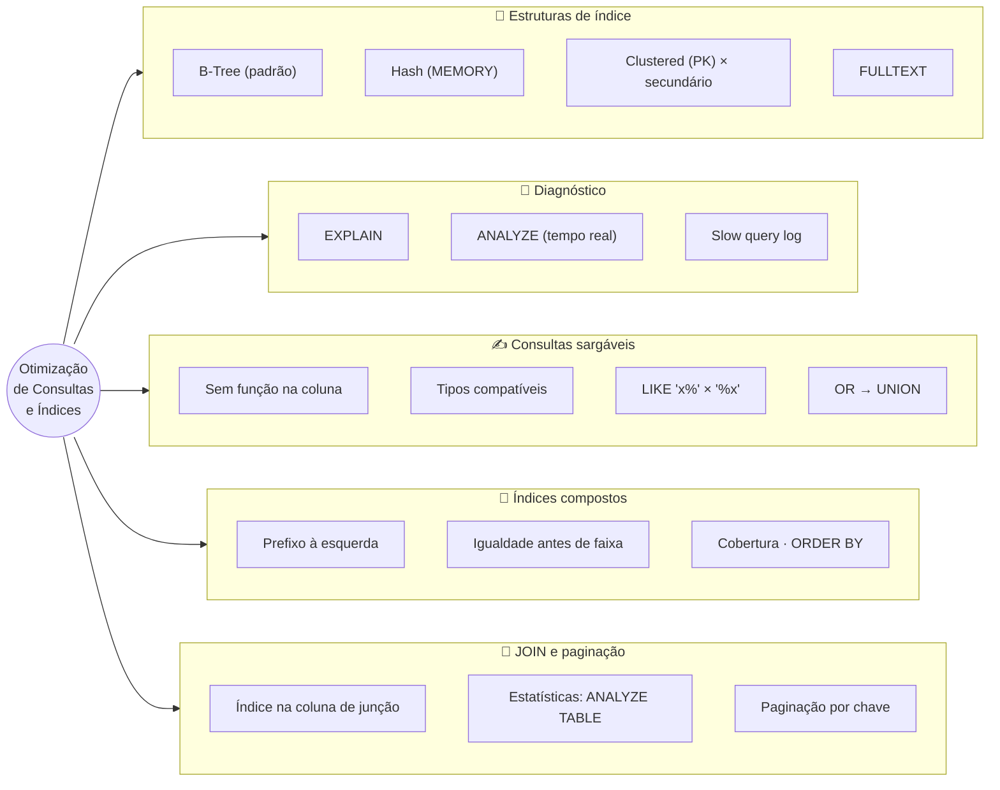
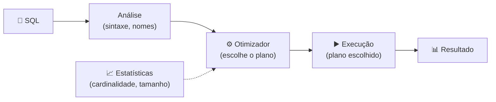
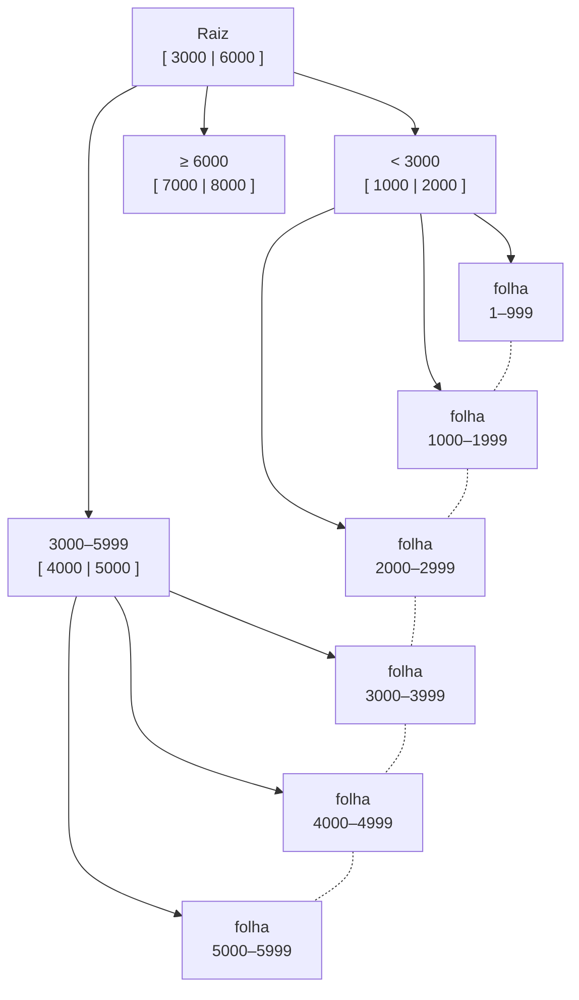

# Tópico 13 — Otimização de Consultas e Índices

**Disciplina:** Banco de Dados — Relacional (IBD015)
**Professor:** Ronan Adriel Zenatti · ronan.zenatti@cps.sp.gov.br
**Fatec Jahu — 2º Semestre/2026**

---

## 🎯 Objetivos do Tópico

Ao final deste tópico você deverá ser capaz de:

- Descrever como funcionam os índices **B-Tree** e **Hash**, o índice agrupado (*clustered*) do InnoDB, e quando cada estrutura serve;
- Ler o plano de execução de uma consulta com `EXPLAIN` e `ANALYZE`, interpretando `type`, `key`, `rows` e `Extra`;
- Reescrever consultas para que o índice possa ser usado (consultas "sargáveis") e evitar as armadilhas mais comuns;
- Projetar índices compostos considerando a ordem das colunas, a cobertura (*covering index*) e a ordenação;
- Otimizar `JOIN`s e subconsultas, paginar com eficiência e manter as estatísticas do otimizador atualizadas;
- Seguir o ciclo **medir → diagnosticar → alterar → medir de novo**, sem otimizar "no escuro".

---

## 🗺️ Mapa Mental do Tópico



---

## 🧭 Contexto

Todo o curso até aqui tratou de fazer a consulta **certa**. Este tópico trata de fazê-la **rápida**. Com 12 pedidos e 12 produtos qualquer consulta é instantânea — o problema só aparece quando a tabela cresce: 200 mil, 20 milhões, 2 bilhões de linhas. Uma consulta que lê a tabela inteira para devolver uma única linha, sem que ninguém perceba nos testes, vira o gargalo que derruba o sistema em produção.

Você já conheceu a ideia do índice no Tópico 08. Agora vamos olhar **por dentro**: como ele é organizado, como **ver** (com o `EXPLAIN`) se o banco o está usando, e como escrever consultas e índices que trabalham **juntos**.

Para sentir a diferença na prática, precisamos de volume. O script abaixo cria, dentro do `loja_virtual`, a tabela `acessos_site` — um registro de navegação com **200.000 linhas** (milhares de visitantes e 40 páginas distintas, ao longo de ~90 dias). Ela nasce **sem nenhum índice** além da chave primária, e vamos criando-os ao longo do tópico.

??? note "📦 Script de carga da tabela `acessos_site` — 200 mil linhas (clique para expandir)"
    O script usa o **motor de sequências** do MariaDB (`seq_1_to_200000`, uma tabela virtual de números de 1 a 200.000) para gerar os dados — recurso do MariaDB que **não existe no MySQL**. Pode ser executado várias vezes (ele recria a tabela).

    ```sql
    -- =============================================================================
    -- Script de apoio (NÃO faz parte do site) — Tópico 13 — Tabela de 200 mil linhas
    -- Disciplina: IBD015 — Banco de Dados Relacional — Fatec Jahu — 2º Sem/2026
    -- Professor: Ronan Adriel Zenatti
    --
    -- Objetivo: criar, no schema loja_virtual, a tabela acessos_site (registro de
    -- navegação de um site, com 200.000 linhas) usada nos experimentos de
    -- EXPLAIN e de índices do Tópico 13.
    --
    -- Como a carga funciona: o MariaDB tem um "motor de sequências" que cria, sem
    -- precisar de tabela alguma, a tabela virtual seq_1_to_200000 (números de 1 a
    -- 200.000). O INSERT ... SELECT usa esses números para gerar valores variados.
    -- ATENÇÃO: o motor SEQUENCE é do MariaDB — não existe no MySQL.
    --
    -- A tabela nasce SEM índice algum além da chave primária, de propósito: o
    -- tópico ensina a criar cada índice na hora certa. Não é uma FK para pessoas
    -- porque tabelas de log de eventos de alto volume costumam registrar o
    -- visitante (inclusive anônimo) sem validar contra outra tabela.
    --
    -- PRÉ-REQUISITO: schema loja_virtual criado (Tópico 03). Pode ser executado
    -- várias vezes (ele recria a tabela).
    --
    -- Como executar (Windows / XAMPP):
    --   "C:\xampp\mysql\bin\mysql.exe" -u root -p --default-character-set=utf8mb4 < sql\Topico_13_Otimizacao_Carga.sql
    -- =============================================================================

    USE loja_virtual;

    DROP TABLE IF EXISTS acessos_site;

    CREATE TABLE acessos_site (
        id_acesso     BIGINT UNSIGNED  NOT NULL AUTO_INCREMENT,
        visitante_id  BIGINT UNSIGNED  NOT NULL,
        pagina        VARCHAR(100)     NOT NULL,
        tipo_evento   ENUM('visualizacao', 'clique', 'busca', 'compra') NOT NULL,
        duracao_ms    INT UNSIGNED     NOT NULL,
        dispositivo   VARCHAR(20)      NOT NULL,
        ocorrido_em   DATETIME         NOT NULL,
        criado_em     DATETIME         NOT NULL DEFAULT CURRENT_TIMESTAMP,
        alterado_em   DATETIME         NOT NULL DEFAULT CURRENT_TIMESTAMP
                                                ON UPDATE CURRENT_TIMESTAMP,
        deletado_em   DATETIME             NULL,

        CONSTRAINT pk_acesso PRIMARY KEY (id_acesso)
    );

    INSERT INTO acessos_site (visitante_id, pagina, tipo_evento, duracao_ms, dispositivo, ocorrido_em)
    SELECT 1 + (seq * 7919) % 5000,                                    -- 5.000 visitantes distintos
           CONCAT('/produto/', 1 + (seq * 31) % 40),                   -- 40 páginas
           ELT(1 + seq % 4, 'visualizacao', 'clique', 'busca', 'compra'),
           100 + (seq * 13) % 9000,                                    -- 100 a 9.099 ms
           ELT(1 + seq % 3, 'desktop', 'celular', 'tablet'),
           '2026-07-25 00:00:00' + INTERVAL (seq * 37) % 7776000 SECOND  -- ~90 dias a partir de 25/07/2026
    FROM seq_1_to_200000;

    -- Atualiza as estatísticas que o otimizador usa para escolher o plano
    ANALYZE TABLE acessos_site;

    -- Conferência
    SELECT COUNT(*)                    AS linhas,
           COUNT(DISTINCT visitante_id) AS visitantes,
           MIN(ocorrido_em)             AS primeiro_acesso,
           MAX(ocorrido_em)             AS ultimo_acesso
    FROM   acessos_site;
    ```

> 📌 Os tempos citados neste tópico foram medidos em MariaDB 10.4 num computador comum. No seu computador os milissegundos e as estimativas de `rows` serão um pouco diferentes — o que importa é a **ordem de grandeza** e a **mudança de plano**.

---

## 1. Como o Banco Executa uma Consulta

Quando você envia um `SELECT`, o banco não o executa "como está escrito". Passa por etapas:



O **otimizador** é *baseado em custo*: ele considera vários planos possíveis (usar este índice ou aquele, juntar as tabelas nesta ou naquela ordem, ler a tabela inteira) e **estima o custo** de cada um com base em **estatísticas** sobre os dados (quantas linhas há, quantos valores distintos cada índice tem). Escolhe o mais barato. Duas consequências:

- Você **não manda** o banco usar um índice — você cria as condições (índice + consulta bem escrita) para que ele o escolha. Se o índice não é usado, existe uma razão, e o `EXPLAIN` mostra qual.
- Com **estatísticas desatualizadas**, o otimizador estima errado e escolhe mal (veja a Seção 6.2).

O custo dominante é quase sempre o de **ler dados do disco** (ou da memória): quantas linhas, quantas páginas o plano precisa tocar. Otimizar é, na maior parte do tempo, **reduzir o número de linhas lidas**.

---

## 2. Estruturas de Índice

### 2.1 B-Tree — o padrão

Se você não escolhe, o índice é uma **B-Tree** (na prática, uma B+Tree): uma árvore **balanceada** e **ordenada**.



- Os **nós internos** servem de "placas de direção": cada um diz para qual filho ir. A busca desce da raiz até a folha em poucos passos. Como cada nó (uma *página* de 16 KB no InnoDB) cabe **centenas** de chaves, uma árvore com **3 a 4 níveis** indexa **milhões** de linhas — achar uma linha custa 3 ou 4 leituras de página, em vez de ler a tabela toda.
- As **folhas** guardam as chaves **em ordem** e são **encadeadas** entre si (as linhas pontilhadas). É isso que permite percorrer um intervalo (`BETWEEN`) ou entregar o resultado já ordenado (`ORDER BY`) sem ordenar de novo.

**O que a B-Tree acelera:** igualdade (`=`), faixas (`<`, `>`, `BETWEEN`), `ORDER BY`/`MIN`/`MAX`, e `LIKE 'texto%'` (prefixo). **O que ela não acelera:** `LIKE '%texto'` (o começo é desconhecido, a ordem não ajuda), nem condições sobre uma coluna **transformada** por função (Seção 4).

### 2.2 Índice agrupado (*clustered*) × índice secundário

No InnoDB a **própria tabela é uma B-Tree ordenada pela chave primária**: as linhas completas ficam nas folhas do índice `PRIMARY`. Por isso o InnoDB chama a PK de **índice agrupado** (*clustered index*). Todos os outros índices são **secundários**: suas folhas guardam a chave do índice **e o valor da PK** da linha. Uma busca por um índice secundário faz, então, **dois passos**: acha a PK no índice secundário e depois vai ao índice agrupado buscar a linha inteira (*lookup*).

Consequências práticas:

- Busca pela **PK é a mais rápida possível** (um único passo até a linha).
- Uma **PK curta** (`BIGINT` de 8 bytes) deixa todos os índices secundários menores, pois cada um carrega uma cópia dela. PK longa (um `VARCHAR(255)` natural) engorda todos.
- PKs sequenciais (`AUTO_INCREMENT`) inserem no fim da árvore; PKs aleatórias (UUID) espalham as inserções e fragmentam — outra razão da Regra 5 pedir `BIGINT UNSIGNED AUTO_INCREMENT`.
- Se o índice secundário **já contém todas as colunas** que a consulta pede, o segundo passo é dispensado (*covering index*, Seção 5.2).

### 2.3 Hash

Um índice **hash** aplica uma função a cada chave e guarda o resultado numa tabela de dispersão: ideal para **igualdade exata**, quase instantâneo — mas sem noção de ordem.

| | **B-Tree** | **Hash** |
|---|---|---|
| `=` (igualdade) | ✅ | ✅ (muito rápido) |
| `<`, `>`, `BETWEEN` | ✅ | ❌ |
| `ORDER BY` | ✅ | ❌ |
| `LIKE 'abc%'` | ✅ | ❌ |
| Prefixo de índice composto | ✅ | ❌ (usa a chave inteira) |
| Disponível no **InnoDB**? | ✅ | ❌ — veja abaixo |

No MariaDB, índices **hash** existem apenas no engine **MEMORY** (tabelas em RAM). No InnoDB, pedir `USING HASH` é aceito e **silenciosamente convertido** em B-Tree. Num teste:

```sql
-- InnoDB: o HASH vira BTREE
CREATE TABLE tmp_hash_innodb (id INT PRIMARY KEY, codigo VARCHAR(20),
                              INDEX idx_codigo USING HASH (codigo)) ENGINE=InnoDB;
SHOW INDEX FROM tmp_hash_innodb;         -- idx_codigo | Index_type: BTREE

-- MEMORY: o HASH é de verdade
CREATE TABLE tmp_hash_mem (id INT, codigo VARCHAR(20),
                           INDEX idx_hash USING HASH (codigo),
                           INDEX idx_btree USING BTREE (id)) ENGINE=MEMORY;
EXPLAIN SELECT * FROM tmp_hash_mem WHERE codigo = 'C777';            -- ref   (usa o hash)
EXPLAIN SELECT * FROM tmp_hash_mem WHERE codigo LIKE 'C77%';         -- ALL   (hash não serve a prefixo)
EXPLAIN SELECT * FROM tmp_hash_mem WHERE id BETWEEN 100 AND 200;     -- range (B-Tree serve a faixa)
```

(O InnoDB mantém, por conta própria, um *índice hash adaptativo* em memória que acelera buscas por igualdade em páginas muito acessadas — mas é automático: você não o cria nem controla.)

### 2.4 Outros tipos

- **`FULLTEXT`**: índice invertido para busca por **palavras** em texto (`MATCH(coluna) AGAINST('termo')`) — a solução quando `LIKE '%palavra%'` fica lento. Serve em tabelas InnoDB do MariaDB 10.0.5+.
- **`SPATIAL`**: dados geográficos (pontos, polígonos) — fora do escopo.

!!! tip "✅ Verificação Rápida — escolhendo a estrutura"
    Bloco conceitual — confira o entendimento com os dois quizzes abaixo. A resposta é revelada na hora.

<quiz>
Uma tabela InnoDB tem índice secundário em email e a PK id_usuario BIGINT. Ao buscar WHERE email = 'ana@x.com' com SELECT *, quantas estruturas o InnoDB percorre?
- [ ] Apenas o índice secundário, pois ele guarda a linha completa
- [x] O índice secundário (que devolve a PK) e depois o índice agrupado (PK) para buscar a linha inteira
- [ ] Apenas o índice agrupado
- [ ] Nenhuma: lê a tabela inteira

As folhas do índice secundário guardam a chave do índice e o valor da PK. Para trazer as demais colunas, o InnoDB usa essa PK para buscar a linha no índice agrupado — por isso uma PK curta torna todos os índices menores.
</quiz>

<quiz>
Marque todas as consultas que um índice B-Tree em preco consegue acelerar.
- [x] WHERE preco = 399.90
- [x] WHERE preco BETWEEN 100 AND 500
- [x] ORDER BY preco LIMIT 10
- [ ] WHERE preco + 10 > 400

A B-Tree guarda os valores ordenados: serve a igualdade, a faixas e à ordenação. Quando a coluna é usada dentro de uma expressão (preco + 10), o banco precisaria calcular a expressão para cada linha e o índice não ajuda.
</quiz>

!!! example "🔍 Checkpoint 1 — Escolhendo a estrutura: plataforma de cloud gaming"
    Uma plataforma de cloud gaming tem seis necessidades de busca. Para cada uma, diga se você usaria **índice B-Tree**, **hash (MEMORY)**, **`FULLTEXT`** ou **nenhum índice**, e por quê: **(a)** achar uma sessão ativa pelo `token_sessao` (32 caracteres), com igualdade exata, em uma tabela pequena e volátil mantida em memória; **(b)** listar jogadores com `pontos` entre 1.000 e 2.000, ordenados por pontos; **(c)** autocompletar o `apelido` digitado até agora (`LIKE 'dra%'`); **(d)** pesquisar jogos cuja `descricao` contenha as palavras "aventura espacial"; **(e)** listar jogadores com `online = 1`, sabendo que só 2% estão online; **(f)** achar apelidos que *contenham* "mer" no meio (`LIKE '%mer%'`).

    🔑 Resolução no [Gabarito do Tópico 13](Topico_13_Gabarito.md#checkpoint-1) — tente resolver antes de conferir.

---

## 3. `EXPLAIN` — a Lupa do Otimizador

O `EXPLAIN` mostra **o plano** que o otimizador escolheu para uma consulta, **sem executá-la**. É a ferramenta número um da otimização. Com a tabela `acessos_site` ainda sem índices:

```sql
EXPLAIN SELECT * FROM acessos_site WHERE visitante_id = 1234;
```

| id | select_type | table | type | possible_keys | key | key_len | ref | rows | Extra |
|---|---|---|---|---|---|---|---|---|---|
| 1 | SIMPLE | acessos_site | **ALL** | NULL | **NULL** | NULL | NULL | **199172** | Using where |

Leitura: o banco vai ler **as 199.172 linhas** (estimativa) da tabela, uma a uma, para aplicar o filtro — e vai devolver só umas 40. Agora o índice:

```sql
CREATE INDEX idx_acessos_site_visitante ON acessos_site (visitante_id);
EXPLAIN SELECT * FROM acessos_site WHERE visitante_id = 1234;
```

| id | select_type | table | type | possible_keys | key | key_len | ref | rows | Extra |
|---|---|---|---|---|---|---|---|---|---|
| 1 | SIMPLE | acessos_site | **ref** | idx_acessos_site_visitante | **idx_acessos_site_visitante** | 8 | const | **40** | |

De 199.172 linhas lidas para **40**. É essa mudança que você procura.

### 3.1 As colunas do `EXPLAIN`

| Coluna | O que diz |
|---|---|
| `select_type` | Tipo de `SELECT` (`SIMPLE`, `PRIMARY`, `SUBQUERY`, `UNION`...) |
| `table` | Tabela (ou alias) a que a linha do plano se refere; em `JOIN`s, uma linha por tabela, **na ordem em que serão lidas** |
| **`type`** | **Como** as linhas são acessadas — a coluna mais importante (tabela abaixo) |
| `possible_keys` | Índices que *poderiam* servir |
| **`key`** | Índice **realmente escolhido** (`NULL` = nenhum) |
| `key_len` | Bytes do índice efetivamente usados — em índice composto, mostra **quantas colunas** entraram (8 = só a `BIGINT`; 13 = `BIGINT` + `DATETIME`) |
| `ref` | O que é comparado com o índice (`const` = uma constante; `tabela.coluna` = uma coluna de outra tabela, num `JOIN`) |
| **`rows`** | **Estimativa** de linhas que o banco precisará examinar |
| **`Extra`** | Detalhes importantes (tabela abaixo) |

**O `type` (do melhor para o pior):**

| `type` | Significado | Exemplo |
|---|---|---|
| `const` / `system` | No máximo **1 linha**, achada por PK ou `UNIQUE` com constante | `WHERE id_pessoa = 3` |
| `eq_ref` | **1 linha** por combinação anterior, em um `JOIN` pela PK/`UNIQUE` | `JOIN pessoas ON pessoas.id_pessoa = pedidos.cliente_id` |
| `ref` | Várias linhas com o **mesmo valor** de índice não único | `WHERE visitante_id = 1234` |
| `range` | Uma **faixa** do índice | `BETWEEN`, `>`, `<`, `IN (...)`, `LIKE 'abc%'` |
| `index` | **Varre o índice inteiro** (melhor que a tabela, mas ainda "tudo") | `COUNT(*)` sem filtro, ou filtro sem prefixo |
| **`ALL`** | **Varre a tabela inteira** (*full table scan*) | sem índice utilizável |

**O `Extra`:**

| Mensagem | Significa |
|---|---|
| `Using where` | Há um filtro aplicado sobre as linhas lidas |
| `Using index` | **Índice de cobertura**: a consulta foi respondida só com o índice, sem ler a tabela (ótimo) |
| `Using index condition` | O filtro foi empurrado para dentro da leitura do índice (também bom) |
| `Using filesort` | Será necessária uma **ordenação extra** (apesar do nome, nem sempre usa disco) — costuma indicar `ORDER BY` sem índice adequado |
| `Using temporary` | O banco criará uma **tabela temporária** (comum em `GROUP BY`/`DISTINCT` sem índice adequado) |
| `Using join buffer` | Um `JOIN` sem índice na coluna de junção (compara por força bruta) |

**Regra de leitura rápida:** olhe primeiro `type` (queremos longe de `ALL`), depois `key` (foi usado?), `rows` (é pequeno?) e `Extra` (há `filesort`/`temporary` evitáveis?).

### 3.2 `ANALYZE` — o plano **com** o resultado real

O `EXPLAIN` mostra a *estimativa*. O comando `ANALYZE` do MariaDB **executa** a consulta e mostra, ao lado da estimativa, o que **realmente** aconteceu:

```sql
ANALYZE SELECT * FROM acessos_site WHERE visitante_id = 1234;
-- acrescenta as colunas: r_rows (linhas realmente lidas), r_filtered (% que passou no filtro)

ANALYZE FORMAT=JSON SELECT * FROM acessos_site WHERE visitante_id = 1234\G
-- inclui r_total_time_ms: o tempo real gasto em cada etapa
```

Sem índice, o `ANALYZE FORMAT=JSON` da mesma consulta mostrou `"access_type": "ALL"`, `"r_rows": 200000`, `"r_filtered": 0.02` (só 0,02% das linhas lidas serviram) e cerca de **67 ms**. Com o índice: `"r_rows": 40` e tempo na casa de centésimos de milissegundo.

> 📌 **No MariaDB, o equivalente ao `EXPLAIN ANALYZE` do PostgreSQL e do MySQL 8 é o `ANALYZE`** (aceita `FORMAT=JSON`). Digitar `EXPLAIN ANALYZE SELECT ...` no MariaDB 10.4 dá erro de sintaxe. Compare `rows` (estimado) com `r_rows` (real): uma grande diferença indica estatísticas desatualizadas (Seção 6.2).

### 3.3 Cuidado: `EXPLAIN` não é cronômetro

Em tabelas pequenas o otimizador pode preferir ler tudo mesmo existindo índice (ler 12 linhas é mais barato que navegar numa árvore), e os tempos medidos são ruído. Teste sempre em um volume **parecido com o de produção** — por isso a tabela de 200 mil linhas.

!!! example "🔍 Checkpoint 2 — Lendo planos: plataforma de streaming"
    Uma plataforma de streaming tem `reproducoes (id_reproducao PK, usuario_id, titulo_id, iniciada_em, minutos_assistidos, dispositivo)` com 200 mil linhas e **nenhum índice** além da PK. Três consultas frequentes têm os planos abaixo. Para cada uma, diga o que o plano revela e **qual índice** resolve.

    | Consulta | `type` | `key` | `rows` | `Extra` |
    |---|---|---|---|---|
    | **Q1:** `SELECT * FROM reproducoes WHERE usuario_id = 777;` | ALL | NULL | 199392 | Using where |
    | **Q2:** `SELECT * FROM reproducoes WHERE usuario_id = 777 ORDER BY iniciada_em DESC LIMIT 20;` | ALL | NULL | 199392 | Using where; **Using filesort** |
    | **Q3:** `SELECT dispositivo, AVG(minutos_assistidos) FROM reproducoes GROUP BY dispositivo;` | ALL | NULL | 199392 | **Using temporary; Using filesort** |

    Crie o índice que resolve Q1 e Q2 **de uma vez**, e explique por que o `Using temporary; Using filesort` de Q3 não precisa (nem deve) ser eliminado com um índice.

    🔑 Resolução no [Gabarito do Tópico 13](Topico_13_Gabarito.md#checkpoint-2) — tente resolver antes de conferir.

---

## 4. Escrevendo Consultas que o Índice Consegue Usar

Existir o índice não garante que será usado. Uma condição que o índice consegue aproveitar é chamada de ***sargable*** (do inglês *Search ARGument ABLE*). Os erros abaixo tornam a condição **não sargável** — o banco precisa calcular algo para cada linha e o índice fica de lado. Todos foram verificados com `EXPLAIN` na tabela de 200 mil linhas.

Antes, crie os índices que usaremos:

```sql
CREATE INDEX idx_acessos_site_ocorrido ON acessos_site (ocorrido_em);
CREATE INDEX idx_acessos_site_pagina   ON acessos_site (pagina);
```

### 4.1 Função aplicada à coluna

```sql
-- ❌ Aplica DATE() à coluna: o índice em ocorrido_em é ignorado
EXPLAIN SELECT * FROM acessos_site WHERE DATE(ocorrido_em) = '2026-09-15';
--  type: ALL · rows: 199172

-- ✅ Compara a coluna "crua" com um intervalo
EXPLAIN SELECT * FROM acessos_site
WHERE  ocorrido_em >= '2026-09-15' AND ocorrido_em < '2026-09-16';
--  type: range · key: idx_acessos_site_ocorrido · rows: 2335
```

O mesmo vale para `YEAR(col) = 2026`, `MONTH(col) = 9`, `UPPER(col) = 'X'`, `LEFT(col, 3) = 'abc'` e **expressões aritméticas** na coluna (`WHERE valor + 10 > 100` → escreva `WHERE valor > 90`). Regra: **deixe a coluna sozinha de um lado do operador e mova o cálculo para o lado da constante**.

### 4.2 Tipos incompatíveis (conversão implícita)

Comparar uma coluna de **texto** com um **número** força o banco a converter *a coluna inteira* para número, linha a linha:

```sql
-- pessoas.cpf é CHAR(11) com índice UNIQUE (uq_cpf)
EXPLAIN SELECT * FROM pessoas WHERE cpf = 11122233344;      -- ❌ número: type ALL, key NULL (possible_keys: uq_cpf)
EXPLAIN SELECT * FROM pessoas WHERE cpf = '11122233344';    -- ✅ texto: type const, key uq_cpf
```

O banco chegou a "ver" o índice (`possible_keys`) mas não pôde usá-lo. Conferir `key` é o que revela o problema — a consulta devolve o mesmo resultado nos dois casos, só muda o custo.

### 4.3 `LIKE`: o `%` no começo mata o índice

```sql
EXPLAIN SELECT COUNT(*) FROM acessos_site WHERE pagina LIKE '/produto/12%';
--  type: range · rows: 5000        (o prefixo é conhecido: a árvore pula direto para a região)

EXPLAIN SELECT COUNT(*) FROM acessos_site WHERE pagina LIKE '%/12';
--  type: index · rows: 199172      (varre o índice inteiro: o começo é desconhecido)
```

Se você precisa mesmo de "contém" em texto longo, o caminho é `FULLTEXT` (Seção 2.4).

### 4.4 `OR` entre colunas diferentes

```sql
-- Os dois lados do OR têm índice → o MariaDB combina os dois (index_merge)
EXPLAIN SELECT * FROM acessos_site WHERE visitante_id = 10 OR pagina = '/produto/3';
--  type: index_merge · Extra: Using union(...)

-- Um dos lados NÃO tem índice (duracao_ms) → lê a tabela toda
EXPLAIN SELECT * FROM acessos_site WHERE visitante_id = 10 OR duracao_ms = 5000;
--  type: ALL
```

Um `OR` só é rápido se **todos** os lados têm índice. Quando um lado não pode ser indexado, reescrever com `UNION ALL` ajuda apenas se cada parte puder usar um índice.

### 4.5 `SELECT *`

Pedir todas as colunas impede o **índice de cobertura** (Seção 5.2), trafega mais dados e quebra silenciosamente quando a tabela ganha colunas. Liste só o necessário.

!!! example "🔍 Checkpoint 3 — Reescrevendo para o índice: fintech"
    Uma fintech guarda `transacoes (id_transacao PK, codigo_conta VARCHAR(12), valor DECIMAL, status, criada_em DATETIME, descricao VARCHAR(100))` com 200 mil linhas, com índices em `codigo_conta` (valores como `'00000042'`) e em `criada_em`. Estas consultas não usam os índices — descubra o motivo de cada uma e **reescreva** para que usem: **(1)** `WHERE YEAR(criada_em) = 2026 AND MONTH(criada_em) = 3`; **(2)** `WHERE codigo_conta = 00000042` (o número escrito sem aspas); **(3)** `WHERE UPPER(codigo_conta) = '00000042'`; **(4)** `WHERE valor + 10 > 100 AND criada_em >= '2026-03-15' AND criada_em < '2026-03-16'`; **(5)** `WHERE descricao LIKE '%ref 1999'`. Para a (5), diga se existe reescrita com índice B-Tree.

    🔑 Resolução no [Gabarito do Tópico 13](Topico_13_Gabarito.md#checkpoint-3) — tente resolver antes de conferir.

---

## 5. Índices Compostos, Cobertura e Ordenação

### 5.1 Índice composto e a regra do prefixo à esquerda

Um índice composto `(a, b, c)` é uma B-Tree ordenada por `a`, depois por `b` dentro de `a`, depois por `c` — como uma lista telefônica ordenada por sobrenome, depois nome. Dela se tira a **regra do prefixo à esquerda**: o índice serve a consultas que usam `a`, ou `a + b`, ou `a + b + c` — **nunca** `b` ou `c` sozinhos.

Veja uma consulta típica ("os 10 acessos mais recentes de um visitante") antes e depois do índice composto:

```sql
EXPLAIN SELECT * FROM acessos_site WHERE visitante_id = 1234 ORDER BY ocorrido_em DESC LIMIT 10;
-- Com apenas idx_acessos_site_visitante:
--   type: ref · rows: 40 · Extra: Using where; Using filesort     ← acha os 40, mas precisa ORDENAR

CREATE INDEX idx_acessos_site_visitante_ocorrido ON acessos_site (visitante_id, ocorrido_em);
-- Agora:
--   type: ref · key: idx_acessos_site_visitante_ocorrido · Extra: Using where   ← já vem na ordem: sem filesort
```

O novo índice já cobre o antigo (`visitante_id` é o prefixo à esquerda dele), então o índice simples fica **redundante** e pode ser removido — menos índices, escritas mais rápidas:

```sql
DROP INDEX idx_acessos_site_visitante ON acessos_site;
EXPLAIN SELECT * FROM acessos_site WHERE visitante_id = 1234;                        -- ainda usa o composto (key_len 8)
EXPLAIN SELECT * FROM acessos_site WHERE visitante_id = 1234 AND ocorrido_em >= '2026-09-15' AND ocorrido_em < '2026-09-16';
--  key_len: 13  ← as DUAS colunas do índice foram usadas (8 + 5)
```

E o que o prefixo **não** serve:

```sql
DROP INDEX idx_acessos_site_ocorrido ON acessos_site;
EXPLAIN SELECT * FROM acessos_site WHERE ocorrido_em >= '2026-09-15' AND ocorrido_em < '2026-09-16';
--  type: ALL   ← filtrar só pela 2ª coluna do composto não aproveita o índice
```

**Como ordenar as colunas de um índice composto** (regra de bolso):

1. Colunas comparadas por **igualdade** (`=`) primeiro;
2. Depois a coluna usada em **faixa** (`>`, `<`, `BETWEEN`) ou em `ORDER BY`;
3. Dentro de cada grupo, a mais **seletiva** (com mais valores distintos) primeiro.

Depois de uma coluna em faixa, as colunas seguintes do índice não conseguem mais restringir a busca.

### 5.2 Índice de cobertura (*covering index*)

Quando todas as colunas que a consulta usa (no `SELECT`, `WHERE`, `ORDER BY`) estão **dentro do próprio índice**, o banco responde só com ele, sem o segundo passo até a tabela. O `Extra` mostra `Using index`:

```sql
EXPLAIN SELECT visitante_id, ocorrido_em FROM acessos_site WHERE visitante_id = 1234;
--  type: ref · Extra: Using index        ← cobertura: não toca na tabela

EXPLAIN SELECT * FROM acessos_site WHERE visitante_id = 1234;
--  type: ref · Extra: (vazio)            ← precisa buscar a linha completa na tabela
```

Aumentar um índice para "cobrir" uma consulta crítica é uma troca legítima (mais espaço e escritas um pouco mais caras em troca de leituras muito mais rápidas), mas faça-a só para consultas que justifiquem.

### 5.3 `ORDER BY` e `GROUP BY` sem índice

```sql
EXPLAIN SELECT dispositivo, COUNT(*) FROM acessos_site GROUP BY dispositivo;
--  type: ALL · Extra: Using temporary; Using filesort

EXPLAIN SELECT * FROM acessos_site WHERE tipo_evento = 'compra' ORDER BY duracao_ms DESC LIMIT 10;
--  type: ALL · Extra: Using where; Using filesort
```

Não é obrigatório eliminar todo `filesort`: ordenar poucas dezenas de linhas, ou agrupar uma vez por noite num relatório, é aceitável. Preocupe-se quando a consulta é **frequente** e o `rows` é grande.

!!! example "🔍 Checkpoint 4 — Projetando índices compostos: micromobilidade elétrica"
    Uma operadora de patinetes elétricos tem `viagens (id_viagem PK, usuario_id, patinete_id, status, iniciada_em, distancia_km, valor)` com 200 mil linhas e `status` em `'em_andamento'` (poucas), `'concluida'` (a maioria) e `'cancelada'`. Sem nenhum índice, as três consultas mais frequentes fazem `type: ALL`: **Q1:** `SELECT id_viagem, iniciada_em, valor FROM viagens WHERE usuario_id = 500 AND status = 'concluida' ORDER BY iniciada_em DESC LIMIT 10;` **Q2:** `SELECT patinete_id, COUNT(*), SUM(valor) FROM viagens WHERE iniciada_em >= '2026-09-01' AND iniciada_em < '2026-09-08' GROUP BY patinete_id;` **Q3:** `SELECT * FROM viagens WHERE status = 'em_andamento' AND iniciada_em < '2026-08-01';` Proponha **um índice composto para cada uma**, justificando a ordem das colunas, e diga o que você espera ver no `EXPLAIN` depois.

    🔑 Resolução no [Gabarito do Tópico 13](Topico_13_Gabarito.md#checkpoint-4) — tente resolver antes de conferir.

---

## 6. `JOIN`s, Subconsultas e Estatísticas

### 6.1 Índice na coluna de junção

No `JOIN`, o banco escolhe uma tabela para percorrer e, para cada linha dela, **procura** as linhas correspondentes na outra. A procura só é barata se existe **índice na coluna de junção da tabela procurada**. Veja a mesma consulta — o total de acessos de cada pessoa — com e sem índice em `visitante_id`:

```sql
SELECT p.nome, COUNT(*) AS acessos
FROM   pessoas p
INNER JOIN acessos_site a ON a.visitante_id = p.id_pessoa
GROUP BY p.id_pessoa, p.nome;
```

| | Plano | Tempo real (`ANALYZE`) |
|---|---|---|
| **Sem índice** em `a.visitante_id` | `a`: **ALL** (200 mil linhas) → `p`: eq_ref, executado **200.000 vezes** | **≈ 353 ms** |
| **Com índice** (composto começando por `visitante_id`) | `p`: ALL (12 linhas) → `a`: **ref**, executado **12 vezes**, `Using index` | **≈ 0,35 ms** |

(Para reproduzir a linha "sem índice" sem apagar os seus índices, meça a mesma consulta numa cópia sem índices: `CREATE TABLE tmp_acessos_sem_indice SELECT id_acesso, visitante_id, pagina, ocorrido_em FROM acessos_site;` e troque `acessos_site` por `tmp_acessos_sem_indice` no `JOIN`.)

Uma diferença de **mil vezes** causada por um único índice. Num banco de produção com milhões de linhas, é a diferença entre uma tela que carrega e uma que dá *timeout*. Dois lembretes:

- **Toda chave estrangeira precisa de índice.** O InnoDB cria um automaticamente quando você declara a `FOREIGN KEY` (Tópico 08); em tabelas importadas sem constraints, o índice não existe até alguém criar.
- Num `JOIN` de várias tabelas (como o de `pedidos`, `pessoas`, `itens_pedidos` e `produtos`) o `EXPLAIN` traz uma linha por tabela, **na ordem de leitura**. O que se quer ver: `eq_ref`/`ref` nas tabelas lidas depois da primeira, e `ALL` apenas em tabelas pequenas (como `produtos`, 12 linhas):

```sql
EXPLAIN SELECT ped.id_pedido, pes.nome, pr.nome
FROM pedidos ped JOIN pessoas pes ON pes.id_pessoa = ped.cliente_id
                 JOIN itens_pedidos i ON i.pedido_id = ped.id_pedido
                 JOIN produtos pr ON pr.id_produto = i.produto_id
WHERE ped.status = 'entregue';
```

| table | type | key | ref | Extra |
|---|---|---|---|---|
| pr | ALL | NULL | NULL | |
| i | ref | fk_item_produto | loja_virtual.pr.id_produto | Using index |
| ped | eq_ref | PRIMARY | loja_virtual.i.pedido_id | Using where |
| pes | eq_ref | PRIMARY | loja_virtual.ped.cliente_id | |

### 6.2 Estatísticas desatualizadas

O otimizador decide com base em estatísticas guardadas por tabela e índice. Depois de uma carga em massa ou de criar um índice em uma tabela grande, elas podem ficar defasadas — e o plano escolhido, errado (por exemplo, estimar "14 linhas" para uma tabela de 200 mil e preferir varrê-la). Corrige-se com:

```sql
ANALYZE TABLE acessos_site;       -- recalcula as estatísticas (rápido)
OPTIMIZE TABLE acessos_site;      -- no InnoDB: reconstrói a tabela e os índices (desfragmenta) e recalcula; lento e trava a escrita durante
```

Um sintoma típico: `rows` do `EXPLAIN` muito diferente do `r_rows` do `ANALYZE`.

### 6.3 Subconsulta × `JOIN`

No MariaDB 10.x o otimizador reescreve `IN (SELECT ...)`, `EXISTS` e `JOIN ... DISTINCT` para estratégias equivalentes (*semi-join*, materialização), e os três planos que testamos para "produtos que já foram vendidos" ficaram praticamente iguais. Logo, a escolha entre eles é de **clareza** (Tópico 07); meça com `EXPLAIN` apenas se houver lentidão. A exceção que continua valendo é o `NOT IN`, que merece cuidado por causa do `NULL` (Tópico 07) — prefira `NOT EXISTS`.

!!! example "🔍 Checkpoint 5 — Diagnosticando um JOIN lento: saúde digital"
    Um sistema de saúde digital importou de planilhas as tabelas `pacientes (id_paciente PK, nome, cidade)` com 20 mil linhas e `consultas (id_consulta PK, paciente_id, especialidade, realizada_em, valor)` com 200 mil, **sem nenhuma constraint além das PKs**. A consulta `SELECT p.nome, c.especialidade, c.realizada_em, c.valor FROM pacientes p JOIN consultas c ON c.paciente_id = p.id_paciente WHERE p.nome = 'Paciente 777';` demorou cerca de **140 ms** e o plano mostra: `c` → **ALL**, 199650 linhas, depois `p` → eq_ref. Explique o plano, proponha a correção que resolve a lentidão **e** melhora a integridade, e proponha um segundo índice para a busca por nome. O que você espera ver no `EXPLAIN` e no tempo?

    🔑 Resolução no [Gabarito do Tópico 13](Topico_13_Gabarito.md#checkpoint-5) — tente resolver antes de conferir.

---

## 7. Paginação Eficiente

No Tópico 05 você aprendeu a paginar com `LIMIT ... OFFSET`. Em tabelas grandes, essa técnica tem um defeito: para entregar a página 7.501 (com 20 itens por página), o banco **lê e descarta** todas as linhas anteriores.

```sql
-- Página 7.501 de 20 itens (OFFSET = 150.000)
EXPLAIN SELECT id_publicacao, titulo FROM publicacoes ORDER BY id_publicacao DESC LIMIT 20 OFFSET 150000;
--  type: index · rows: 150020         ← lê 150 mil entradas para devolver 20
```

No exemplo com `acessos_site`, `LIMIT 10 OFFSET 190000` examinou **190.010** linhas (≈ 28 ms) para devolver 10. A página 1 é rápida e cada página seguinte é mais lenta que a anterior.

A alternativa é a **paginação por chave** (*keyset pagination*): em vez de "pule N linhas", diga "continue **depois da última linha que você já viu**", usando uma coluna indexada e ordenada:

```sql
-- Página inicial: os 20 mais recentes
SELECT id_publicacao, titulo FROM publicacoes ORDER BY id_publicacao DESC LIMIT 20;

-- Próxima página: o cliente envia o menor id da página anterior (ex.: 199981)
SELECT id_publicacao, titulo FROM publicacoes
WHERE  id_publicacao < 199981
ORDER BY id_publicacao DESC
LIMIT  20;
```

O `WHERE id_publicacao < ...` usa o índice para **pular direto** ao ponto certo: o banco lê só as 20 linhas devolvidas, em qualquer profundidade. Medido: `OFFSET 190000` ≈ 28 ms e 190 mil linhas; a versão por chave ≈ 0,02 ms e **10 linhas**.

Quando a ordem é por uma coluna **não única** (data de publicação), use o par `(coluna, id)` como "marcador" para desempatar, e um índice composto nas mesmas colunas:

```sql
CREATE INDEX idx_publicacoes_publicada_id ON publicacoes (publicada_em, id_publicacao);

SELECT id_publicacao, titulo FROM publicacoes
WHERE  publicada_em < '2026-06-01 10:00:00'
   OR (publicada_em = '2026-06-01 10:00:00' AND id_publicacao < 70000)
ORDER BY publicada_em DESC, id_publicacao DESC
LIMIT  20;
```

> ⚠️ **Armadilha do MariaDB:** o PostgreSQL permite escrever essa condição como comparação de tupla, `WHERE (publicada_em, id_publicacao) < ('2026-06-01 10:00:00', 70000)`. No MariaDB 10.4 essa forma **é aceita e devolve o resultado certo, mas não vira uma faixa de índice**: o `ANALYZE` mostrou `type: index` examinando **54.661 linhas** (≈ 40 ms) para devolver 20. A forma expandida com `OR`, acima, virou `range` e examinou **20 linhas** (≈ 0,05 ms). É mais um caso de "a consulta funciona, mas o `EXPLAIN` conta outra história".

**Limitações:** não permite "pular para a página 500" (só avançar/voltar a partir de um ponto) — o que combina com *scroll infinito* e botão "ver mais", e não com um paginador numerado. Para muitos casos de negócio, essa troca vale a pena.

!!! example "🔍 Checkpoint 6 — Paginação por chave: feed de criadores"
    Um app de criadores de conteúdo tem `publicacoes (id_publicacao PK, criador_id, titulo, publicada_em, curtidas)` com 200 mil linhas. O feed é paginado com `... ORDER BY id_publicacao DESC LIMIT 20 OFFSET :deslocamento` e os usuários que "rolam até o fim" fazem a aplicação travar. **(a)** Explique por que a página 7.501 (`OFFSET 150000`) é muito mais lenta que a página 1. **(b)** Reescreva a consulta com paginação por chave (primeira página e páginas seguintes). **(c)** Diga o que a aplicação precisa guardar entre uma requisição e outra.

    🔑 Resolução no [Gabarito do Tópico 13](Topico_13_Gabarito.md#checkpoint-6) — tente resolver antes de conferir.

---

## 8. O Ciclo de Otimização e Outras Ferramentas

Otimização é um método, não um conjunto de truques:


### 8.1 Encontrando as consultas lentas: o *slow query log*

Em um sistema real você não sabe de antemão quais consultas são lentas. O **log de consultas lentas** registra, com o tempo gasto, toda consulta que passar de um limite:

```sql
SET GLOBAL slow_query_log = 1;
SET GLOBAL long_query_time = 1;                 -- registra consultas com mais de 1 segundo
SET GLOBAL log_queries_not_using_indexes = 1;   -- (opcional) registra as que não usam índice
SHOW VARIABLES LIKE 'slow_query_log_file';      -- onde o arquivo é gravado (no XAMPP: pasta data)
```

Uma entrada do log (de um teste com a tabela de 200 mil linhas):

```
# Query_time: 0.060330  Lock_time: 0.000044  Rows_sent: 1  Rows_examined: 200000
SELECT COUNT(*) FROM acessos_site WHERE duracao_ms = 5000;
```

O sinal de alerta é a distância entre `Rows_examined` (200.000) e `Rows_sent` (1): a consulta leu duzentas mil linhas para entregar uma. (Para tornar os ajustes permanentes, coloque `slow_query_log=1` e `long_query_time=1` na seção `[mysqld]` do `my.ini`.) Desligue o `log_queries_not_using_indexes` fora de investigações — ele gera muito ruído.

### 8.2 Checklist de uma consulta saudável

- [ ] Nenhum `type: ALL` em tabelas grandes (a não ser que o resultado seja realmente "quase tudo")
- [ ] `key` preenchido, e `rows` próximo do número de linhas que a consulta devolve
- [ ] Colunas filtradas sozinhas no operador, com tipos compatíveis
- [ ] Colunas de `JOIN` e FKs indexadas
- [ ] Índice composto na ordem *igualdade → faixa/ordem*
- [ ] `SELECT` só com as colunas necessárias
- [ ] Paginação por chave em listas longas
- [ ] Estatísticas atualizadas depois de cargas em massa
- [ ] **Medido antes e depois.** Índice que nenhuma consulta usa só custa espaço e atrasa escritas

> ⚠️ **"A otimização prematura é a raiz de todo mal"** (Knuth). Não indexe tudo por precaução (Tópico 08: cada índice custa nas escritas). Primeiro faça funcionar corretamente, depois meça, e só então otimize o que medir como gargalo. O cache de consultas do MariaDB (*query cache*) vem desabilitado por padrão e não deve ser tratado como estratégia de otimização.

---

## 9. Exercícios de Fixação

> 🔑 As resoluções destes cinco exercícios estão no [Gabarito do Tópico 13](Topico_13_Gabarito.md) — tente resolver antes de conferir. Use a tabela `acessos_site` (script de carga na abertura do tópico).

**Exercício 1:** execute `ANALYZE FORMAT=JSON SELECT * FROM acessos_site WHERE visitante_id = 1234;` **sem índice**, anote `access_type`, `r_rows` e o tempo; crie o índice `idx_acessos_site_visitante` e repita. Resuma a melhora em uma frase.

**Exercício 2:** diga o que há de errado em cada consulta, reescreva-a para que a condição fique "sargável" em `ocorrido_em` (crie o índice, se preciso) e compare os planos: **(a)** `WHERE MONTH(ocorrido_em) = 9`; **(b)** `WHERE ocorrido_em + INTERVAL 1 DAY > '2026-10-17'`; **(c)** `WHERE DATE(ocorrido_em) BETWEEN '2026-09-10' AND '2026-09-12'`. Atenção ao plano da reescrita de (a): ele continua mostrando `type: ALL`. Por quê? Teste o que muda se você restringir o intervalo à primeira semana de setembro.

**Exercício 3:** crie o índice composto que atende, sem `filesort`, a consulta "as 20 últimas páginas visitadas por um visitante" (`WHERE visitante_id = ? ORDER BY ocorrido_em DESC LIMIT 20`) e confirme com `EXPLAIN`. Em seguida, explique por que ele **torna redundante** um índice simples só em `visitante_id`.

**Exercício 4:** implemente a navegação "ver mais" em `acessos_site`, ordenando por `id_acesso` decrescente, 15 itens por vez: escreva a consulta da primeira página e a das páginas seguintes, e compare o `ANALYZE` com o de `LIMIT 15 OFFSET 180000`.

**Exercício 5:** habilite o log de consultas lentas com `long_query_time` baixo (0,03), execute `SELECT COUNT(*) FROM acessos_site WHERE duracao_ms = 5000;` e localize a entrada no arquivo. O que `Rows_examined` e `Rows_sent` dizem? Qual índice você criaria (e, antes, o que perguntaria sobre a frequência dessa consulta)?

---

## 📚 Referências deste Tópico

- ELMASRI, R.; NAVATHE, S. B. *Sistemas de Banco de Dados*. 7 ed. Caps. 17–19 — Estruturas de indexação, processamento e otimização de consultas. São Paulo: Pearson, 2018.
- SILBERSCHATZ, A.; SUNDARSHAN, S.; KORTH, H. F. *Sistema de banco de dados*. Caps. 11–13 — Indexação, processamento e otimização de consultas. Rio de Janeiro: Elsevier Brasil, 2016.
- Documentação oficial do MariaDB — [EXPLAIN](https://mariadb.com/kb/en/explain/), [ANALYZE Statement](https://mariadb.com/kb/en/analyze-statement/), [Slow Query Log](https://mariadb.com/kb/en/slow-query-log-overview/), [Optimization and Indexes](https://mariadb.com/kb/en/optimization-and-indexes/), [Sequence Storage Engine](https://mariadb.com/kb/en/sequence-storage-engine/)

---

## 🃏 Flashcards de Revisão

??? question "Qual a estrutura padrão dos índices do InnoDB e o que ela acelera?"
    A **B-Tree** (B+Tree): árvore balanceada e ordenada. Acelera igualdade, faixas
    (`BETWEEN`, `>`, `<`), `ORDER BY` e `LIKE 'prefixo%'`. Não acelera `LIKE '%sufixo'` nem
    condições com função aplicada à coluna.

??? question "O que são índice agrupado e índice secundário no InnoDB?"
    O **agrupado** (*clustered*) é a própria PK: as linhas completas ficam nas folhas. Os
    **secundários** guardam a chave do índice mais a PK; uma busca por eles faz um segundo passo
    até o índice agrupado (a menos que o índice cubra a consulta). Por isso a PK deve ser curta.

??? question "Como ler rapidamente um EXPLAIN?"
    Olhe `type` (fuja de `ALL`), `key` (qual índice foi usado), `rows` (quantas linhas serão
    examinadas) e `Extra` (`Using index` é bom; `Using filesort`/`Using temporary` merecem atenção).
    `const > eq_ref > ref > range > index > ALL`.

??? question "Por que WHERE YEAR(data) = 2026 não usa o índice de data e como corrigir?"
    A função é aplicada a cada linha, então o índice ordenado por `data` não ajuda. Corrija
    comparando a coluna "crua" com um intervalo: `data >= '2026-01-01' AND data < '2027-01-01'`.

??? question "O que é a regra do prefixo à esquerda em um índice composto (a, b, c)?"
    O índice atende consultas que usam `a`, `a+b` ou `a+b+c`, mas não `b` ou `c` sozinhos.
    Por isso se ordenam as colunas: igualdade primeiro, depois faixa/ordenação.

??? question "Qual é o equivalente do EXPLAIN ANALYZE no MariaDB?"
    O comando `ANALYZE` (por exemplo, `ANALYZE FORMAT=JSON SELECT ...`): ele **executa** a
    consulta e mostra, junto da estimativa, as linhas realmente lidas (`r_rows`) e os tempos
    reais (`r_total_time_ms`). Escrever `EXPLAIN ANALYZE` no MariaDB 10.4 dá erro de sintaxe.

??? question "Qual a vantagem da paginação por chave sobre LIMIT/OFFSET?"
    A paginação por chave (`WHERE id < último_visto ORDER BY id DESC LIMIT n`) lê apenas as
    linhas devolvidas, em qualquer profundidade; o `OFFSET` lê e descarta todas as linhas
    anteriores, ficando mais lento a cada página. A contrapartida: não permite saltar para uma
    página numerada arbitrária.

---

## ✅ Quiz de Fixação

<quiz>
No EXPLAIN de uma consulta aparecem type: ALL e rows: 199172. O que isso indica?
- [ ] Que o índice ideal está sendo usado
- [x] Que o banco fará uma varredura da tabela inteira, lendo cerca de 199 mil linhas
- [ ] Que a consulta devolve 199.172 linhas
- [ ] Que a tabela está corrompida

O type ALL é o acesso sem índice (full table scan), e rows é a estimativa de linhas examinadas. Não indica quantas linhas serão devolvidas.
</quiz>

<quiz>
Existe um índice (visitante_id, ocorrido_em). Qual consulta NÃO consegue usá-lo para filtrar?
- [ ] WHERE visitante_id = 5
- [ ] WHERE visitante_id = 5 AND ocorrido_em >= '2026-09-01'
- [x] WHERE ocorrido_em >= '2026-09-01'
- [ ] WHERE visitante_id = 5 ORDER BY ocorrido_em

Pela regra do prefixo à esquerda, o índice só ajuda quando a consulta usa a primeira coluna (visitante_id). Filtrar apenas pela segunda coluna força a leitura da tabela inteira.
</quiz>

<quiz>
Marque todas as condições que impedem o uso de um índice B-Tree na coluna cpf (CHAR(11)).
- [x] WHERE cpf = 11122233344 (número, sem aspas)
- [x] WHERE LEFT(cpf, 3) = '111'
- [ ] WHERE cpf = '11122233344'
- [ ] WHERE cpf LIKE '111%'

Comparar texto com número exige conversão da coluna linha a linha, e a função LEFT() transforma a coluna; nos dois casos o índice é ignorado. Comparação com texto e LIKE por prefixo continuam sargáveis.
</quiz>

<quiz>
Por que um JOIN com índice na coluna de junção pode ser centenas de vezes mais rápido que sem ele?
- [ ] Porque o índice reduz o número de colunas do resultado
- [x] Porque, para cada linha da tabela percorrida, o banco localiza as correspondentes pela árvore em vez de varrer a outra tabela inteira
- [ ] Porque o índice elimina a necessidade do ON
- [ ] Porque o índice guarda o resultado da junção

Sem índice, o custo se aproxima de linhas_A × linhas_B (ou de uma varredura repetida); com índice, cada busca na tabela procurada custa apenas alguns acessos de página.
</quiz>

<quiz>
Qual vantagem da paginação por chave (WHERE id < último_visto ORDER BY id DESC LIMIT 20) sobre LIMIT 20 OFFSET 150000?
- [ ] Permite pular direto para qualquer número de página
- [x] O custo não cresce com a profundidade: o banco lê somente as 20 linhas devolvidas, e não as 150.000 anteriores
- [ ] Dispensa o uso de índices
- [ ] Funciona mesmo sem ORDER BY

O OFFSET força o banco a ler e descartar as linhas puladas; a condição na chave usa o índice para ir direto ao ponto de continuação. A contrapartida é não poder saltar para a "página N" arbitrária.
</quiz>

---

## 📝 Resumo

Otimizar é reduzir o trabalho do banco, principalmente o **número de linhas lidas**. O índice
**B-Tree** (padrão do InnoDB, onde a PK é o índice agrupado) acelera igualdade, faixas, ordenação e prefixos;
o **hash** só existe no engine MEMORY e só serve a igualdade; o `FULLTEXT` atende à busca por palavras. O
**`EXPLAIN`** mostra o plano (`type`, `key`, `rows`, `Extra`) e o **`ANALYZE`** mostra o que de fato aconteceu;
no MariaDB, `EXPLAIN ANALYZE` é escrito `ANALYZE`. Para o índice ser usado, a consulta precisa ser
**sargável**: coluna sozinha no operador, tipos compatíveis, nada de função na coluna nem `LIKE '%x'`.
Índices compostos seguem o **prefixo à esquerda** e a ordem *igualdade → faixa*; um índice de cobertura
dispensa a leitura da tabela. Em `JOIN`s, a coluna de junção precisa de índice (uma diferença de ~1000x
medida no tópico), e depois de cargas em massa as estatísticas devem ser atualizadas com `ANALYZE TABLE`.
Em listas longas, prefira paginação por chave a `OFFSET`. E sempre: **medir → alterar → medir de novo.**

---

## 🏆 Conquista do Tópico

!!! success "Selo desbloqueado: 🚀 Otimizador(a) de Consultas"
    Você enxerga o que o banco está fazendo por trás de cada consulta e sabe escolher —
    e justificar — o índice certo. Falta consolidar tudo: o próximo tópico é uma revisão
    geral, com exercícios que integram toda a trilha.

---

## 🔑 Gabarito deste Tópico

As respostas dos 6 checkpoints espalhados pelo tópico, e dos 5 Exercícios de Fixação da
Seção 9, estão em um arquivo separado, para não estragar a tentativa de quem ainda não
chegou até aqui: [Gabarito — Tópico 13](Topico_13_Gabarito.md).

---

## 🔗 Navegação

⬅️ [Tópico 12 — Backup, Restauração e Segurança](./Topico_12_Backup_Seguranca.md) · ➡️ [Tópico 14 — Revisão Geral](./Topico_14_Revisao_Geral.md)

---

*Fatec Jahu · IBD015 · Prof. Ronan Adriel Zenatti · 2026*
