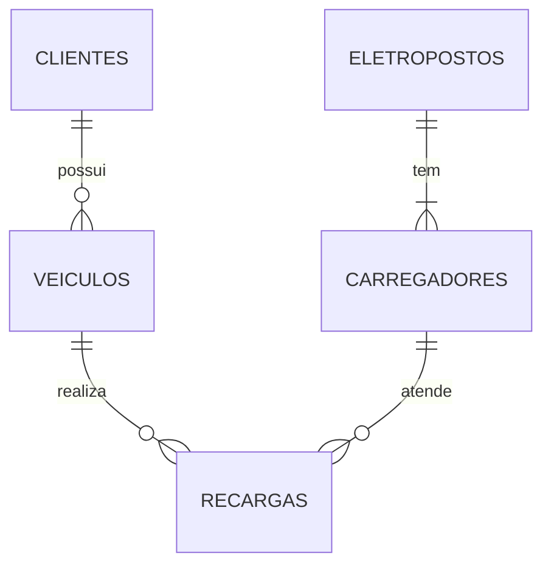

<!--
GABARITO — não faz parte do fluxo principal do tópico e fica fora do `nav` do
mkdocs.yml de propósito. É acessível só pelo link no final de
Topico_14_Revisao_Geral.md.
-->

# Gabarito — Tópico 14 — Revisão Geral

**Disciplina:** Banco de Dados — Relacional (IBD015)
**Professor:** Ronan Adriel Zenatti · ronan.zenatti@cps.sp.gov.br
**Fatec Jahu — 2º Semestre/2026**

> ⚠️ Este gabarito é para conferência **depois** de você tentar resolver os checkpoints
> e o Desafio Integrador por conta própria no [Tópico 14](Topico_14_Revisao_Geral.md).
> Resolver antes de tentar reduz o benefício de treinar a recuperação ativa do
> conteúdo.

---

## Checkpoint 1 — Normalização: clube de assinatura para pets {: #checkpoint-1 }

**(a) Violação da 1FN:** a coluna `servicos_incluidos` guarda uma **lista** ('banho, tosa, vacina')
numa única célula — o valor não é atômico. Não dá para filtrar "planos que incluem vacina" com
igualdade nem garantir que cada serviço exista.

**(b) Dependências funcionais** (a chave é `id_assinatura`, mas muitos atributos dependem de outros
não-chave — dependências transitivas, que violam a 3FN):

- `tutor_cpf → tutor_nome, tutor_email` (os dados do tutor dependem do CPF, não da assinatura);
- `(tutor_cpf, pet_nome) → pet_especie` (os dados do pet dependem do pet);
- `plano_nome → plano_valor_mensal, servicos_incluidos` (os dados do plano dependem do plano);
- `id_assinatura → tudo` (a chave determina a linha toda).

Consequências práticas: o nome e o e-mail do tutor se repetem a cada assinatura (anomalia de
atualização); mudar o valor do plano exige alterar várias linhas; apagar a última assinatura
de um plano apaga o próprio plano (anomalia de exclusão).

**(c) Modelo lógico em 3FN** (nomes seguindo as Regras 1–7; todas as tabelas levam também os campos de
log da Regra 9, omitidos aqui por brevidade):

```text
tutores          (id_tutor PK, nome, cpf UNIQUE, email UNIQUE)
pets             (id_pet PK, tutor_id FK → tutores, nome, especie)
planos           (id_plano PK, nome UNIQUE, valor_mensal)
servicos         (id_servico PK, nome UNIQUE)
planos_servicos  (plano_id FK → planos, servico_id FK → servicos, PK(plano_id, servico_id))
assinaturas      (id_assinatura PK, pet_id FK → pets, plano_id FK → planos, data_inicio)
```

**(d) Cardinalidades:**

| Relacionamento | Cardinalidade |
|---|---|
| tutor — pet | 1:N (um tutor tem vários pets; cada pet tem um tutor) |
| pet — assinatura | 1:N (um pet pode ter várias assinaturas ao longo do tempo) |
| plano — assinatura | 1:N |
| **plano — serviço** | **N:M** (um plano inclui vários serviços; um serviço está em vários planos) → resolvido pela tabela associativa `planos_servicos` |

A lista `servicos_incluidos` virou linhas em `planos_servicos`, e a 1FN foi restaurada.

---

## Checkpoint 2 — DDL e DML: plataforma de podcasts {: #checkpoint-2 }

**(a) DDL:**

```sql
CREATE TABLE podcasts (
    id_podcast   BIGINT UNSIGNED  NOT NULL AUTO_INCREMENT,
    titulo       VARCHAR(255)     NOT NULL,
    categoria    ENUM('tecnologia', 'negocios', 'saude', 'cultura') NOT NULL,
    ativo        TINYINT(1)       NOT NULL DEFAULT 1,
    criado_em    DATETIME         NOT NULL DEFAULT CURRENT_TIMESTAMP,
    alterado_em  DATETIME         NOT NULL DEFAULT CURRENT_TIMESTAMP ON UPDATE CURRENT_TIMESTAMP,
    deletado_em  DATETIME             NULL,

    CONSTRAINT pk_podcast         PRIMARY KEY (id_podcast),
    CONSTRAINT uq_podcast_titulo  UNIQUE (titulo)
);

CREATE TABLE episodios (
    id_episodio   BIGINT UNSIGNED    NOT NULL AUTO_INCREMENT,
    podcast_id    BIGINT UNSIGNED    NOT NULL,
    numero        SMALLINT UNSIGNED  NOT NULL,
    titulo        VARCHAR(255)       NOT NULL,
    duracao_seg   INT UNSIGNED       NOT NULL,
    publicado_em  DATETIME               NULL,
    criado_em     DATETIME           NOT NULL DEFAULT CURRENT_TIMESTAMP,
    alterado_em   DATETIME           NOT NULL DEFAULT CURRENT_TIMESTAMP ON UPDATE CURRENT_TIMESTAMP,
    deletado_em   DATETIME               NULL,

    CONSTRAINT pk_episodio         PRIMARY KEY (id_episodio),
    CONSTRAINT uq_episodio_numero  UNIQUE (podcast_id, numero),
    CONSTRAINT fk_episodio_podcast FOREIGN KEY (podcast_id)
                                   REFERENCES podcasts (id_podcast)
                                   ON DELETE CASCADE
                                   ON UPDATE CASCADE,
    CONSTRAINT ck_episodio_duracao CHECK (duracao_seg > 0)
);
```

O `UNIQUE (podcast_id, numero)` expressa "número único **dentro** do podcast" (episódio 1 pode
existir em vários podcasts). O `ON DELETE CASCADE` atende ao requisito de apagar os episódios
junto com o podcast: o episódio é parte do podcast (não faz sentido sem ele).

**(b) Inserção em transação:**

```sql
START TRANSACTION;

INSERT INTO podcasts (titulo, categoria) VALUES ('Dados em Foco', 'tecnologia');
SET @podcast = LAST_INSERT_ID();

INSERT INTO episodios (podcast_id, numero, titulo, duracao_seg) VALUES
    (@podcast, 1, 'Modelagem sem medo', 1800),
    (@podcast, 2, 'Índices na prática', 2400),
    (@podcast, 3, 'Transações',         2100);

COMMIT;
```

**(c) Publicar só os episódios 1 e 2:**

```sql
UPDATE episodios
SET    publicado_em = NOW()
WHERE  podcast_id = (SELECT id_podcast FROM podcasts WHERE titulo = 'Dados em Foco')
  AND  numero <= 2
  AND  publicado_em IS NULL;
```

**(d) Erros:** o número repetido gera `ERROR 1062 Duplicate entry '1-2' for key 'uq_episodio_numero'`
(integridade de entidade); a duração 0 gera `ERROR 4025 CONSTRAINT ck_episodio_duracao failed`
(integridade de domínio). Apagar o podcast (`DELETE FROM podcasts WHERE id_podcast = @podcast`) leva os
3 episódios junto, pelo `CASCADE`.

---

## Checkpoint 3 — Consultas combinadas: campeonato de e-sports {: #checkpoint-3 }

**(a) Vitórias e K/D por time (com pelo menos 2 partidas):**

```sql
SELECT t.nome                                       AS time,
       SUM(p.venceu)                                AS vitorias,
       ROUND(SUM(p.abates) / SUM(p.mortes), 2)      AS kd_geral
FROM   times t
INNER JOIN jogadores     j ON j.time_id    = t.id_time
INNER JOIN participacoes p ON p.jogador_id = j.id_jogador
GROUP BY t.id_time, t.nome
HAVING COUNT(DISTINCT p.partida_id) >= 2
ORDER BY vitorias DESC, kd_geral DESC;
```

O `INNER JOIN` já elimina times sem participações. O `COUNT(DISTINCT p.partida_id)` conta partidas
**diferentes** (um time com 2 jogadores na mesma partida geraria 2 linhas, mas é 1 partida). O filtro
sobre o resultado da agregação vai no `HAVING`.

**(b) Jogadores que nunca participaram (anti-join):**

```sql
SELECT j.nick
FROM   jogadores j
LEFT JOIN participacoes p ON p.jogador_id = j.id_jogador
WHERE  p.partida_id IS NULL;
```

**(c) K/D individual acima do K/D geral (subconsulta no `HAVING`):**

```sql
SELECT j.nick,
       ROUND(SUM(p.abates) / SUM(p.mortes), 2) AS kd
FROM   jogadores j
INNER JOIN participacoes p ON p.jogador_id = j.id_jogador
GROUP BY j.id_jogador, j.nick
HAVING SUM(p.abates) / SUM(p.mortes) > (SELECT SUM(abates) / SUM(mortes) FROM participacoes)
ORDER BY kd DESC;
```

O K/D "geral" é a razão **das somas** (e não a média dos K/D individuais); a subconsulta escalar
calcula esse valor uma única vez e o `HAVING` compara cada jogador com ele.

---

## Checkpoint 4 — Regra de negócio com trigger: estúdios de gravação {: #checkpoint-4 }

**(a) Restrição declarativa:**

```sql
CONSTRAINT ck_reserva_estudio_periodo CHECK (fim > inicio)
```

**(b) Trigger anti-sobreposição:**

```sql
DELIMITER $$
CREATE TRIGGER trg_reservas_estudio_evitar_sobreposicao
BEFORE INSERT ON reservas_estudio
FOR EACH ROW
BEGIN
    IF EXISTS (SELECT 1
               FROM   reservas_estudio r
               WHERE  r.estudio_id = NEW.estudio_id
                 AND  r.inicio < NEW.fim          -- a existente começa antes de a nova terminar
                 AND  r.fim    > NEW.inicio) THEN -- e termina depois de a nova começar
        SIGNAL SQLSTATE '45000' SET MESSAGE_TEXT = 'Estúdio já reservado neste horário';
    END IF;
END$$
DELIMITER ;
```

Dois intervalos se sobrepõem exatamente quando **cada um começa antes de o outro terminar**. Como as
comparações são estritas (`<` e `>`), o horário 12h–14h **não** colide com 10h–12h (o fim de um é
o início do outro) — testado: a reserva 12h–14h foi aceita; 11h–13h e 09h–10h30 foram recusadas. Um
trigger `BEFORE UPDATE` equivalente (excluindo a própria reserva com `r.id_reserva <> NEW.id_reserva`)
fecharia o caminho da alteração de horário.

**(c) Por que não é um `CHECK`:** a regra compara a nova linha com **outras linhas** da tabela, e o
`CHECK` só enxerga a linha atual (Tópico 08). **Risco de concorrência:** duas pessoas reservando o mesmo
horário **ao mesmo tempo** podem passar ambas pela verificação do trigger antes de qualquer uma confirmar
(cada transação não vê a linha ainda não confirmada da outra). A correção está no Tópico 11: fazer a
reserva em uma procedure transacional que, no início, trava a linha do estúdio
(`SELECT … FROM estudios WHERE id_estudio = ? FOR UPDATE`), serializando as reservas de cada estúdio.

---

## Checkpoint 5 — Saque seguro: carteira de entregadores {: #checkpoint-5 }

**(a) Procedure com trava de linha:**

```sql
DELIMITER $$
CREATE PROCEDURE sp_sacar(IN p_entregador_id BIGINT UNSIGNED, IN p_valor DECIMAL(12, 2))
BEGIN
    DECLARE v_carteira  BIGINT UNSIGNED;
    DECLARE v_saldo     DECIMAL(12, 2);

    DECLARE EXIT HANDLER FOR SQLEXCEPTION
    BEGIN
        ROLLBACK;
        RESIGNAL;
    END;

    IF p_valor <= 0 THEN
        SIGNAL SQLSTATE '45000' SET MESSAGE_TEXT = 'O valor do saque deve ser positivo';
    END IF;

    START TRANSACTION;

    SELECT id_carteira, saldo INTO v_carteira, v_saldo
    FROM   carteiras_entregadores
    WHERE  entregador_id = p_entregador_id
    FOR UPDATE;                                   -- trava: o 2º saque simultâneo ESPERA aqui

    IF v_carteira IS NULL THEN
        SIGNAL SQLSTATE '45000' SET MESSAGE_TEXT = 'Carteira inexistente';
    ELSEIF v_saldo < p_valor THEN
        SIGNAL SQLSTATE '45000' SET MESSAGE_TEXT = 'Saldo insuficiente';
    END IF;

    UPDATE carteiras_entregadores SET saldo = saldo - p_valor WHERE id_carteira = v_carteira;
    INSERT INTO saques (carteira_id, valor) VALUES (v_carteira, p_valor);

    COMMIT;
END$$
DELIMITER ;
```

Sem o `FOR UPDATE`, dois saques de R$ 200 com saldo de R$ 300 poderiam ler `300` ao mesmo tempo,
ambos passar pela verificação e debitar — o `CHECK (saldo >= 0)` ainda barraria o segundo no
`UPDATE` (rede de segurança), mas só depois de um erro tardio e sem mensagem útil. Com a trava, o
segundo saque espera o primeiro terminar, relê o saldo já debitado (R$ 100) e é recusado com
"Saldo insuficiente". No teste: saldo 300 → saque de 120 aceito (saldo 180); saque de 200 recusado;
carteira inexistente e valor 0 recusados.

**(b) Débito em um único comando (otimista):**

```sql
UPDATE carteiras_entregadores
SET    saldo = saldo - 200
WHERE  entregador_id = 10
  AND  saldo >= 200;

SELECT ROW_COUNT();     -- 1 = saque feito · 0 = saldo insuficiente (ou carteira inexistente)
```

A verificação e a gravação ocorrem no mesmo comando, sob trava de linha automática: não há intervalo
entre "ler o saldo" e "debitar". (Para registrar também o saque, esse `UPDATE` e o `INSERT` em
`saques` ainda devem estar na mesma transação.)

**(c) Permissão só de execução:**

```sql
CREATE USER 'app_saques'@'localhost' IDENTIFIED BY 'Troque#Esta2026';
GRANT EXECUTE ON PROCEDURE entregas_db.sp_sacar TO 'app_saques'@'localhost';
```

Como a procedure roda com os privilégios de quem a criou (`SQL SECURITY DEFINER`, o padrão), a
conta da aplicação consegue sacar mas **não** consegue `SELECT`, `UPDATE` nem `DELETE` diretos nas
tabelas — a procedure vira a única porta de entrada.

---

## Checkpoint 6 — Diagnóstico de desempenho: exames de saúde digital {: #checkpoint-6 }

**(a)** Índice composto: igualdade em `paciente_id`, depois a coluna da ordenação:

```sql
CREATE INDEX idx_exames_paciente_resultado ON exames (paciente_id, resultado_em);
```

`EXPLAIN` esperado (e medido): `type: ref`, `key: idx_exames_paciente_resultado`, ~7 linhas, **sem
`Using filesort`** — o índice já entrega as linhas do paciente na ordem de `resultado_em` (lido de trás
para frente por causa do `DESC`) e o `LIMIT 5` para cedo.

**(b)** Na Q2, o `DATE(resultado_em)` aplica uma função à coluna; o índice em `resultado_em` não pode
ser usado como filtro (no teste, mesmo com um índice cobrindo a coluna, o plano foi `type: index` varrendo
**as 99.973 entradas**). Reescrita sargável, com um índice que também cobre a consulta:

```sql
CREATE INDEX idx_exames_resultado_tipo ON exames (resultado_em, tipo);

SELECT tipo, COUNT(*)
FROM   exames
WHERE  resultado_em >= '2026-09-15' AND resultado_em < '2026-09-16'
GROUP BY tipo;
```

Plano: `type: range`, ~1.4 mil linhas, `Using index` (cobertura: as duas colunas usadas estão no índice).
O `Using temporary; Using filesort` do `GROUP BY tipo` permanece, mas agora opera sobre ~1.4 mil linhas
em vez de 100 mil.

**(c)** Depois de uma carga em massa, rodar `ANALYZE TABLE exames;` para atualizar as estatísticas do
otimizador (sem elas ele pode estimar errado e escolher um plano ruim — Tópico 13, Seção 6.2).

---

## Desafio Integrador — Rede de Eletropostos {: #desafio-integrador }

> O script completo e executável com todos os passos está no final desta página. Cada passo abaixo mostra
> o raciocínio e o trecho principal. O banco usado é o `eletropostos` (separado do `loja_virtual`).

### Passo 1 — Modelo conceitual

| Entidade | Atributos principais |
|---|---|
| **Cliente** | nome, cpf, email |
| **Veículo** | placa, modelo, capacidade (kWh) |
| **Eletroposto** | nome, cidade, UF |
| **Carregador** | código (A1, B2...), potência (kW), status |
| **Recarga** | início, fim, kWh consumidos, valor, status |

| Relacionamento | Cardinalidade |
|---|---|
| Cliente **possui** Veículo | 1:N |
| Eletroposto **tem** Carregador | 1:N |
| Veículo **recarrega em** Carregador | **N:M** — um veículo usa vários carregadores, um carregador atende vários veículos |

A entidade que associa veículo e carregador é a **Recarga**: o N:M "veículo × carregador" é resolvido por
ela, que carrega atributos próprios (início, fim, consumo, valor). No lógico, `recargas` tem FK para
`veiculos` e para `carregadores`.



### Passo 2 — Normalização

Dependências funcionais da planilha:

- `placa → modelo, capacidade_kwh, cliente_cpf` (o veículo pertence a um cliente);
- `cliente_cpf → cliente_nome, cliente_email`;
- `eletroposto → cidade, uf`;
- `(eletroposto, carregador) → potencia_kw`;
- `(placa, eletroposto, carregador, iniciada_em) → finalizada_em, kwh, valor`.

Os atributos de cliente, veículo, eletroposto e carregador se repetem a cada recarga (dependem de uma
parte da chave ou de atributos não-chave: violam a 2FN/3FN). Modelo lógico em 3FN:

```text
clientes      (id_cliente PK, nome, cpf UNIQUE, email UNIQUE)
veiculos      (id_veiculo PK, cliente_id FK, placa UNIQUE, modelo, capacidade_kwh)
eletropostos  (id_eletroposto PK, nome UNIQUE, cidade, estado)
carregadores  (id_carregador PK, eletroposto_id FK, codigo, potencia_kw, status, UNIQUE(eletroposto_id, codigo))
recargas      (id_recarga PK, veiculo_id FK, carregador_id FK, iniciada_em, finalizada_em, kwh_consumidos, valor_total, status)
```

### Passo 3 — DDL

Trecho das duas tabelas mais interessantes (as demais seguem o mesmo padrão, no script completo):

```sql
CREATE TABLE carregadores (
    id_carregador   BIGINT UNSIGNED  NOT NULL AUTO_INCREMENT,
    eletroposto_id  BIGINT UNSIGNED  NOT NULL,
    codigo          VARCHAR(10)      NOT NULL COMMENT 'Identificação dentro do eletroposto (ex.: A1)',
    potencia_kw     DECIMAL(5, 1)    NOT NULL,
    status          ENUM('livre', 'ocupado', 'manutencao') NOT NULL DEFAULT 'livre',
    criado_em       DATETIME         NOT NULL DEFAULT CURRENT_TIMESTAMP,
    alterado_em     DATETIME         NOT NULL DEFAULT CURRENT_TIMESTAMP ON UPDATE CURRENT_TIMESTAMP,
    deletado_em     DATETIME             NULL,

    CONSTRAINT pk_carregador                    PRIMARY KEY (id_carregador),
    CONSTRAINT uq_carregador_eletroposto_codigo UNIQUE (eletroposto_id, codigo),
    CONSTRAINT fk_carregador_eletroposto        FOREIGN KEY (eletroposto_id)
                                                REFERENCES eletropostos (id_eletroposto)
                                                ON DELETE RESTRICT ON UPDATE CASCADE,
    CONSTRAINT ck_carregador_potencia           CHECK (potencia_kw > 0)
);

CREATE TABLE recargas (
    id_recarga       BIGINT UNSIGNED  NOT NULL AUTO_INCREMENT,
    veiculo_id       BIGINT UNSIGNED  NOT NULL,
    carregador_id    BIGINT UNSIGNED  NOT NULL,
    iniciada_em      DATETIME         NOT NULL,
    finalizada_em    DATETIME             NULL,
    kwh_consumidos   DECIMAL(7, 2)        NULL,
    valor_total      DECIMAL(10, 2)       NULL,
    status           ENUM('em_andamento', 'concluida', 'cancelada') NOT NULL DEFAULT 'em_andamento',
    criado_em        DATETIME         NOT NULL DEFAULT CURRENT_TIMESTAMP,
    alterado_em      DATETIME         NOT NULL DEFAULT CURRENT_TIMESTAMP ON UPDATE CURRENT_TIMESTAMP,
    deletado_em      DATETIME             NULL,

    CONSTRAINT pk_recarga            PRIMARY KEY (id_recarga),
    CONSTRAINT fk_recarga_veiculo    FOREIGN KEY (veiculo_id)    REFERENCES veiculos (id_veiculo)
                                     ON DELETE RESTRICT ON UPDATE CASCADE,
    CONSTRAINT fk_recarga_carregador FOREIGN KEY (carregador_id) REFERENCES carregadores (id_carregador)
                                     ON DELETE RESTRICT ON UPDATE CASCADE,
    CONSTRAINT ck_recarga_kwh        CHECK (kwh_consumidos IS NULL OR kwh_consumidos >= 0),
    CONSTRAINT ck_recarga_valor      CHECK (valor_total IS NULL OR valor_total >= 0),
    CONSTRAINT ck_recarga_periodo    CHECK (finalizada_em IS NULL OR finalizada_em >= iniciada_em)
);
```

**Justificativas das ações referenciais:** todas as FKs usam `RESTRICT` — carregador, veículo e cliente
são entidades com **histórico financeiro** (as recargas), que não pode ficar sem origem; a exclusão
deve ser lógica (`deletado_em`, Regra 9). `ON UPDATE CASCADE` é inofensivo. Os `CHECK` com
`IS NULL OR …` tratam o fato de que uma recarga em andamento ainda não tem fim, consumo nem valor (lembre:
o `CHECK` só barra quando a expressão é falsa, mas explicitar o `NULL` documenta a intenção). A `placa` é
`CHAR(7)` porque o padrão Mercosul é **realmente fixo**; o telefone, ao contrário, seria `VARCHAR`
(Regra 8).

### Passo 4 — DML

Uma única transação (`START TRANSACTION … COMMIT`) com os `INSERT`s múltiplos de clientes, veículos,
eletropostos, carregadores e recargas — no script completo. Cuidados: as tabelas-pai primeiro e os IDs das
FKs conferindo com a ordem de inserção; o cliente "Gustavo Lima" fica sem veículo (para a consulta 5b); o
carregador `B2` entra como `'manutencao'`; uma recarga é carregada como `'cancelada'` (sem fim nem consumo).

### Passo 5 — Consultas

```sql
-- (a) kWh e receita por eletroposto em setembro/2026
SELECT e.nome AS eletroposto, COUNT(*) AS recargas, SUM(r.kwh_consumidos) AS total_kwh, SUM(r.valor_total) AS receita
FROM   recargas r
INNER JOIN carregadores c ON c.id_carregador = r.carregador_id
INNER JOIN eletropostos e ON e.id_eletroposto = c.eletroposto_id
WHERE  r.status = 'concluida'
  AND  r.iniciada_em >= '2026-09-01' AND r.iniciada_em < '2026-10-01'
GROUP BY e.id_eletroposto, e.nome
ORDER BY receita DESC;

-- (b) Clientes que nunca recarregaram (anti-join através de veículos)
SELECT cli.nome
FROM   clientes cli
LEFT JOIN veiculos v ON v.cliente_id = cli.id_cliente
LEFT JOIN recargas r ON r.veiculo_id = v.id_veiculo
WHERE  r.id_recarga IS NULL;

-- (c) Os 3 veículos que mais consumiram, com o cliente
SELECT v.placa, v.modelo, cli.nome AS cliente, SUM(r.kwh_consumidos) AS total_kwh
FROM   recargas r
INNER JOIN veiculos v   ON v.id_veiculo = r.veiculo_id
INNER JOIN clientes cli ON cli.id_cliente = v.cliente_id
WHERE  r.status = 'concluida'
GROUP BY v.id_veiculo, v.placa, v.modelo, cli.nome
ORDER BY total_kwh DESC
LIMIT 3;

-- (d) Recargas acima da média (subconsulta escalar)
SELECT id_recarga, kwh_consumidos
FROM   recargas
WHERE  status = 'concluida'
  AND  kwh_consumidos > (SELECT AVG(kwh_consumidos) FROM recargas WHERE status = 'concluida')
ORDER BY kwh_consumidos DESC;

-- (e) View sem o CPF
CREATE VIEW vw_recargas_detalhadas AS
SELECT r.id_recarga, cli.nome AS cliente, v.placa, e.nome AS eletroposto, c.codigo AS carregador,
       c.potencia_kw, r.iniciada_em, r.finalizada_em, r.kwh_consumidos, r.valor_total, r.status
FROM   recargas r
INNER JOIN veiculos v     ON v.id_veiculo = r.veiculo_id
INNER JOIN clientes cli   ON cli.id_cliente = v.cliente_id
INNER JOIN carregadores c ON c.id_carregador = r.carregador_id
INNER JOIN eletropostos e ON e.id_eletroposto = c.eletroposto_id;
```

Resultados com os dados do script: (a) Voltaja Rodovia (2 recargas, 75 kWh, R$ 135,00), Voltaja Shopping
(2, 80 kWh, R$ 127,20), Voltaja Centro (3, 65,5 kWh, R$ 78,60); (b) Gustavo Lima; (c) Volvo EX30/Carlos Melo
(113 kWh), BYD Seal/Diego Rocha (112 kWh), BYD Dolphin/Ana Lima (52,5 kWh).
Pontos de atenção: em (b), os **dois** `LEFT JOIN` em sequência (cliente → veículo → recarga) e o teste
na PK da última tabela; em (a), o `WHERE` filtra o período **sem função na coluna** (sargável).

### Passo 6 — Programação

```sql
DELIMITER $$

CREATE FUNCTION fn_valor_recarga(p_kwh DECIMAL(7, 2), p_potencia_kw DECIMAL(5, 1))
RETURNS DECIMAL(10, 2)
DETERMINISTIC
BEGIN
    DECLARE v_tarifa DECIMAL(4, 2);

    IF p_kwh < 0 THEN
        SIGNAL SQLSTATE '45000' SET MESSAGE_TEXT = 'Consumo (kWh) não pode ser negativo';
    END IF;

    SET v_tarifa = IF(p_potencia_kw <= 22, 1.20, 1.80);

    RETURN GREATEST(5.00, ROUND(p_kwh * v_tarifa, 2));        -- cobrança mínima de R$ 5,00
END$$

CREATE TRIGGER trg_carregadores_logar_status
AFTER UPDATE ON carregadores
FOR EACH ROW
BEGIN
    IF OLD.status <> NEW.status THEN
        INSERT INTO log_status_carregadores (carregador_id, status_anterior, status_novo)
        VALUES (OLD.id_carregador, OLD.status, NEW.status);
    END IF;
END$$

CREATE TRIGGER trg_recargas_proteger_finalizadas
BEFORE UPDATE ON recargas
FOR EACH ROW
BEGIN
    IF OLD.status IN ('concluida', 'cancelada') THEN
        SIGNAL SQLSTATE '45000' SET MESSAGE_TEXT = 'Recarga concluída ou cancelada não pode ser alterada';
    END IF;
END$$

CREATE PROCEDURE sp_iniciar_recarga(
    IN  p_veiculo_id    BIGINT UNSIGNED,
    IN  p_carregador_id BIGINT UNSIGNED,
    OUT p_recarga_id    BIGINT UNSIGNED
)
BEGIN
    DECLARE v_status_carregador  VARCHAR(20);
    DECLARE v_recargas_ativas    INT;

    DECLARE EXIT HANDLER FOR SQLEXCEPTION
    BEGIN
        ROLLBACK;
        RESIGNAL;
    END;

    START TRANSACTION;

    SELECT status INTO v_status_carregador
    FROM   carregadores
    WHERE  id_carregador = p_carregador_id
    FOR UPDATE;                                          -- trava o carregador (Passo 7)

    IF v_status_carregador IS NULL THEN
        SIGNAL SQLSTATE '45000' SET MESSAGE_TEXT = 'Carregador inexistente';
    ELSEIF v_status_carregador <> 'livre' THEN
        SIGNAL SQLSTATE '45000' SET MESSAGE_TEXT = 'Carregador indisponível';
    END IF;

    SELECT COUNT(*) INTO v_recargas_ativas
    FROM   recargas
    WHERE  veiculo_id = p_veiculo_id AND status = 'em_andamento';

    IF v_recargas_ativas > 0 THEN
        SIGNAL SQLSTATE '45000' SET MESSAGE_TEXT = 'O veículo já tem uma recarga em andamento';
    END IF;

    INSERT INTO recargas (veiculo_id, carregador_id, iniciada_em)
    VALUES (p_veiculo_id, p_carregador_id, NOW());

    SET p_recarga_id = LAST_INSERT_ID();

    UPDATE carregadores SET status = 'ocupado' WHERE id_carregador = p_carregador_id;

    COMMIT;
END$$

CREATE PROCEDURE sp_finalizar_recarga(IN p_recarga_id BIGINT UNSIGNED, IN p_kwh DECIMAL(7, 2))
BEGIN
    DECLARE v_status      VARCHAR(20);
    DECLARE v_carregador  BIGINT UNSIGNED;
    DECLARE v_potencia    DECIMAL(5, 1);

    DECLARE EXIT HANDLER FOR SQLEXCEPTION
    BEGIN
        ROLLBACK;
        RESIGNAL;
    END;

    START TRANSACTION;

    SELECT status, carregador_id INTO v_status, v_carregador
    FROM   recargas
    WHERE  id_recarga = p_recarga_id
    FOR UPDATE;

    IF v_status IS NULL THEN
        SIGNAL SQLSTATE '45000' SET MESSAGE_TEXT = 'Recarga inexistente';
    ELSEIF v_status <> 'em_andamento' THEN
        SIGNAL SQLSTATE '45000' SET MESSAGE_TEXT = 'A recarga não está em andamento';
    END IF;

    SELECT potencia_kw INTO v_potencia FROM carregadores WHERE id_carregador = v_carregador;

    UPDATE recargas
    SET    finalizada_em  = NOW(),
           kwh_consumidos = p_kwh,
           valor_total    = fn_valor_recarga(p_kwh, v_potencia),
           status         = 'concluida'
    WHERE  id_recarga = p_recarga_id;

    UPDATE carregadores SET status = 'livre' WHERE id_carregador = v_carregador;

    COMMIT;
END$$

DELIMITER ;
```

(A tabela `log_status_carregadores` — PK, FK para `carregadores`, `status_anterior`, `status_novo` e os campos de log — está no script completo, ao final desta página.) Testes realizados: `fn_valor_recarga(30.5, 7.4)` = 36,60 (AC, 1,20/kWh); `fn_valor_recarga(40, 50.0)` = 72,00
(DC, 1,80/kWh); `fn_valor_recarga(1, 7.4)` = 5,00 (mínimo); iniciar e finalizar uma recarga de 25 kWh
no carregador A1 (7,4 kW) deu R$ 30,00, e a tabela `log_status_carregadores` registrou livre → ocupado →
livre. Erros confirmados: carregador ocupado/em manutenção ("Carregador indisponível"), carregador
inexistente, veículo com recarga em andamento, finalizar duas vezes ("A recarga não está em andamento"),
`UPDATE` em recarga concluída (trigger) e consumo negativo na função.

### Passo 7 — Concorrência

**O que impede o duplo uso:** o `SELECT status … FOR UPDATE` na procedure `sp_iniciar_recarga` coloca uma
trava exclusiva na linha do carregador até o `COMMIT`/`ROLLBACK`. A segunda transação, ao tentar travar a
mesma linha, **espera**; quando consegue, relê o status já como `'ocupado'` e é recusada com "Carregador
indisponível".

**Anomalia sem a trava:** a de *atualização perdida* / condição de corrida — ambos leem `'livre'` (o
`REPEATABLE READ` dá a cada um o seu snapshot, sem ver o outro, que ainda não confirmou), ambos inserem
uma recarga e marcam o carregador como `'ocupado'`: dois carros "no mesmo carregador". Como gatilhos e
`CHECK` não resolvem (nenhum enxerga a outra transação), a solução é a trava.

**Deadlock em transferências cruzadas:** acessar as linhas **sempre na mesma ordem** (por exemplo, travar
primeiro a conta de menor `id`), como no Checkpoint 6 do Tópico 11. Em qualquer caso, a aplicação deve
tratar o erro `1213` repetindo a transação.

### Passo 8 — Segurança e backup

```sql
-- Aplicação: DML e execução de rotinas, sem DDL
CREATE USER 'app_eletropostos'@'localhost' IDENTIFIED BY 'Troque#App2026';
GRANT SELECT, INSERT, UPDATE, DELETE, EXECUTE ON eletropostos.* TO 'app_eletropostos'@'localhost';

-- Analista: papel que lê a view, eletropostos/carregadores e SÓ id e nome dos clientes
CREATE ROLE role_analista_eletropostos;
GRANT SELECT ON eletropostos.vw_recargas_detalhadas TO role_analista_eletropostos;
GRANT SELECT ON eletropostos.eletropostos           TO role_analista_eletropostos;
GRANT SELECT ON eletropostos.carregadores           TO role_analista_eletropostos;
GRANT SELECT (id_cliente, nome) ON eletropostos.clientes TO role_analista_eletropostos;
CREATE USER 'analista_eletropostos'@'localhost' IDENTIFIED BY 'Troque#Analista2026';
GRANT role_analista_eletropostos TO 'analista_eletropostos'@'localhost';
SET DEFAULT ROLE role_analista_eletropostos FOR 'analista_eletropostos'@'localhost';

-- Backup: leitura de tudo, nada mais
CREATE USER 'backup_eletropostos'@'localhost' IDENTIFIED BY 'Troque#Backup2026';
GRANT SELECT, SHOW VIEW, TRIGGER, EVENT, LOCK TABLES ON eletropostos.* TO 'backup_eletropostos'@'localhost';
GRANT SELECT ON mysql.proc TO 'backup_eletropostos'@'localhost';       -- para o dump incluir as rotinas (MariaDB 10.4)
```

**Estratégia de backup (RPO 15 min, RTO 2 h):** (1) **log binário** ligado, com os arquivos copiados para fora
do servidor a cada 5–10 min (garante o RPO e permite PITR); (2) **backup completo** semanal
(`mariabackup`, a quente) — ou `mysqldump --single-transaction --routines --triggers --events` se o banco
ainda for pequeno; (3) **backup diferencial** diário, para que a restauração seja "completo + último diferencial + log
binário"; (4) cópia externa criptografada (regra 3-2-1); (5) **ensaio de restauração** periódico,
cronometrado, para provar o RTO de 2 h. O analista enxerga o CPF? **Não**: nem pela view (que não o expõe)
nem pela tabela (privilégio por coluna só em `id_cliente` e `nome`).

### Passo 9 — Desempenho

Com 100 mil recargas históricas (tabela de apoio `recargas_volume`):

```sql
-- Antes: type ALL, ~99.940 linhas, Using where; Using filesort
EXPLAIN SELECT id_recarga, iniciada_em, kwh_consumidos, valor_total
FROM   recargas_volume
WHERE  veiculo_id = 777 AND status = 'concluida'
ORDER BY iniciada_em DESC
LIMIT  10;

CREATE INDEX idx_recargas_volume_veiculo_status_iniciada
    ON recargas_volume (veiculo_id, status, iniciada_em);
-- Depois: type ref, key_len 9 (duas colunas de igualdade), ~5 linhas, sem filesort
```

A ordem do índice segue "igualdade (`veiculo_id`, `status`) → ordenação (`iniciada_em`)".

**Consulta sargável:** `WHERE DATE(iniciada_em) = '2026-03-15'` aplica função à coluna (mesmo com um índice
que contenha a coluna, o plano é varredura de índice completa, ~99.940 entradas). Reescrita, com um índice em `iniciada_em`:

```sql
CREATE INDEX idx_recargas_volume_iniciada ON recargas_volume (iniciada_em);

SELECT COUNT(*) FROM recargas_volume
WHERE  iniciada_em >= '2026-03-15' AND iniciada_em < '2026-03-16';
-- type: range, ~278 linhas, Using index
```

### Script completo e executável

??? note "📦 Todo o Desafio Integrador em um único arquivo (clique para expandir)"
    O script abaixo executa do início ao fim, sem erros, em um MariaDB 10.4 do XAMPP. Ele **apaga e recria o banco `eletropostos`** (não toca no `loja_virtual`) e cria usuários e um papel no servidor; no final há os comandos, comentados, para removê-los.

    ```sql
    -- =============================================================================
    -- Script de apoio (NÃO faz parte do site) — Tópico 14 — Revisão Geral
    -- GABARITO DO DESAFIO INTEGRADOR: rede de eletropostos (carregadores de veículos elétricos)
    -- Disciplina: IBD015 — Banco de Dados Relacional — Fatec Jahu — 2º Sem/2026
    -- Professor: Ronan Adriel Zenatti
    --
    -- Este arquivo reúne, em ordem, a solução completa dos 9 passos do Desafio
    -- Integrador do Tópico 14 (docs/topicos/Topico_14_Revisao_Geral.md e seu gabarito).
    -- Executa do início ao fim SEM ERROS em um MariaDB 10.4 do XAMPP padrão.
    --
    -- Como executar (Windows / XAMPP):
    --   "C:\xampp\mysql\bin\mysql.exe" -u root -p --default-character-set=utf8mb4 < sql\Topico_14_Desafio_Integrador.sql
    --
    -- ATENÇÃO: o script apaga e recria o banco "eletropostos" (um banco só deste
    -- desafio — não toca no loja_virtual). Os comandos de segurança do Passo 8
    -- criam usuários e roles no servidor; no final do arquivo há os comandos
    -- (comentados) para removê-los.
    -- =============================================================================

    DROP DATABASE IF EXISTS eletropostos;
    CREATE DATABASE eletropostos CHARACTER SET utf8mb4 COLLATE utf8mb4_unicode_ci;
    USE eletropostos;


    -- =============================================================================
    -- PASSO 3 — DDL: modelo lógico em 3FN, seguindo as 9 regras de nomenclatura
    -- (Passo 1 = MER conceitual e Passo 2 = normalização estão no texto do gabarito)
    -- =============================================================================

    CREATE TABLE clientes (
        id_cliente   BIGINT UNSIGNED  NOT NULL AUTO_INCREMENT,
        nome         VARCHAR(255)     NOT NULL,
        cpf          CHAR(11)         NOT NULL COMMENT 'Apenas dígitos',
        email        VARCHAR(255)     NOT NULL,
        criado_em    DATETIME         NOT NULL DEFAULT CURRENT_TIMESTAMP,
        alterado_em  DATETIME         NOT NULL DEFAULT CURRENT_TIMESTAMP ON UPDATE CURRENT_TIMESTAMP,
        deletado_em  DATETIME             NULL,

        CONSTRAINT pk_cliente  PRIMARY KEY (id_cliente),
        CONSTRAINT uq_cliente_cpf   UNIQUE (cpf),
        CONSTRAINT uq_cliente_email UNIQUE (email)
    );

    CREATE TABLE veiculos (
        id_veiculo      BIGINT UNSIGNED  NOT NULL AUTO_INCREMENT,
        cliente_id      BIGINT UNSIGNED  NOT NULL,
        placa           CHAR(7)          NOT NULL COMMENT 'Padrão Mercosul, sem hífen',
        modelo          VARCHAR(100)     NOT NULL,
        capacidade_kwh  DECIMAL(5, 1)    NOT NULL COMMENT 'Capacidade da bateria',
        criado_em       DATETIME         NOT NULL DEFAULT CURRENT_TIMESTAMP,
        alterado_em     DATETIME         NOT NULL DEFAULT CURRENT_TIMESTAMP ON UPDATE CURRENT_TIMESTAMP,
        deletado_em     DATETIME             NULL,

        CONSTRAINT pk_veiculo          PRIMARY KEY (id_veiculo),
        CONSTRAINT uq_veiculo_placa    UNIQUE (placa),
        CONSTRAINT fk_veiculo_cliente  FOREIGN KEY (cliente_id)
                                       REFERENCES clientes (id_cliente)
                                       ON DELETE RESTRICT ON UPDATE CASCADE,
        CONSTRAINT ck_veiculo_capacidade CHECK (capacidade_kwh > 0)
    );

    CREATE TABLE eletropostos (
        id_eletroposto  BIGINT UNSIGNED  NOT NULL AUTO_INCREMENT,
        nome            VARCHAR(255)     NOT NULL,
        cidade          VARCHAR(255)     NOT NULL,
        estado          CHAR(2)          NOT NULL,
        criado_em       DATETIME         NOT NULL DEFAULT CURRENT_TIMESTAMP,
        alterado_em     DATETIME         NOT NULL DEFAULT CURRENT_TIMESTAMP ON UPDATE CURRENT_TIMESTAMP,
        deletado_em     DATETIME             NULL,

        CONSTRAINT pk_eletroposto     PRIMARY KEY (id_eletroposto),
        CONSTRAINT uq_eletroposto_nome UNIQUE (nome),
        CONSTRAINT ck_eletroposto_uf  CHECK (LENGTH(estado) = 2)
    );

    CREATE TABLE carregadores (
        id_carregador   BIGINT UNSIGNED  NOT NULL AUTO_INCREMENT,
        eletroposto_id  BIGINT UNSIGNED  NOT NULL,
        codigo          VARCHAR(10)      NOT NULL COMMENT 'Identificação dentro do eletroposto (ex.: A1)',
        potencia_kw     DECIMAL(5, 1)    NOT NULL,
        status          ENUM('livre', 'ocupado', 'manutencao') NOT NULL DEFAULT 'livre',
        criado_em       DATETIME         NOT NULL DEFAULT CURRENT_TIMESTAMP,
        alterado_em     DATETIME         NOT NULL DEFAULT CURRENT_TIMESTAMP ON UPDATE CURRENT_TIMESTAMP,
        deletado_em     DATETIME             NULL,

        CONSTRAINT pk_carregador              PRIMARY KEY (id_carregador),
        CONSTRAINT uq_carregador_eletroposto_codigo UNIQUE (eletroposto_id, codigo),
        CONSTRAINT fk_carregador_eletroposto  FOREIGN KEY (eletroposto_id)
                                              REFERENCES eletropostos (id_eletroposto)
                                              ON DELETE RESTRICT ON UPDATE CASCADE,
        CONSTRAINT ck_carregador_potencia     CHECK (potencia_kw > 0)
    );

    CREATE TABLE recargas (
        id_recarga       BIGINT UNSIGNED  NOT NULL AUTO_INCREMENT,
        veiculo_id       BIGINT UNSIGNED  NOT NULL,
        carregador_id    BIGINT UNSIGNED  NOT NULL,
        iniciada_em      DATETIME         NOT NULL,
        finalizada_em    DATETIME             NULL,
        kwh_consumidos   DECIMAL(7, 2)        NULL,
        valor_total      DECIMAL(10, 2)       NULL,
        status           ENUM('em_andamento', 'concluida', 'cancelada') NOT NULL DEFAULT 'em_andamento',
        criado_em        DATETIME         NOT NULL DEFAULT CURRENT_TIMESTAMP,
        alterado_em      DATETIME         NOT NULL DEFAULT CURRENT_TIMESTAMP ON UPDATE CURRENT_TIMESTAMP,
        deletado_em      DATETIME             NULL,

        CONSTRAINT pk_recarga             PRIMARY KEY (id_recarga),
        CONSTRAINT fk_recarga_veiculo     FOREIGN KEY (veiculo_id)
                                          REFERENCES veiculos (id_veiculo)
                                          ON DELETE RESTRICT ON UPDATE CASCADE,
        CONSTRAINT fk_recarga_carregador  FOREIGN KEY (carregador_id)
                                          REFERENCES carregadores (id_carregador)
                                          ON DELETE RESTRICT ON UPDATE CASCADE,
        CONSTRAINT ck_recarga_kwh         CHECK (kwh_consumidos IS NULL OR kwh_consumidos >= 0),
        CONSTRAINT ck_recarga_valor       CHECK (valor_total IS NULL OR valor_total >= 0),
        CONSTRAINT ck_recarga_periodo     CHECK (finalizada_em IS NULL OR finalizada_em >= iniciada_em)
    );


    -- =============================================================================
    -- PASSO 4 — DML: carga inicial (em transação)
    -- =============================================================================

    START TRANSACTION;

    INSERT INTO clientes (nome, cpf, email) VALUES
        ('Ana Lima',      '11122233344', 'ana@email.com'),
        ('Carlos Melo',   '22233344455', 'carlos@email.com'),
        ('Beatriz Costa', '33344455566', 'bi@email.com'),
        ('Diego Rocha',   '44455566677', 'diego@email.com'),
        ('Fernanda Alves','66677788899', 'fernanda@email.com'),
        ('Gustavo Lima',  '77788899900', 'gustavo@email.com');   -- Gustavo nunca recarregou

    INSERT INTO veiculos (cliente_id, placa, modelo, capacidade_kwh) VALUES
        (1, 'ABC1D23', 'BYD Dolphin',      44.9),
        (1, 'ABC1D24', 'Renault Kwid E-Tech', 26.8),
        (2, 'DEF2E34', 'Volvo EX30',       69.0),
        (3, 'GHI3F45', 'GWM Ora 03',       48.0),
        (4, 'JKL4G56', 'BYD Seal',         82.5),
        (5, 'MNO5H67', 'Chevrolet Bolt',   66.0),
        (2, 'PQR6I78', 'Caoa Chery iCar',  55.0);

    INSERT INTO eletropostos (nome, cidade, estado) VALUES
        ('Voltaja Centro',  'Jahu',     'SP'),
        ('Voltaja Rodovia', 'Bauru',    'SP'),
        ('Voltaja Shopping','Campinas', 'SP');

    INSERT INTO carregadores (eletroposto_id, codigo, potencia_kw, status) VALUES
        (1, 'A1',  7.4, 'livre'),
        (1, 'A2', 22.0, 'livre'),
        (2, 'B1', 50.0, 'livre'),
        (2, 'B2', 120.0,'manutencao'),
        (3, 'C1', 22.0, 'livre'),
        (3, 'C2', 60.0, 'livre');

    INSERT INTO recargas (veiculo_id, carregador_id, iniciada_em, finalizada_em, kwh_consumidos, valor_total, status) VALUES
        (1, 1, '2026-09-02 08:10:00', '2026-09-02 12:40:00', 30.50,  36.60, 'concluida'),
        (2, 2, '2026-09-04 18:00:00', '2026-09-04 19:30:00', 15.00,  18.00, 'concluida'),
        (3, 3, '2026-09-05 10:00:00', '2026-09-05 10:50:00', 40.00,  72.00, 'concluida'),
        (3, 3, '2026-09-12 09:00:00', '2026-09-12 09:45:00', 35.00,  63.00, 'concluida'),
        (4, 5, '2026-09-15 20:00:00', '2026-09-15 23:30:00', 28.00,  33.60, 'concluida'),
        (5, 6, '2026-09-18 14:00:00', '2026-09-18 14:40:00', 52.00,  93.60, 'concluida'),
        (6, 2, '2026-09-20 07:30:00', '2026-09-20 10:00:00', 20.00,  24.00, 'concluida'),
        (1, 1, '2026-10-01 08:00:00', '2026-10-01 11:00:00', 22.00,  26.40, 'concluida'),
        (7, 3, '2026-10-03 16:00:00', '2026-10-03 16:55:00', 45.00,  81.00, 'concluida'),
        (3, 6, '2026-10-07 12:00:00', '2026-10-07 12:40:00', 38.00,  68.40, 'concluida'),
        (5, 6, '2026-10-10 19:00:00', '2026-10-10 19:50:00', 60.00, 108.00, 'concluida'),
        (4, 5, '2026-10-12 21:00:00', NULL,                  NULL,   NULL,  'cancelada'),
        (6, 2, '2026-10-15 07:45:00', '2026-10-15 09:30:00', 18.00,  21.60, 'concluida');

    COMMIT;


    -- =============================================================================
    -- PASSO 5 — Consultas (JOIN, agregação, anti-join, subconsulta, visão)
    -- =============================================================================

    -- 5a) kWh e receita por eletroposto em setembro/2026 (INNER JOIN + GROUP BY)
    SELECT e.nome AS eletroposto,
           COUNT(*)                   AS recargas,
           SUM(r.kwh_consumidos)      AS total_kwh,
           SUM(r.valor_total)         AS receita
    FROM   recargas r
    INNER JOIN carregadores c ON c.id_carregador = r.carregador_id
    INNER JOIN eletropostos e ON e.id_eletroposto = c.eletroposto_id
    WHERE  r.status = 'concluida'
      AND  r.iniciada_em >= '2026-09-01' AND r.iniciada_em < '2026-10-01'
    GROUP BY e.id_eletroposto, e.nome
    ORDER BY receita DESC;

    -- 5b) Clientes que nunca recarregaram (anti-join)
    SELECT cli.nome
    FROM   clientes cli
    LEFT JOIN veiculos v  ON v.cliente_id = cli.id_cliente
    LEFT JOIN recargas r  ON r.veiculo_id = v.id_veiculo
    WHERE  r.id_recarga IS NULL;

    -- 5c) Os 3 veículos que mais consumiram (com o nome do cliente)
    SELECT v.placa, v.modelo, cli.nome AS cliente, SUM(r.kwh_consumidos) AS total_kwh
    FROM   recargas r
    INNER JOIN veiculos v   ON v.id_veiculo = r.veiculo_id
    INNER JOIN clientes cli ON cli.id_cliente = v.cliente_id
    WHERE  r.status = 'concluida'
    GROUP BY v.id_veiculo, v.placa, v.modelo, cli.nome
    ORDER BY total_kwh DESC
    LIMIT 3;

    -- 5d) Recargas acima da média de kWh (subconsulta escalar)
    SELECT r.id_recarga, r.kwh_consumidos
    FROM   recargas r
    WHERE  r.status = 'concluida'
      AND  r.kwh_consumidos > (SELECT AVG(kwh_consumidos) FROM recargas WHERE status = 'concluida')
    ORDER BY r.kwh_consumidos DESC;

    -- 5e) Visão que esconde o CPF e junta tudo
    CREATE VIEW vw_recargas_detalhadas AS
    SELECT r.id_recarga,
           cli.nome       AS cliente,
           v.placa,
           e.nome         AS eletroposto,
           c.codigo       AS carregador,
           c.potencia_kw,
           r.iniciada_em,
           r.finalizada_em,
           r.kwh_consumidos,
           r.valor_total,
           r.status
    FROM   recargas r
    INNER JOIN veiculos v     ON v.id_veiculo = r.veiculo_id
    INNER JOIN clientes cli   ON cli.id_cliente = v.cliente_id
    INNER JOIN carregadores c ON c.id_carregador = r.carregador_id
    INNER JOIN eletropostos e ON e.id_eletroposto = c.eletroposto_id;

    SELECT * FROM vw_recargas_detalhadas WHERE cliente = 'Ana Lima' ORDER BY iniciada_em;


    -- =============================================================================
    -- PASSO 6 — Programação: função, gatilhos e procedures
    -- =============================================================================

    DELIMITER $$

    -- Tarifa: R$ 1,20/kWh em carregadores até 22 kW (corrente alternada) e R$ 1,80/kWh
    -- acima disso (corrente contínua, recarga rápida); cobrança mínima de R$ 5,00.
    CREATE FUNCTION fn_valor_recarga(p_kwh DECIMAL(7, 2), p_potencia_kw DECIMAL(5, 1))
    RETURNS DECIMAL(10, 2)
    DETERMINISTIC
    BEGIN
        DECLARE v_tarifa DECIMAL(4, 2);

        IF p_kwh < 0 THEN
            SIGNAL SQLSTATE '45000' SET MESSAGE_TEXT = 'Consumo (kWh) não pode ser negativo';
        END IF;

        SET v_tarifa = IF(p_potencia_kw <= 22, 1.20, 1.80);

        RETURN GREATEST(5.00, ROUND(p_kwh * v_tarifa, 2));
    END$$

    -- Auditoria das mudanças de status dos carregadores
    CREATE TABLE log_status_carregadores (
        id_log           BIGINT UNSIGNED  NOT NULL AUTO_INCREMENT,
        carregador_id    BIGINT UNSIGNED  NOT NULL,
        status_anterior  VARCHAR(20)      NOT NULL,
        status_novo      VARCHAR(20)      NOT NULL,
        criado_em        DATETIME         NOT NULL DEFAULT CURRENT_TIMESTAMP,
        alterado_em      DATETIME         NOT NULL DEFAULT CURRENT_TIMESTAMP ON UPDATE CURRENT_TIMESTAMP,
        deletado_em      DATETIME             NULL,
        CONSTRAINT pk_log_status_carregador PRIMARY KEY (id_log),
        CONSTRAINT fk_log_status_carregador FOREIGN KEY (carregador_id)
                                            REFERENCES carregadores (id_carregador)
                                            ON DELETE CASCADE ON UPDATE CASCADE
    )$$

    CREATE TRIGGER trg_carregadores_logar_status
    AFTER UPDATE ON carregadores
    FOR EACH ROW
    BEGIN
        IF OLD.status <> NEW.status THEN
            INSERT INTO log_status_carregadores (carregador_id, status_anterior, status_novo)
            VALUES (OLD.id_carregador, OLD.status, NEW.status);
        END IF;
    END$$

    -- Uma recarga concluída ou cancelada é um registro financeiro: não pode ser alterada
    CREATE TRIGGER trg_recargas_proteger_finalizadas
    BEFORE UPDATE ON recargas
    FOR EACH ROW
    BEGIN
        IF OLD.status IN ('concluida', 'cancelada') THEN
            SIGNAL SQLSTATE '45000' SET MESSAGE_TEXT = 'Recarga concluída ou cancelada não pode ser alterada';
        END IF;
    END$$

    CREATE PROCEDURE sp_iniciar_recarga(
        IN  p_veiculo_id    BIGINT UNSIGNED,
        IN  p_carregador_id BIGINT UNSIGNED,
        OUT p_recarga_id    BIGINT UNSIGNED
    )
    BEGIN
        DECLARE v_status_carregador  VARCHAR(20);
        DECLARE v_recargas_ativas    INT;

        DECLARE EXIT HANDLER FOR SQLEXCEPTION
        BEGIN
            ROLLBACK;
            RESIGNAL;
        END;

        START TRANSACTION;

        -- Trava a linha do carregador: duas pessoas não passam ao mesmo tempo pela verificação
        SELECT status INTO v_status_carregador
        FROM   carregadores
        WHERE  id_carregador = p_carregador_id
        FOR UPDATE;

        IF v_status_carregador IS NULL THEN
            SIGNAL SQLSTATE '45000' SET MESSAGE_TEXT = 'Carregador inexistente';
        ELSEIF v_status_carregador <> 'livre' THEN
            SIGNAL SQLSTATE '45000' SET MESSAGE_TEXT = 'Carregador indisponível';
        END IF;

        SELECT COUNT(*) INTO v_recargas_ativas
        FROM   recargas
        WHERE  veiculo_id = p_veiculo_id AND status = 'em_andamento';

        IF v_recargas_ativas > 0 THEN
            SIGNAL SQLSTATE '45000' SET MESSAGE_TEXT = 'O veículo já tem uma recarga em andamento';
        END IF;

        INSERT INTO recargas (veiculo_id, carregador_id, iniciada_em)
        VALUES (p_veiculo_id, p_carregador_id, NOW());

        SET p_recarga_id = LAST_INSERT_ID();

        UPDATE carregadores SET status = 'ocupado' WHERE id_carregador = p_carregador_id;

        COMMIT;
    END$$

    CREATE PROCEDURE sp_finalizar_recarga(
        IN p_recarga_id  BIGINT UNSIGNED,
        IN p_kwh         DECIMAL(7, 2)
    )
    BEGIN
        DECLARE v_status      VARCHAR(20);
        DECLARE v_carregador  BIGINT UNSIGNED;
        DECLARE v_potencia    DECIMAL(5, 1);

        DECLARE EXIT HANDLER FOR SQLEXCEPTION
        BEGIN
            ROLLBACK;
            RESIGNAL;
        END;

        START TRANSACTION;

        SELECT status, carregador_id INTO v_status, v_carregador
        FROM   recargas
        WHERE  id_recarga = p_recarga_id
        FOR UPDATE;

        IF v_status IS NULL THEN
            SIGNAL SQLSTATE '45000' SET MESSAGE_TEXT = 'Recarga inexistente';
        ELSEIF v_status <> 'em_andamento' THEN
            SIGNAL SQLSTATE '45000' SET MESSAGE_TEXT = 'A recarga não está em andamento';
        END IF;

        SELECT potencia_kw INTO v_potencia FROM carregadores WHERE id_carregador = v_carregador;

        UPDATE recargas
        SET    finalizada_em  = NOW(),
               kwh_consumidos = p_kwh,
               valor_total    = fn_valor_recarga(p_kwh, v_potencia),
               status         = 'concluida'
        WHERE  id_recarga = p_recarga_id;

        UPDATE carregadores SET status = 'livre' WHERE id_carregador = v_carregador;

        COMMIT;
    END$$

    DELIMITER ;

    -- Teste do fluxo completo
    SELECT fn_valor_recarga(30.5, 7.4)  AS valor_ac,       -- 36.60
           fn_valor_recarga(40,  50.0)  AS valor_dc,       -- 72.00
           fn_valor_recarga(1,   7.4)   AS valor_minimo;   -- 5.00

    CALL sp_iniciar_recarga(1, 1, @nova);
    SELECT @nova AS recarga_iniciada;
    SELECT id_carregador, status FROM carregadores WHERE id_carregador = 1;      -- ocupado

    -- Estes dois devem falhar (descomente para ver):
    -- CALL sp_iniciar_recarga(2, 1, @x);   -- Carregador indisponível
    -- CALL sp_iniciar_recarga(1, 3, @x);   -- O veículo já tem uma recarga em andamento
    -- CALL sp_iniciar_recarga(2, 4, @x);   -- Carregador indisponível (em manutenção)

    CALL sp_finalizar_recarga(@nova, 25.00);
    SELECT id_recarga, status, kwh_consumidos, valor_total FROM recargas WHERE id_recarga = @nova;   -- 30.00
    SELECT * FROM log_status_carregadores;                                       -- livre → ocupado → livre


    -- =============================================================================
    -- PASSO 8 — Segurança: usuários, privilégios e roles
    -- =============================================================================

    DROP USER IF EXISTS 'app_eletropostos'@'localhost';
    DROP USER IF EXISTS 'analista_eletropostos'@'localhost';
    DROP USER IF EXISTS 'backup_eletropostos'@'localhost';
    DROP ROLE IF EXISTS role_analista_eletropostos;

    CREATE USER 'app_eletropostos'@'localhost' IDENTIFIED BY 'Troque#App2026';
    GRANT SELECT, INSERT, UPDATE, DELETE ON eletropostos.* TO 'app_eletropostos'@'localhost';
    GRANT EXECUTE ON eletropostos.* TO 'app_eletropostos'@'localhost';

    CREATE ROLE role_analista_eletropostos;
    GRANT SELECT ON eletropostos.vw_recargas_detalhadas TO role_analista_eletropostos;
    GRANT SELECT ON eletropostos.eletropostos TO role_analista_eletropostos;
    GRANT SELECT ON eletropostos.carregadores TO role_analista_eletropostos;
    GRANT SELECT (id_cliente, nome) ON eletropostos.clientes TO role_analista_eletropostos;
    CREATE USER 'analista_eletropostos'@'localhost' IDENTIFIED BY 'Troque#Analista2026';
    GRANT role_analista_eletropostos TO 'analista_eletropostos'@'localhost';
    SET DEFAULT ROLE role_analista_eletropostos FOR 'analista_eletropostos'@'localhost';

    CREATE USER 'backup_eletropostos'@'localhost' IDENTIFIED BY 'Troque#Backup2026';
    GRANT SELECT, SHOW VIEW, TRIGGER, EVENT, LOCK TABLES ON eletropostos.* TO 'backup_eletropostos'@'localhost';
    GRANT SELECT ON mysql.proc TO 'backup_eletropostos'@'localhost';

    SHOW GRANTS FOR 'app_eletropostos'@'localhost';
    SHOW GRANTS FOR 'analista_eletropostos'@'localhost';
    SHOW GRANTS FOR role_analista_eletropostos;


    -- =============================================================================
    -- PASSO 9 — Desempenho: volume + EXPLAIN + índices
    -- Gera 100.000 recargas concluídas (usando o motor SEQUENCE do MariaDB) em uma
    -- tabela de apoio, para ver os planos de execução com volume realista.
    -- =============================================================================

    CREATE TABLE recargas_volume (
        id_recarga      BIGINT UNSIGNED  NOT NULL AUTO_INCREMENT,
        veiculo_id      BIGINT UNSIGNED  NOT NULL,
        carregador_id   BIGINT UNSIGNED  NOT NULL,
        iniciada_em     DATETIME         NOT NULL,
        kwh_consumidos  DECIMAL(7, 2)    NOT NULL,
        valor_total     DECIMAL(10, 2)   NOT NULL,
        status          ENUM('em_andamento', 'concluida', 'cancelada') NOT NULL,
        CONSTRAINT pk_recarga_volume PRIMARY KEY (id_recarga)
    );

    INSERT INTO recargas_volume (veiculo_id, carregador_id, iniciada_em, kwh_consumidos, valor_total, status)
    SELECT 1 + (seq * 7919) % 20000,
           1 + seq % 6,
           '2026-01-01 00:00:00' + INTERVAL (seq * 311) % 25000000 SECOND,
           5 + (seq * 13) % 70,
           10 + (seq * 17) % 120,
           CASE WHEN seq % 25 = 0 THEN 'em_andamento'
                WHEN seq % 40 = 0 THEN 'cancelada'
                ELSE                   'concluida'
           END
    FROM seq_1_to_100000;

    ANALYZE TABLE recargas_volume;

    -- Consulta frequente: histórico recente de um veículo (sem índice → varredura completa)
    EXPLAIN SELECT id_recarga, iniciada_em, kwh_consumidos, valor_total
    FROM   recargas_volume
    WHERE  veiculo_id = 777 AND status = 'concluida'
    ORDER BY iniciada_em DESC
    LIMIT  10;

    CREATE INDEX idx_recargas_volume_veiculo_status_iniciada
        ON recargas_volume (veiculo_id, status, iniciada_em);

    EXPLAIN SELECT id_recarga, iniciada_em, kwh_consumidos, valor_total
    FROM   recargas_volume
    WHERE  veiculo_id = 777 AND status = 'concluida'
    ORDER BY iniciada_em DESC
    LIMIT  10;

    -- Não sargável: função na coluna
    EXPLAIN SELECT COUNT(*) FROM recargas_volume WHERE DATE(iniciada_em) = '2026-03-15';
    -- Sargável
    CREATE INDEX idx_recargas_volume_iniciada ON recargas_volume (iniciada_em);
    EXPLAIN SELECT COUNT(*) FROM recargas_volume WHERE iniciada_em >= '2026-03-15' AND iniciada_em < '2026-03-16';


    -- =============================================================================
    -- LIMPEZA (opcional) — remove usuários, role e banco criados por este script
    -- =============================================================================
    -- DROP USER IF EXISTS 'app_eletropostos'@'localhost';
    -- DROP USER IF EXISTS 'analista_eletropostos'@'localhost';
    -- DROP USER IF EXISTS 'backup_eletropostos'@'localhost';
    -- DROP ROLE IF EXISTS role_analista_eletropostos;
    -- DROP DATABASE IF EXISTS eletropostos;
    ```

---

⬅️ [Voltar ao Tópico 14 — Revisão Geral](./Topico_14_Revisao_Geral.md)

---

*Fatec Jahu · IBD015 · Prof. Ronan Adriel Zenatti · 2026*
