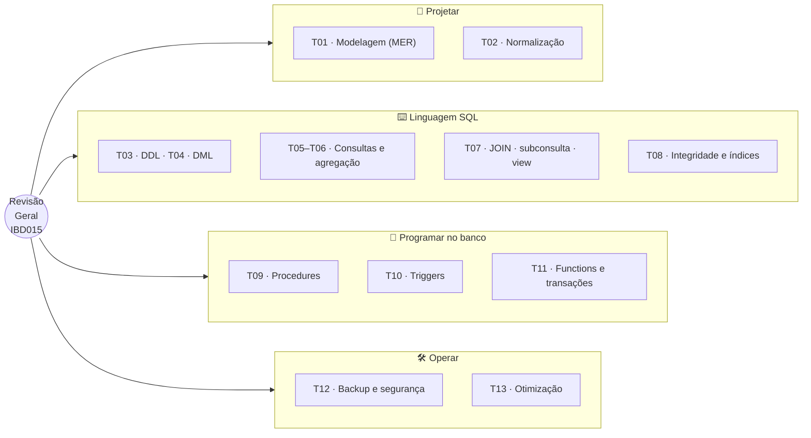

# Tópico 14 — Revisão Geral

**Disciplina:** Banco de Dados — Relacional (IBD015)
**Professor:** Ronan Adriel Zenatti · ronan.zenatti@cps.sp.gov.br
**Fatec Jahu — 2º Semestre/2026**

---

## 🎯 Objetivos do Tópico

Ao final deste tópico você deverá ser capaz de:

- Conectar os 13 tópicos anteriores em um único **caminho do dado**: do requisito de negócio ao banco rápido, seguro e recuperável;
- Reconhecer, em um enunciado, **qual ferramenta** de SQL ou do SGBD resolve cada problema (modelagem, DDL, DML, consulta, integridade, programação, transação, segurança, desempenho);
- Identificar e evitar as **armadilhas clássicas** de cada assunto;
- Resolver, de ponta a ponta, um problema integrador — da planilha desorganizada ao banco funcionando, com programação, segurança e índices.

---

## 🗺️ Mapa Mental do Tópico

---

## 🧭 Contexto

Os tópicos anteriores foram **verticais**: cada um aprofundou uma ferramenta. Este é **horizontal**: mostra que elas formam uma cadeia, e que um problema real atravessa todas. Imagine o caminho de uma ideia de negócio até um sistema em produção:

Como usar este tópico:

1. **Leia a ficha-resumo** de cada bloco — ela não ensina de novo, apenas aciona a memória.
2. **Resolva o checkpoint** do bloco antes de olhar o gabarito. Cada um usa um domínio diferente, porque o raciocínio é o mesmo em qualquer negócio.
3. Se travar, volte ao tópico indicado na ficha. Esse vai-e-volta **é** o estudo: tentar lembrar (recuperação ativa) fixa muito mais que reler.
4. Termine pelo **Desafio Integrador** (Seção 7), que reúne tudo em um único problema e tem solução completa e executável no gabarito.

---

## 1. Bloco A — Modelar e Normalizar (Tópicos 01 e 02)

| Assunto | Lembre-se |
|---|---|
| **MER** (T01) | Entidade, atributo (simples, composto, **multivalorado**, derivado), relacionamento, **cardinalidade** (1:1, 1:N, N:M) e participação (total/parcial) |
| **Do MER ao lógico** | 1:N → FK no lado "N". **N:M → tabela associativa** com as duas FKs. Atributo multivalorado → tabela própria. Relacionamento com atributo próprio → vira tabela |
| **Dependência funcional** (T02) | `A → B`: conhecendo A, sabe-se B. A normalização procura dependências "fora do lugar" |
| **1FN** | Valores **atômicos** — nada de listas dentro de uma célula (`'banho, tosa'`) nem colunas repetidas (`telefone1`, `telefone2`) |
| **2FN** | Atributo não-chave não pode depender de **parte** de uma PK composta |
| **3FN** | Atributo não-chave não pode depender de **outro não-chave** (dependência transitiva). Mnemônico: *"a chave, a chave inteira, e nada além da chave"* |
| **Armadilhas** | Esquecer a tabela associativa no N:M · guardar dado derivado como se fosse base · nomear FK `pessoa1_id` em vez do papel (Regra 7) |

!!! example "🔍 Checkpoint 1 — Normalização: clube de assinatura para pets"
    Um app de cuidados com pets guarda tudo em uma única tabela:

    `assinaturas_pet (id_assinatura PK, tutor_nome, tutor_cpf, tutor_email, pet_nome, pet_especie, plano_nome, plano_valor_mensal, servicos_incluidos, data_inicio)`

    com linhas como `(1, 'Ana Lima', '11122233344', 'ana@email.com', 'Thor', 'cachorro', 'Premium', 129.90, 'banho, tosa, vacina', '2026-03-01')`. **(a)** Aponte a violação da 1FN. **(b)** Liste as dependências funcionais que mostram que a tabela não está em 3FN. **(c)** Escreva o modelo lógico em 3FN (tabelas, PKs, FKs, seguindo as Regras 4 a 7). **(d)** Indique a cardinalidade de cada relacionamento resultante, destacando o único N:M.

    🔑 Resolução no [Gabarito do Tópico 14](Topico_14_Gabarito.md#checkpoint-1) — tente resolver antes de conferir.

---

## 2. Bloco B — Definir e Manipular (Tópicos 03 e 04)

| Assunto | Lembre-se |
|---|---|
| **As 9 regras** (T03) | `snake_case` · minúsculas · palavras reservadas em MAIÚSCULAS · tabelas no **plural** · PK `id_<singular>` · FK `<singular>_id` · FK pelo **papel** · tipos adequados (`DECIMAL` p/ dinheiro; telefone é `VARCHAR`) · campos de log (`criado_em`, `alterado_em`, `deletado_em`) |
| **DDL** | `CREATE`, `ALTER`, `DROP`; constraints nomeadas (`pk_`, `fk_`, `uq_`, `ck_`); criar pais antes dos filhos, apagar filhos antes dos pais |
| **DML** (T04) | `INSERT` **sempre com lista de colunas**; `UPDATE`/`DELETE` **sempre com `WHERE`**; `TRUNCATE` ≠ `DELETE` (reinicia `AUTO_INCREMENT`, sem `ROLLBACK`) |
| **Transação básica** | `START TRANSACTION` … `COMMIT`/`ROLLBACK`; `SAVEPOINT` para desfazer parte; `LAST_INSERT_ID()` liga pai e filhos |
| **Armadilhas** | `UPDATE` sem `WHERE` · DDL faz *commit* implícito · `INSERT … VALUES` sem colunas quebra quando a tabela muda |

!!! example "🔍 Checkpoint 2 — DDL e DML: plataforma de podcasts"
    Uma plataforma de podcasts tem **podcasts** (título único, categoria entre `'tecnologia'`, `'negocios'`, `'saude'` e `'cultura'`, indicador de ativo) e **episódios** (pertencem a um podcast; têm número sequencial **único dentro do podcast**, título, duração em segundos maior que zero e data de publicação, opcional). **(a)** Escreva os dois `CREATE TABLE` (9 regras, constraints nomeadas; ao apagar um podcast, seus episódios devem ser apagados). **(b)** Em **uma transação**, insira o podcast "Dados em Foco" e seus 3 primeiros episódios, usando `LAST_INSERT_ID()`. **(c)** Publique (preencha `publicado_em`) apenas os episódios 1 e 2. **(d)** Que erros ocorrem ao inserir um episódio com número repetido e um com duração 0?

    🔑 Resolução no [Gabarito do Tópico 14](Topico_14_Gabarito.md#checkpoint-2) — tente resolver antes de conferir.

---

## 3. Bloco C — Consultar (Tópicos 05, 06 e 07)

| Assunto | Lembre-se |
|---|---|
| **DQL básica** (T05) | `SELECT` colunas explícitas · `WHERE` (`BETWEEN` é inclusivo; `IN`; `LIKE` com `%`/`_`) · **`IS NULL`**, nunca `= NULL` · `ORDER BY` · `LIMIT`/`OFFSET` |
| **Agregação** (T06) | `COUNT(*)` ≠ `COUNT(col)` ≠ `COUNT(DISTINCT col)` · agregações **ignoram `NULL`** · `GROUP BY` · **`WHERE` filtra linhas, `HAVING` filtra grupos** · ordem lógica: `FROM → WHERE → GROUP BY → HAVING → SELECT → ORDER BY → LIMIT` |
| **JOIN** (T07) | `INNER` só o que casa · `LEFT` mantém a esquerda · **anti-join** = `LEFT JOIN … IS NULL` · mesma tabela duas vezes com alias (papéis) · sem `ON` = produto cartesiano |
| **Subconsultas** | escalar · `IN`/`EXISTS` · correlacionada · tabela derivada e `WITH` · escolha por **clareza** |
| **Views** | consulta com nome; não guarda dados; limita colunas; atualizável só se "simples" |
| **Armadilhas** | `NOT IN` com `NULL` devolve vazio (use `NOT EXISTS`) · `COUNT(*)` em `LEFT JOIN` conta a linha "vazia" · filtro da tabela opcional no `WHERE` transforma `LEFT` em `INNER` · coluna solta fora do `GROUP BY` |

!!! example "🔍 Checkpoint 3 — Consultas combinadas: campeonato de e-sports"
    Um campeonato tem `times (id_time PK, nome)`, `jogadores (id_jogador PK, time_id FK, nick)` e `participacoes (partida_id, jogador_id, abates, mortes, venceu)` (PK composta; `venceu` vale 1 ou 0). **(a)** Para cada time, mostre as vitórias de seus jogadores (`vitorias`) e o K/D geral (`SUM(abates) / SUM(mortes)`, 2 casas), considerando só times com **pelo menos 2 partidas diferentes** disputadas. **(b)** Liste os jogadores que **nunca** participaram de uma partida. **(c)** Liste os jogadores com K/D individual **acima do K/D geral** do campeonato.

    🔑 Resolução no [Gabarito do Tópico 14](Topico_14_Gabarito.md#checkpoint-3) — tente resolver antes de conferir.

---

## 4. Bloco D — Proteger os Dados por Dentro (Tópicos 08, 09 e 10)

| Assunto | Lembre-se |
|---|---|
| **Integridade** (T08) | Entidade (`PK`, `UNIQUE`) · domínio (tipo, `NOT NULL`, `CHECK`) · referencial (`FK`) · negócio (procedure/trigger) |
| **Ações da FK** | `RESTRICT` (padrão; histórico) · `CASCADE` (o filho é parte do pai) · `SET NULL` (referência opcional). Pergunta: *"o filho faz sentido sem o pai?"* |
| **CHECK** | Só barra quando é **falso** (passa com `NULL`); não aceita `NOW()`/`CURDATE()` nem subconsulta |
| **Procedures** (T09) | `CALL`, `IN`/`OUT`, `DELIMITER`, `SIGNAL` para recusar, `HANDLER` para reagir; "tudo ou nada" = `START TRANSACTION` + `EXIT HANDLER … ROLLBACK; RESIGNAL` |
| **Triggers** (T10) | `BEFORE` valida/ajusta `NEW`; `AFTER` reage; `OLD`/`NEW`; **só por linha** no MariaDB |
| **Armadilhas** | Parâmetro com nome de coluna · erro dentro de transação não a encerra · **cascata de FK e `TRUNCATE` não disparam gatilhos** · gatilho não altera a própria tabela nem faz `COMMIT` · regra implementada em dois lugares |

!!! tip "✅ Verificação Rápida — escolhendo a ferramenta"
    Bloco conceitual — confira o entendimento com os dois quizzes abaixo. A resposta é revelada na hora.

<quiz>
Qual a ferramenta mais adequada para garantir que "a data de término de uma assinatura nunca seja anterior à de início", comparando duas colunas da mesma linha?
- [ ] Uma stored procedure chamada pelo sistema
- [ ] Um trigger AFTER INSERT
- [x] Uma restrição CHECK (fim IS NULL OR fim >= inicio)
- [ ] Uma FOREIGN KEY

A regra depende só de valores da própria linha e é determinística: a restrição declarativa é a mais simples, a mais visível no CREATE TABLE e a mais barata. Procedure e trigger são necessários quando a regra envolve outras linhas/tabelas ou funções como NOW().
</quiz>

<quiz>
Uma FK com ON DELETE CASCADE apaga o pedido e seus itens em cascata. Existe um trigger AFTER DELETE em itens_pedidos que registra a exclusão em um log. O que acontece com o log?
- [ ] Recebe um registro por item apagado em cascata
- [x] Não recebe nada: as ações referenciais em cascata do InnoDB não disparam triggers
- [ ] A exclusão em cascata é bloqueada pelo trigger
- [ ] Recebe um único registro, para o pedido

Apagar diretamente um item dispara o gatilho; apagar o pai com CASCADE remove os filhos sem disparar os gatilhos deles. Quem depende do log precisa tratar a exclusão do pai de outra forma (procedure, por exemplo).
</quiz>

!!! example "🔍 Checkpoint 4 — Regra de negócio com trigger: estúdios de gravação"
    Um espaço de estúdios de gravação tem `estudios (id_estudio PK, nome)` e `reservas_estudio (id_reserva PK, estudio_id FK, inicio, fim)`. **(a)** Escreva a restrição declarativa que garante `fim > inicio`. **(b)** Escreva o trigger que **impede reservas sobrepostas no mesmo estúdio** (considere que um horário que termina às 12h e outro que começa às 12h **não** se sobrepõem). **(c)** Explique por que essa regra não cabe em um `CHECK` e qual risco de concorrência o trigger sozinho ainda deixa.

    🔑 Resolução no [Gabarito do Tópico 14](Topico_14_Gabarito.md#checkpoint-4) — tente resolver antes de conferir.

---

## 5. Bloco E — Concorrência, Backup e Segurança (Tópicos 11 e 12)

| Assunto | Lembre-se |
|---|---|
| **Funções** (T11) | Devolvem **um valor**, usadas dentro de `SELECT`/`WHERE`; declarar `DETERMINISTIC`/`READS SQL DATA`; sem função de tabela no MariaDB |
| **ACID** | Atomicidade (undo log) · Consistência (constraints + regras) · Isolamento (MVCC/travas) · Durabilidade (redo log) |
| **Anomalias** | Atualização perdida · leitura suja · não repetível · fantasma. Padrão do InnoDB: **`REPEATABLE READ`** (MVCC) |
| **Travas** | `SELECT … FOR UPDATE` (pessimista) · `UPDATE … WHERE condição` / coluna de versão (otimista) · deadlock = erro `1213`, repita a transação · acesse linhas **sempre na mesma ordem** |
| **Backup** (T12) | RPO/RTO · lógico (`mysqldump --single-transaction --routines`) × físico (`mariabackup`) · completo/incremental/diferencial · **PITR** com log binário · **réplica ≠ backup** · teste a restauração |
| **Segurança** | Menor privilégio · `CREATE USER`/`GRANT`/`REVOKE` (banco, tabela, **coluna**, rotina) · roles · **consultas parametrizadas** contra injeção · senhas com hash lento · TLS · LGPD |
| **Armadilhas** | `COMMIT` implícito por DDL · cálculo na aplicação em vez de `estoque = estoque - 1` · dump sem `--routines` (procedures somem) · `>` do PowerShell 5.1 gera UTF-16 · conta `root` sem senha no XAMPP |

!!! example "🔍 Checkpoint 5 — Saque seguro: carteira de entregadores"
    Uma plataforma de entregas tem `carteiras_entregadores (id_carteira PK, entregador_id UNIQUE, saldo)` com `CHECK (saldo >= 0)` e `saques (id_saque PK, carteira_id FK, valor, solicitado_em)`. **(a)** Escreva a procedure `sp_sacar(p_entregador_id, p_valor)` que, numa transação, recuse valor não positivo, carteira inexistente e saldo insuficiente, e então debite o saldo e registre o saque — de modo que **dois saques simultâneos** do mesmo entregador não possam, juntos, ultrapassar o saldo. **(b)** Mostre uma forma de fazer o débito em **um único comando** sem `SELECT` prévio. **(c)** Escreva o `GRANT` que permite ao aplicativo executar saques **sem** poder ler nem alterar diretamente as tabelas.

    🔑 Resolução no [Gabarito do Tópico 14](Topico_14_Gabarito.md#checkpoint-5) — tente resolver antes de conferir.

---

## 6. Bloco F — Desempenho (Tópico 13)

| Assunto | Lembre-se |
|---|---|
| **Índices** | B-Tree (igualdade, faixa, ordem, `LIKE 'x%'`) · hash só no `MEMORY` · PK = índice agrupado (mantenha curta) · `FULLTEXT` p/ palavras |
| **`EXPLAIN`** | `type`: `const > eq_ref > ref > range > index > ALL` · veja `key`, `rows`, `Extra` (`Using filesort`, `Using temporary`, `Using index`) · `ANALYZE` mede o real |
| **Sargabilidade** | Coluna **sozinha** de um lado · tipos compatíveis · sem função na coluna · `LIKE 'x%'` ok, `'%x'` não |
| **Compostos** | Prefixo à esquerda · igualdade antes de faixa/ordem · cobertura (`Using index`) |
| **JOIN / paginação** | Índice na coluna de junção (FK!) · `ANALYZE TABLE` após carga · paginação **por chave** em vez de `OFFSET` grande |
| **Armadilhas** | `YEAR(col) = …` · `cpf = 123` com `cpf` texto · índice em coluna de poucos valores · índice demais (custo nas escritas) · otimizar sem medir |

!!! example "🔍 Checkpoint 6 — Diagnóstico de desempenho: exames de saúde digital"
    Um laboratório digital tem `exames (id_exame PK, paciente_id, tipo, solicitado_em, resultado_em, valor)` com 100 mil linhas e só a PK. A consulta **Q1** — `SELECT id_exame, tipo, resultado_em FROM exames WHERE paciente_id = 4321 ORDER BY resultado_em DESC LIMIT 5;` — mostra no `EXPLAIN`: `type: ALL`, `rows: 99973`, `Extra: Using where; Using filesort`. A consulta **Q2** — `SELECT tipo, COUNT(*) FROM exames WHERE DATE(resultado_em) = '2026-09-15' GROUP BY tipo;` — mostra `ALL`, `Using temporary; Using filesort`. **(a)** Proponha o índice que resolve Q1 e diga o que o `EXPLAIN` deve mostrar depois. **(b)** Diga por que um índice em `resultado_em` **não** ajuda a Q2 como ela está escrita, reescreva-a e proponha o índice (que também deixe a consulta coberta). **(c)** Que cuidado tomar se um dia essas tabelas passarem por uma carga em massa?

    🔑 Resolução no [Gabarito do Tópico 14](Topico_14_Gabarito.md#checkpoint-6) — tente resolver antes de conferir.

---

## 7. Desafio Integrador — Rede de Eletropostos

Para fechar, um problema que atravessa **todos os blocos**. Uma rede de carregadores de veículos elétricos, a *Voltaja*, controla tudo em uma planilha. Sua missão é transformá-la em um banco de dados completo. Cada passo usa o que foi visto em um bloco desta revisão.

> 🔑 A solução completa de cada passo (e o script executável inteiro) está no [Gabarito do Tópico 14](Topico_14_Gabarito.md#desafio-integrador). Tente cada passo antes de conferir — e, se puder, **monte o banco no seu XAMPP** para testar de verdade.

**A planilha atual** (uma linha por recarga; os dados do cliente, do veículo e do eletroposto se repetem a cada linha):

| placa | modelo | capacidade_kwh | cliente_nome | cliente_cpf | cliente_email | eletroposto | cidade | uf | carregador | potencia_kw | iniciada_em | finalizada_em | kwh | valor |
|---|---|---|---|---|---|---|---|---|---|---|---|---|---|---|
| ABC1D23 | BYD Dolphin | 44.9 | Ana Lima | 11122233344 | ana@email.com | Voltaja Centro | Jahu | SP | A1 | 7.4 | 2026-09-02 08:10 | 2026-09-02 12:40 | 30.50 | 36.60 |
| ABC1D23 | BYD Dolphin | 44.9 | Ana Lima | 11122233344 | ana@email.com | Voltaja Centro | Jahu | SP | A1 | 7.4 | 2026-10-01 08:00 | 2026-10-01 11:00 | 22.00 | 26.40 |
| DEF2E34 | Volvo EX30 | 69.0 | Carlos Melo | 22233344455 | carlos@email.com | Voltaja Rodovia | Bauru | SP | B1 | 50.0 | 2026-09-05 10:00 | 2026-09-05 10:50 | 40.00 | 72.00 |

**Passo 1 — Modelo conceitual (Bloco A).** Identifique as entidades, seus atributos principais e os relacionamentos, indicando a **cardinalidade** de cada um. Quem é a entidade "central" que associa veículo e carregador?

**Passo 2 — Normalização (Bloco A).** Liste as dependências funcionais da planilha e desenhe o modelo lógico em **3FN**, seguindo as 9 regras.

**Passo 3 — DDL (Bloco B).** Escreva os `CREATE TABLE` com PK, FK (com ações referenciais justificadas), `UNIQUE`, `NOT NULL`, `CHECK` (potência positiva, capacidade positiva, consumo não negativo, fim da recarga não anterior ao início) e os campos de log. O carregador tem `status` entre `'livre'`, `'ocupado'` e `'manutencao'`.

**Passo 4 — DML (Bloco B).** Em uma transação, carregue pelo menos 3 clientes (um que **nunca** recarregou), 4 veículos, 3 eletropostos, 5 carregadores (um em manutenção) e 10 recargas.

**Passo 5 — Consultas (Bloco C).** Escreva: **(a)** kWh e receita por eletroposto em setembro de 2026; **(b)** clientes que nunca recarregaram; **(c)** os 3 veículos que mais consumiram, com o nome do cliente; **(d)** as recargas com consumo acima da média; **(e)** uma **view** `vw_recargas_detalhadas` que junte cliente, veículo, eletroposto e carregador **sem expor o CPF**.

**Passo 6 — Programação (Bloco D).** Crie: **(a)** a função `fn_valor_recarga(p_kwh, p_potencia_kw)` (R$ 1,20/kWh em carregadores de até 22 kW; R$ 1,80/kWh acima; cobrança mínima de R$ 5,00; rejeita consumo negativo); **(b)** um trigger que **registre em log** toda mudança de status de um carregador; **(c)** um trigger que **impeça alterar** recargas concluídas ou canceladas; **(d)** as procedures `sp_iniciar_recarga(p_veiculo_id, p_carregador_id, OUT p_recarga_id)` e `sp_finalizar_recarga(p_recarga_id, p_kwh)`, ambas transacionais: iniciar exige carregador `'livre'` e veículo sem outra recarga em andamento, e marca o carregador `'ocupado'`; finalizar calcula o valor com a função, conclui a recarga e libera o carregador.

**Passo 7 — Concorrência (Bloco E).** Dois motoristas tentam iniciar recarga **no mesmo carregador livre ao mesmo tempo**. O que impede que ambos passem pela verificação? Que anomalia ocorreria sem essa proteção? Se fossem duas transferências cruzadas de saldo entre contas, que cuidado evitaria *deadlock*?

**Passo 8 — Segurança e backup (Bloco E).** Crie: um usuário da **aplicação** (DML + execução de rotinas, sem DDL), um **papel** de analista que lê a view e as tabelas de eletropostos/carregadores e **só o nome** (não o CPF) dos clientes, e um usuário de **backup**. Defina uma estratégia de backup para **RPO de 15 min** e **RTO de 2 h**.

**Passo 9 — Desempenho (Bloco F).** Com 100 mil recargas históricas, a consulta "últimas 10 recargas concluídas de um veículo" faz `type: ALL` e `Using filesort`. Proponha o índice, mostre o `EXPLAIN` antes e depois, e reescreva `WHERE DATE(iniciada_em) = '2026-03-15'` para ser sargável.

---

## 8. As Armadilhas Mais Cobradas

Uma lista para rever na véspera da avaliação — todas apareceram nos tópicos e todas são perguntas clássicas:

| # | Armadilha | Correção |
|---|---|---|
| 1 | `WHERE coluna = NULL` | `IS NULL` / `IS NOT NULL` |
| 2 | `UPDATE`/`DELETE` sem `WHERE` | Sempre `WHERE`; teste com `SELECT` antes; use transação |
| 3 | `HAVING` para filtrar linhas / `WHERE` com `COUNT` | `WHERE` filtra linhas (antes); `HAVING` filtra grupos (depois) |
| 4 | `a OR b AND c` | Parênteses: `AND` tem precedência |
| 5 | `COUNT(*)` em `LEFT JOIN` | `COUNT(tabela_direita.coluna)` |
| 6 | Filtro da tabela opcional no `WHERE` do `LEFT JOIN` | Mover para o `ON` |
| 7 | `NOT IN (subconsulta com NULL)` | `NOT EXISTS` ou `IS NOT NULL` na subconsulta |
| 8 | `CHECK` com `NULL`, `NOW()` ou subconsulta | `NOT NULL` junto; use trigger para o resto |
| 9 | Esperar que `CASCADE`/`TRUNCATE` disparem triggers | Eles não disparam |
| 10 | Erro dentro de transação "cancela tudo" | Só o comando falha; faça `ROLLBACK` (ou `EXIT HANDLER`) |
| 11 | `ROLLBACK` depois de um `CREATE`/`ALTER`/`DROP` | DDL faz *commit* implícito |
| 12 | Calcular `novo = velho - 1` na aplicação | `SET col = col - 1` ou `SELECT … FOR UPDATE` |
| 13 | Backup sem `--routines` / nunca restaurado | Confira o arquivo e **teste a restauração** |
| 14 | `WHERE YEAR(col) = 2026`, `LIKE '%x'`, `texto = 123` | Intervalo na coluna crua, tipos iguais, prefixo no `LIKE` |
| 15 | `OFFSET` enorme em listas longas | Paginação por chave |

---

## 📚 Referências deste Tópico

- ELMASRI, R.; NAVATHE, S. B. *Sistemas de Banco de Dados*. 7 ed. São Paulo: Pearson, 2018. (revisão dos Caps. 3–7, 10, 14–22)
- SILBERSCHATZ, A.; SUNDARSHAN, S.; KORTH, H. F. *Sistema de banco de dados*. Rio de Janeiro: Elsevier Brasil, 2016.
- Material dos Tópicos 01 a 13 desta disciplina (links nas fichas de cada bloco).

---

## 🃏 Flashcards de Revisão

??? question "Qual é a ordem lógica de execução de um SELECT?"
    `FROM` → `WHERE` → `GROUP BY` → `HAVING` → `SELECT` → `ORDER BY` → `LIMIT`. Explica por que
    o `WHERE` não vê alias nem agregações, e o `ORDER BY` vê alias.

??? question "Como se resolve um relacionamento N:M no modelo lógico?"
    Com uma **tabela associativa** cuja PK é composta pelas duas FKs (ex.: `planos_servicos`) —
    e, se o relacionamento tem atributos próprios, eles ficam nessa tabela.

??? question "Qual a diferença entre CHECK, trigger e procedure para impor uma regra?"
    `CHECK`: regra sobre a própria linha, determinística (declarativa, mais barata). Trigger: regra
    que vale para **qualquer** escrita e pode consultar outras tabelas. Procedure: operação de
    negócio chamada explicitamente, com transação e tratamento de erro.

??? question "Qual o padrão de procedure 'tudo ou nada'?"
    `DECLARE EXIT HANDLER FOR SQLEXCEPTION BEGIN ROLLBACK; RESIGNAL; END;` + `START TRANSACTION` +
    validações com `SIGNAL` + operações + `COMMIT`. Para evitar atualização perdida, `SELECT … FOR
    UPDATE` na linha lida.

??? question "O que fazer, em ordem, para recuperar o banco após um DELETE sem WHERE?"
    Parar as escritas e **copiar os logs binários**; restaurar o último backup completo;
    reaplicar o log com `mysqlbinlog --start-position … --stop-datetime/--stop-position`
    até logo antes do erro; validar; religar a aplicação.

??? question "Como saber se uma consulta está usando bem os índices?"
    `EXPLAIN` (ou `ANALYZE` para os tempos reais): `type` longe de `ALL`, `key` preenchido,
    `rows` próximo do que a consulta devolve, sem `filesort`/`temporary` desnecessários. Sempre
    **medir antes e depois**.

---

## ✅ Quiz de Fixação

<quiz>
Qual consulta lista os clientes que NUNCA fizeram um pedido, de forma segura mesmo se houver NULL na tabela de pedidos?
- [ ] SELECT nome FROM clientes WHERE id_cliente NOT IN (SELECT cliente_id FROM pedidos);
- [x] SELECT nome FROM clientes c WHERE NOT EXISTS (SELECT 1 FROM pedidos p WHERE p.cliente_id = c.id_cliente);
- [ ] SELECT nome FROM clientes c INNER JOIN pedidos p ON p.cliente_id = c.id_cliente;
- [ ] SELECT nome FROM clientes WHERE id_cliente = NULL;

NOT EXISTS não é afetado por NULL e é a forma segura do anti-join (o LEFT JOIN … IS NULL também serve). O NOT IN devolve vazio se a subconsulta contiver NULL; o INNER JOIN traz justamente quem tem pedido; = NULL nunca é verdadeiro.
</quiz>

<quiz>
Marque todas as afirmações corretas.
- [x] Uma tabela em 3FN não tem dependências transitivas entre atributos não-chave
- [x] Um relacionamento N:M vira uma tabela associativa no modelo lógico
- [ ] Uma lista 'banho, tosa, vacina' dentro de uma coluna respeita a 1FN
- [ ] Chave estrangeira pelo papel semântico deve se chamar pessoa1_id e pessoa2_id

A 1FN exige valores atômicos (a lista na célula viola); a Regra 7 manda nomear a FK pelo papel (cliente_id, funcionario_id), nunca por numeração.
</quiz>

<quiz>
Uma transação lê estoque = 50, outra confirma estoque = 48, e a primeira grava estoque = 49 (calculado na aplicação). Qual o problema e a correção mais simples?
- [ ] Leitura suja; usar READ UNCOMMITTED
- [x] Atualização perdida; usar UPDATE … SET estoque = estoque - 1 (ou SELECT … FOR UPDATE)
- [ ] Deadlock; reiniciar o servidor
- [ ] Fantasma; criar um índice

A segunda gravação sobrescreveu a baixa da primeira por ter sido calculada sobre um valor velho. Fazer o banco calcular, de forma atômica, ou travar a linha na leitura corrige.
</quiz>

<quiz>
No EXPLAIN de WHERE cpf = 11122233344, com cpf CHAR(11) indexado, o plano mostra type: ALL e key: NULL, apesar de possible_keys listar o índice. Por quê?
- [ ] Porque o índice está corrompido
- [ ] Porque CHAR não pode ser indexado
- [x] Porque comparar texto com número força a conversão da coluna linha a linha; o correto é WHERE cpf = '11122233344'
- [ ] Porque falta um ORDER BY

A conversão implícita de tipo inutiliza o índice B-Tree. O conserto é só comparar com um literal do mesmo tipo da coluna.
</quiz>

<quiz>
Qual conjunto de práticas é o mais adequado para a conta da aplicação web de uma loja?
- [ ] Conta root, para evitar erros de permissão
- [ ] GRANT ALL PRIVILEGES ON *.* com host '%'
- [x] Usuário próprio, host restrito, privilégios de DML apenas no banco da loja e consultas parametrizadas
- [ ] Mesma conta do administrador, mas com senha forte

Menor privilégio: se a conta for comprometida (por injeção de SQL, por exemplo), o estrago fica limitado ao DML do banco da loja. Senha forte não substitui a restrição de privilégios.
</quiz>

---

## 📝 Resumo

Os 13 tópicos formam uma cadeia: **modelar** (MER) e **normalizar** (1FN, 2FN, 3FN) o problema; **definir** (DDL) e **popular** (DML) o banco seguindo as 9 regras; **consultar** com filtros, agregações, junções, subconsultas e visões; **proteger os dados por dentro** com constraints, procedures e triggers; garantir **transações** corretas sob concorrência; **proteger e recuperar** o banco com privilégios mínimos, consultas parametrizadas e backups testados (inclusive PITR); e **medir e otimizar** com `EXPLAIN` e índices bem escolhidos. As armadilhas se repetem entre os assuntos — `NULL`, ordem de execução, cascata que não dispara, comandos que causam *commit* implícito, funções sobre colunas indexadas — e reconhecê-las é metade do caminho para a avaliação. O próximo (e último) tópico olha para frente: as novas tecnologias de banco de dados.

---

## 🏆 Conquista do Tópico

!!! success "Selo desbloqueado: 🧠 Revisor(a) Mestre"
    Você consegue percorrer o caminho completo do dado — da planilha desorganizada ao
    banco normalizado, programado, seguro, recuperável e rápido. A última parada da
    Trilha do(a) Arquiteto(a) de Dados é olhar adiante: NewSQL, nuvem, Big Data e bancos
    não relacionais.

---

## 🔑 Gabarito deste Tópico

As respostas dos 6 checkpoints e a solução completa do Desafio Integrador (9 passos, com o script executável) estão em um arquivo separado, para não estragar a tentativa de quem ainda não chegou até aqui: [Gabarito — Tópico 14](Topico_14_Gabarito.md).

---

## 🔗 Navegação

⬅️ [Tópico 13 — Otimização de Consultas e Índices](./Topico_13_Otimizacao_Indices.md) · ➡️ [Tópico 15 — Novas Tecnologias em BD e Encerramento](./Topico_15_Novas_Tecnologias_Encerramento.md)

---

*Fatec Jahu · IBD015 · Prof. Ronan Adriel Zenatti · 2026*
