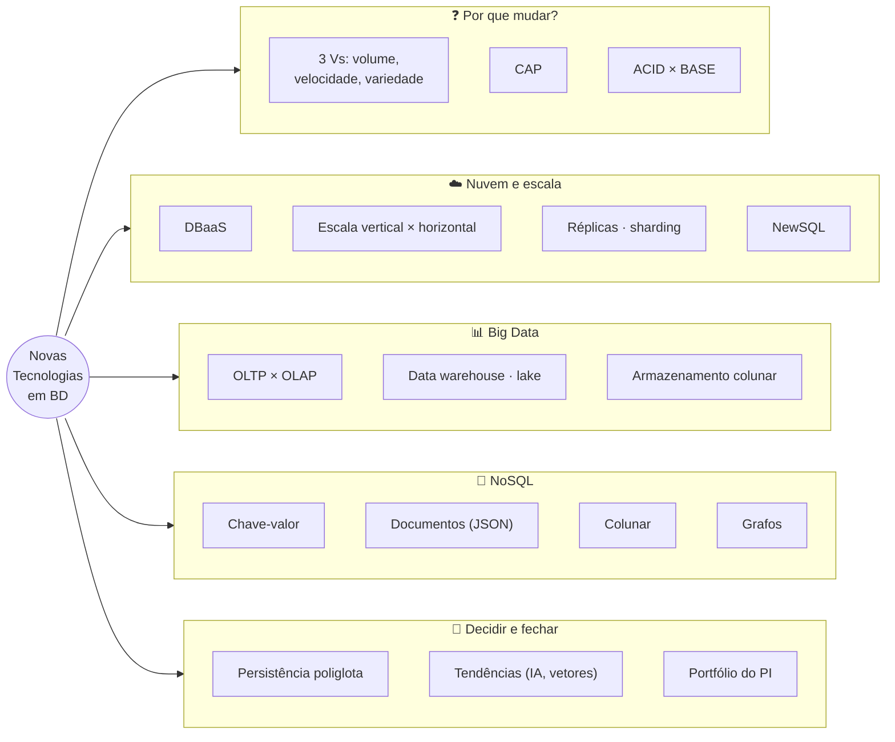
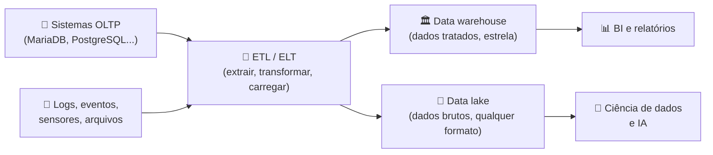
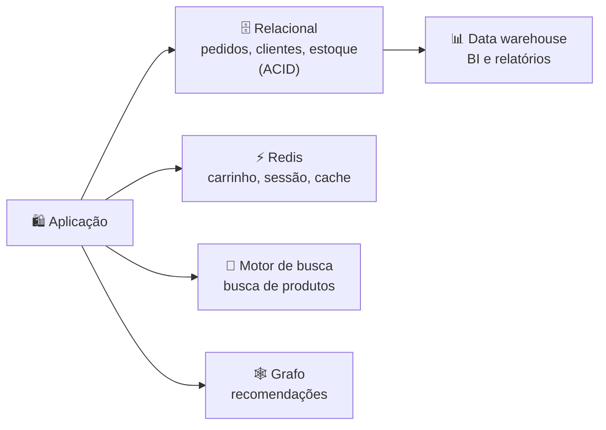
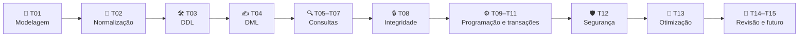

# Tópico 15 — Novas Tecnologias em BD e Encerramento

**Disciplina:** Banco de Dados — Relacional (IBD015)
**Professor:** Ronan Adriel Zenatti · ronan.zenatti@cps.sp.gov.br
**Fatec Jahu — 2º Semestre/2026**

---

## 🎯 Objetivos do Tópico

Ao final deste tópico você deverá ser capaz de:

- Explicar por que o modelo relacional continua dominante e o que motivou o surgimento de outras tecnologias (volume, velocidade e variedade dos dados);
- Descrever o teorema **CAP** e a diferença entre **ACID** e **BASE**;
- Diferenciar **DBaaS**, **NewSQL**, **Big Data** (OLTP × OLAP) e as quatro famílias principais de **NoSQL** (chave-valor, documentos, colunar e grafos);
- Usar JSON dentro do MariaDB e comparar a modelagem relacional com a de documentos;
- Escolher, justificadamente, a tecnologia adequada a um cenário (**persistência poliglota**);
- Organizar o Projeto Integrador como um **portfólio** apresentável.

---

## 🗺️ Mapa Mental do Tópico



---

## 🧭 Contexto

Ao longo do semestre você construiu uma competência sólida em bancos **relacionais**: modelar, normalizar, escrever SQL, programar no banco, proteger e otimizar. Esse conhecimento não envelhece — o modelo relacional completou mais de 50 anos e segue sendo a base de quase todo sistema que lida com dinheiro, pedidos, cadastros e qualquer dado que precise estar **correto**.

Mas o mundo de dados mudou. Aplicativos com milhões de usuários simultâneos, sensores que enviam leituras a cada segundo, redes sociais, catálogos com atributos que variam de produto para produto, modelos de IA que buscam "o que se parece com isto". Para alguns desses problemas, outras ferramentas se encaixam melhor. Este último tópico é um **mapa do território**: o que existe, para que serve cada coisa e, principalmente, **como decidir** — sem cair nem no "tudo é relacional" nem no "relacional é coisa do passado".

---

## 1. Por que Surgiram Alternativas

### 1.1 Os "Vs" do Big Data

O termo ***Big Data*** descreve dados que desafiam as ferramentas tradicionais por alguma destas dimensões:

| "V" | Significa | Exemplo |
|---|---|---|
| **Volume** | Quantidade enorme de dados (terabytes, petabytes) | Histórico de cliques de um grande e-commerce |
| **Velocidade** (*velocity*) | Dados chegando e precisando ser processados em tempo real | Leituras de milhares de inversores solares por segundo |
| **Variedade** | Formatos e estruturas diversos (tabelas, JSON, texto, imagem, áudio) | Posts, fotos, logs e eventos de um aplicativo |
| **Veracidade** | Confiabilidade e qualidade (dados incompletos, ruidosos) | Dados de sensores com falhas |
| **Valor** | Utilidade de negócio que se extrai | Recomendação de produtos |

### 1.2 O teorema CAP

Em um sistema de dados **distribuído** (vários servidores), existem três propriedades desejáveis, das quais só é possível garantir **duas ao mesmo tempo** quando ocorre uma falha de rede:

- **C**onsistência (*Consistency*): toda leitura devolve a escrita mais recente (todos os nós veem o mesmo dado);
- **D**isponibilidade (*Availability*): toda requisição recebe uma resposta;
- **T**olerância a **P**articionamento (*Partition tolerance*): o sistema continua funcionando mesmo que a rede entre os servidores seja interrompida.

Como falhas de rede **acontecem**, a tolerância a partição é praticamente obrigatória em sistemas distribuídos; a escolha real é, durante uma partição, **entre C e A**:

| Escolha | Comportamento na falha de rede | Exemplo de uso |
|---|---|---|
| **CP** | Prefere recusar/atrasar respostas a devolver dado possivelmente desatualizado | Saldo bancário, estoque do último item |
| **AP** | Responde sempre, aceitando que réplicas fiquem temporariamente divergentes (*consistência eventual*) | Curtidas, carrinho de compras, feed |

### 1.3 ACID × BASE

| | **ACID** (bancos relacionais) | **BASE** (muitos bancos NoSQL) |
|---|---|---|
| Significa | Atomicidade, Consistência, Isolamento, Durabilidade (Tópico 11) | *Basically Available, Soft state, Eventual consistency* |
| Prioridade | **Correção** imediata dos dados | **Disponibilidade** e escala |
| Consistência | Forte: após o `COMMIT`, todos veem o dado novo | **Eventual**: as réplicas convergem, com atraso |
| Bom para | Dinheiro, pedidos, cadastros | Dados em enorme escala onde um atraso curto é tolerável |

Nenhum dos dois é "melhor": são **trocas** diferentes. Um banco ACID não é "lento" por ser rigoroso — ele paga o preço da garantia.

!!! tip "✅ Verificação Rápida — CAP e ACID × BASE"
    Bloco conceitual — confira o entendimento com os dois quizzes abaixo. A resposta é revelada na hora.

<quiz>
Um aplicativo mostra o número de curtidas de uma publicação. Se uma réplica estiver alguns segundos atrasada, ninguém é prejudicado, mas o aplicativo nunca pode ficar fora do ar. Qual perfil de sistema (CAP) combina melhor?
- [ ] CP: recusar respostas até todas as réplicas concordarem
- [x] AP: responder sempre, aceitando consistência eventual
- [ ] Nenhum: é obrigatório garantir C, A e P ao mesmo tempo
- [ ] CA: ignorar falhas de rede

Quando a divergência temporária é tolerável e a disponibilidade é prioridade, escolhe-se AP. Já um saldo bancário pediria CP. Garantir as três propriedades ao mesmo tempo durante uma partição de rede é impossível.
</quiz>

<quiz>
Qual afirmação descreve corretamente a consistência eventual?
- [ ] Os dados nunca ficam consistentes
- [x] Se não houver novas escritas, todas as réplicas acabam convergindo para o mesmo valor, mas leituras intermediárias podem ver valores antigos
- [ ] É idêntica ao nível SERIALIZABLE
- [ ] Exige COMMIT em todos os nós antes de qualquer leitura

Na consistência eventual há uma janela em que réplicas divergem; passada a propagação, todas concordam. É a base do modelo BASE e a troca por disponibilidade e escala.
</quiz>

---

## 2. Nuvem e Escalabilidade

### 2.1 DBaaS — banco de dados como serviço

Em vez de instalar o MariaDB em um servidor seu (como no XAMPP) e cuidar de tudo, você pode **contratar o banco pronto**, operado por um provedor de nuvem: o ***Database as a Service*** (DBaaS). Exemplos de serviços gerenciados: Amazon RDS/Aurora, Google Cloud SQL, Azure Database, além de ofertas gerenciadas de MariaDB, PostgreSQL e MongoDB.

| Tarefa | Servidor próprio (*on-premise*/máquina virtual) | **DBaaS** |
|---|---|---|
| Instalar, atualizar e aplicar correções | Você | Provedor |
| Backups, PITR e retenção (Tópico 12) | Você | Automatizado (você configura a política) |
| Alta disponibilidade e *failover* | Você projeta e opera | Opção pronta (réplicas em outras zonas) |
| Escalar CPU/memória/disco | Compra/migração | Alguns cliques (ou automático) |
| Segurança do **dado**, usuários e privilégios (Tópico 12) | Você | **Você** (modelo de responsabilidade compartilhada) |
| Modelagem, índices e consultas (Tópicos 01–13) | Você | **Você** |
| Custo | Investimento + equipe | Pago por uso (pode crescer rápido) |

**Vantagens:** menos trabalho operacional, escala rápida, alta disponibilidade, recuperação simplificada. **Cuidados:** custo recorrente, dependência do fornecedor (*vendor lock-in*), latência da rede, e **onde os dados ficam fisicamente** — a LGPD (Lei nº 13.709/2018) exige atenção à transferência internacional de dados pessoais. Perceba o que **não** muda: o provedor opera o servidor, mas um modelo mal normalizado, uma consulta sem índice e um privilégio mal concedido continuam sendo problema seu.

### 2.2 Escalar: para cima ou para os lados

| | **Vertical** (*scale up*) | **Horizontal** (*scale out*) |
|---|---|---|
| Como | Servidor maior (mais CPU, RAM, disco) | Mais servidores trabalhando juntos |
| Vantagem | Simples; o banco continua "um só" | Capacidade praticamente ilimitada |
| Limite | Há um servidor máximo (e ele é caro) | Complexidade distribuída (CAP!) |

Duas técnicas de escala horizontal:

- **Réplicas de leitura** (*primary–replica*): um servidor principal recebe as escritas e várias réplicas atendem às leituras. Resolve cargas pesadas de leitura. A réplica pode estar alguns instantes atrás do principal (consistência eventual!). Lembre: **réplica não é backup** (Tópico 12).
- ***Sharding*** (fragmentação): os dados são **divididos** entre servidores por uma chave (por exemplo, clientes de A–M em um servidor e N–Z em outro, ou por região). Permite escalar também as escritas, ao custo de complexidade: consultas e transações que cruzam fragmentos ficam difíceis (`JOIN` entre servidores diferentes!).

### 2.3 NewSQL

Os bancos NoSQL ganharam escala abrindo mão de SQL e de transações ACID completas. Os sistemas ***NewSQL*** (o termo surgiu por volta de 2011) tentam entregar **os dois mundos**: interface **SQL**, modelo relacional e transações **ACID**, mas com **escala horizontal** automática, distribuindo os dados em vários nós e usando protocolos de consenso (como Raft e Paxos) para manter a consistência.

| | Relacional clássico (MariaDB, PostgreSQL) | **NewSQL** (ex.: Google Spanner, CockroachDB, TiDB, YugabyteDB) | NoSQL |
|---|---|---|---|
| Linguagem | SQL | SQL (muitos compatíveis com PostgreSQL ou MySQL) | APIs próprias / linguagens específicas |
| Transações ACID | Sim | **Sim, distribuídas** | Frequentemente limitadas |
| Escala de escrita | Vertical (e *sharding* manual) | **Horizontal, nativa** | Horizontal |
| Preço pago | Escala limitada a um servidor | Latência maior nas escritas (consenso entre nós) e operação mais complexa | Consistência mais fraca |

Quando faz sentido? Sistemas **globais** com dados transacionais em escala muito acima do que um servidor aguenta (pagamentos, marketplaces enormes). Para a ampla maioria dos sistemas — inclusive os de porte médio — um relacional bem projetado e otimizado (os Tópicos 01–13) resolve com folga e é bem mais simples.

---

## 3. Big Data: Transações × Análise

### 3.1 OLTP × OLAP

Os bancos que você usou até aqui são projetados para **OLTP** (*Online Transaction Processing*): muitas operações pequenas e rápidas de leitura e escrita — registrar um pedido, consultar um cliente. Já a análise de grandes volumes (**OLAP**, *Online Analytical Processing*) tem outro padrão: poucas consultas, mas que varrem **milhões de linhas** para agregar.

| | **OLTP** | **OLAP** |
|---|---|---|
| Objetivo | Operar o negócio | Analisar o negócio |
| Operações | `INSERT`/`UPDATE`/`DELETE` e consultas pontuais | Consultas pesadas com `GROUP BY`, `SUM`, `JOIN` sobre histórico |
| Modelo | Normalizado (3FN) | **Desnormalizado**, em estrela (fatos e dimensões) |
| Armazenamento | Por **linha** (InnoDB) | Por **coluna** (colunar) |
| Exemplo | `loja_virtual` | Painel de vendas dos últimos 3 anos |

Por que colunar? Uma consulta como `SELECT SUM(valor_total) FROM pedidos` precisa **só** de uma coluna; um armazenamento por coluna lê somente ela (comprimindo bem valores parecidos), enquanto o por linha precisa ler as linhas inteiras. É a base de ferramentas de análise como ClickHouse, Google BigQuery, Amazon Redshift e Snowflake.

### 3.2 O caminho dos dados para análise



- ***Data warehouse***: repositório analítico com dados **já tratados e organizados**, geralmente em modelo estrela.
- ***Data lake***: repositório de dados **brutos**, em qualquer formato, barato e muito grande, para exploração e ciência de dados. A arquitetura *lakehouse* tenta unir os dois.
- **ETL/ELT**: o processo que move e transforma os dados do sistema operacional para o analítico (e o SQL que você aprendeu é a principal ferramenta dessa transformação).
- Para volumes que não cabem em uma máquina, entram **ecossistemas distribuídos** (Hadoop e, principalmente hoje, Apache Spark) e **fluxos em tempo real** (Apache Kafka).

!!! tip "✅ Verificação Rápida — DBaaS, NewSQL e OLTP × OLAP"
    Bloco conceitual — confira o entendimento com os dois quizzes abaixo. A resposta é revelada na hora.

<quiz>
Ao contratar um DBaaS, qual responsabilidade continua sendo SUA?
- [ ] Aplicar correções de segurança no sistema operacional do servidor
- [ ] Trocar o disco quando ele falhar
- [x] Modelar as tabelas, criar os índices certos e definir os privilégios dos usuários
- [ ] Instalar a nova versão do SGBD

No modelo de responsabilidade compartilhada, o provedor cuida da infraestrutura e da operação do servidor; o projeto do banco, as consultas, os índices e o controle de acesso aos dados continuam a cargo de quem usa.
</quiz>

<quiz>
Uma consulta que soma o faturamento de 3 anos de vendas, agrupado por mês e região, é típica de qual tipo de carga, e qual armazenamento a favorece?
- [ ] OLTP, armazenamento por linha
- [x] OLAP, armazenamento colunar
- [ ] OLTP, armazenamento colunar
- [ ] OLAP, tabelas totalmente normalizadas em 3FN

É uma análise que varre muitas linhas e usa poucas colunas: perfil OLAP, que se beneficia de armazenamento colunar e de modelos desnormalizados (estrela). Bancos OLTP, normalizados e por linha, atendem melhor às operações pequenas e frequentes.
</quiz>

---

## 4. NoSQL — "Not Only SQL"

***NoSQL*** é um guarda-chuva para bancos que **não** seguem o modelo relacional de tabelas e SQL, criados para escala horizontal, flexibilidade de esquema e modelos de dados específicos. O nome significa mais "*Not Only* SQL" que "contra o SQL". Há quatro famílias principais:

| Família | Modelo | Exemplos | Bom para |
|---|---|---|---|
| **Chave-valor** | `chave → valor` (como um dicionário gigante) | Redis, Amazon DynamoDB | Sessões, cache, carrinhos, contadores |
| **Documentos** | Documentos JSON (aninhados, esquema flexível) | MongoDB, Couchbase | Catálogos com atributos variáveis, conteúdo, perfis |
| **Colunar (famílias de colunas)** | Linhas esparsas agrupadas por famílias de colunas | Apache Cassandra, HBase | Escrita massiva, séries temporais, IoT |
| **Grafos** | Nós e arestas (relacionamentos de primeira classe) | Neo4j | Redes sociais, recomendação, detecção de fraude |

Também existem especializados: **séries temporais** (InfluxDB, TimescaleDB), **busca de texto** (Elasticsearch/OpenSearch) e **vetoriais** (Seção 6).

### 4.1 Um mesmo dado, três jeitos de guardar

O pedido da Ana, no `loja_virtual`, é guardado em **duas tabelas relacionadas** (`pedidos` + `itens_pedidos`) com `JOIN` para reconstruí-lo. Em um banco de **documentos**, o pedido inteiro vira **um documento JSON**, com os itens *aninhados*:

```json
{
  "cliente": { "id": 1, "nome": "Ana Lima" },
  "status": "entregue",
  "valor_total": 3899.80,
  "itens": [
    { "produto": "Notebook Lenovo IdeaPad",  "quantidade": 1, "preco": 3499.90 },
    { "produto": "Mouse Logitech MX Master", "quantidade": 1, "preco": 399.90 }
  ]
}
```

Consultas ilustrativas (sintaxe de cada tecnologia, apenas para comparar o estilo):

```javascript
// MongoDB (documentos): pedidos entregues da Ana, e total por cliente
db.pedidos.find({ "cliente.id": 1, status: "entregue" })
db.pedidos.aggregate([
  { $match: { status: "entregue" } },
  { $group: { _id: "$cliente.nome", total: { $sum: "$valor_total" } } }
])
```

```text
# Redis (chave-valor): sessão que expira em 1 hora e contador de visitas
SET sessao:abc123 "usuario:42" EX 3600
GET sessao:abc123
INCR visitas:pagina:/produto/7
```

```cypher
// Neo4j (grafos): amigos de amigos de Ana — um JOIN recursivo vira um caminho
MATCH (a:Pessoa {nome: 'Ana'})-[:AMIGO_DE]->()-[:AMIGO_DE]->(sugestao)
RETURN DISTINCT sugestao.nome
```

| | Relacional | Documentos |
|---|---|---|
| Esquema | **Rígido** e declarado (`CREATE TABLE`) | **Flexível**: cada documento pode ter campos diferentes |
| Dado relacionado | Em tabelas separadas (normalizado); `JOIN` | **Embutido** (desnormalizado) no documento |
| Leitura de um agregado (pedido completo) | `JOIN` de várias tabelas | **Uma leitura** só |
| Consistência entre entidades | `FOREIGN KEY`, transações multi-tabela | Fica a cargo da aplicação (embora haja transações em alguns) |
| Atualizar o nome de um cliente | Uma linha em `clientes` | Pode exigir atualizar **todos** os documentos que o copiam |

A desnormalização do documento é uma troca consciente: leitura rápida do agregado **versus** redundância e anomalias de atualização — exatamente o que a normalização (Tópico 02) evita.

### 4.2 O relacional também fala JSON

Uma observação importante: não é preciso trocar de banco para ter flexibilidade pontual. O MariaDB (e o PostgreSQL, com ainda mais recursos) guarda e consulta JSON em colunas. No MariaDB, `JSON` é um apelido para `LONGTEXT` com uma restrição `CHECK (JSON_VALID(...))`:

```sql
CREATE TABLE pedidos_documento (
    id_pedido  BIGINT UNSIGNED  NOT NULL AUTO_INCREMENT,
    documento  JSON             NOT NULL,
    criado_em  DATETIME         NOT NULL DEFAULT CURRENT_TIMESTAMP,
    CONSTRAINT pk_pedido_documento PRIMARY KEY (id_pedido)
);

INSERT INTO pedidos_documento (documento) VALUES
('{"cliente": {"id": 1, "nome": "Ana Lima"}, "status": "entregue", "valor_total": 3899.80,
  "itens": [{"produto": "Notebook Lenovo IdeaPad", "quantidade": 1, "preco": 3499.90},
            {"produto": "Mouse Logitech MX Master", "quantidade": 1, "preco": 399.90}]}'),
('{"cliente": {"id": 2, "nome": "Carlos Melo"}, "status": "pendente", "valor_total": 1899.00,
  "itens": [{"produto": "Smartphone Samsung A55", "quantidade": 1, "preco": 1899.00}], "cupom": "BEMVINDO10"}'),
('{"cliente": {"id": 1, "nome": "Ana Lima"}, "status": "entregue", "valor_total": 659.81,
  "itens": [{"produto": "Teclado Mecânico Redragon", "quantidade": 1, "preco": 299.90}]}');

-- Texto que não é JSON válido é recusado pelo CHECK:
INSERT INTO pedidos_documento (documento) VALUES ('isto nao e json');
-- ERROR 4025 (23000): CONSTRAINT `pedidos_documento.documento` failed for ...
```

```sql
-- Extraindo campos (caminhos no estilo $.campo.subcampo, $.lista[0])
SELECT id_pedido,
       JSON_VALUE(documento, '$.cliente.nome')        AS cliente,
       JSON_VALUE(documento, '$.status')              AS status,
       JSON_VALUE(documento, '$.itens[0].produto')    AS primeiro_item,
       JSON_LENGTH(documento, '$.itens')              AS qtd_itens,
       JSON_VALUE(documento, '$.cupom')               AS cupom       -- NULL quando o campo não existe
FROM   pedidos_documento;

-- Agregando sobre campos do JSON (converta para número!)
SELECT JSON_VALUE(documento, '$.cliente.nome')                     AS cliente,
       SUM(CAST(JSON_VALUE(documento, '$.valor_total') AS DECIMAL(12, 2))) AS total
FROM   pedidos_documento
WHERE  JSON_VALUE(documento, '$.status') = 'entregue'
GROUP BY JSON_VALUE(documento, '$.cliente.nome');                  -- Ana Lima: 4559.61

-- Alterando só um campo dentro do documento
UPDATE pedidos_documento
SET    documento = JSON_SET(documento, '$.status', 'enviado')
WHERE  id_pedido = 2;
```

E dá para indexar: crie uma **coluna virtual** que extrai o campo e um índice sobre ela (Tópico 13). O plano passa a usar o índice:

```sql
ALTER TABLE pedidos_documento
    ADD COLUMN status_doc VARCHAR(20) AS (JSON_VALUE(documento, '$.status')) VIRTUAL,
    ADD INDEX idx_pedidos_documento_status (status_doc);

EXPLAIN SELECT id_pedido FROM pedidos_documento WHERE status_doc = 'entregue';
--  type: ref · key: idx_pedidos_documento_status · Using index
```

> ⚠️ **Cuidado com o excesso:** colocar tudo em colunas JSON "para não precisar modelar" joga fora as constraints, a normalização e a clareza. Use JSON para a parte realmente **flexível** (atributos variáveis, dados de terceiros) e mantenha em colunas normais o que é estrutural e consultado o tempo todo.

!!! example "🔍 Checkpoint 1 — Relacional × documento: marketplace de criadores"
    Em um marketplace de criadores de conteúdo, cada **produto digital** (curso, e-book, preset) tem campos em comum (título, preço) e **atributos que variam por tipo**: curso tem `carga_horaria` e `modulos`; e-book, `paginas` e `formato`; preset, `compatibilidade` (lista de aplicativos). **(a)** Modele uma tabela `produtos_digitais` com colunas fixas para o que é comum e **uma coluna JSON** para os atributos variáveis, e insira um curso e um e-book. **(b)** Escreva uma consulta que liste o título e a carga horária dos produtos que têm `carga_horaria` acima de 20. **(c)** Aponte duas desvantagens dessa modelagem em relação a colunas normais e quando você preferiria criar tabelas separadas por tipo.

    🔑 Resolução no [Gabarito do Tópico 15](Topico_15_Gabarito.md#checkpoint-1) — tente resolver antes de conferir.

---

## 5. Escolhendo a Tecnologia: Persistência Poliglota

Não existe "o melhor banco". A pergunta certa é: **qual característica do dado e do acesso domina?**

| Se o requisito dominante é... | Considere |
|---|---|
| Transações corretas, integridade, consultas ad hoc e relatórios (pedidos, finanças, cadastros) | **Relacional** (MariaDB, PostgreSQL) |
| Transações em escala global, com SQL e ACID | **NewSQL** |
| Latência mínima para buscas por chave (sessão, cache, ranking em tempo real) | **Chave-valor** (Redis) |
| Dados em formato de documento, com atributos variáveis, lidos como um todo | **Documentos** (MongoDB) — ou JSON no relacional |
| Escrita massiva e contínua, sem junções (IoT, logs) | **Colunar** (Cassandra) / séries temporais |
| Relacionamentos profundos (rede de amigos, recomendação, fraude) | **Grafos** (Neo4j) |
| Busca por texto livre, filtros e relevância | Motor de busca (Elasticsearch/OpenSearch) |
| Análise de histórico gigante | **Data warehouse** colunar (BigQuery, ClickHouse...) |
| Busca por similaridade (IA, RAG) | **Vetorial** (extensões como pgvector no PostgreSQL, ou bancos vetoriais) |

Grandes sistemas combinam várias dessas peças — a chamada **persistência poliglota**. Um e-commerce moderno, por exemplo:



> 💡 **Regra de prudência:** comece pelo relacional. Ele resolve a grande maioria dos problemas, é o mais bem compreendido e tem a melhor ferramenta de consulta (SQL). Acrescente outra tecnologia quando houver uma **necessidade medida** que o relacional não atende bem — cada banco novo é mais um sistema para operar, proteger, fazer backup e manter consistente com os demais.

!!! example "🔍 Checkpoint 2 — Escolhendo a tecnologia: aplicativo de mobilidade urbana"
    Um aplicativo de mobilidade urbana (patinetes e bicicletas elétricas) precisa guardar: **(a)** os cadastros de usuários, as viagens e a cobrança (valores em reais, estornos); **(b)** a posição GPS de cada veículo, enviada a cada 2 segundos por 50 mil veículos, mantida por 30 dias; **(c)** os tokens de sessão dos usuários logados, que expiram em 24 horas; **(d)** a rede de "amigos que andaram juntos" para sugerir convites; **(e)** a busca textual de endereços ("rua das flores 120 jahu"); **(f)** um painel de análise da receita dos últimos 3 anos por cidade e semana. Para cada item, escolha a tecnologia e justifique em uma frase, e diga se o ACID é essencial.

    🔑 Resolução no [Gabarito do Tópico 15](Topico_15_Gabarito.md#checkpoint-2) — tente resolver antes de conferir.

---

## 6. Tendências

- **Bancos e IA — busca vetorial.** Modelos de IA transformam textos, imagens e áudios em listas de números (*embeddings*). Um banco **vetorial** (ou um relacional com suporte a vetores, como o PostgreSQL com a extensão *pgvector*; outros SGBDs relacionais, MariaDB incluído, também vêm incorporando essa capacidade) guarda esses vetores e encontra os mais **parecidos** com uma consulta. É a base de recomendações e de sistemas de IA que respondem consultando seus próprios documentos (*RAG*). O SQL e o relacional continuam no centro: os metadados, permissões e transações seguem em tabelas.
- **Serverless e autoescalável.** Bancos que ajustam capacidade automaticamente (e cobram pelo uso) e podem "dormir" quando ociosos.
- **HTAP e multimodelo.** Bancos que tentam servir transações **e** análises ao mesmo tempo (HTAP) e que oferecem vários modelos (relacional + documentos + grafos) em um só produto — o "relacional que fala JSON" da Seção 4.2 é um exemplo.
- **Privacidade e governança.** LGPD, auditoria, mascaramento de dados e controle de acesso por coluna (Tópico 12) deixam de ser extras e viram requisito de projeto.
- **SQL em toda parte.** Mesmo ferramentas de Big Data (Spark, BigQuery, ClickHouse...) e NewSQL oferecem SQL. O que você aprendeu neste semestre é a habilidade mais **portátil** do universo de dados.

---

## 7. Fechamento da Disciplina e Portfólio

### 7.1 A trilha percorrida



### 7.2 Seu Projeto Integrador como portfólio

Um banco de dados bem documentado é um dos melhores itens que um(a) desenvolvedor(a) júnior pode mostrar. O repositório do seu Projeto Integrador (PI) pode virar uma peça de portfólio. Uma estrutura sugerida (**sugestão** — para a entrega de cada atividade, siga sempre o enunciado e os prazos informados pelo professor):

```text
meu-projeto-integrador/
├── README.md                  ← visão geral: problema, tecnologias, como executar, prints
├── docs/
│   ├── mer_conceitual.png     ← modelo entidade-relacionamento
│   ├── modelo_logico.png      ← diagrama lógico (dbdiagram.io ou similar)
│   └── decisoes.md            ← por que cada escolha (normalização, tipos, índices)
├── sql/
│   ├── 01_criar_banco.sql     ← DDL com as 9 regras de nomenclatura
│   ├── 02_carga_dados.sql     ← dados de exemplo (fictícios!)
│   ├── 03_consultas.sql       ← consultas de negócio (JOIN, agregação, subconsulta)
│   ├── 04_programacao.sql     ← views, procedures, functions, triggers
│   ├── 05_seguranca.sql       ← usuários, roles, privilégios
│   └── 06_desempenho.sql      ← índices + EXPLAIN antes/depois
└── backup/
    └── backup.ps1             ← script de backup (sem senhas!) + instruções de restauração
```

Boas práticas para esse portfólio:

- **README primeiro.** Quem abre o repositório decide em 30 segundos se vai continuar lendo. Explique o problema de negócio, mostre o diagrama e ensine a rodar (`mysql < sql/01_criar_banco.sql`...).
- **Scripts que executam do início ao fim sem erro** em um banco limpo — e na ordem numerada.
- **Dados fictícios.** Nunca publique dados pessoais reais (LGPD) nem senhas, tokens ou arquivos de backup reais.
- **Evidências de desempenho.** Mostrar o `EXPLAIN` antes e depois de um índice conta uma história muito melhor que "adicionei um índice".
- **Decisões justificadas.** Em `decisoes.md`: por que 3FN, por que `RESTRICT` e não `CASCADE` ali, por que aquele índice composto naquela ordem.
- **Commits claros** e um repositório organizado: o histórico mostra como você pensa.

!!! example "🔍 Checkpoint 3 — Um README que vende o projeto"
    Escreva o esqueleto do `README.md` do seu Projeto Integrador (ou de um projeto fictício de sua escolha) com: título e descrição de uma frase; "o problema que resolve" (3 linhas); tecnologias; **como executar** (comandos na ordem); um **resumo do modelo** (entidades e uma cardinalidade N:M, se houver); uma lista de **5 consultas de negócio** que o banco responde; e uma seção "Decisões de projeto" com **3 decisões** justificadas (uma de modelagem, uma de integridade/segurança, uma de desempenho).

    🔑 Resolução no [Gabarito do Tópico 15](Topico_15_Gabarito.md#checkpoint-3) — tente resolver antes de conferir.

### 7.3 Para continuar

- **Aprofundar no relacional:** PostgreSQL (tipos avançados, JSON, extensões), *window functions*, CTEs recursivas, planos de execução em profundidade, replicação e alta disponibilidade.
- **Explorar NoSQL com projeto próprio:** MongoDB (documentos) e Redis (cache/sessões) combinados a um banco relacional.
- **Engenharia e análise de dados:** modelagem dimensional, ETL/ELT, Spark e data warehouses em nuvem.
- **Nuvem:** serviços gerenciados de banco dos principais provedores (as certificações de fundamentos são uma boa porta de entrada).
- **Prática constante:** resolver problemas de SQL, ler planos de execução de consultas reais e contribuir com projetos abertos.

---

## 8. Exercícios de Fixação

> 🔑 As resoluções destes quatro exercícios estão no [Gabarito do Tópico 15](Topico_15_Gabarito.md) — tente resolver antes de conferir.

**Exercício 1:** explique, com suas palavras, por que um banco de dados bancário tende a escolher **CP** e uma rede social, para o contador de curtidas, **AP** — e o que "consistência eventual" significa para o usuário final.

**Exercício 2:** pegue os dados de `pedidos` e `itens_pedidos` do pedido nº 1 do `loja_virtual` e escreva o **documento JSON** equivalente. Liste duas vantagens e duas desvantagens dessa representação em relação às duas tabelas normalizadas.

**Exercício 3:** na tabela `pedidos_documento` da Seção 4.2, escreva (a) uma consulta que mostre o nome do **segundo item** de cada pedido que tenha mais de um item (dica: `JSON_LENGTH` e o caminho `$.itens[1].produto`) e (b) um `UPDATE` que mude o campo `status` para `'cancelado'` em todos os pedidos **pendentes** do cliente de `id` 2 (dica: `JSON_VALUE` no `WHERE` e `JSON_SET`).

**Exercício 4:** para a sua área de interesse profissional (jogos, saúde, finanças, educação, mobilidade...), descreva **um** sistema real e proponha, em uma tabela, qual tecnologia de banco de dados você usaria para cada tipo de dado dele, justificando as escolhas.

---

## 📚 Referências deste Tópico

- ELMASRI, R.; NAVATHE, S. B. *Sistemas de Banco de Dados*. 7 ed. Caps. 23–25 — Bancos de dados NoSQL e Big Data; Cap. 29 — Data warehousing. São Paulo: Pearson, 2018.
- SILBERSCHATZ, A.; SUNDARSHAN, S.; KORTH, H. F. *Sistema de banco de dados*. Cap. 10 — Big Data; Cap. 20 — Bancos de dados distribuídos. Rio de Janeiro: Elsevier Brasil, 2016.
- BREWER, E. *CAP Twelve Years Later: How the "Rules" Have Changed*. IEEE Computer, 2012.
- BRASIL. *Lei nº 13.709, de 14 de agosto de 2018* (Lei Geral de Proteção de Dados Pessoais — LGPD).
- Documentação oficial do MariaDB — [JSON Functions](https://mariadb.com/kb/en/json-functions/), [JSON Data Type](https://mariadb.com/kb/en/json-data-type/)

---

## 🃏 Flashcards de Revisão

??? question "O que diz o teorema CAP?"
    Em um sistema distribuído, durante uma partição de rede só é possível garantir uma entre
    **consistência** e **disponibilidade** (a tolerância a partição é praticamente obrigatória).
    Daí os perfis CP (prioriza correção) e AP (prioriza responder sempre).

??? question "Qual a diferença entre ACID e BASE?"
    **ACID**: transações com consistência forte e imediata (bancos relacionais). **BASE**:
    basicamente disponível, estado "suave" e **consistência eventual** — prioriza disponibilidade e
    escala, tolerando divergência temporária entre réplicas.

??? question "O que muda (e o que não muda) ao usar um DBaaS?"
    O provedor assume instalação, atualizações, backups automatizados, alta disponibilidade e
    escala. Continuam sendo seus: modelagem, índices, consultas, usuários/privilégios, qualidade e
    proteção dos dados (responsabilidade compartilhada) — além do custo e do vendor lock-in.

??? question "O que é NewSQL?"
    Bancos que combinam SQL, modelo relacional e transações ACID com escala horizontal
    nativa (ex.: Spanner, CockroachDB, TiDB, YugabyteDB). Troca: maior latência de escrita (consenso
    entre nós) e operação mais complexa.

??? question "Quais as quatro famílias principais de NoSQL e um uso típico de cada?"
    Chave-valor (cache/sessão — Redis), documentos (catálogos flexíveis — MongoDB), colunar
    (escrita massiva/IoT — Cassandra) e grafos (relacionamentos/recomendação — Neo4j).

??? question "Qual é a regra de prudência na escolha entre relacional e outras tecnologias?"
    Comece pelo relacional — ele atende à maioria dos casos e tem o SQL. Acrescente outra
    tecnologia quando houver uma **necessidade medida** que ele não atende bem (persistência
    poliglota), lembrando que cada banco novo é mais um sistema para operar, proteger e manter
    consistente.

---

## ✅ Quiz de Fixação

<quiz>
Qual tecnologia é a mais indicada para guardar tokens de sessão que expiram em 24 horas, com acesso por chave em milissegundos?
- [ ] Um data warehouse colunar
- [ ] Um banco de grafos
- [x] Um banco chave-valor em memória, como o Redis
- [ ] Um banco relacional com 12 tabelas normalizadas

O acesso é sempre por chave exata, com expiração automática e altíssima velocidade de leitura/escrita: o caso clássico do chave-valor. Os demais não são o foco para esse padrão de acesso.
</quiz>

<quiz>
Marque todas as afirmações corretas sobre a modelagem de documentos (JSON) comparada à relacional.
- [x] Ler um agregado inteiro (pedido com itens) pode exigir uma única leitura, sem JOIN
- [x] Dados embutidos em muitos documentos podem exigir atualizações múltiplas quando mudam
- [ ] As FOREIGN KEYs garantem automaticamente a integridade entre documentos
- [ ] A normalização é sempre obrigatória em bancos de documentos

A desnormalização torna a leitura do agregado simples, mas reintroduz a redundância que a normalização evita; a integridade entre documentos fica por conta da aplicação, e a normalização é uma escolha de projeto, não uma obrigação.
</quiz>

<quiz>
Qual é a característica do OLAP em relação ao OLTP?
- [ ] Muitas transações pequenas e rápidas de escrita
- [x] Poucas consultas pesadas que agregam grande volume de dados históricos, geralmente em modelo desnormalizado e armazenamento colunar
- [ ] Garantia de ACID entre milhares de usuários simultâneos
- [ ] Uso exclusivo de chaves estrangeiras

OLAP é a análise de grandes volumes (somas, médias, agrupamentos), com estruturas otimizadas para leitura em massa. Transações pequenas e frequentes com ACID são o perfil do OLTP.
</quiz>

<quiz>
Uma startup, com 10 mil usuários, ainda sem requisitos especiais de escala, está decidindo o banco para seu sistema de pedidos e pagamentos. Qual a escolha mais prudente?
- [ ] Um banco NoSQL de grafos, por ser mais moderno
- [ ] Um NewSQL distribuído em cinco regiões, para estar pronto para o futuro
- [x] Um banco relacional gerenciado (ou próprio), com ACID, bem modelado e indexado, acrescentando outras tecnologias só quando houver necessidade medida
- [ ] Vários bancos diferentes desde o início, um para cada tipo de dado

Pedidos e pagamentos exigem integridade e transações ACID, e a escala é modesta. Complexidade desnecessária (várias tecnologias, distribuição global) custa tempo, dinheiro e riscos sem benefício atual.
</quiz>

---

## 📝 Resumo

O modelo relacional segue sendo a base para dados que precisam estar corretos, mas os **3 Vs** (volume, velocidade, variedade) e a
escala global criaram necessidades novas. O **teorema CAP** mostra a troca entre consistência e disponibilidade em sistemas
distribuídos (**ACID** × **BASE**); o **DBaaS** terceiriza a operação do servidor (nunca a modelagem, os índices e a segurança); o
**NewSQL** une SQL e ACID com escala horizontal; o **Big Data** separa o mundo transacional (**OLTP**) do analítico (**OLAP**, em
*data warehouses/lakes* e armazenamento colunar); e o **NoSQL** oferece chave-valor, documentos, colunar e grafos para
necessidades específicas — enquanto o próprio MariaDB já sabe consultar JSON. A decisão é sempre por requisito dominante e por
**persistência poliglota**, começando pelo relacional. Com isso fechamos a trilha: do MER à otimização, você domina o essencial
de bancos relacionais e sabe reconhecer onde outras tecnologias entram. Leve o conteúdo para o seu **portfólio**.

---

## 🏆 Conquista do Tópico

!!! success "Selo desbloqueado: 🏆 Arquiteto(a) de Dados — IBD015"
    Você completou a Trilha do(a) Arquiteto(a) de Dados: modelou, normalizou, criou, populou,
    consultou, programou, protegeu, recuperou e otimizou bancos relacionais — e enxerga o
    mapa das tecnologias que vêm a seguir. Parabéns por chegar até aqui! 🎉 O próximo passo é
    seu: transforme este conhecimento em projetos, no Projeto Integrador e além.

---

## 🔑 Gabarito deste Tópico

As respostas dos 3 checkpoints espalhados pelo tópico e dos 4 Exercícios de Fixação da Seção 8 estão em um arquivo separado, para não estragar a tentativa de quem ainda não chegou até aqui: [Gabarito — Tópico 15](Topico_15_Gabarito.md).

---

## 🔗 Navegação

⬅️ [Tópico 14 — Revisão Geral](./Topico_14_Revisao_Geral.md) · ➡️ 🔒 Fim da trilha de tópicos — consulte as [Atividades e Avaliações](../atividades/index.md).

---

*Fatec Jahu · IBD015 · Prof. Ronan Adriel Zenatti · 2026*
